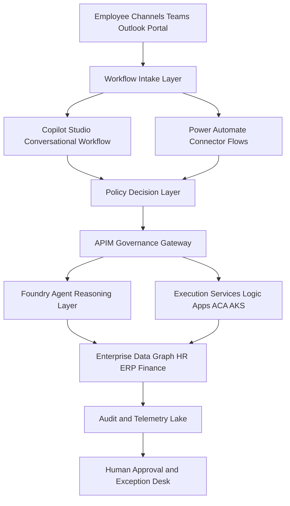
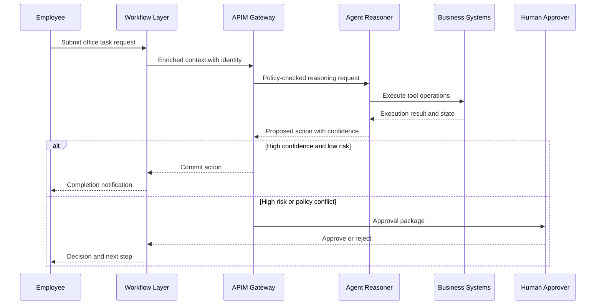

# 企业办公自动化智能体平台选型 FAQ：Copilot Studio vs Power Automate vs Foundry+APIM
> 🌐 **Language / 语言切换**: **[🇨🇳 中文版](enterprise-office-automation-agent-copilot-studio-vs-power-automate-vs-foundry-apim-selection-faq.md)** | **[🇬🇧 English](enterprise-office-automation-agent-copilot-studio-vs-power-automate-vs-foundry-apim-selection-faq.en.md)** | **[📚 返回目录](README.md)**
> 证据标签：`measured` / `synthetic` / `anonymized_reported`
> 抓取日期：2026-11-22

## 1) 执行摘要：办公自动化智能体的成败关键是“流程可控性”而不是“回答聪明度”
企业办公自动化智能体
常被误解为
“把聊天机器人接到文档系统”。
但真实场景里，
决定效果的不是对话流畅度，
而是流程可控性。
例如采购审批、
费用报销、
合同审阅、
会议纪要分发、
人事入离职流程，
都要求
明确权限、
确定状态、
可回滚操作、
可审计轨迹。
因此平台选型应优先比较：
流程编排能力、
连接器治理深度、
异常处理确定性、
以及跨系统凭据安全。
本指南对比四类企业常用路径：
Copilot Studio 业务编排、
Power Automate 流程连接器、
Foundry+APIM 工程化智能体、
以及双层混合治理架构。

## 2) 场景边界：办公自动化与客服智能体的差异
办公自动化智能体
通常面对内部员工，
而非外部客户。
这意味着其核心风险
从“对外服务体验”
转向“对内流程合规”。
典型任务包括：
自动生成审批单、
跨系统同步字段、
触发后续任务、
读取内部知识库、
并在风险节点请求人工确认。
其关键约束有四类。
第一是身份与权限继承，
必须按员工真实权限执行。
第二是系统连接复杂度，
往往涉及 ERP、HR、财务、协同套件。
第三是长流程幂等性，
避免重复创建与重复审批。
第四是审计与问责可追溯。
因此选型时
不能只看模型效果，
而要看“流程引擎 + 网关 + 身份 + 可观测”。

## 3) 可验证来源与证据标签
来源 1（`measured`）：Copilot Studio 文档  
https://learn.microsoft.com/power-virtual-agents/

来源 2（`measured`）：Power Automate 文档  
https://learn.microsoft.com/power-automate/

来源 3（`measured`）：Azure AI Foundry 文档  
https://learn.microsoft.com/azure/ai-foundry/

来源 4（`measured`）：Azure API Management 文档  
https://learn.microsoft.com/azure/api-management/

来源 5（`measured`）：Microsoft Graph 文档  
https://learn.microsoft.com/graph/

来源 6（`measured`）：Azure Logic Apps 文档  
https://learn.microsoft.com/azure/logic-apps/

来源 7（`anonymized_reported`）：匿名化企业办公流程自动化复盘。  
来源 8（`synthetic`）：并发任务与每千任务成本测算模型。  
说明：
本文聚焦企业应用与服务架构，
不展开底层系统实现细节。

## 4) 路径 A：Copilot Studio 作为办公智能体编排中枢
Copilot Studio 的价值在于
业务可配置能力强，
面向流程所有者友好。
对于标准化办公流程，
它可以快速建立
问答入口、
流程分支、
人工确认节点、
以及通知机制。
当企业目标是
“先让流程跑起来”，
此路径往往交付效率最高。
但其边界也很清晰。
对于复杂协议转换、
高度自定义系统适配、
或重度工程化策略路由，
通常需要外部平台协同。
因此在大型组织里，
Copilot Studio 更适合作为
流程体验层与业务规则层，
而非唯一执行底座。

## 5) 路径 B：Power Automate 连接器驱动流程自动化
Power Automate 的优势
在于连接器生态与流程模板。
它非常适合
跨 M365、D365、SharePoint、Teams
等系统的快速集成。
对于审批链、
文档分发、
提醒催办、
简单数据同步等场景，
该路径稳定且低门槛。
其短板在于
复杂推理与深度模型治理能力有限。
当流程需要
复杂语义决策、
高并发工具编排、
或多层风险策略时，
单独使用 Power Automate
往往不够。
最佳实践通常是
让它承担“流程连接总线”角色，
将复杂推理外置到智能体平台。

## 6) 路径 C：Foundry + APIM + 执行服务工程化路径
该路径强调
模型治理、
工具治理、
和执行治理的分层解耦。
Foundry 负责
模型选择与评测闭环，
APIM 负责
配额、鉴权、审计与策略拦截，
执行层由 ACA/AKS/Logic Apps
承载实际工具操作。
这种模式适合
多业务域共享平台、
多租户隔离、
和严格合规环境。
它的优势是可扩展与可治理，
但代价是工程复杂度较高。
若组织没有
清晰的平台责任边界，
容易出现“平台很强、落地很慢”问题。

## 7) 路径 D：双层混合模式（办公自动化主流解法）
在多数大型企业中，
更常见的落地方式
是双层混合。
第一层由 Copilot Studio/Power Automate
承接业务友好流程。
第二层由 Foundry+APIM
承接复杂决策与高风险操作。
这种分层可以做到：
业务团队保持迭代速度，
平台团队保持治理一致性。
同时，
统一身份委派与审计链路
可避免“流程快但不可控”。
对多部门协同而言，
该模式通常是
短期可交付与长期可演进
之间的平衡点。

## 8) Mermaid：企业办公自动化智能体分层拓扑

## 9) 12 维企业选型对比矩阵
| 维度 | Copilot Studio 路径 | Power Automate 路径 | Foundry+APIM 工程化路径 | 双层混合路径 |
|---|---|---|---|---|
| 首版交付速度 | 高 | 高 | 中 | 中高 |
| 业务人员可维护性 | 高 | 高 | 中 | 高 |
| 连接器覆盖广度 | 中 | 高 | 中 | 高 |
| 复杂语义决策能力 | 中 | 低中 | 高 | 高 |
| 权限治理深度 | 中高 | 中 | 高 | 高 |
| 审计可追溯性 | 中高 | 中高 | 高 | 高 |
| 多租户隔离能力 | 中 | 中 | 高 | 高 |
| 高并发扩展弹性 | 中 | 中 | 高 | 高 |
| 异常补偿与幂等控制 | 中 | 中 | 高 | 高 |
| 运维复杂度 | 低中 | 低中 | 高 | 中高 |
| 单任务成本优化空间 | 中 | 中 | 高 | 高 |
| 三年演进弹性 | 中高 | 中 | 高 | 高 |

## 10) Mermaid：请求流、审批流与异常补偿流

## 11) 量化表：任务并发、P95 与 TCO break-even（`synthetic`）
| 指标 | Copilot Studio | Power Automate | Foundry+APIM | 双层混合 |
|---|---:|---:|---:|---:|
| 峰值并发任务（标准化） | 3,500 | 4,200 | 11,000 | 12,500 |
| P95 端到端处理时延（ms） | 2,280 | 2,140 | 1,760 | 1,620 |
| 失败补偿成功率（`anonymized_reported`） | 0.81 | 0.84 | 0.91 | 0.93 |
| 人工介入率（`anonymized_reported`） | 0.22 | 0.19 | 0.14 | 0.12 |
| 月度总成本指数（基线=1） | 1.00 | 0.96 | 1.24 | 1.12 |
| 每千任务成本（美元，`synthetic`） | 14.8 | 13.9 | 12.7 | 11.9 |
| 规模拐点（并发任务） | <4k | <5k | >8k | >6k |
| 推荐定位 | 业务入口编排 | 流程连接总线 | 复杂治理执行 | 企业主流平衡 |

解释：
低复杂度流程与中小规模场景，
Power Automate 与 Copilot Studio
往往交付更快。
当复杂度与并发提升后，
Foundry 工程化路径
和混合架构
在长期成本与稳定性上更优。

## 12) 决策树：如何选择首发平台与演进路线
先判断流程复杂度。
若流程规则明确且稳定，
优先选择 Copilot Studio 或 Power Automate。
再判断系统异构程度。
若系统连接类型非常多，
连接器优先级更高，
可先以 Power Automate 打底。
再判断风险等级。
高风险审批与敏感写操作
应通过 APIM + Agent 层
执行策略门禁。
最后判断组织成熟度。
若平台团队成熟，
可尽早采用混合模式。
若平台团队仍在组建，
应先跑通业务价值，
再逐步抽象治理层。

## 13) 常见反模式
反模式一：
把审批流和执行流混在同一脚本里。
后果是失败补偿困难，
状态不一致频发。
反模式二：
使用共享高权限凭据执行所有流程。
后果是权限越界不可追责。
反模式三：
没有为自动化动作设置幂等键。
后果是重试导致重复创建单据。
反模式四：
先大规模自动执行，
后补人工确认策略。
后果是错误操作放大。
反模式五：
只看流程成功率，
不看人工返工成本。
后果是“自动化率高、真实 ROI 低”。

## 14) 生产就绪检查清单
1. 已建立流程状态机与幂等键规范。  
2. 已建立身份委派与最小权限矩阵。  
3. 已在网关层配置配额、鉴权与审计。  
4. 已定义高风险动作人工确认阈值。  
5. 已建立失败补偿策略与重试上限。  
6. 已完成连接器白名单与版本治理。  
7. 已建立端到端追踪与告警规则。  
8. 已建立流程 SLA 与超时处理策略。  
9. 已完成法务、审计、业务三方签核。  
10. 已建立上线回滚与应急封禁机制。  
11. 已配置成本看板与每千任务成本指标。  
12. 已建立季度复盘与流程瘦身机制。  

## 15) 实战 FAQ（8 问）
### Q1：办公自动化首发为何常选 Copilot Studio 或 Power Automate？
因为业务团队可快速落地，
且流程可视化维护成本低。

### Q2：何时必须引入 Foundry+APIM？
当流程涉及复杂语义决策、
高风险写操作、
多租户治理时，
必须引入工程化治理层。

### Q3：Power Automate 与 Copilot Studio 如何协同？
常见做法是
Copilot Studio 负责交互与路由，
Power Automate 负责连接器执行。

### Q4：如何避免自动化误操作扩大？
要做三件事：
幂等键、
高风险人工确认、
失败补偿。

### Q5：办公自动化智能体的核心 KPI 是什么？
不是模型分数，
而是流程时效、
返工率、
合规通过率、
和单位任务成本。

### Q6：什么时候应升级到双层混合？
当并发上升、
系统异构增加、
合规要求提升时，
应逐步切换到混合架构。

### Q7：最容易忽视的治理点是什么？
跨系统身份映射与权限继承，
这是多数生产事故源头之一。

### Q8：Good fit vs Not for 如何判断？
Good fit：
流程明确、愿意建设治理能力的企业。
Not for：
希望“零治理即全自动”的团队。
