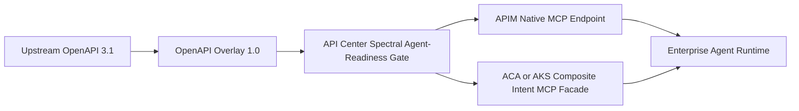
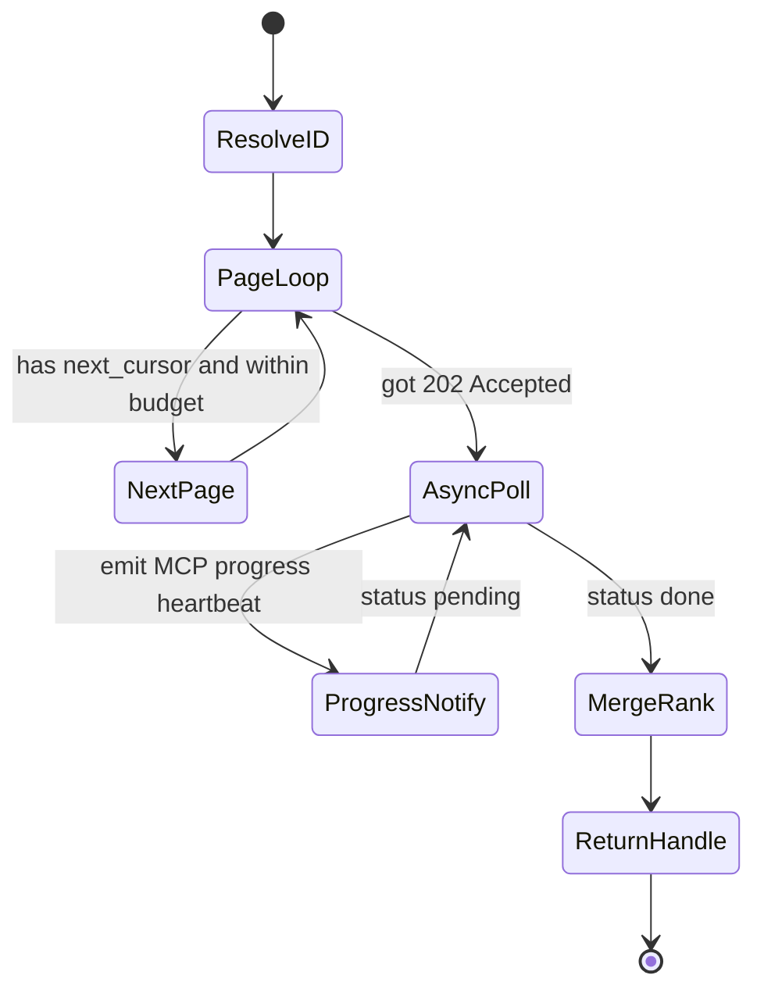

# Enterprise OpenAPI-to-MCP Curation and Ergonomics Architecture FAQ (Overlay + APIM Native MCP vs Composite Intent Facade vs Dynamic Meta-Tool)
> Topic ID: #461
> Section: 3.3 AI Gateway, MCP Tool Governance, and Cross-Organization A2A Federation
> Decision Goal: transform legacy REST/OpenAPI assets into agent-usable MCP tool surfaces with bounded token cost, higher first-try selection accuracy, and safer mutation governance
> Target Platforms: enterprises with `300–2,000` REST operations, heavy pagination/async patterns, and centralized APIM policy governance
## 1) Production problem: the 1:1 OpenAPI-to-MCP anti-pattern trap
Many teams start by mapping each REST path directly to one MCP tool.
In practice, that quickly expands `tools/list` to `150+` entries.
Complex enterprise schemas often include nested `$ref` structures and low-usability parameter names.
The model spends significant context budget just parsing tool surfaces, often exceeding `40,000` prompt tokens.
Cryptic parameters like `fltr_tp_cd`, `biz_st_cd`, and `page_token` reduce tool-routing precision.
`202 Accepted + Location` polling and cursor loops are then handled by the model in repeated manual turns.
A single business query can stretch to `8–15` turns with higher latency, cost, and error probability.
## 2) Why “more tools exposed” does not mean “better agent usability”
From an API publishing perspective, exposing all operations looks complete.
From an agent execution perspective, oversized tool surfaces create routing noise.
As candidate count grows, first-try tool selection accuracy usually drops.
When descriptions and examples are not intent-oriented, argument construction errors increase.
Pagination, async polling, and ID resolution compound into turn amplification.
The goal is not maximal exposure; it is maximal intent usability with policy control.
## 3) Four architecture patterns
Pattern A: declarative Overlay + API Center + APIM Native MCP.
This keeps upstream OpenAPI untouched while pruning low-value or unsafe operations.
Pattern B: Composite Intent Facade (FastMCP/TypeScript) for multi-step orchestration.
It collapses pagination, polling, ID lookup, and ranking into server-side workflows.
Pattern C: Dynamic Meta-Tool Explorer for mega catalogs.
It exposes only `2–3` stable meta-tools while discovering operations from curated registry search.
Pattern D: unfiltered 1:1 auto-export.
This commonly leaks dangerous admin mutations and bloated low-ergonomics schemas into model context.
## 4) Twelve-dimension decision matrix
| Dimension | Pattern A (Overlay + APIM) | Pattern B (Composite Facade) | Pattern C (Meta-Tool) | Pattern D (1:1 Export) |
|---|---|---|---|---|
| `tools/list` token footprint | Low | Low | Very low (near-constant) | High |
| First-try selection accuracy | High | High | Medium-high | Low |
| Pagination/polling turn collapse | Medium | High | Medium | Low |
| Upstream spec maintainability | High | Medium | High | Medium |
| APIM policy reuse | High | High | High | Medium |
| Schema-drift resilience | High | Medium-high | High | Low |
| Read/write safety separation | High | High | High | Low |
| Implementation complexity | Medium | Medium-high | Medium-high | Low |
| Operations complexity | Medium | Medium-high | Medium | High (incident-heavy) |
| Audit explainability | High | High | High | Low |
| Three-year TCO | Best | Best | Good | Poor |
| Enterprise recommendation | Primary | Primary | Primary for mega APIs | Avoid |
## 5) Mermaid: CI/CD curation and runtime topology

This topology shifts tool usability and safety checks left into delivery pipelines.
Runtime remains policy-governed, while spec hygiene is enforced before deployment.
## 6) Mermaid: bounded cursor and `202 Accepted` polling coalescer

The coalescer compresses chatty backend choreography into stable intent-level outputs.
It also centralizes timeout, budget, and audit enforcement in one governance plane.
## 7) Q1: quantifying tool-surface token tax
Use `Tokens_tools = N_tools * AvgSchemaTokens`.
As `N_tools` grows, nearly every turn pays recurring context tax.
In practice, keeping domain scope near `<=25` tools often preserves routing F1 stability.
If a domain exceeds that, split by intent and role instead of dumping all operations.
## 8) Q2: turn-amplification savings from server-side coalescing
With `K` pages and `M` async polling ticks, client-driven loops add `K+M` iterative contexts.
Server-side coalescing can save roughly `(K + M - 1)` prefix-bearing turns.
When prefix payloads are large, that reduction materially improves both latency and cost.
Pattern B is especially effective for chatty legacy APIs.
## 9) Q3: why Overlay beats manual spec forks
Overlay applies deterministic JSONPath patches without cloning full upstream specs.
Upstream teams can evolve contracts while governance teams maintain minimal delta rules.
Manual forks frequently drift and create documentation-runtime mismatches.
Overlay also allows intent-oriented annotation for agent ergonomics without upstream contract pollution.
## 10) Q4: aligning `202 Accepted` polling with MCP timeout behavior
Polling should be bounded and cadence-aware (`Retry-After` or controlled interval).
During polling, emit `notifications/progress` to prevent client-side timeout ambiguity.
Timeout policy must align upstream SLA and MCP client `request_timeout`.
On timeout, return resumable handles rather than opaque hard failures.
## 11) Q5: minimum viable breaking-change detection
New required fields in upstream OpenAPI are high-risk and should gate rollout.
Enum contractions and sort-semantics changes can silently alter agent behavior.
CI should include schema diff + representative call replay gates.
Promotion should require replay-baseline pass, not schema-only pass.
## 12) Q6: mutation safety segregation and confirmation gates
GET/Search tools can be auto-invoked with scoped policy constraints.
POST/DELETE/PATCH should require explicit confirmation or approval claims.
APIM policy can enforce verb-sensitive JWT claim checks and rate controls.
This relocates mutation risk from probabilistic model behavior to deterministic policy controls.
## 13) Production code blocks (real multiline code only)
### 13.1 OpenAPI Overlay 1.0.0: prune and enrich operations
```yaml
overlay: 1.0.0
info:
  title: ERP Orders MCP Overlay
  version: 2026-11-27
actions:
  - target: "$.paths['/admin/users']"
    remove: true
  - target: "$.paths['/internal/audit/export']"
    remove: true
  - target: "$.paths['/orders'].get"
    update:
      description: "Query orders by order id, customer id, and status; default recent 30 days."
      x-mcp-annotations:
        readOnlyHint: true
        destructiveHint: false
  - target: "$.paths['/orders/{id}/cancel'].post"
    update:
      description: "Cancel order with explicit business confirmation."
      x-mcp-annotations:
        readOnlyHint: false
        destructiveHint: true
```
### 13.2 APIM Bicep/policy fragment: MCP endpoint governance + mutation claims
```bicep
resource apim 'Microsoft.ApiManagement/service@2023-05-01-preview' existing = {
  name: apimName
}
resource mcpApi 'Microsoft.ApiManagement/service/apis@2023-05-01-preview' = {
  name: '${apim.name}/erp-mcp'
  properties: {
    displayName: 'ERP MCP Gateway'
    path: 'mcp/erp'
    protocols: ['https']
  }
}
resource policy 'Microsoft.ApiManagement/service/apis/policies@2023-05-01-preview' = {
  name: '${apim.name}/${mcpApi.name}/policy'
  properties: {
    format: 'rawxml'
    value: '<policies><inbound><base /><rate-limit-by-key calls=\"120\" renewal-period=\"60\" counter-key=\"@(context.Subscription.Id)\" /><choose><when condition=\"@(context.Request.Method == \"DELETE\" || context.Request.Method == \"PATCH\")\"><validate-jwt header-name=\"Authorization\" failed-validation-httpcode=\"403\"><required-claims><claim name=\"tool.mutation.approved\"><value>true</value></claim></required-claims></validate-jwt></when></choose></inbound><backend><base /></backend><outbound><base /></outbound></policies>'
  }
}
```
### 13.3 FastMCP composite tool: bounded pagination + `202` polling + progress
```python
import asyncio
import httpx
from fastmcp import FastMCP, Context

mcp = FastMCP("erp-composite")

@mcp.tool
async def list_orders_compact(ctx: Context, customer_id: str, max_pages: int = 5, max_bytes: int = 32768):
    results = []
    cursor = None
    async with httpx.AsyncClient(timeout=20) as client:
        for page in range(max_pages):
            params = {"customer_id": customer_id, "page_token": cursor}
            resp = await client.get("https://api.example.com/orders", params=params)
            if resp.status_code == 202:
                status_url = resp.headers.get("Location")
                for tick in range(10):
                    await ctx.report_progress(progress=tick + 1, total=10, message="polling async job")
                    await asyncio.sleep(1)
                    job = await client.get(status_url)
                    if job.status_code == 200:
                        resp = job
                        break
            data = resp.json()
            items = data.get("items", [])
            results.extend(items)
            cursor = data.get("next_cursor")
            if not cursor:
                break
            if len(str(results).encode("utf-8")) > max_bytes:
                break
    return {"count": len(results), "next_cursor": cursor, "items": results[:50]}
```
## 14) Enterprise scenarios and three-tier three-year TCO
### 14.1 Scenario A: global ERP order-to-cash platform (14 services, 640 operations)
This program combined Pattern A and Pattern B.
Overlay reduced exposed operations to an intent-relevant governed subset.
Composite tools absorbed pagination and polling orchestration server-side.
Average turns per order inquiry dropped from `11.4` to `2.3`.
Tool-surface token volume dropped by about `84%` with better first-try tool routing.
### 14.2 Scenario B: ITSM/CMDB mega catalog (`1,400+` operations)
This program adopted Pattern C with `2` governed meta-tools plus strict operation allowlists.
Agents discover operations first, then execute under APIM claim/policy controls.
Dangerous verbs require explicit authorization claims and full audit trace continuity.
This pattern is effective where endpoint breadth is large and change frequency is high.
### 14.3 Three-tier TCO (`50 / 300 / 1,500` endpoints, three-year)
| Tier | Endpoint scale | Pattern A | Pattern B | Pattern C |
|---|---:|---:|---:|---:|
| Business unit | 50 | `$0.42M` | `$0.55M` | `$0.51M` |
| Enterprise domain | 300 | `$1.96M` | `$2.38M` | `$2.11M` |
| Platform-wide | 1500 | `$8.44M` | `$10.26M` | `$9.02M` |
Cost driver 1: tool-surface token load and turn amplification tax.
Cost driver 2: whether pagination/polling is coalesced server-side.
Cost driver 3: schema drift governance and incident response overhead.
Cost driver 4: mutation-control failures and their business impact.
### 14.4 Governance notes for long-term API-to-tool ecosystem health
OpenAPI-to-MCP should be run as a sustained product governance stream, not a one-time conversion project.
Establish a cross-functional governance board across platform, application, security, and audit stakeholders.
Require business value, observability, rollbackability, and risk classification before adding any new tool.
For cross-organization exposure, isolate tool views, quotas, and mutation policies per partner boundary.
Track quarterly KPI sets including tool-hit rate, turn-compression ratio, unsafe-call rate, approval rejection rate, and replay-gate pass rate.
Prefer declarative, reviewable, and reversible Overlay rules over hidden imperative transformation scripts.
For high-risk mutations, enforce a three-layer guardrail: human-readable confirmation, executable policy claim checks, and durable audit evidence.
When upstream fields evolve rapidly, require API Center diff gates and replay controls before production promotion.
The objective is not “all endpoints callable”; it is “high-hit, low-turn, governed, auditable, and evolvable” enterprise tool ergonomics.
## 15) Day-0 / Day-1 / Day-2 action plan (15 actions)
Day-0: inventory OpenAPI catalogs by domain, risk tier, and operation frequency.
Day-0: define Overlay templates for prune, annotate, and block actions.
Day-0: publish tool ergonomics standards (name, description, examples, aliases, defaults).
Day-0: define server-side pagination/polling coalescing limits and heartbeat cadence.
Day-0: define mutation gating and approval/audit requirements by verb and tenant.
Day-1: canary Pattern A Overlay pipeline and measure tool-surface reduction and routing lift.
Day-1: canary Pattern B composite tools and measure turn-compression and latency gains.
Day-1: enable APIM rate limits, claim checks, and mutation policy controls.
Day-1: enforce schema-diff and call-replay gates for breaking-change protection.
Day-1: stand up multi-tenant observability dashboards for token, turn, error, and approval metrics.
Day-2: weekly prune low-value tools and optimize domain-scoped tool sets.
Day-2: monthly tune pagination/polling coalescing limits against SLO and completeness goals.
Day-2: quarterly drill upstream breaking-change rollback and partner-isolation failure scenarios.
Day-2: continuously tune meta-tool retrieval quality for mega-catalog precision.
Day-2: version governance policy bundles and integrate them into release management evidence trails.
### 15.1 Pre-production anti-pattern gate checklist
Verify the team is not using endpoint count as a proxy for agent usability outcomes.
Verify destructive mutations are not mixed with read-only discovery tools under the same safety envelope.
Verify `202 Accepted` polling is server-side coalesced rather than left to model-side iterative loops.
Verify cryptic legacy field names are mapped to intent-oriented aliases and documented examples.
Verify bounded pagination budgets (`max_pages` and `max_bytes`) are enforced with explicit truncation signaling.
Verify per-tool and per-tenant rate policies exist, rather than one shared gateway throttle bucket.
Verify schema-diff plus replay gates are mandatory before promoting upstream contract changes.
Verify request, policy, execution, and audit IDs are correlated end-to-end for incident forensics.
Verify Overlay rules are versioned declarative assets, not opaque script fragments.
Verify cross-organization deployments isolate catalog projections and quotas per partner boundary.
### 15.2 Runtime SLO and governance alert baselines
If first-try tool-hit ratio drops below threshold, trigger catalog contraction review instead of adding more tools.
If turn-compression ratio degrades, triage pagination merge health, async polling merge health, and semantic-description drift.
If mutation interception rate falls unexpectedly, block release and run policy replay regression immediately.
If tenant-fairness alerts rise, bind corrective actions to business-priority classes and compensation policy.
Require non-repudiable evidence for high-risk tools: policy version, claim snapshot, argument digest, and result hash.
Set quarterly caps for net-new tools and enforce retirement targets for low-value operations.
Run dual-track canaries on policy upgrades so old and new controls can be compared before full rollout.
Codify ownership for approval, rollback, and post-incident review to keep governance operationally accountable.
Score platform success on business completion rate, risk exposure rate, operational explainability, and unit-query cost balance.
Official references (fetched 2026-11-27):
- OpenAPI Overlays 1.0.0: https://spec.openapis.org/overlay/v1.0.0.html
- Azure API Center: https://learn.microsoft.com/azure/api-center/overview
- Azure API Management AI Gateway: https://learn.microsoft.com/azure/api-management/ai-gateway-overview
- Model Context Protocol: https://modelcontextprotocol.io/specification
