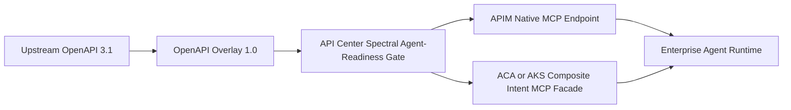
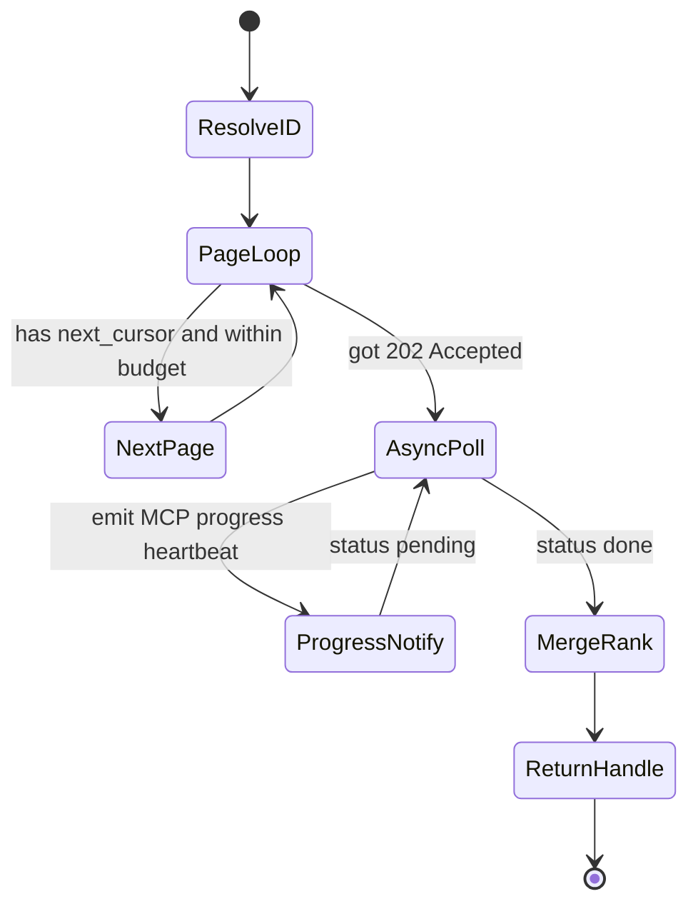

# 企业 OpenAPI 到 MCP 工具编排与人体工学治理选型 FAQ（Overlay + APIM Native MCP vs Composite Intent Facade vs Dynamic Meta-Tool）
> 主题编号：#461
> 章节归属：3.3 AI 网关、MCP 工具治理与跨组织 A2A 协议
> 目标问题：把遗留 REST/OpenAPI 资产转化为可被 Agent 高准确率调用的 MCP 工具面，同时控制 token、回合数与安全风险
> 适用对象：拥有 `300–2,000` REST 接口、分页与异步任务复杂度高、且需要统一网关治理的企业平台团队
## 1) 生产问题：1:1 OpenAPI 到 MCP 的反模式陷阱
很多企业把“每个 REST 路径 = 一个 MCP 工具”当成最省事路径。
实际落地后，`tools/list` 很容易膨胀到 `150+` 条目。
在复杂组织里，单个工具 schema 常带大量嵌套 `$ref` 与稀疏参数说明。
模型在工具选择前就要消耗大量上下文预算，常见额外开销达到 `40,000+` token。
当参数命名充满 `fltr_tp_cd`、`biz_st_cd`、`page_token` 这类人机不友好的字段时，路由准确率会快速下降。
更棘手的是 `202 Accepted + Location` 轮询与 cursor 分页经常被模型拆成多轮手工调用。
结果是一次业务查询要 `8–15` 回合才完成，延迟、成本与失败率都被放大。
## 2) 为什么“工具越多越全”并不等于“智能体越好用”
从开发者视角，暴露全部接口似乎更完整。
从智能体执行视角，过多细粒度工具会形成选择噪声。
工具面膨胀后，模型需要在更多候选之间做分辨，首选命中率显著下降。
当工具说明与示例不贴近业务意图时，模型更易触发错误字段组合。
一旦叠加分页、异步轮询和实体 ID 解析，回合放大会呈乘法效应。
因此企业要追求的不是“暴露最大化”，而是“意图可用性最大化”。
## 3) 四种架构路径：从声明式治理到反模式
Pattern A：声明式 Overlay + API Center + APIM Native MCP。
该路径通过 Overlay `actions` 定向裁剪低价值/高风险操作，保持上游 OpenAPI 不分叉。
Pattern B：Composite Intent Facade（FastMCP/TypeScript）封装多步编排。
该路径把分页、轮询、ID 解析、排序归并在服务端完成，暴露少量“意图级工具”。
Pattern C：Dynamic Meta-Tool Explorer。
该路径把工具面固定为 `2–3` 个元工具，适用于 `500+` 操作的巨型 API 目录。
Pattern D：无过滤 1:1 自动导出。
该路径通常暴露管理类危险路由和低质量 schema，是典型生产反模式。
## 4) 十二维决策矩阵（OpenAPI 到 MCP 工具体系）
| 评估维度 | Pattern A（Overlay+APIM） | Pattern B（Composite Facade） | Pattern C（Meta-Tool） | Pattern D（1:1 导出） |
|---|---|---|---|---|
| `tools/list` token 体积 | 低 | 低 | 极低（常数级） | 高 |
| 首次工具选择准确率 | 高 | 高 | 中高 | 低 |
| 分页/轮询回合压缩 | 中 | 高 | 中 | 低 |
| 上游规范可维护性 | 高 | 中 | 高 | 中 |
| APIM 策略复用 | 高 | 高 | 高 | 中 |
| 变更漂移韧性 | 高 | 中高 | 高 | 低 |
| 读写安全隔离 | 高 | 高 | 高 | 低 |
| 实施复杂度 | 中 | 中高 | 中高 | 低 |
| 运维复杂度 | 中 | 中高 | 中 | 高（故障多） |
| 合规审计可解释性 | 高 | 高 | 高 | 低 |
| 三年 TCO | 优 | 优 | 良 | 差 |
| 企业推荐等级 | 主路径 | 主路径 | 大目录场景主路径 | 禁用 |
## 5) Mermaid：OpenAPI 到 MCP 的 CI/CD 与运行时拓扑

该拓扑强调“规范治理前移”，而不是把治理压力全部留给运行时。
通过 CI 阶段门禁，可把工具人体工学与安全策略在上线前固定下来。
## 6) Mermaid：服务端分页与 `202 Accepted` 轮询合并状态机

状态机把高聊天度编排收敛到服务端，显著减少模型无效推理回合。
同时可在网关统一执行预算上限、超时策略与审计日志记录。
## 7) Q1：工具 token 税怎么量化
可用 `Tokens_tools = N_tools * AvgSchemaTokens`。
当 `N_tools` 上升时，几乎每轮都要重复承担工具上下文税。
经验上单域工具数控制在 `<=25`，通常更有利于选择 F1 稳定。
如果业务域过大，应优先按域拆分工具目录，而不是继续堆叠工具条目。
## 8) Q2：回合放大成本与编排合并收益
若分页页数为 `K`、轮询次数为 `M`，客户端手工循环会带来 `K+M` 次额外调用上下文。
服务端合并后可近似节省 `(K + M - 1)` 个回合前缀成本。
当前缀 token 很重时，这一节省会直接反映在延迟与费用下降上。
因此 Pattern B 对“聊天度高”的遗留 API 特别有效。
## 9) Q3：Overlay 合并规则为何比手工分叉更稳
OpenAPI Overlay 通过 JSONPath 指定修改点，避免复制整份上游规范。
这意味着上游团队更新 API 时，下游治理层可最小增量跟随。
手工 fork 规范往往在数周后与上游漂移，导致文档和运行行为不一致。
Overlay 还能将 LLM 友好的说明注入到操作级别，不污染原始业务契约。
## 10) Q4：`202 Accepted` 轮询与 MCP 超时如何协同
服务端应实现 bounded polling，并按 `Retry-After` 或固定节拍执行。
在轮询过程中持续发 `notifications/progress`，避免客户端误判为卡死。
超时策略要同时考虑上游 SLA 与 MCP 客户端 `request_timeout`。
若轮询超时，应返回可恢复句柄而非直接吞掉上下文。
## 11) Q5：变更破坏检测的最低门槛
上游 OpenAPI 新增 required 字段是高风险变更，应触发阻断或灰度。
删除枚举值、改变默认排序语义也可能导致智能体行为偏移。
建议在 CI 加入 schema diff 与典型调用回放测试。
只有通过回放基线，才允许将新版本推广到生产租户。
## 12) Q6：读写分离与危险操作确认门禁
对 GET/Search 类工具可开放自动调用，但应加速率与数据范围门禁。
对 POST/DELETE/PATCH 应要求显式确认或双人审批策略。
APIM 层可基于 claim、tenant、verb 执行差异化策略。
这样可以把“错误执行”风险从模型层降到策略层可控范围。
## 13) 生产代码片段（真实多行，无转义换行）
### 13.1 OpenAPI Overlay 1.0.0：裁剪路由并注入 Agent 友好注释
```yaml
overlay: 1.0.0
info:
  title: ERP Orders MCP Overlay
  version: 2026-11-27
actions:
  - target: "$.paths['/admin/users']"
    remove: true
  - target: "$.paths['/internal/audit/export']"
    remove: true
  - target: "$.paths['/orders'].get"
    update:
      description: "按订单号、客户号、状态查询订单；默认返回最近30天。"
      x-mcp-annotations:
        readOnlyHint: true
        destructiveHint: false
  - target: "$.paths['/orders/{id}/cancel'].post"
    update:
      description: "取消订单（需要业务确认）。"
      x-mcp-annotations:
        readOnlyHint: false
        destructiveHint: true
```
### 13.2 APIM 策略与 Bicep 片段：MCP 端点治理与危险动词校验
```bicep
resource apim 'Microsoft.ApiManagement/service@2023-05-01-preview' existing = {
  name: apimName
}
resource mcpApi 'Microsoft.ApiManagement/service/apis@2023-05-01-preview' = {
  name: '${apim.name}/erp-mcp'
  properties: {
    displayName: 'ERP MCP Gateway'
    path: 'mcp/erp'
    protocols: ['https']
  }
}
resource policy 'Microsoft.ApiManagement/service/apis/policies@2023-05-01-preview' = {
  name: '${apim.name}/${mcpApi.name}/policy'
  properties: {
    format: 'rawxml'
    value: '<policies><inbound><base /><rate-limit-by-key calls=\"120\" renewal-period=\"60\" counter-key=\"@(context.Subscription.Id)\" /><choose><when condition=\"@(context.Request.Method == \"DELETE\" || context.Request.Method == \"PATCH\")\"><validate-jwt header-name=\"Authorization\" failed-validation-httpcode=\"403\"><required-claims><claim name=\"tool.mutation.approved\"><value>true</value></claim></required-claims></validate-jwt></when></choose></inbound><backend><base /></backend><outbound><base /></outbound></policies>'
  }
}
```
### 13.3 FastMCP 复合工具：分页与 202 轮询合并 + 进度心跳
```python
import asyncio
import httpx
from fastmcp import FastMCP, Context

mcp = FastMCP("erp-composite")

@mcp.tool
async def list_orders_compact(ctx: Context, customer_id: str, max_pages: int = 5, max_bytes: int = 32768):
    results = []
    cursor = None
    async with httpx.AsyncClient(timeout=20) as client:
        for page in range(max_pages):
            params = {"customer_id": customer_id, "page_token": cursor}
            resp = await client.get("https://api.example.com/orders", params=params)
            if resp.status_code == 202:
                status_url = resp.headers.get("Location")
                for tick in range(10):
                    await ctx.report_progress(progress=tick + 1, total=10, message="polling async job")
                    await asyncio.sleep(1)
                    job = await client.get(status_url)
                    if job.status_code == 200:
                        resp = job
                        break
            data = resp.json()
            items = data.get("items", [])
            results.extend(items)
            cursor = data.get("next_cursor")
            if not cursor:
                break
            if len(str(results).encode("utf-8")) > max_bytes:
                break
    return {"count": len(results), "next_cursor": cursor, "items": results[:50]}
```
## 14) 企业场景与三档三年 TCO
### 14.1 场景 A：全球 ERP 与订单到现金平台（14 微服务，640 接口）
该企业将 Pattern A 与 Pattern B 组合使用。
Overlay 将工具面压缩到“高价值可调用子集”，复合工具吸收分页与轮询细节。
上线后订单查询平均回合数从 `11.4` 降到 `2.3`。
工具上下文 token 总量下降约 `84%`，并显著提升首选命中率。
### 14.2 场景 B：ITSM/CMDB 超大目录（1,400+ 操作）
该企业采用 Pattern C，将工具面固定为 `2` 个元工具 + 严格 allowlist。
模型先发现操作再受控执行，避免将上千接口直接暴露给推理上下文。
在 APIM 策略下，危险动词必须满足额外 claim，审计链完整可追溯。
该路径适合接口数巨大且跨团队演进频繁的平台型组织。
### 14.3 三档三年 TCO（50 / 300 / 1,500 REST 端点）
| 规模层级 | 端点规模 | Pattern A | Pattern B | Pattern C |
|---|---:|---:|---:|---:|
| 业务线级 | 50 | `$0.42M` | `$0.55M` | `$0.51M` |
| 集团域级 | 300 | `$1.96M` | `$2.38M` | `$2.11M` |
| 平台级 | 1500 | `$8.44M` | `$10.26M` | `$9.02M` |
成本驱动一：工具面 token 体积与回合放大造成的推理税。
成本驱动二：分页/轮询是否在服务端合并导致的调用次数差异。
成本驱动三：规范漂移治理成本与事故处理成本。
成本驱动四：安全门禁缺失导致的高影响错误执行风险成本。
### 14.4 治理补充：规范、网关与智能体协同的长期机制
企业不应把 OpenAPI-to-MCP 视为一次性转换工程，而应视为持续治理产品线。
建议建立“规范治理委员会”，由平台、应用、安全、审计四方共同维护 Overlay 规则与风险分级目录。
每次新增工具前都要评估其业务价值、可观测性、破坏性级别与回滚可行性，避免工具面无序增长。
对跨组织场景，应为每个合作方建立独立工具视图与配额边界，防止单方异常请求拖垮全局智能体通道。
建议将“工具命中率、回合压缩率、错误调用率、审批驳回率、变更回放通过率”固化为季度 KPI，而不是只看接口上线数量。
在技术实现上，尽量保持 Overlay 规则声明式、可审查、可回滚，减少散落在脚本中的隐式转换逻辑。
对于高风险写操作，必须保持“人可读确认语 + 策略可执行 claim 检查 + 审计可追溯证据”三位一体，不可只依赖模型自觉。
当上游团队频繁调整字段时，应通过 API Center 的差异扫描和回放闸门阻断破坏性发布，避免生产智能体出现隐性行为漂移。
最终目标不是追求“全部接口都可调用”，而是构建“高命中、低回合、可治理、可审计、可持续演进”的企业级工具生态。
## 15) Day-0 / Day-1 / Day-2（15 项执行动作）
Day-0：盘点现有 OpenAPI 目录，按业务域、读写风险、调用频度建立分层清单。
Day-0：定义 Overlay 规则模板，明确可裁剪、可注释、可阻断的统一规范。
Day-0：建立工具人体工学标准（命名、描述、示例、参数别名与默认值策略）。
Day-0：定义分页与轮询的服务端合并协议（页数、字节预算、心跳节奏）。
Day-0：定义 GET 与 mutation 的安全门禁、审批策略与审计字段。
Day-1：灰度上线 Pattern A Overlay 管线，验证工具面缩减与命中率变化。
Day-1：灰度上线 Pattern B 复合工具，验证回合压缩与延迟收益。
Day-1：在 APIM 启用速率限制、claim 校验与危险动词策略。
Day-1：接入调用回放与 schema diff 门禁，阻断破坏性变更直达生产。
Day-1：建立多租户可观测面板（token、回合、错误率、审批链）。
Day-2：每周复盘工具面规模与命中率，持续清理低价值工具。
Day-2：每月复盘分页/轮询合并参数，平衡完整性与时延预算。
Day-2：每季度演练上游破坏性变更回滚与跨组织配额隔离故障。
Day-2：持续优化元工具检索质量，避免大目录下发现噪声上升。
Day-2：把治理策略版本化并纳入发布管理，确保合规可追溯。
### 15.1 反模式识别清单（上线前必须逐项复核）
检查是否仍把“接口数量”当作“智能体可用性”代理指标，而忽视工具命中率与回合压缩率。
检查是否把危险写操作和只读查询混放在同一工具层，导致审批语义与策略语义冲突。
检查是否将 `202 Accepted` 轮询留给模型端循环处理，造成长尾超时与成本不可控。
检查是否继续暴露原生字段黑话（如 `fltr_tp_cd`）而未提供业务可理解别名和示例。
检查是否缺失分页预算（`max_pages/max_bytes`）和结果截断告警，导致单次调用吞噬上下文窗口。
检查是否没有工具级速率限制与租户隔离，导致热点租户拖垮公共网关容量。
检查是否跳过 schema diff + 回放闸门，直接把上游契约变更发布到生产智能体。
检查是否缺乏“请求-策略-执行-审计”四段关联 ID，导致事后问责无法闭环。
检查是否将 Overlay 规则散落在脚本中而非版本化声明，导致治理行为不可审查。
检查是否在跨组织场景中复用同一工具目录视图，破坏最小暴露与伙伴边界隔离。
### 15.2 运行期 SLO 与治理告警基线（建议默认）
工具首选命中率（First-Try Tool Hit）低于阈值时应自动触发工具面收敛评审，而不是继续扩容工具目录。
回合压缩率持续下降应定位为平台治理问题，优先排查分页合并、轮询合并与描述语义漂移。
危险操作拦截率异常下降时必须阻断发布并执行策略回归回放，避免隐性越权扩散。
跨租户配额冲突告警需绑定业务优先级与赔偿规则，防止公平性策略成为“静态摆设”。
所有高风险工具调用应保留不可抵赖审计证据（策略版本、claim 快照、参数摘要、执行结果哈希）。
对“新增工具数”设置季度上限与淘汰比率，鼓励高价值收敛而非无边界增长。
对每次治理策略升级执行双轨金丝雀（旧策略并行对照），避免大面积误伤生产流量。
在组织流程层面明确“谁批准、谁负责、谁复盘”，把工具治理纳入正式变更管理体系。
最终考核指标应聚焦“业务成功率、风险暴露率、运维可解释性、单位查询成本”四维平衡，而非单点最优。
官方参考（抓取 2026-11-27）：
- OpenAPI Overlays 1.0.0: https://spec.openapis.org/overlay/v1.0.0.html
- Azure API Center: https://learn.microsoft.com/azure/api-center/overview
- Azure API Management AI Gateway: https://learn.microsoft.com/azure/api-management/ai-gateway-overview
- Model Context Protocol: https://modelcontextprotocol.io/specification
