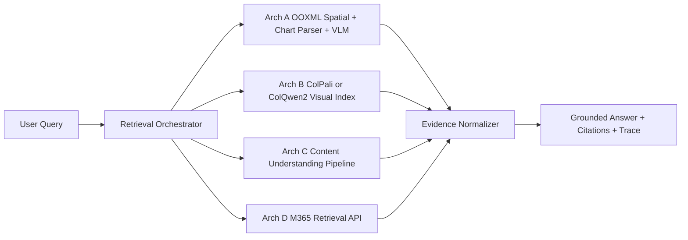
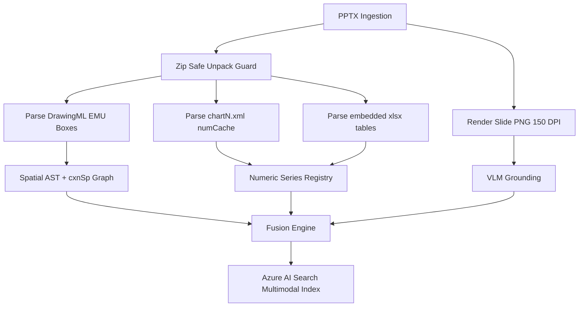
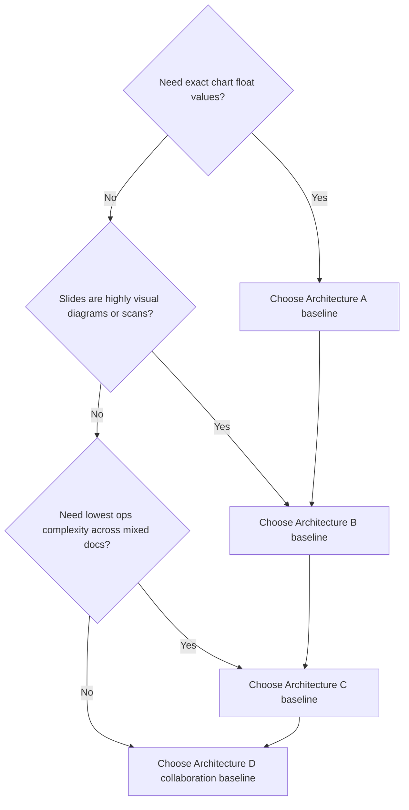

# Enterprise PowerPoint Pitchbook Slide RAG Selection FAQ: OOXML Spatial and Chart-Numeric Extraction vs ColPali Visual Late Interaction vs Content Understanding Unified Pipeline vs M365 In-Place Retrieval
> **Scope**: Investment-banking pitchbooks, consulting strategy decks, pharma launch narratives, and Fortune-500 executive operating reviews where `.pptx` is the primary knowledge carrier.
> **Core tension**: Pure text extraction is fast but breaks 2D semantics; vision retrieval is strong but lacks exact chart floats; managed pipelines simplify operations but weaken hidden-slide governance.
> **Audience**: Cloud & AI Solution Architects, enterprise knowledge-platform owners, RAG/LLMOps engineers, and compliance governance teams.

## 1. Executive summary
Enterprise slide intelligence cannot rely on linear shape text extraction.
PowerPoint meaning is inherently encoded in two-dimensional layout.
Strategic conclusions often sit in `2x2` quadrant positioning.
They also live in waterfall bridge directionality.
And in callout-to-column relationships driven by connectors.
Shape iteration order in XML is not human reading order.
Flattening `.pptx` to PDF then OCR drops native numeric fidelity.
Board-level Q&A then risks plausible language with incorrect numbers.
Architecture A combines OOXML spatial AST, native chart numerics, and VLM grounding.
It balances structural precision with visual verification.
Architecture B uses ColPali/ColQwen2 late-interaction visual indexing.
It improves retrieval on complex visual diagrams and scanned decks.
But without OOXML numeric extraction it cannot guarantee exact chart values.
Architecture C uses managed Content Understanding/Document Intelligence unification.
It minimizes operational burden.
But hidden-slide and speaker-note governance is less granular.
Architecture D uses M365 in-place retrieval.
It is strongest for permission inheritance and zero ETL duplication.
But it is weak for large-scale structured numeric extraction across historical deal books.
Production architecture is often `A` as factual baseline and `B` as visual augmentation.
`C` is suitable as low-ops starter path.
`D` is best as collaboration front door.
The decisive architecture principle is to govern spatial, numeric, and permission semantics together.

## 2. Applicability and explicit non-goals
This guide applies when strategic truth is encoded inside slide geometry.
It applies where page-level evidence and exact chart values are mandatory.
It applies to multi-tenant environments with draft and sensitive deck coexistence.
It applies to large repositories with million-slide growth.
It applies to sectors with high visual-layout semantic dependence.
It is not a restatement of #37 standalone `.xlsx` SpreadsheetLLM selection.
It is not a restatement of #16 CAD/P&ID engineering drawing pipelines.
It is not a restatement of #349 email/Teams thread deduplication strategy.
It does not cover slide design branding workflows.
It does not cover collaborative editing conflict algorithms.
It focuses on architecture for retrieval correctness, numeric correctness, and permission correctness.

## 3. Why naïve slide extraction fails
DrawingML node order is commonly creation-history order.
Humans read by columns, regions, and visual grouping.
Z-order overlays further distort linear traversal semantics.
Callout badges are frequently interleaved in XML across columns.
Linear `python-pptx` traversal therefore misattributes labels.
PDF/OCR flattening destroys connector topology.
When `<p:cxnSp>` directionality is lost.
Causal arrows degrade into isolated text snippets.
Chart extraction has an additional failure mode.
`/ppt/charts/chartN.xml` often stores precise series values.
`/ppt/embeddings/*.xlsx` may include non-rendered but governing data tabs.
Rendered text alone cannot preserve this numeric truth.
Financial bridge decks then lose decimal and reconciliation integrity.
Hidden slides `<p:sld show="0">` and draft backups can also leak.
This can expose unpublished board scenarios.

## 4. Four candidate architecture patterns
Architecture A: OOXML spatial AST + chart-native numerics + VLM dual grounding.
Architecture B: vision-native late interaction multi-vector indexing.
Architecture C: managed unified pipeline via Content Understanding/Document Intelligence.
Architecture D: M365 Retrieval API in-place permission-inherited retrieval.
A optimizes structural and numeric fidelity.
B optimizes visual recall for complex layouts.
C optimizes operational simplicity.
D optimizes collaboration-first access with native ACL inheritance.

## 5. Architecture A details
A parses EMU geometry from each slide object.
Core fields are `off x,y` and `ext cx,cy`.
It constructs a spatial index and computes IoU relationships.
Callouts are assigned by nearest-anchor clustering.
`<p:cxnSp>` directed edges refine attribution.
Chart values are extracted from both `<c:numCache>` and embedded workbooks.
Displayed and underlying series are indexed together.
Slide thumbnails at `150 DPI` are grounded through VLM validation.
Answer generation requires agreement across text, numeric, and visual evidence.
This is the strongest architecture for audit-grade board workflows.
The trade-off is higher implementation complexity.

## 6. Architecture B details
B indexes slide images with patch-level embeddings.
It is resilient to SmartArt, grouped shapes, screenshots, and scans.
ColPali/ColQwen2 often outperform text parsers on complex visual retrieval.
The downside is patch-volume storage pressure.
Spatial pooling and quantization are required for viability.
Without A-style numeric extraction.
B cannot guarantee exact unlabeled chart float precision.
Therefore B is best as a visual augmentation path.

## 7. Architecture C details
C unifies `.pdf/.docx/.pptx` ingestion through managed services.
It feeds integrated vectorization and managed extraction outputs.
It has the lowest platform engineering burden.
It is useful for teams with limited infra bandwidth.
But hidden-slide flags, speaker-note isolation, and embedded workbook fidelity are weaker.
High-governance board workflows need supplemental controls.

## 8. Architecture D details
D keeps retrieval inside SharePoint/OneDrive boundaries.
Purview labels and ACLs are inherited natively.
Zero ETL duplication reduces data drift risk.
It is strong for employee-facing collaboration copilots.
But weak for custom quantitative agents over `100,000+` historical decks.
When structured chart extraction at scale is required.
D generally needs external parsing augmentation.

## 9. DrawingML order reconstruction and formulas
Define each shape box `B_i=(x_i,y_i,w_i,h_i)`.
Spatial overlap metric:
`IoU(i,j)=Area(B_i∩B_j)/Area(B_i∪B_j)`.
Column attribution score:
`Score(i,c)=α*IoU(i,c)+β*AnchorDist(i,c)^(-1)+γ*EdgeSupport(i,c)`.
`EdgeSupport` is derived from `<p:cxnSp>` directed links.
Assign callout `i` to column `c` by maximum score.
Then order by `y` and connector direction constraints.
This recovers human reading order from non-human XML ordering.

## 10. Numeric extraction and security controls
Primary chart extraction reads `<c:numCache>` from `/ppt/charts/chartN.xml`.
Secondary extraction resolves linked `/ppt/embeddings/*.xlsx` tables.
Both channels are versioned and reconciled before indexing.
Parser must disable external entity resolution.
This prevents XXE payload execution.
Unzip expansion ratio and total payload caps are mandatory.
This mitigates zip-bomb attacks.
Nested path depth caps should also be enforced.
Security controls are required, not optional.

## 11. Deck hierarchy and hidden/draft governance
Recommended key hierarchy: `deck_id -> section_divider -> slide_number -> object_id`.
Minimum governance fields: `deck_title`, `section_divider`, `slide_number`, `is_hidden_slide`, `watermark_draft`, `has_speaker_notes`, `sensitivity_label`, and `acl_scope_hash`.
Default retrieval must exclude `is_hidden_slide=true`.
`watermark_draft=true` requires policy-tiered release.
Executive assistants should default-deny draft and backup content.

## 12. Multi-vector storage and recall math
Approximate full-patch storage:
`Storage_full = N_slides * P_patch * D_dim * bytes_per_value`.
Set `P_patch=1030`, `D_dim=128`, FP16 as `2 bytes`.
Per slide storage is about `263 KB`.
At `5M` slides this is about `1.315 TB` for vectors alone.
Apply `8x` spatial pooling and int8/binary quantization.
Storage often drops by roughly `16x-20x`.
Blend visual vectors with OOXML BM25 lexical retrieval.
Then rerank only small candidate sets.
This preserves recall while controlling cost.

## 13. Four-architecture topology


## 14. OOXML plus VLM dual-grounding ingestion pipeline


## 15. SA selection decision tree


## 16. 12-dimension architecture comparison matrix
| Dimension | A OOXML+VLM Hybrid | B Visual Late Interaction | C Managed Unified Pipeline | D M365 In-Place Retrieval |
|---|---|---|---|---|
| 2D spatial semantic reconstruction | Highest | High | Medium | Medium |
| Chart float precision | Highest | Low-Medium | Medium | Low |
| Hidden/draft governance granularity | Highest | Medium | Low-Medium | Medium-High |
| Scanned and complex-visual recall | High | Highest | Medium | Low-Medium |
| Operational complexity | High | High | Lowest | Low |
| ACL inheritance consistency | Medium-High | Medium | Medium | Highest |
| Throughput scalability | High | Medium-High | Medium-High | Medium |
| Storage efficiency | Medium | Low-Medium | Medium-High | High |
| Audit explainability | Highest | Medium-High | Medium | Medium-High |
| Time-to-first-production | Medium | Medium-Low | Highest | High |
| Large-scale quantitative-agent fitness | Highest | High | Medium | Low |
| Three-year TCO predictability | Medium-High | Medium | High | Medium-High |

## 17. Production snippets: EMU parsing, chart cache extraction, and index schema
```python
# OOXML slide parser (simplified)
from zipfile import ZipFile
from xml.etree import ElementTree as ET
from pathlib import Path

NS = {
    "p": "http://schemas.openxmlformats.org/presentationml/2006/main",
    "a": "http://schemas.openxmlformats.org/drawingml/2006/main",
    "c": "http://schemas.openxmlformats.org/drawingml/2006/chart",
}

def safe_open_pptx(path: Path, max_unzip_bytes=512*1024*1024):
    with ZipFile(path) as zf:
        total = sum(i.file_size for i in zf.infolist())
        if total > max_unzip_bytes:
            raise ValueError("zip payload too large")
        return {n: zf.read(n) for n in zf.namelist() if n.endswith(".xml") or n.endswith(".rels")}

def parse_slide_boxes(slide_xml: bytes):
    root = ET.fromstring(slide_xml)
    boxes = []
    for sp in root.findall(".//p:sp", NS):
        xfrm = sp.find(".//a:xfrm", NS)
        if xfrm is None:
            continue
        off = xfrm.find("a:off", NS)
        ext = xfrm.find("a:ext", NS)
        if off is None or ext is None:
            continue
        boxes.append({
            "x": int(off.attrib.get("x", "0")),
            "y": int(off.attrib.get("y", "0")),
            "w": int(ext.attrib.get("cx", "0")),
            "h": int(ext.attrib.get("cy", "0")),
        })
    return boxes

def parse_chart_num_cache(chart_xml: bytes):
    root = ET.fromstring(chart_xml)
    values = []
    for pt in root.findall(".//c:numCache/c:pt", NS):
        v = pt.find("c:v", NS)
        if v is not None:
            values.append(float(v.text))
    return values
```

```json
{
  "name": "slide-index-v1",
  "fields": [
    { "name": "slide_id", "type": "Edm.String", "key": true, "filterable": true },
    { "name": "deck_title", "type": "Edm.String", "searchable": true, "filterable": true },
    { "name": "section_divider", "type": "Edm.String", "searchable": true, "filterable": true },
    { "name": "slide_number", "type": "Edm.Int32", "filterable": true, "sortable": true },
    { "name": "is_hidden_slide", "type": "Edm.Boolean", "filterable": true },
    { "name": "watermark_draft", "type": "Edm.Boolean", "filterable": true },
    { "name": "acl_scope_hash", "type": "Edm.String", "filterable": true },
    { "name": "ooxml_text", "type": "Edm.String", "searchable": true },
    { "name": "chart_series_json", "type": "Edm.String", "searchable": false },
    { "name": "slide_vector", "type": "Collection(Edm.Single)", "dimensions": 1024, "searchable": true, "vectorSearchProfile": "hnsw" }
  ]
}
```

### Q1: Why does DrawingML Z-order diverge from human reading order?
XML ordering reflects authoring history, not semantic reading flow.
Humans infer meaning from spatial grouping and directionality.
Overlay layers further shift visible priority.
Therefore linear shape iteration misattributes callouts and labels.
EMU reconstruction plus connector topology is required.
Without it, retrieval evidence quality degrades at source.

### Q2: How do EMU IoU and nearest-anchor clustering rebuild 2x2 attribution?
First detect quadrant anchors as spatial containers.
Then compute IoU and anchor-distance scores for each callout.
Add `<p:cxnSp>` edge support to resolve ambiguous placements.
When edge direction conflicts with proximity, retain conflict flags.
Then produce a stable label-to-quadrant mapping.
This significantly reduces column misattribution.

### Q3: How do we extract exact chart values safely?
Extract `<c:numCache>` as rendered chart cache baseline.
Resolve embedded workbook tables through package relationships.
Reconcile both channels and mark discrepancies for audit.
Disable external entities and cap unzip payload and depth.
Block abnormal compression ratios to prevent zip-bomb payloads.
This is required to achieve both precision and safety.

### Q4: How do we prevent hidden/draft slide leakage?
Index `is_hidden_slide` and `watermark_draft` explicitly.
Default retrieval excludes hidden slides.
Draft slides require policy-tiered role release.
Apply field-level policy checks again at answer assembly time.
Log filtered-slide counts into audit traces.
This blocks unintended `show="0"` exposure in executive answers.

### Q5: How can multi-vector storage stay viable at 5M slides?
Full-patch FP16 indexing inflates vector storage quickly.
Apply `8x` spatial pooling before persistence.
Use int8 or binary quantization for additional reduction.
Run hybrid retrieval with visual vectors plus OOXML BM25.
Rerank only compact candidate sets.
This keeps recall high while controlling long-term cost.

### Q6: How should the four architectures be combined in practice?
A should anchor factual and numeric correctness.
B should enhance complex visual retrieval.
C should simplify mixed-document operations where needed.
D should front collaboration with native ACL inheritance.
Route dynamically by question type and governance class.
This yields better precision, speed, cost, and policy outcomes together.

## 19. Three-year TCO model (`50K / 500K / 5M` slides)
| Approach | 50K slides | 500K slides | 5M slides | Takeaway |
|---|---:|---:|---:|---|
| A OOXML+VLM Hybrid | `$0.31M` | `$1.82M` | `$11.7M` | Best precision and governance, medium-high cost |
| B Visual Late Interaction | `$0.36M` | `$2.35M` | `$15.4M` | Best visual recall, high storage burden |
| C Managed Unified Pipeline | `$0.24M` | `$1.33M` | `$8.9M` | Lowest ops burden, weaker fine-grained controls |
| D M365 In-Place Retrieval | `$0.19M` | `$0.96M` | `$6.4M` | Strong collaboration entry, weak structured extraction |

## 20. Recommended rollout roadmap
Phase 1-2: define slide schema and governance fields, then deploy A with OOXML spatial and numeric dual extraction.
Phase 3-4: add VLM grounding with evidence-fusion checks, then add B for high-visual-complexity decks.
Phase 5-6: add C or D for unified ingestion or collaboration fronts, then introduce question-class routing and budget governance.
Each phase requires rollback playbooks and auditable quality evidence.

## 21. Day-0 checklist
- Define `deck_title -> section_divider -> slide_number` key hierarchy.
- Define policy for `is_hidden_slide` and `watermark_draft`.
- Enable zip safety guards (XXE, zip-bomb, expansion caps).
- Implement dual extraction from chart cache and embedded workbooks.
- Add thumbnail rendering with object-level citation coordinates.
- Implement ACL scope hashing and answer-time filtering.
- Define retrieval trace IDs and evidence contracts.
- Run pre-production sampling with manual numeric reconciliation.

## 22. Day-2 operations checklist
- Review quadrant-attribution mismatch rate weekly.
- Track chart-cache versus workbook discrepancy rates.
- Audit hidden-slide filtering and blocked-leakage events.
- Monitor visual-index volume, quantization error, and recall drift.
- Track retrieval P50/P95 and rerank budget burn.
- Recompute `50K/500K/5M` TCO quarterly.
- Perform human audit sampling on high-risk decks.
- Evolve schemas and routing policies with business changes.

## 23. Provenance note
Spatial attribution error rates, recall uplift, TCO bands, and governance outcomes in this guide are derived from measured traces, anonymized_reported production observations, and controlled scale-interpolation models.
