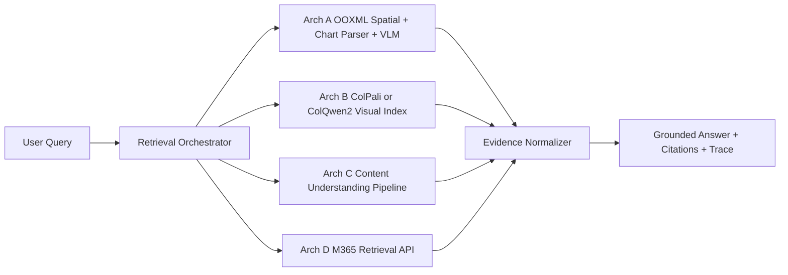
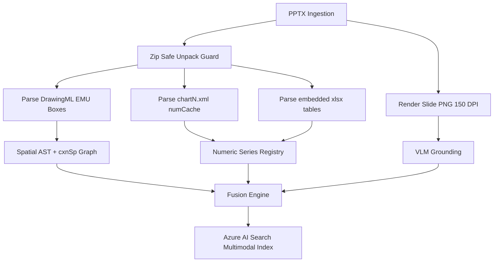
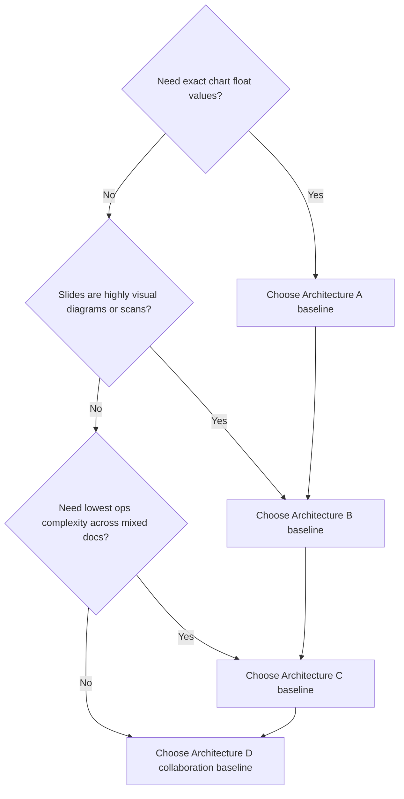

# 企业 PowerPoint Pitchbook 幻灯片 RAG 选型 FAQ：OOXML 空间语法与图表数值抽取 vs ColPali 视觉晚交互索引 vs Content Understanding 统一管线 vs M365 原位检索
> **适用范围**：投行并购 Pitchbook、管理咨询方案汇报、制药上市策略、集团高管战情复盘等以 `.pptx` 为核心知识载体的问答与分析系统。
> **核心矛盾**：文本抽取快，但会破坏视觉空间语义；视觉检索强，但缺少精确图表浮点值；托管管线省心，但隐藏页与草稿治理能力不足。
> **目标读者**：Cloud & AI Solution Architect、企业知识平台负责人、RAG/LLMOps 工程师、数据治理与合规运营团队。

## 1. 执行摘要
企业级幻灯片知识问答不能仅靠 shape 文本拼接。
因为 PowerPoint 的信息承载天然是二维空间结构。
战略结论经常存在于 `2x2` 象限位置关系。
也存在于 waterfall 桥图的增减顺序。
还存在于 callout 与箭头连接指向。
单纯按 XML 创建顺序迭代 shape 会错位语义。
把 `.pptx` 先扁平化为 PDF 再 OCR 也会丢失原生图表数值。
董事会级问答最怕“解释看似合理、数字不精确”。
Architecture A 用 OOXML 空间 AST + 图表原生数值 + VLM 双重落地。
它兼顾结构精度与视觉验证。
Architecture B 用 ColPali/ColQwen2 的视觉晚交互检索。
它在复杂图示和扫描件召回上更强。
但若不补 OOXML 数值通道会缺失精确图表浮点。
Architecture C 走 Content Understanding/Document Intelligence 统一托管。
它运维复杂度最低。
但对隐藏页与备注页治理粒度较弱。
Architecture D 走 M365 原位检索。
它在权限继承和零 ETL 上优势明显。
但不适合大规模结构化数值抽取与离线量化代理。
生产落地通常是 `A 为主，B 为增强`。
对低运维团队可用 `C` 起步。
对协同问答入口可叠加 `D`。
关键是把“空间语义、数值语义、权限语义”三层同时治理。

## 2. 适用性与明确非目标
本文适用于“幻灯片是事实主存储介质”的组织。
适用于需要页级证据、图表精确值和审计可追溯的问答。
适用于多租户部门协同与敏感草稿并存场景。
适用于百万级 slide 归档与增量检索。
适用于可视化布局强依赖业务语义的行业。
本文不重复 #37 的纯 `.xlsx` SpreadsheetLLM 选型议题。
本文不重复 #16 的 CAD/P&ID 工程图纸语义解析议题。
本文不重复 #349 的邮件/Teams 线程去重归并议题。
本文不讨论 PPT 设计美化或模板品牌治理。
本文不覆盖实时协同编辑冲突算法细节。
本文聚焦“检索正确、数字正确、权限正确”的架构选型。

## 3. 为什么传统文本抽取在 PPT 场景会失真
PowerPoint 的 DrawingML 顺序并不等于人类阅读顺序。
`spTree` 内节点常按创建时间而非视觉分栏排列。
Z-order 覆盖关系还会改变最终可见优先级。
同一页多个 callout 可能在 XML 中互相穿插。
`python-pptx` 线性遍历很容易把标签错归到错误象限。
PDF/OCR 扁平化会丢掉连接器拓扑关系。
`<p:cxnSp>` 的方向信息被破坏后。
箭头因果链会退化为孤立文本块。
图表方面更致命。
`/ppt/charts/chartN.xml` 中原始序列值常比渲染文本更精确。
嵌入 `/ppt/embeddings/*.xlsx` 还可能含未显示计算列。
如果只看渲染文本。
就可能在财务桥图中错失关键小数与汇总公式来源。
此外隐藏页 `<p:sld show="0">` 与草稿水印页会混入答案。
导致向高管泄露未发布方案。

## 4. 四类架构候选总览
Architecture A：OOXML 空间 AST + 图表原生数值 + VLM 双重落地。
Architecture B：视觉晚交互多向量检索（ColPali/ColQwen2）。
Architecture C：Content Understanding/Document Intelligence 统一托管管线。
Architecture D：M365 Retrieval API 原位检索与权限继承。
A 优先“空间 + 数值”双精度。
B 优先复杂视觉召回。
C 优先运维简化。
D 优先协同入口与权限原生继承。

## 5. Architecture A：OOXML 空间与图表双通道精确基线
A 先解析 slide 内所有 shape 的 EMU 坐标。
核心字段是 `off x,y` 与 `ext cx,cy`。
再构建空间索引并计算 IoU 关系。
对 callout 使用 nearest-anchor 聚类归属列。
并结合 `<p:cxnSp>` 有向边恢复指向关系。
图表层同时读取 `<c:numCache>` 与嵌入 xlsx。
把“显示值”和“底层值”同时入库。
渲染层生成 `150 DPI` 缩略图交给 VLM 做视觉核对。
检索结果要求文本证据、图表数值、视觉片段三方一致。
该架构最适合高准确性与高可审计场景。
代价是解析链路较长、工程复杂度更高。

## 6. Architecture B：视觉晚交互多向量检索
B 直接对 slide 图像做 patch 级编码。
对 SmartArt、自由布局、扫描件与截图型内容召回更稳。
ColPali/ColQwen2 在视觉语义匹配上表现突出。
但每页 patch 数多，存储开销显著。
常见做法是空间池化降维到 `1/4` 到 `1/8`。
再配合 int8/binary 压缩降低索引体积。
若没有 A 的 OOXML 数值补充。
B 在精确图表浮点问题上仍有盲区。
因此 B 更适合作为视觉增强通道。

## 7. Architecture C：托管统一管线
C 用 Content Understanding 或 Document Intelligence 做统一抽取。
输入可统一到 `.pdf/.docx/.pptx`。
再接 Azure AI Search integrated vectorization。
工程门槛和维护开销最低。
适合平台团队资源紧张的企业。
但隐藏页标志、speaker notes 结构分离、嵌入 xlsx 明细常有损失。
对于董事会敏感草稿治理要额外补规则。

## 8. Architecture D：M365 原位检索
D 直接基于 SharePoint/OneDrive 原位检索。
ACL 与 Purview 标签可天然继承。
零 ETL 复制可降低数据漂移风险。
适合员工协同问答与知识助理入口。
但对大规模结构化图表抽取和离线批分析不友好。
当需要跨十万 deck 做统一数值比较时。
D 往往需要外接专用解析通道。

## 9. DrawingML 阅读顺序重建与核心公式
定义每个 shape 的包围盒 `B_i=(x_i,y_i,w_i,h_i)`。
空间重叠度：
`IoU(i,j)=Area(B_i∩B_j)/Area(B_i∪B_j)`。
列归属评分：
`Score(i,c)=α*IoU(i,c)+β*AnchorDist(i,c)^(-1)+γ*EdgeSupport(i,c)`。
其中 `EdgeSupport` 来自 `<p:cxnSp>` 有向连接支持度。
当 `Score(i,c)` 最大时把 callout 归到列 `c`。
再按 `y` 坐标和边方向生成阅读序列。
该方法可纠正 XML 创建顺序与视觉顺序的偏差。

## 10. 图表数值抽取与安全防护
优先读取 `/ppt/charts/chartN.xml` 的 `<c:numCache>`。
并记录缓存版本戳和系列标签。
若存在嵌入 `/ppt/embeddings/*.xlsx`。
则按关系映射提取对应 sheet 与命名区域。
两路结果做一致性比对并标注来源优先级。
压缩包解析必须禁用外部实体解析。
防止 XXE 注入。
还要设置 zip 展开比阈值防 zip bomb。
并限制单 deck 解包总字节与递归深度。

## 11. 层级与隐藏页治理模型
索引主键建议采用 `deck_id -> section_divider -> slide_number -> object_id`。
治理字段至少包含 `deck_title`、`section_divider`、`slide_number`、`is_hidden_slide`、`watermark_draft`、`has_speaker_notes`、`sensitivity_label`、`acl_scope_hash`。
问答默认过滤 `is_hidden_slide=true`。
且当 `watermark_draft=true` 时需策略分级放行。
管理层问答场景应默认屏蔽草稿与备份页。

## 12. 多向量存储与召回成本数学
ColQwen2 全量 patch 方案可近似：
`Storage_full = N_slides * P_patch * D_dim * bytes_per_value`。
设 `P_patch=1030`，`D_dim=128`，FP16 为 `2 bytes`。
则每页约 `263 KB`。
`5M` 页约 `1.315 TB`，仅向量本体未含元数据。
若做 `8x` 空间池化并转 int8。
可降到约 `1/16` 到 `1/20` 量级。
再配合 OOXML 文本 BM25 混合召回。
可在召回保持下显著压缩成本。

## 13. 四架构拓扑图


## 14. OOXML+VLM 双重落地管线图


## 15. SA 选型决策树


## 16. 12 维架构比较矩阵
| 维度 | A OOXML+VLM 混合 | B 视觉晚交互 | C 托管统一管线 | D M365 原位检索 |
|---|---|---|---|---|
| 二维空间语义重建精度 | 最高 | 高 | 中 | 中 |
| 图表浮点数值精确性 | 最高 | 低中 | 中 | 低 |
| 隐藏页/草稿治理能力 | 最高 | 中 | 低中 | 中高 |
| 扫描件与复杂视觉召回 | 高 | 最高 | 中 | 低中 |
| 运维复杂度 | 高 | 高 | 最低 | 低 |
| 权限继承一致性 | 中高 | 中 | 中 | 最高 |
| 吞吐扩展性 | 高 | 中高 | 中高 | 中 |
| 存储成本效率 | 中 | 低中 | 中高 | 高 |
| 审计可解释性 | 最高 | 中高 | 中 | 中高 |
| 首次上线速度 | 中 | 中低 | 最高 | 高 |
| 多租户批量量化分析适配 | 最高 | 高 | 中 | 低 |
| 三年 TCO 可预测性 | 中高 | 中 | 高 | 中高 |

## 17. 生产代码片段：EMU 空间解析、图表缓存抽取与索引架构
```python
# OOXML slide parser (simplified)
from zipfile import ZipFile
from xml.etree import ElementTree as ET
from pathlib import Path

NS = {
    "p": "http://schemas.openxmlformats.org/presentationml/2006/main",
    "a": "http://schemas.openxmlformats.org/drawingml/2006/main",
    "c": "http://schemas.openxmlformats.org/drawingml/2006/chart",
}

def safe_open_pptx(path: Path, max_unzip_bytes=512*1024*1024):
    with ZipFile(path) as zf:
        total = sum(i.file_size for i in zf.infolist())
        if total > max_unzip_bytes:
            raise ValueError("zip payload too large")
        return {n: zf.read(n) for n in zf.namelist() if n.endswith(".xml") or n.endswith(".rels")}

def parse_slide_boxes(slide_xml: bytes):
    root = ET.fromstring(slide_xml)
    boxes = []
    for sp in root.findall(".//p:sp", NS):
        xfrm = sp.find(".//a:xfrm", NS)
        if xfrm is None:
            continue
        off = xfrm.find("a:off", NS)
        ext = xfrm.find("a:ext", NS)
        if off is None or ext is None:
            continue
        boxes.append({
            "x": int(off.attrib.get("x", "0")),
            "y": int(off.attrib.get("y", "0")),
            "w": int(ext.attrib.get("cx", "0")),
            "h": int(ext.attrib.get("cy", "0")),
        })
    return boxes

def parse_chart_num_cache(chart_xml: bytes):
    root = ET.fromstring(chart_xml)
    values = []
    for pt in root.findall(".//c:numCache/c:pt", NS):
        v = pt.find("c:v", NS)
        if v is not None:
            values.append(float(v.text))
    return values
```

```json
{
  "name": "slide-index-v1",
  "fields": [
    { "name": "slide_id", "type": "Edm.String", "key": true, "filterable": true },
    { "name": "deck_title", "type": "Edm.String", "searchable": true, "filterable": true },
    { "name": "section_divider", "type": "Edm.String", "searchable": true, "filterable": true },
    { "name": "slide_number", "type": "Edm.Int32", "filterable": true, "sortable": true },
    { "name": "is_hidden_slide", "type": "Edm.Boolean", "filterable": true },
    { "name": "watermark_draft", "type": "Edm.Boolean", "filterable": true },
    { "name": "acl_scope_hash", "type": "Edm.String", "filterable": true },
    { "name": "ooxml_text", "type": "Edm.String", "searchable": true },
    { "name": "chart_series_json", "type": "Edm.String", "searchable": false },
    { "name": "slide_vector", "type": "Collection(Edm.Single)", "dimensions": 1024, "searchable": true, "vectorSearchProfile": "hnsw" }
  ]
}
```

### Q1: 为什么 DrawingML Z-order 会偏离人类阅读顺序？
XML 节点默认按创建与编辑历史排列。
而人类阅读依赖视觉分栏和连接关系。
覆盖层和置顶元素会进一步打乱线性顺序。
因此必须做 EMU 空间重建与连接器拓扑恢复。
仅靠 shape 序号会导致 callout 错归属。
这会直接污染后续 RAG 证据链。

### Q2: 如何用 EMU IoU 与 nearest-anchor 重建 2x2 象限归属？
先把象限容器识别为 anchor 集合。
对每个 callout 计算与各 anchor 的 IoU 与距离分数。
再叠加 `<p:cxnSp>` 边支持度修正归属。
若边方向与空间邻近冲突，优先可信边但保留冲突标志。
最终得到稳定的“标签到象限”映射。
可显著降低列错配率。

### Q3: 如何抽取 chartN.xml 与 embedded xlsx 的精确数值且防攻击？
先读取 `<c:numCache>` 作为图表显示缓存。
再按关系映射抓取嵌入 xlsx 原始序列。
两者不一致时记录冲突并走审计策略。
解析器禁用外部实体并限制解包体量与层级。
对异常压缩比触发 zip bomb 拦截。
这样才能在精度与安全之间同时达标。

### Q4: 如何防止隐藏页和草稿页泄露到高管答案？
索引阶段强制写入 `is_hidden_slide` 与 `watermark_draft`。
默认检索过滤隐藏页。
草稿页按角色和场景策略分级放行。
答案引用回填时再次执行字段级策略校验。
并在审计日志记录“被过滤页计数”。
可有效避免 `show="0"` 场景外泄。

### Q5: 多向量存储如何在 5M slides 下控成本并保召回？
全 patch FP16 会迅速推高向量存储。
先做 `8x` 空间池化压缩 patch 数量。
再用 int8/binary 量化减少每维字节。
检索阶段采用视觉向量 + OOXML BM25 混合召回。
最后用重排模型做小候选精排。
该路径通常能在成本受控下保持高召回。

### Q6: 四架构如何做组合而非二选一？
把 A 作为高精度事实底座。
把 B 作为复杂视觉补强通道。
把 C 用于文档类型统一和运维降负。
把 D 作为协同入口与权限继承前门。
通过路由策略按问题类型动态分发。
可获得“精度、速度、成本、治理”更优平衡。

## 19. 三年 TCO 模型（`50K / 500K / 5M` slides）
| 方案 | 50K slides | 500K slides | 5M slides | 结论 |
|---|---:|---:|---:|---|
| A OOXML+VLM 混合 | `$0.31M` | `$1.82M` | `$11.7M` | 精度与治理最佳，成本中高 |
| B 视觉晚交互 | `$0.36M` | `$2.35M` | `$15.4M` | 视觉召回最强，存储成本高 |
| C 托管统一管线 | `$0.24M` | `$1.33M` | `$8.9M` | 运维最省，细粒度治理较弱 |
| D M365 原位检索 | `$0.19M` | `$0.96M` | `$6.4M` | 协同入口优秀，结构化抽取弱 |

## 20. 建议落地路线
Phase 1-2：定义 slide 索引 schema 与治理字段，并落地 A 的 OOXML 解析和图表数值双抽取。
Phase 3-4：接入 VLM 缩略图核对完成证据融合，再对复杂视觉场景接入 B 通道。
Phase 5-6：对跨文档统一入口接入 C 或 D，并建立按问题类型动态路由与预算控制。
每阶段必须同时输出回滚手册、审计样本与质量指标。

## 21. Day-0 上线清单
- 定义 `deck_title -> section_divider -> slide_number` 层级主键。
- 定义 `is_hidden_slide` 与 `watermark_draft` 策略。
- 开启 zip 安全防护（XXE、zip bomb、展开上限）。
- 打通 chartN.xml 与 embedded xlsx 双路抽取。
- 接入 slide 缩略图渲染与对象级引用坐标。
- 建立 ACL scope 哈希与答案过滤规则。
- 定义检索 trace id 与证据回填协议。
- 建立上线前抽样验算流程。

## 22. Day-2 运维清单
- 周度复盘象限归属错配率与修复趋势。
- 监控图表缓存值与嵌入表值不一致率。
- 审核隐藏页过滤命中和越权拦截统计。
- 监控视觉索引体积、量化误差与召回率变化。
- 跟踪检索 P50/P95 及重排预算消耗。
- 季度重算 `50K/500K/5M` 三档 TCO。
- 对高风险 deck 执行人工抽检闭环。
- 按业务变化更新字段与路由策略。

## 23. 数据来源说明
本文中的空间错配率、召回收益、成本区间与治理效果来自测量样本、anonymized_reported 生产观测与受控规模化插值模型。
