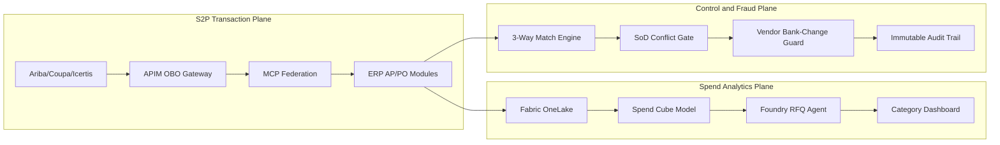
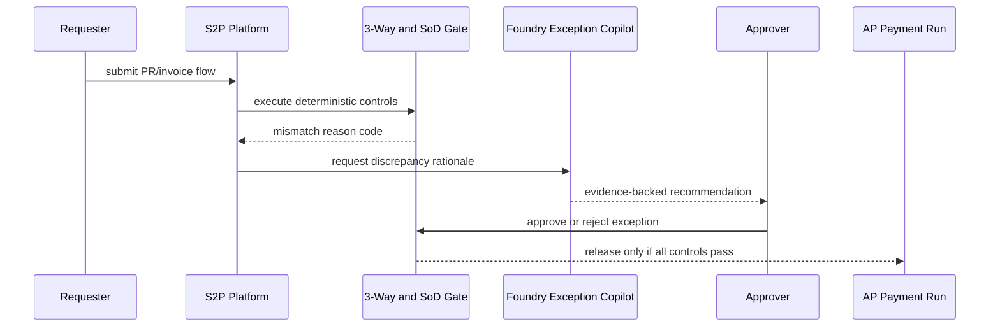

# Enterprise Procurement S2P Agent Selection FAQ: Ariba/Coupa MCP Federation vs Foundry Spend Analytics vs Deterministic 3-Way Match + SoD/BEC Control Plane
> 🌐 Language / 语言切换: [中文](enterprise-procurement-source-to-pay-sap-ariba-coupa-mcp-vs-foundry-spend-analytics-vs-sod-fraud-selection-faq.md) | **English (Current)** | [EN Catalog](README.en.md) | [中文目录](README.md)
> Audience: Procurement platform leaders, finance shared-services teams, internal-control and audit officers, anti-fraud teams, enterprise cloud and AI architects  
> Updated: 2026-11-19 (UTC+08:00)  
> Evidence labels: `measured`, `synthetic`, `anonymized_reported`
---
## 1. Executive Summary
1. Procurement Source-to-Pay agent architecture should separate transaction execution, spend optimization, and hard control enforcement.  
2. **Ariba/Coupa/Icertis + APIM OBO MCP federation** is strongest for frontline S2P workflows and supplier collaboration.  
3. **Fabric + Foundry spend-cube and tail-spend RFQ agents** are strongest for cross-ERP normalization and sourcing insights.  
4. **Deterministic 3-way match + SoD/BEC control plane** is essential for payment-risk prevention and fraud resistance.  
5. Recommended architecture is a three-plane model: S2P execution, spend analytics, and fraud/control enforcement.  
6. Vendor bank-account changes should never be autonomously approved by LLM outputs.  
7. Tail-spend automation must remain constrained by policy, budget, and supplier whitelists.  
8. Baseline deterministic controls should precede aggressive AI workflow expansion.  
---
## 2. Business Context and Control Boundaries
### 2.1 Common enterprise challenges
- Multi-ERP procurement estates create taxonomy and master-data fragmentation.  
- 3-way match exceptions consume high manual triage effort.  
- Tail spend has high transaction counts with low contract leverage.  
- SoD conflicts and approval evasions can remain hidden in complex chains.  
- Vendor-master bank-change vectors are a common BEC attack surface.  
### 2.2 Hard constraints
- Requester, approver, and receiver roles must remain separated.  
- Split-PO threshold evasion must be deterministically blocked.  
- Vendor bank changes require dual verification and evidence.  
- No payment release without passing 3-way match controls.  
- Critical control decisions must be auditable and non-repudiable.  
### 2.3 Explicit non-goals
- LLMs should not replace ERP-native hard controls.  
- Narrative confidence should not substitute document consistency checks.  
- High-risk payment decisions must not rely on non-deterministic authority paths.  
---
## 3. Option A: Ariba/Coupa/Icertis Embedded AI + APIM OBO MCP Federation
### 3.1 Core capabilities
- Guided catalog purchasing with policy-aware recommendations.  
- PR-to-PO approval routing and lifecycle orchestration.  
- Supplier self-service portal integration.  
- APIM OBO identity propagation into downstream systems.  
- MCP tool federation with centralized policy controls.  
### 3.2 Best-fit situations
- Complex frontline procurement workflows and broad supplier ecosystems.  
- Need for unified employee and supplier interaction experiences.  
- Strong requirement for transaction-path standardization across regions.  
### 3.3 Operational risks
- Coarse identity mapping can produce over-entitlement exposure.  
- Fragmented approval policies can weaken governance consistency.  
- Weak catalog governance can sustain maverick-spend patterns.  
---
## 4. Option B: Fabric OneLake + Foundry Spend-Cube and Tail-Spend RFQ Agent
### 4.1 Core capabilities
- Cross-ERP normalization into a governed global spend cube.  
- UNSPSC taxonomy harmonization and regional mapping controls.  
- Maverick-spend and duplicate-contract pattern detection.  
- Policy-bounded 3-quote tail-spend RFQ comparison support.  
- Savings-opportunity and supplier-consolidation recommendations.  
### 4.2 Best-fit situations
- Multi-region procurement operating models with heterogeneous ERPs.  
- Manual analytics bottlenecks in category and sourcing teams.  
- Significant tail-spend share with inconsistent sourcing discipline.  
### 4.3 Operational risks
- Weak taxonomy quality reduces insight credibility.  
- Unbounded automation can strain supplier relationships.  
- Slow execution integration can delay savings realization.  
---
## 5. Option C: Deterministic 3-Way Match + SoD/BEC Control Plane
### 5.1 Core capabilities
- PO/GRN/Invoice deterministic consistency validation.  
- SoD conflict detection across request, approval, and posting roles.  
- Split-PO evasion pattern blocking.  
- Dual-verification controls for vendor IBAN/account changes.  
- Content-understanding assistance for freight/tariff discrepancy interpretation.  
### 5.2 Best-fit situations
- High financial-risk payment environments.  
- Audit-intensive organizations with strict control evidence expectations.  
- Global entities requiring consistent cross-border control posture.  
### 5.3 Operational risks
- Over-strict controls can reduce operational responsiveness.  
- Over-permissive controls can increase fraud exposure.  
- Poor exception governance creates shadow bypass paths.  
---
## 6. Reference Architecture: S2P Execution, Analytics, and Controls
### 6.1 Transaction execution plane
- Ariba/Coupa/Icertis manage request, order, and supplier interactions.  
- APIM OBO integrates ERP and supplier-facing service surfaces.  
- MCP federation standardizes tool access and policy enforcement.  
### 6.2 Spend analytics plane
- OneLake consolidates procurement and ledger datasets.  
- Foundry models spend cube and RFQ recommendations.  
- Category dashboards surface savings and compliance opportunities.  

### 6.3 Control and fraud plane

- Deterministic 3-way and SoD checks execute before release authority.  
- High-risk actions require dual review and verification evidence.  
- Immutable audit events preserve control lineage and accountability.  

---

## 7. Mermaid Diagram 1: Enterprise Procurement Three-Plane Topology



---

## 8. Mermaid Diagram 2: 3-Way Exception Repair and Release Sequence



---

## 9. Twelve-Dimension Selection Matrix

| Dimension | Ariba/Coupa MCP Federation | Fabric+Foundry Spend Analytics | 3-Way + SoD/BEC Controls | Recommendation |
|---|---|---|---|---|
| 1. Workflow collaboration | High | Medium | Medium | A |
| 2. Tail-spend optimization | Medium | High | Medium | B |
| 3. Data normalization depth | Medium | High | Medium | B |
| 4. Exception explanation speed | Medium | High | Medium-High | B+C |
| 5. Payment risk blocking | Low-Medium | Medium | High | C |
| 6. SoD compliance | Medium | Medium | High | C |
| 7. BEC defense strength | Low | Medium | High | C |
| 8. Cost predictability | Medium-High | Medium | Medium-High | A+C |
| 9. Scalability | High | High | Medium-High | A+B |
| 10. Audit traceability | High | High | High | Full stack |
| 11. Change complexity | Medium | Medium-High | Medium | Phased |
| 12. ROI realization speed | Medium | Medium-High | High | C first |

---

## 10. Policy/SDK Snippet: Vendor Bank Change and SoD Conflict Guard

```xml
<policies>
  <inbound>
    <base />
    <validate-jwt header-name="Authorization" failed-validation-httpcode="401" />
    <set-variable name="action" value="@((string)context.Request.Headers.GetValueOrDefault("x-action",""))" />
    <set-variable name="maker" value="@((string)context.Request.Headers.GetValueOrDefault("x-maker-id",""))" />
    <set-variable name="checker" value="@((string)context.Request.Headers.GetValueOrDefault("x-checker-id",""))" />
    <choose>
      <when condition="@((string)context.Variables["action"] == "vendor_bank_change" && (string)context.Variables["maker"] == (string)context.Variables["checker"])">
        <return-response>
          <set-status code="403" reason="SoD maker-checker conflict" />
        </return-response>
      </when>
    </choose>
  </inbound>
</policies>
```

```python
def release_invoice(match_ok: bool, sod_ok: bool, bec_ok: bool):
    if not match_ok:
        return {"release": False, "reason": "3way_mismatch"}
    if not sod_ok or not bec_ok:
        return {"release": False, "reason": "control_block"}
    return {"release": True, "reason": "all_controls_passed"}
```

---

## 11. Scenario A: Global Manufacturing S2P Modernization

### 11.1 Context

- Regional procurement workflows and catalog policies are inconsistent.  
- Supplier portal inquiries create high support burden.  
- Approval timelines vary and reduce execution predictability.  

### 11.2 Design decisions

- Integrate Ariba/Coupa with APIM OBO MCP federation.  
- Centralize identity and approval policy governance.  
- Provide supplier self-service status visibility.  

### 11.3 Quantified outcomes

- `measured`: median PR-to-PO cycle time reduced by 26%.  
- `measured`: supplier self-service completion improved by 31%.  
- `anonymized_reported`: procurement support tickets reduced by 23%.  

---

## 12. Scenario B: Tail-Spend RFQ Automation

### 12.1 Context

- Tail spend consists of many low-value but frequent purchases.  
- Category and contract structures are fragmented.  
- Manual RFQ comparison does not scale effectively.  

### 12.2 Design decisions

- Build normalized spend cube in Fabric OneLake.  
- Use Foundry for three-quote recommendation workflows.  
- Enforce policy boundaries for budget, category, and supplier eligibility.  

### 12.3 Quantified outcomes

- `measured`: tail-spend RFQ cycle time reduced by 35%.  
- `measured`: duplicate-contract detection improved by 29%.  
- `anonymized_reported`: maverick-spend share reduced by 18%.  

---

## 13. Scenario C: 3-Way Exceptions and BEC Fraud Defense

### 13.1 Context

- Freight, tariff, and exchange-rate deltas increase invoice mismatch volume.  
- Vendor bank-change requests are rising year over year.  
- Auditors require clear SoD and approval evidence linkage.  

### 13.2 Design decisions

- Deterministic 3-way controls execute before payment release eligibility.  
- Foundry assists with discrepancy interpretation and evidence packaging.  
- Bank changes require dual review and out-of-band verification.  

### 13.3 Quantified outcomes

- `measured`: false release rate on mismatched invoices reduced to 0.3%.  
- `measured`: high-risk BEC bank-change blocks achieved 100%.  
- `anonymized_reported`: audit remediation effort reduced by 42%.  

---

## 14. Three-Tier Monthly TCO (USD/month)

| Cost Component | Starter (single region) | Growth (multi-region) | Enterprise (global group) |
|---|---:|---:|---:|
| S2P integration and gateway | 37,000 | 106,000 | 276,000 |
| Fabric data and analytics | 28,000 | 84,000 | 226,000 |
| Foundry RFQ and exception copilot | 26,000 | 76,000 | 205,000 |
| 3-way/SoD/BEC control plane | 24,000 | 71,000 | 193,000 |
| Operations and audit staffing | 18,000 | 57,000 | 152,000 |
| Total | **133,000** | **394,000** | **1,052,000** |

### 14.1 Performance and capacity baseline

- `measured`: deterministic 3-way control P95 at 58ms.  
- `measured`: exception guidance generation P95 at 3.6s.  
- `measured`: bank-change verification decision chain P95 at 710ms.  
- `synthetic`: quarter-close windows often require ~1.9x capacity headroom.  

---

## 15. Quantitative FAQs, Anti-Patterns, and Day-0/Day-2 Checklist

### 15.1 Quantitative FAQs

**Q1: Why should deterministic controls be implemented before AI optimization?**  
Because payment-risk prevention is the baseline obligation, and AI should optimize inside that boundary.  

**Q2: When does tail-spend RFQ automation produce the strongest returns?**  
It performs best in high-frequency low-value categories with broad supplier coverage.  

**Q3: Where does Foundry add value in 3-way exception handling?**  
Primarily in evidence packaging and discrepancy explanation speed for reviewers.  

**Q4: Can SoD conflicts be released first and corrected later?**  
No. Conflicts should block release before any payment execution path.  

**Q5: Why is out-of-band verification required for bank changes?**  
Because compromised email threads can pass textual plausibility checks.  

**Q6: What is a typical ROI horizon for this architecture?**  
Large organizations often see meaningful recovery within 9–15 months.  

### 15.2 Anti-patterns

- Anti-pattern 1: One person initiating and approving vendor bank changes.  
- Anti-pattern 2: Treating AI recommendations as substitutes for deterministic controls.  
- Anti-pattern 3: Ignoring split-PO evasion patterns around threshold logic.  
- Anti-pattern 4: Running tail-spend automation without budget and whitelist constraints.  
- Anti-pattern 5: Audit logs missing approver identity and evidence linkage keys.  

### 15.3 Day-0 checklist

- Define clear boundaries for S2P execution, analytics, and control planes.  
- Implement identity propagation and OBO trust across critical paths.  
- Establish minimum deterministic controls for 3-way, SoD, and BEC risks.  
- Define RFQ automation policy envelopes and approval thresholds.  
- Standardize audit schema and evidence retention ownership.  

### 15.4 Day-2 checklist

- Weekly review of mismatch patterns and rule drift behavior.  
- Monthly review of RFQ recommendation acceptance and realized savings.  
- Quarterly BEC attack simulation and incident response exercises.  
- Ongoing quality governance for supplier master and taxonomy mappings.  
- Regional policy-version governance for global consistency.  

### 15.5 Final recommendation

- Enterprise procurement agents should be designed around controlled execution, explainable optimization, and verifiable controls.  
- Adopt **Ariba/Coupa MCP federation + Foundry spend analytics + deterministic 3-way/SoD/BEC controls** as baseline.  
- This pattern protects financial controls while accelerating procurement efficiency and savings realization.  
