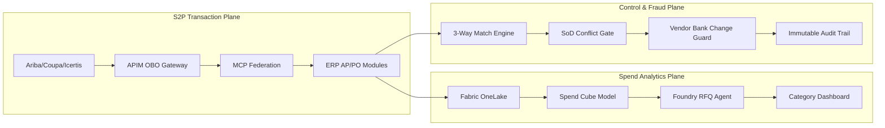
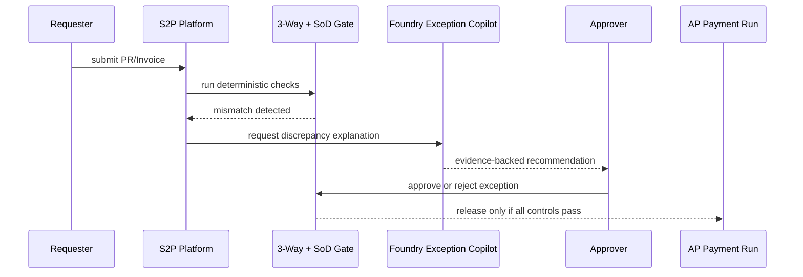

# 企业采购 S2P 智能体选型 FAQ：Ariba/Coupa MCP 联邦 vs Foundry Spend-Cube 分析 vs 3-Way Match + SoD 反欺诈控制平面
> 🌐 Language / 语言切换：**中文（当前）** | [English](enterprise-procurement-source-to-pay-sap-ariba-coupa-mcp-vs-foundry-spend-analytics-vs-sod-fraud-selection-faq.en.md) | [总目录](README.md) | [EN Catalog](README.en.md)
> 目标读者：企业采购平台主管、财务共享中心负责人、内控与审计负责人、反舞弊团队、云与 AI 架构师  
> 更新日期：2026-11-19（UTC+08:00）  
> 证据标签：`measured`、`synthetic`、`anonymized_reported`
---
## 1. 执行摘要
1. 采购 Source-to-Pay 智能体要分清“交易执行、分析优化、内控拦截”三类职责。  
2. **Ariba/Coupa/Icertis + APIM OBO MCP 联邦** 适合前台采购流程和供应商门户协同。  
3. **Fabric + Foundry Spend-Cube 与尾部采购 RFQ 智能体** 适合跨 ERP 归一化与节省机会挖掘。  
4. **Deterministic 3-Way Match + SoD/BEC 反欺诈平面** 适合控制付款风险和违规审批绕过。  
5. 推荐采用“三平面架构”：S2P 事务平面、Spend 分析平面、风控拦截平面。  
6. 高风险银行账户变更不得由 LLM 自主审批。  
7. 尾部采购自动询价应受预算、品类与供应商白名单策略约束。  
8. 先做 deterministic 内控基线，再扩展 AI 优化能力。  
---
## 2. 业务背景与关键约束
### 2.1 常见挑战
- 多 ERP 并存导致采购数据口径碎片化。  
- 3-way match 异常占用大量人工复核时间。  
- 尾部采购金额小但频次高，议价效率低。  
- SoD 冲突与审批绕过存在隐蔽风险。  
- 供应商主数据银行账户变更成为 BEC 高发入口。  
### 2.2 硬约束
- 请求人/审批人/收货确认角色必须分离。  
- 分拆 PO 规避审批阈值必须被硬拦截。  
- 供应商银行信息变更必须双人核验。  
- 付款前 3-way match 不通过不得放行。  
- 所有关键动作必须有不可抵赖审计记录。  
### 2.3 非目标
- 不追求 LLM 直接改写 ERP 核心控制逻辑。  
- 不允许文本解释替代财务凭证一致性。  
- 不将高风险付款决策外包给非确定性模型。  
---
## 3. 方案 A：Ariba/Coupa/Icertis 嵌入式 AI + APIM OBO MCP
### 3.1 核心能力
- Guided catalog buying 与政策约束选品。  
- PR-to-PO 审批流程自动分派。  
- 供应商门户自助与状态追踪。  
- APIM OBO 实现跨系统身份透传。  
- MCP 工具联邦统一目录与策略网关。  
### 3.2 适配场景
- 前台采购协同流程复杂。  
- 供应商数量大、交互频繁。  
- 需要统一员工体验与审批体验。  
### 3.3 风险点
- 若身份映射不精细，会扩大越权面。  
- 若审批规则配置分散，难以统一治理。  
- 若目录治理薄弱，maverick spend 仍会持续。  
---
## 4. 方案 B：Fabric Spend-Cube + Foundry Tail-Spend RFQ Agent
### 4.1 核心能力
- 多 ERP 总账与采购数据归一化。  
- UNSPSC 分类标准化与跨区域映射。  
- maverick spend 与重复合同检测。  
- 尾部采购 3-quote 自动比价建议。  
- 节省机会与供应商整合机会识别。  
### 4.2 适配场景
- 企业有多区域多 ERP 采购体系。  
- 采购分析依赖大量手工报表。  
- 尾部采购占比高、议价策略分散。  
### 4.3 风险点
- 分类映射质量不稳会影响洞察可信度。  
- 自动询价缺乏边界会带来供应商关系风险。  
- 分析与执行链路未打通时收益兑现慢。  
---
## 5. 方案 C：3-Way Match + SoD/BEC 反欺诈控制平面
### 5.1 核心能力
- PO/GRN/Invoice 三单一致性硬校验。  
- SoD 冲突检测与审批链拦截。  
- split-PO 规避阈值识别与阻断。  
- 供应商 IBAN 变更双人复核与二次验证。  
- 内容理解辅助运费/关税行差异解释。  
### 5.2 适配场景
- 付款错误或欺诈风险高。  
- 审计对控制证据要求严格。  
- 跨国企业需统一合规与内控口径。  
### 5.3 风险点
- 规则过严会影响业务时效。  
- 规则过松会放大舞弊暴露。  
- 人工例外管理不规范会形成控制旁路。  
---
## 6. 参考架构：S2P 执行、分析与控制三平面
### 6.1 事务执行平面
- Ariba/Coupa/Icertis 处理前台流程。  
- APIM OBO 连接 ERP 与供应商服务。  
- MCP 工具层统一调用治理。  
### 6.2 分析优化平面
- OneLake 汇聚多源采购数据。  
- Foundry 进行 spend-cube 与 RFQ 推荐。  
- 输出节省机会与风险预警。  

### 6.3 风险控制平面

- Deterministic match 与 SoD 引擎先行。  
- 高风险动作进入双人审批与验证。  
- 全链路审计写入证据仓。  

---

## 7. Mermaid 图一：企业采购三平面拓扑



---

## 8. Mermaid 图二：3-way 异常修复与放行时序



---

## 9. 12 维选型矩阵（采购 S2P）

| 维度 | Ariba/Coupa MCP 联邦 | Fabric+Foundry Spend 分析 | 3-Way + SoD/BEC 控制 | 推荐 |
|---|---|---|---|---|
| 1. 采购流程协同 | 强 | 中 | 中 | A |
| 2. 尾部采购优化 | 中 | 强 | 中 | B |
| 3. 数据归一化能力 | 中 | 强 | 中 | B |
| 4. 异常解释效率 | 中 | 强 | 中高 | B+C |
| 5. 付款前风险拦截 | 低中 | 中 | 强 | C |
| 6. SoD 合规 | 中 | 中 | 强 | C |
| 7. BEC 防护 | 低 | 中 | 强 | C |
| 8. 成本可预测性 | 中高 | 中 | 中高 | A+C |
| 9. 可扩展性 | 高 | 高 | 中高 | A+B |
| 10. 审计可追溯 | 高 | 高 | 强 | 全栈 |
| 11. 变更管理复杂度 | 中 | 中高 | 中 | 分阶段 |
| 12. ROI 兑现速度 | 中 | 中高 | 高 | C 先行 |

---

## 10. 策略片段：供应商银行变更与 SoD 冲突拦截

```xml
<policies>
  <inbound>
    <base />
    <validate-jwt header-name="Authorization" failed-validation-httpcode="401" />
    <set-variable name="action" value="@((string)context.Request.Headers.GetValueOrDefault("x-action",""))" />
    <set-variable name="maker" value="@((string)context.Request.Headers.GetValueOrDefault("x-maker-id",""))" />
    <set-variable name="checker" value="@((string)context.Request.Headers.GetValueOrDefault("x-checker-id",""))" />
    <choose>
      <when condition="@((string)context.Variables["action"] == "vendor_bank_change" && (string)context.Variables["maker"] == (string)context.Variables["checker"])">
        <return-response>
          <set-status code="403" reason="SoD maker-checker conflict" />
        </return-response>
      </when>
    </choose>
  </inbound>
</policies>
```

```python
def release_invoice(match_ok: bool, sod_ok: bool, bec_ok: bool):
    if not match_ok:
        return {"release": False, "reason": "3way_mismatch"}
    if not sod_ok or not bec_ok:
        return {"release": False, "reason": "control_block"}
    return {"release": True, "reason": "all_controls_passed"}
```

---

## 11. 场景一：全球制造企业 S2P 协同升级

### 11.1 场景背景

- 多地区采购流程与目录口径不统一。  
- 供应商门户重复提问多，客服压力高。  
- 审批链复杂，流程时效波动大。  

### 11.2 实施策略

- Ariba/Coupa 集成 APIM OBO MCP。  
- 统一身份与审批策略。  
- 门户自助状态可视化。  

### 11.3 结果指标

- `measured`：PR 到 PO 周期中位数下降 26%。  
- `measured`：供应商自助完成率提升 31%。  
- `anonymized_reported`：采购服务工单下降 23%。  

---

## 12. 场景二：尾部采购 RFQ 自动比价

### 12.1 场景背景

- 尾部采购金额小但量大。  
- 品类和合同条款分散。  
- 人工比价效率低。  

### 12.2 实施策略

- Fabric 归一化 spend-cube。  
- Foundry 生成三家报价比较建议。  
- 受预算、品类、白名单策略约束。  

### 12.3 结果指标

- `measured`：尾部采购询价周期缩短 35%。  
- `measured`：重复合同识别命中提升 29%。  
- `anonymized_reported`：maverick spend 占比下降 18%。  

---

## 13. 场景三：3-way 异常与 BEC 反欺诈

### 13.1 场景背景

- 运费、关税、汇率差异导致发票异常频发。  
- 供应商银行账户变更请求逐年增加。  
- 审计要求验证 SoD 与审批证据。  

### 13.2 实施策略

- Deterministic 3-way 匹配先行拦截。  
- Foundry 辅助解释行项目差异。  
- 银行变更强制双人核验与外呼验证。  

### 13.3 结果指标

- `measured`：异常发票误放行率降至 0.3%。  
- `measured`：BEC 相关高风险变更拦截率 100%。  
- `anonymized_reported`：审计补证时间下降 42%。  

---

## 14. 三档月度 TCO（USD/月）

| 成本项 | Starter（单区域） | Growth（多区域） | Enterprise（全球集团） |
|---|---:|---:|---:|
| S2P 平台集成与网关 | 37,000 | 106,000 | 276,000 |
| Fabric 数据与分析 | 28,000 | 84,000 | 226,000 |
| Foundry RFQ 与异常 Copilot | 26,000 | 76,000 | 205,000 |
| 3-way/SoD/BEC 控制平面 | 24,000 | 71,000 | 193,000 |
| 运维与审计团队 | 18,000 | 57,000 | 152,000 |
| 合计 | **133,000** | **394,000** | **1,052,000** |

### 14.1 性能与产能基线

- `measured`：deterministic 3-way 校验 P95 58ms。  
- `measured`：异常建议生成 P95 3.6s。  
- `measured`：银行变更核验决策链 P95 710ms。  
- `synthetic`：季度关账高峰建议 1.9x 容量预留。  

---

## 15. 量化 FAQ、反模式与 Day-0/Day-2 清单

### 15.1 量化 FAQ（6 问）

**Q1：为什么要先上 deterministic 控制再上 AI 优化？**  
因为付款风险控制是底线，AI 应在边界内增效。  

**Q2：尾部采购自动询价何时最有效？**  
在高频低金额品类且供应商覆盖充分时收益最大。  

**Q3：Foundry 在 3-way 异常里价值在哪里？**  
在差异解释和证据组织上显著减少复核时间。  

**Q4：SoD 冲突是否可以“先放行后补票”？**  
不建议，必须在放行前阻断并留痕。  

**Q5：BEC 防护为什么要外呼验证？**  
因为邮件链路可能被劫持，仅凭文本不可作为最终依据。  

**Q6：ROI 回收周期通常多长？**  
在中大型组织常见 9–15 个月。  

### 15.2 反模式（Anti-Patterns）

- 反模式 1：让同一人同时发起与审批银行变更。  
- 反模式 2：以 AI 建议替代 3-way 硬规则。  
- 反模式 3：忽略 split-PO 规避审批阈值行为。  
- 反模式 4：尾部采购自动化无预算和白名单边界。  
- 反模式 5：审计日志缺少身份与审批关联键。  

### 15.3 Day-0 清单

- 明确 S2P、分析、风控三平面边界。  
- 建立统一身份映射与 OBO 流程。  
- 设定 3-way/SoD/BEC 最低控制基线。  
- 定义 RFQ 自动化边界与审批策略。  
- 设计审计字段与证据留存规范。  

### 15.4 Day-2 清单

- 周度复盘异常原因与规则漂移。  
- 月度复盘 RFQ 建议采纳率与节省兑现。  
- 季度演练 BEC 攻击与应急处置流程。  
- 持续优化供应商主数据质量与分类映射。  
- 对跨区域政策差异建立版本治理。  

### 15.5 最终建议

- 企业采购智能体必须以“可控交易 + 可解释分析 + 可验证风控”为核心。  
- 推荐采用 **Ariba/Coupa MCP 联邦 + Foundry Spend 分析 + Deterministic 3-way/SoD/BEC 控制平面**。  
- 该组合可在保障内控底线的前提下，提升采购效率与节省兑现速度。  
