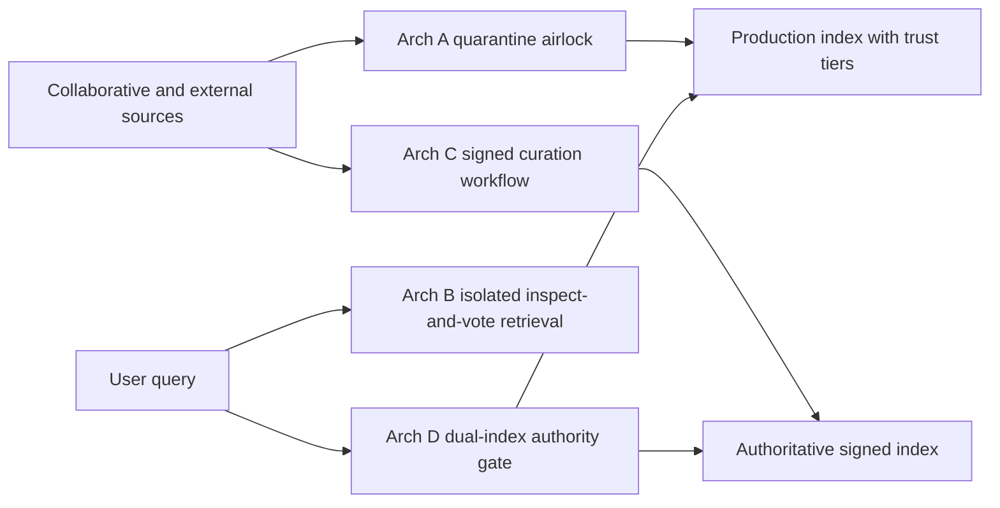
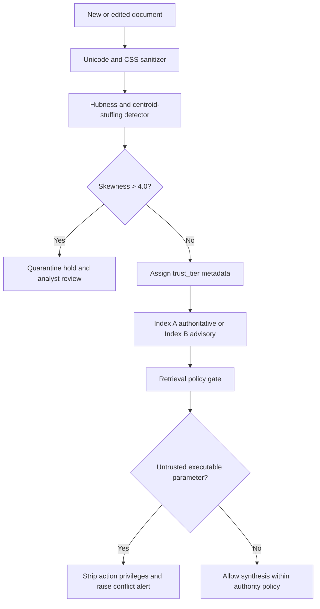
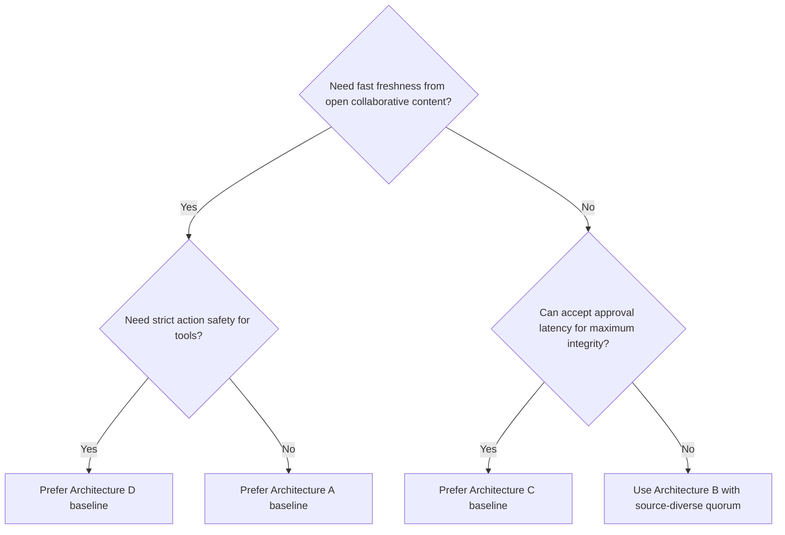

# Enterprise RAG Corpus Poisoning Defense Selection FAQ: Quarantine Trust-Tiers vs Isolated Vote Retrieval vs Signed Authoritative Corpus
> **Applies to**: enterprise RAG programs indexing collaborative repositories, support tickets, vendor portals, and external knowledge feeds into Azure AI Search.
> **Decision pressure**: prevent factual-looking poisoned passages from hijacking top-k synthesis and downstream tool parameters.
> **Core objective**: build a governance and retrieval architecture that preserves knowledge freshness while constraining corpus poisoning blast radius.

## 1. Executive summary
- Corpus poisoning often bypasses prompt-injection regex because malicious passages look operationally plausible.
- A few optimized poisoned chunks can dominate BM25/vector ranking without explicit jailbreak syntax.
- RAG defense must combine ingestion controls, trust semantics, and retrieval-time isolation.
- Architecture A delivers strongest ingestion-stage anomaly interception and trust-tier precedence.
- Architecture B delivers strongest query-time contamination isolation via per-source sub-readers.
- Architecture C offers near-zero poisoning risk but creates material freshness lag.
- Architecture D balances authoritative action safety with advisory collaborative breadth.
- Syntactic shields alone are insufficient against semantically plausible poisoning edits.
- Source-diverse quorum rules reduce sybil chunk-splitting amplification attacks.
- Dual-index privilege gating limits untrusted passages from driving executable actions.
- Rapid lineage eviction is mandatory to contain poisoned cache/session spread.
- Selection should balance freshness, defense depth, token cost, and operational burden.

## 2. Applicability and explicit non-goals
- Scope includes enterprise hybrid corpora with open wikis plus governed policy/runbook sources.
- Scope includes poisoning classes such as semantic stuffing, authority spoofing, and lineage sybiling.
- Scope includes ingestion quarantine, trust-tier metadata, and retrieval privilege gates.
- Scope includes cache/session purge lineage for post-detection response.
- Scope is distinct from legitimate bitemporal `as_of` policy supersession logic in section 3.4.
- Scope is distinct from user-turn runtime prompt-injection firewalls in section 3.3.
- Scope is distinct from pre-fine-tuning training dataset backdoor poisoning in section 3.3.
- Scope excludes legal records retention policy authoring details.
- Scope excludes generic endpoint DLP and network egress governance decisions.

## 3. Scenario and threat mechanics
- Insider or compromised vendor accounts inject high-ranking passages into collaborative sources.
- Poisoned text can mimic “urgent runbook updates” with no obvious policy-violating phrases.
- Retrieval pipelines may surface poisoned chunks in top-k across diverse enterprise queries.
- Downstream tool parameters can be hijacked by poisoned URLs, commands, or account IDs.
- Sparse document-owner controls allow sybil chunk multiplication to dominate voting.
- Cached responses can continue spreading poisoned guidance after source removal.
- Effective defense requires staged controls from ingestion through retrieval and post-incident purge.

## 4. Four architecture candidates
- **Architecture A**: ingestion quarantine airlock plus authority-scored trust-tier precedence.
- **Architecture B**: query-time isolated per-source inspect-and-vote robust retrieval.
- **Architecture C**: signed curated-only authoritative corpus with strict publishing attestation.
- **Architecture D**: dual-index physical segregation with privilege-downgraded untrusted retrieval.
- A focuses on pre-promotion hygiene and trust metadata governance.
- B focuses on cross-attention contamination suppression and source-diversity consensus.
- C focuses on maximal integrity at the expense of update velocity.
- D focuses on action-safety partitioning between authoritative and advisory evidence lanes.

## 5. Architecture A details (quarantine + trust-tier precedence)
- New and changed documents enter a staging quarantine pipeline before production indexing.
- Hidden-unicode/CSS obfuscation stripping normalizes deceptive payload encodings.
- Embedding hubness and near-centroid stuffing detectors flag anomalous broad-match chunks.
- Prompt Shields can assist but are not used as sole acceptance criteria.
- Documents receive immutable `trust_tier` labels (`0..3`) at promotion.
- Retrieval scoring enforces authority precedence so low-tier chunks cannot override high-tier policy facts.
- Quarantine outcomes and analyst overrides should be audit logged.
- A is strong for organizations requiring freshness with governed ingestion controls.

## 6. Architecture B details (isolated inspect-and-vote retrieval)
- Each source document is processed in isolated single-source LLM calls.
- Isolation prevents poisoned passages from dominating cross-attention with clean passages.
- Quorum synthesis requires support from source-diverse document lineages.
- `max_chunks_per_doc_owner = 1` limits sybil chunk-splitting leverage.
- Higher-authority confirmations can outvote larger low-authority chunk counts.
- Token cost can increase `2.5x–4.5x` depending on retrieval breadth.
- Multi-hop synthesis quality may degrade when facts are fragmented across sources.
- B is strongest when high-risk advisory content must remain queryable.

## 7. Architecture C details (signed authoritative corpus only)
- Only dual-control approved and signed documents enter production index.
- Publisher attestation via Cosign/Entra identity enforces provenance chain.
- Open wiki and raw ticket sources are excluded from authoritative retrieval.
- Poisoning risk is minimized because corpus ingress is tightly gated.
- Knowledge freshness can lag `3–14` days during approval workflows.
- Incident-response use cases may suffer when rapidly evolving field fixes are delayed.
- Governance overhead is high but predictable.
- C fits regulated domains prioritizing integrity over freshness.

## 8. Architecture D details (dual-index segregation and privilege gating)
- Index A contains authoritative records eligible to drive executable actions.
- Index B contains collaborative/external notes restricted to advisory interpretation.
- Deterministic contradiction checks compare B claims against A facts.
- Untrusted executable parameters from B are stripped or downgraded automatically.
- Conflict warnings are surfaced explicitly to users and operators.
- This preserves field signal while constraining tool-execution blast radius.
- Requires robust index-synchronization and policy testing discipline.
- D often serves as pragmatic baseline for mixed-governance enterprises.

## 9. Twelve-dimension architecture comparison matrix
| Dimension | Architecture A | Architecture B | Architecture C | Architecture D |
|---|---|---|---|---|
| Poisoning interception stage | Ingestion | Retrieval | Publishing | Retrieval/action gate |
| Freshness | High | High | Low | High |
| Integrity strictness | High | High | Highest | High |
| Sybil chunk resistance | Medium-high | Highest | High | Medium-high |
| Prompt-shield dependency | Low | Low | Low | Low |
| Tool-action safety | High | Medium | High | Highest |
| Token efficiency | High | Low | High | Medium-high |
| Operational complexity | Medium-high | High | Medium-high | Medium |
| Human review load | Medium | Medium | High | Medium |
| Dispute explainability | High | High | Highest | High |
| Blast-radius containment speed | High | Medium-high | High | Highest |
| TCO at large corpus scale | Medium | Medium-high | High governance | Medium |

## 10. Four-architecture topology overview


## 11. Quarantine, hubness detector, and dual-index authority gate pipeline


## 12. SA decision tree


### Q1. Hypergeometric poisoning takeover math and sybil chunk-splitting defense
- Poison takeover risk can be modeled by `P(poison >= τ in top-k)` under mixed clean/poison pools.
- Hypergeometric framing helps estimate probability without replacement in top-k retrieval.
- Sybil attackers inflate representation by splitting one malicious source into many chunks.
- Enforcing `max_chunks_per_doc_owner = 1` caps owner-level vote amplification.
- Source-lineage diversity should be weighted over raw chunk count.
- Quorum thresholds must consider authority tiers, not only majority frequency.
- This lowers takeover probability even when poisoned chunks are rank-optimized.
- Sensitivity analysis should be run for different `k`, `τ`, and owner cardinality.
- Governance policy should codify owner normalization as non-optional.

### Q2. Detecting gradient/HotFlip-style stuffing and query-hubness skew at ingestion
- Semantic stuffing attacks can create chunks that match disproportionate query slices.
- Historical query replay enables empirical hubness profiling at ingestion.
- A practical quarantine rule is `Skewness > 4.0` for k-occurrence distribution tails.
- Near-centroid density outliers should be combined with lexical novelty checks.
- Detection should be tuned per corpus domain to reduce false positives.
- Analyst feedback loops should update detector thresholds over time.
- Detector outputs must be stored with versioned model metadata.
- Quarantine should support expedited review for urgent operational updates.
- This approach catches factual-looking poison that avoids syntax signatures.

### Q3. Why syntactic shields miss factual-looking PoisonedRAG and precedence mitigation
- Syntactic prompt-shield classifiers focus on overt instruction artifacts.
- PoisonedRAG often uses benign prose with malicious factual substitutions.
- No explicit jailbreak tokens means regex or syntax shields can pass poisoned chunks.
- Authority precedence (`authoritative > collaborative`) resolves conflicting factual claims deterministically.
- Trust-tier scoring should be enforced before synthesis, not post-hoc.
- Contradiction detection should emit explicit rationale traces for operators.
- Shield outputs remain useful as auxiliary signals, not sole gatekeepers.
- This layered design improves both safety and explainability.
- Legal and audit teams favor deterministic precedence over opaque model heuristics.

### Q4. Rapid poison blast-radius eviction lineage and cache/session purge
- Poisoned chunk detection must trigger immediate lineage expansion.
- Lineage map should link `chunk_id -> run_id -> cached_response_id`.
- Automated purge should revoke stale cached responses and active session references.
- Incident runbooks should include tenant impact and replay regeneration steps.
- Purge execution logs must be immutable for post-incident verification.
- Re-indexing should block affected source owners until remediation review completes.
- Backfill regeneration should prioritize high-risk workflows first.
- Mean purge completion time is a critical resilience KPI.
- Fast lineage eviction dramatically reduces downstream contamination persistence.

### Q5. Production Python quarantine and dual-index authority-gated retrieval
- Ingestion pipeline should normalize text, score hubness, and set trust metadata.
- Promotion policy should route authoritative versus advisory content to separate indexes.
- Retrieval layer should enforce action privileges by source authority class.
- Contradictory advisory claims should trigger warnings and parameter stripping.
- Pipeline should emit structured evidence for every promotion and block decision.

```python
def quarantine_and_score(doc, query_replay_stats):
    normalized = strip_hidden_unicode_and_css(doc["text"])
    hubness = compute_hubness_score(normalized, query_replay_stats)
    skewness = compute_k_occurrence_skewness(normalized, query_replay_stats)
    if skewness > 4.0 or hubness["is_centroid_outlier"]:
        return {"decision": "quarantine", "reason": "hubness_or_skew_outlier"}
    trust_tier = assign_trust_tier(doc["source_type"], doc.get("publisher_attestation"))
    return {"decision": "promote", "trust_tier": trust_tier}
```

```python
def authority_gated_retrieve(query, idx_authoritative, idx_advisory):
    a_hits = idx_authoritative.search(query, top_k=8)
    b_hits = idx_advisory.search(query, top_k=8)
    advisory = [h for h in b_hits if not proposes_executable_params(h)]
    conflicts = detect_contradictions(a_hits, b_hits)
    return {"authoritative": a_hits, "advisory": advisory, "conflicts": conflicts}
```

```json
{
  "policy_contract": {
    "max_chunks_per_doc_owner": 1,
    "trust_precedence": ["tier0_signed_policy", "tier1_approved_runbook", "tier2_open_wiki", "tier3_external_ticket"],
    "on_conflict": "strip_untrusted_action_params_and_raise_alert"
  }
}
```

### Q6. Three-year TCO across 500K, 10M, and 100M indexed chunks
- Corpus scale amplifies both poisoning risk and governance/compute trade-offs.
- Strict curation lowers risk but increases freshness and review costs.
- Isolated voting improves resilience but adds significant token/runtime overhead.
- Dual-index gating keeps action safety high with moderate ongoing complexity.

| Indexed chunks | Architecture A | Architecture B | Architecture C | Architecture D |
|---|---:|---:|---:|---:|
| 500K | \$1.20M–\$1.90M | \$1.40M–\$2.30M | \$1.60M–\$2.50M | \$1.30M–\$2.00M |
| 10M | \$8.50M–\$13.20M | \$10.20M–\$15.90M | \$11.80M–\$18.40M | \$9.10M–\$14.10M |
| 100M | \$49.00M–\$74.00M | \$58.00M–\$88.00M | \$69.00M–\$104.00M | \$53.00M–\$80.00M |

| Indexed chunks | Typical reduction in poisoning-induced action incidents | Typical reduction in contaminated-response persistence time |
|---|---:|---:|
| 500K | 31%–48% | 28%–43% |
| 10M | 42%–61% | 38%–56% |
| 100M | 50%–69% | 45%–64% |

- Risk-adjusted TCO should include incident handling and customer trust erosion costs.
- Authority gating quality often yields higher ROI than purely increasing model size.
- Quarterly recalibration is needed as source mix and threat patterns evolve.

## 13. Day-0 rollout checklist
- Define source taxonomy and trust-tier contract (`0..3`) with business owners.
- Implement ingestion sanitizer for hidden unicode and style obfuscation artifacts.
- Deploy hubness/skewness detector with quarantine workflow and analyst queue.
- Configure authoritative/advisory dual-index mappings and ownership controls.
- Implement owner-normalized quorum constraints and contradiction signals.
- Wire action-parameter privilege stripping to retrieval policy engine.
- Define blast-radius lineage graph and purge automation hooks.
- Publish incident communication templates for poisoning response events.

## 14. Day-2 operations checklist
- Tune skewness and hubness thresholds based on adjudication outcomes.
- Track false-positive quarantine rate by source domain.
- Rehearse rapid lineage purge drills and recovery generation flows.
- Audit trust-tier assignment drift and attestation-chain validity.
- Monitor contradiction frequency between authoritative and advisory indexes.
- Review owner-sybil pressure indicators and chunk-normalization effectiveness.
- Evaluate token overhead trends for isolated voting pathways.
- Recompute TCO and risk posture quarterly with updated corpus distribution.

## 15. Good fit versus not for
| Category | Guidance |
|---|---|
| ✅ Good fit | Enterprises indexing mixed-governance corpora with executable downstream actions. |
| ✅ Good fit | Programs needing both high freshness and auditable poisoning controls. |
| ✅ Good fit | Teams willing to run ingestion governance plus retrieval policy gates. |
| ⛔ Not for | Static corpora with no collaborative or external ingestion inputs. |
| ⛔ Not for | Deployments that cannot maintain quarantine and lineage purge operations. |
| ⛔ Not for | Use cases where advisory and authoritative content are never mixed. |

## 16. Five-step implementation guide
1. Establish trust-tier taxonomy and source-attestation contracts.
2. Deploy ingestion quarantine with hubness/skewness anomaly detection.
3. Enforce owner-normalized voting and contradiction-aware retrieval policies.
4. Introduce dual-index authority gates for executable-parameter safety.
5. Operationalize lineage purge, incident drills, and quarterly recalibration.

## 17. Quarterly governance metric pack
- Track quarantine intake volume and promotion acceptance ratio.
- Track skewness/hubness outlier detection precision and false-positive rates.
- Track trust-tier distribution drift by source class.
- Track owner-normalized quorum override frequency.
- Track contradiction alerts between authoritative and advisory indexes.
- Track stripped executable-parameter event counts by tenant.
- Track poisoning incident count and mean detection delay.
- Track mean blast-radius purge completion time.
- Track cache/session contamination persistence before and after purge.
- Track affected run/session counts per poisoning event.
- Track isolated-vote token multiplier versus baseline retrieval.
- Track synthesis accuracy deltas under isolated per-source mode.
- Track signed attestation validation failures in authoritative corpus flow.
- Track analyst review backlog and median adjudication latency.
- Track re-poison attempts from previously quarantined source owners.
- Track customer-facing trust incident escalations and resolution time.
- Track post-incident rollback and replay regeneration success rate.
- Track index-sync drift between authoritative and advisory lanes.
- Track retrieval policy version drift and rollback frequency.
- Track high-risk workflow exposure to advisory-only content.
- Track quarterly TCO variance against forecast by architecture lane.
- Track legal/audit exceptions related to provenance controls.
- Track root-cause taxonomy for poisoning attempts by attack pattern.
- Track remediation SLA compliance for blocked poisoned sources.
- Track confidence level of contradiction detector outcomes.
- Track overlap ratio between quarantined chunks and high-traffic query intents.
- Track false-negative poisoning discoveries from post-incident retrospectives.
- Track reindex latency after trust-tier reclassification decisions.
- Track stale advisory-content usage in tool-invoking workflows.
- Track authoritative-source coverage gaps for critical operational domains.
- Track percentage of conflict alerts acknowledged within SLO.
- Track quarantine analyst consistency score across similar cases.
- Track emergency promotion usage and subsequent rollback frequency.
- Track cross-tenant contamination indicators in shared cache layers.
- Track retrieval abstain rate when evidence confidence is insufficient.
- Track policy-gate bypass attempts and block effectiveness.
- Track total advisory-only evidence cited in final responses.
- Track contradiction-alert suppression overrides and justifications.
- Track query cohorts most vulnerable to semantic stuffing.
- Track mean time to full lineage graph reconstruction during incidents.
- Maintain architecture decision records for all trust-policy changes.

## 18. Provenance
- `anonymized_reported`: formulas, attack/defense patterns, and TCO ranges are synthesized from anonymized enterprise RAG security programs with reproducible assumptions.
