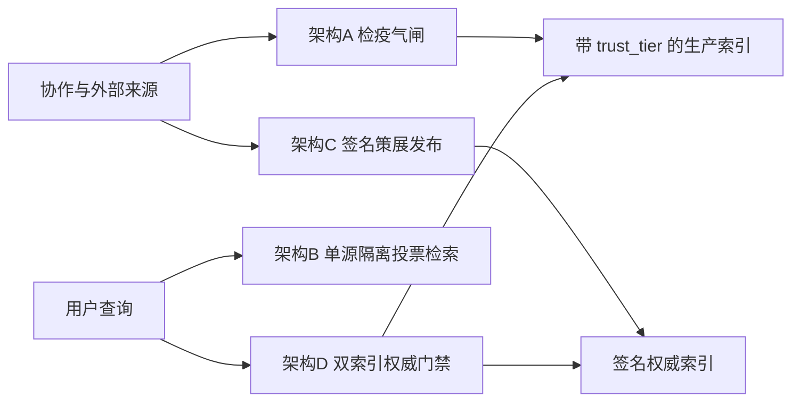
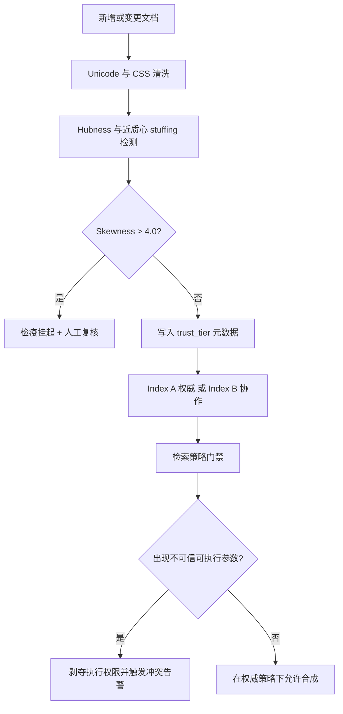
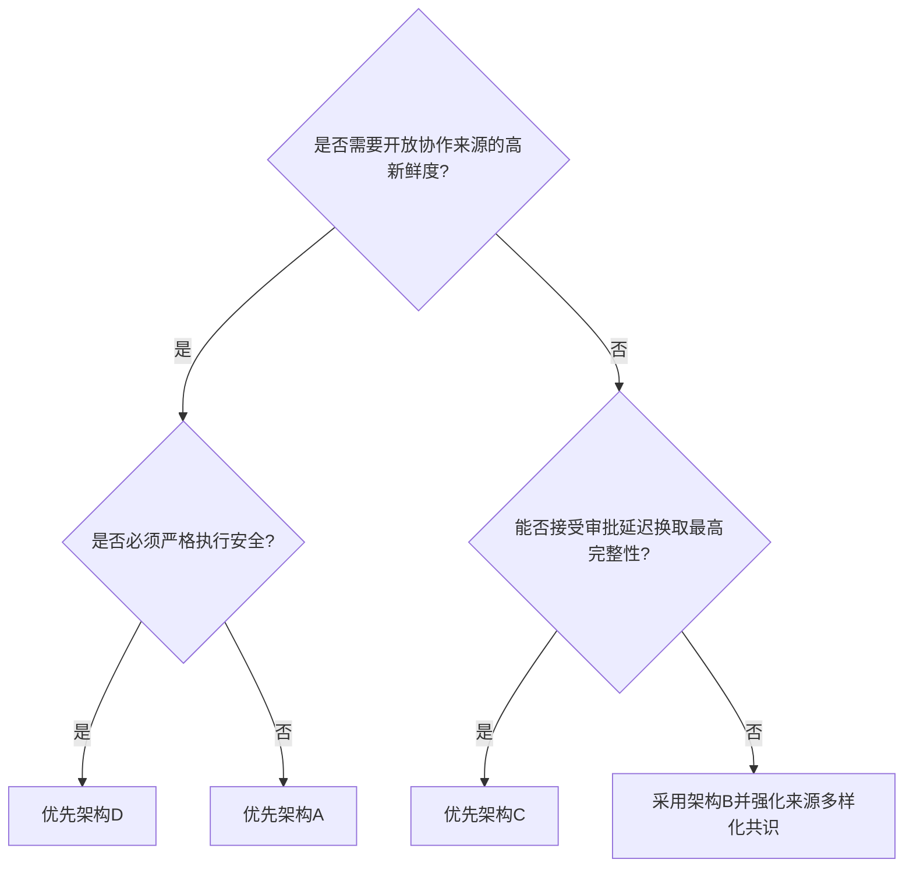

# 企业级 RAG 语料投毒防御选型 FAQ：隔离检疫信任分层 vs 单源隔离投票检索 vs 签名权威知识库
> **适用场景**：把协作文档、工单、供应商门户与外部资料汇入 Azure AI Search 的企业 RAG 平台。
> **决策压力**：阻断“看起来像正常事实更新”的投毒段落劫持 top-k 合成与下游工具参数。
> **核心目标**：在知识新鲜度与投毒风险之间建立可运营、可审计、可扩展的治理架构。

## 1. 执行摘要
- 语料投毒常绕过正则类注入检测，因为文本表面上“像真 runbook”。
- 少量高优化毒段可在 BM25/向量排序中持续占据前位。
- RAG 防御必须同时覆盖入库前、检索时、以及事后清除三个阶段。
- 架构 A 在入库前异常拦截与信任优先级治理上最稳健。
- 架构 B 在查询时隔离污染传播与共识检索上最强。
- 架构 C 在完整性最强，但会带来明显知识时效延迟。
- 架构 D 在可执行安全与协作广覆盖之间平衡较好。
- 仅靠语法型 prompt shield 无法拦住“事实外观”投毒编辑。
- 源多样化投票可显著削弱 Sybil 分片放大攻击。
- 双索引权限降级可阻止不可信段落直接驱动可执行动作。
- 必须具备快速 lineage 清除能力，控制缓存污染扩散。
- 最终选型应综合新鲜度、防御深度、token 成本与运维复杂度。

## 2. 适用边界与明确非目标
- 适用于“开放协作 + 权威知识”混合语料的企业 RAG 系统。
- 适用于语义 stuffing、权威伪装、来源 Sybil 分片等投毒模式。
- 适用于入库检疫、信任分层、检索权限门禁等组合控制。
- 适用于投毒发现后的缓存/会话 lineage 批量清除机制。
- 本文不等同于 3.4 中合法时态修订 `as_of` 过滤策略。
- 本文不等同于 3.3 中用户回合 prompt 注入运行时防火墙。
- 本文不等同于 3.3 中预训练/微调数据集后门投毒议题。
- 不覆盖法律保留策略编写本身。
- 不覆盖通用网络侧 DLP/出网治理设计。

## 3. 场景约束与威胁机制
- 内部账号被盗或供应商源被攻陷后可注入高排序毒段。
- 毒段可伪装成“紧急更新 runbook”且不含显式越权词。
- 检索链路会把毒段在多类查询上稳定推入 top-k。
- 下游工具可能被毒段中的 URL、CLI 参数、账号字段劫持。
- 若不做 owner 归一化，Sybil 分片可放大投票权重。
- 即使源文档下线，缓存答案仍可继续传播污染内容。
- 防御必须覆盖“入库前->检索时->清除恢复”全链路。

## 4. 四类候选架构
- **架构 A**：入库检疫气闸 + 来源权威评分与信任分层优先级。
- **架构 B**：查询时单源隔离 inspect-and-vote 鲁棒检索。
- **架构 C**：签名策展权威语料库（仅双审发布）。
- **架构 D**：双索引物理隔离 + 不可信检索权限降级。
- A 强在入库前卫生检查与 trust_tier 治理。
- B 强在跨注意力污染隔离与来源多样化共识。
- C 强在完整性最强，但知识更新速度最慢。
- D 强在工具执行安全与现场协作信息并存。

## 5. 架构 A 细节（检疫 + 信任优先级）
- 新增/变更文档先进入 staging 检疫流水线再考虑发布。
- 隐藏 Unicode/CSS 混淆清洗可恢复可审查文本表征。
- embedding hubness 与近质心 stuffing 检测用于异常筛查。
- Prompt Shields 可作为辅助信号，但不能作为唯一放行条件。
- 发布时写入不可变 `trust_tier`（`0..3`）元数据。
- 检索评分强制权威优先，低层级不得覆盖高层级政策事实。
- 检疫决策与人工覆核应完整审计留痕。
- A 适合要求高新鲜度且具备入库治理能力的组织。

## 6. 架构 B 细节（单源隔离投票检索）
- 每个来源文档在独立单源上下文中调用子阅读器模型。
- 隔离执行可阻止毒段在跨源注意力里“污染合并推理”。
- 合成结论需满足来源多样性 quorum 支持。
- `max_chunks_per_doc_owner = 1` 可抑制 Sybil 分片刷票。
- 高权威来源可压制低权威多数片段的错误结论。
- token 成本通常增加 `2.5x–4.5x`。
- 多跳事实被拆散时，综合推理质量可能下降。
- B 适合高风险协作内容必须可检索的场景。

## 7. 架构 C 细节（签名权威语料）
- 仅双审通过且具签名证明的文档可进入生产索引。
- 通过 Cosign/Entra 发布者身份链强化来源可追溯性。
- 开放 wiki 与原始工单不进入权威检索通道。
- 语料投毒风险接近最低水平。
- 代价是 `3–14` 天的知识新鲜度滞后。
- 对快速演进故障场景可能造成响应滞后。
- 治理成本高但流程确定性强。
- C 适用于完整性压倒一切的强监管行业。

## 8. 架构 D 细节（双索引 + 权限降级）
- Index A 存放可驱动执行动作的权威事实。
- Index B 存放协作/外部信息，仅可作为 advisory 输入。
- 对 B 与 A 的冲突执行确定性矛盾检测。
- B 中可执行参数（命令、URL、账号、SQL）自动剥夺执行权限。
- 冲突必须显式告警给用户与运维人员。
- 该模式兼顾现场经验信号与执行安全边界。
- 需要持续维护双索引同步与策略回归测试。
- D 常作为混合治理企业的实用基线。

## 9. 十二维架构对比矩阵
| 维度 | 架构 A | 架构 B | 架构 C | 架构 D |
|---|---|---|---|---|
| 投毒拦截阶段 | 入库前 | 检索时 | 发布前 | 检索/执行门禁 |
| 知识新鲜度 | 高 | 高 | 低 | 高 |
| 完整性强度 | 高 | 高 | 最高 | 高 |
| Sybil 抗性 | 中高 | 最高 | 高 | 中高 |
| 对语法盾依赖 | 低 | 低 | 低 | 低 |
| 工具执行安全 | 高 | 中 | 高 | 最高 |
| Token 经济性 | 高 | 低 | 高 | 中高 |
| 运维复杂度 | 中高 | 高 | 中高 | 中 |
| 人工审核负担 | 中 | 中 | 高 | 中 |
| 争议解释能力 | 高 | 高 | 最高 | 高 |
| 污染清除速度 | 高 | 中高 | 高 | 最高 |
| 大规模 TCO | 中 | 中高 | 高治理成本 | 中 |

## 10. 四架构拓扑总览


## 11. 检疫、hubness 检测与双索引权威门禁流水线


## 12. SA 决策树


### Q1. 超几何 takeover 概率与 Sybil 分片防御
- 可用超几何模型估算 `P(poison >= τ in top-k)` 风险上界。
- 该模型适用于“无放回” top-k 检索抽样近似分析。
- 攻击者会通过把单一来源切成多片来放大票数。
- `max_chunks_per_doc_owner = 1` 可硬性限制 owner 级放大。
- 投票应优先考虑来源独立性，而非片段数量。
- quorum 规则需叠加权威层级权重，而不是简单多数。
- 在 rank 被优化的情况下仍可显著降低 takeover 概率。
- 应对不同 `k`、`τ`、owner 数做敏感性分析。
- owner 归一化应固化为不可关闭的治理基线。

### Q2. 入库阶段如何检测 gradient/HotFlip 与 hubness stuffing
- 语义 stuffing 会制造“对很多查询都异常匹配”的伪通用片段。
- 历史查询回放可用于构建 hubness 基线分布。
- `Skewness > 4.0` 可作为可操作的检疫阈值起点。
- 近质心密度异常应结合词法新颖度共同判断。
- 阈值需按语料域持续调优以控制误报。
- 人工复核反馈应反哺检测阈值与特征权重。
- 检测结果必须记录模型版本与参数快照。
- 检疫流程应支持紧急修复文档的快速通道。
- 该方法可识别“无注入语法但有投毒语义”的样本。

### Q3. 为什么语法盾会漏检 PoisonedRAG，如何用权威优先化解
- 语法型 shield 主要捕捉显式指令注入特征。
- PoisonedRAG 往往是“事实外观伪造”，不含明显违规语法。
- 因此正则/语法检查常把毒段当作正常知识放行。
- `authoritative > collaborative` 的优先级可确定性化解冲突事实。
- trust_tier 必须在合成前执行，而非事后纠错。
- 矛盾检测应输出可解释理由，便于运维核查。
- shield 结果应作为辅因子而非唯一闸门。
- 分层治理比“全靠模型判断”更可审计。
- 法务与审计更容易接受确定性优先级策略。

### Q4. 投毒爆炸半径清除：`chunk_id -> run_id -> cached_response_id`
- 发现毒段后必须立即展开 lineage 影响面。
- lineage 图需把 `chunk_id -> run_id -> cached_response_id` 映射打通。
- 自动清除应覆盖缓存响应与在途会话引用。
- 事件 runbook 需包含租户影响统计与再生成计划。
- 清除执行日志必须不可变留存以支持审计。
- 涉事来源 owner 在整改前应禁止重新推广发布。
- 回补生成应优先处理高风险业务工作流。
- 平均清除完成时长是关键韧性 KPI。
- 快速 lineage 清除可显著缩短污染存活窗口。

### Q5. 生产级 Python 检疫 + 双索引权威门禁实现样例
- 入库流程需完成清洗、hubness 评分、trust 元数据写入。
- 发布策略应按权威/协作路由到不同索引。
- 检索层应按来源权威等级控制可执行参数权限。
- 协作索引与权威索引冲突时应强制告警并降级。
- 每次放行/拦截都应输出结构化证据记录。

```python
def quarantine_and_score(doc, query_replay_stats):
    normalized = strip_hidden_unicode_and_css(doc["text"])
    hubness = compute_hubness_score(normalized, query_replay_stats)
    skewness = compute_k_occurrence_skewness(normalized, query_replay_stats)
    if skewness > 4.0 or hubness["is_centroid_outlier"]:
        return {"decision": "quarantine", "reason": "hubness_or_skew_outlier"}
    trust_tier = assign_trust_tier(doc["source_type"], doc.get("publisher_attestation"))
    return {"decision": "promote", "trust_tier": trust_tier}
```

```python
def authority_gated_retrieve(query, idx_authoritative, idx_advisory):
    a_hits = idx_authoritative.search(query, top_k=8)
    b_hits = idx_advisory.search(query, top_k=8)
    advisory = [h for h in b_hits if not proposes_executable_params(h)]
    conflicts = detect_contradictions(a_hits, b_hits)
    return {"authoritative": a_hits, "advisory": advisory, "conflicts": conflicts}
```

```json
{
  "policy_contract": {
    "max_chunks_per_doc_owner": 1,
    "trust_precedence": ["tier0_signed_policy", "tier1_approved_runbook", "tier2_open_wiki", "tier3_external_ticket"],
    "on_conflict": "strip_untrusted_action_params_and_raise_alert"
  }
}
```

### Q6. `500K/10M/100M` 语料规模下三年 TCO 对比
- 规模越大，投毒风险与治理成本耦合越明显。
- 强策展可降风险，但新鲜度与审核成本会上升。
- 隔离投票可提升韧性，但会带来显著 token/runtime 开销。
- 双索引门禁在安全与效率之间通常性价比较高。

| 索引 chunk 规模 | 架构 A | 架构 B | 架构 C | 架构 D |
|---|---:|---:|---:|---:|
| 500K | \$1.20M–\$1.90M | \$1.40M–\$2.30M | \$1.60M–\$2.50M | \$1.30M–\$2.00M |
| 10M | \$8.50M–\$13.20M | \$10.20M–\$15.90M | \$11.80M–\$18.40M | \$9.10M–\$14.10M |
| 100M | \$49.00M–\$74.00M | \$58.00M–\$88.00M | \$69.00M–\$104.00M | \$53.00M–\$80.00M |

| 索引 chunk 规模 | 典型“投毒驱动动作事故”下降幅度 | 典型“污染响应存活时长”下降幅度 |
|---|---:|---:|
| 500K | 31%–48% | 28%–43% |
| 10M | 42%–61% | 38%–56% |
| 100M | 50%–69% | 45%–64% |

- 风险调整后的 TCO 必须计入事故处置与信任损耗成本。
- 相比单纯扩大模型，权威门禁常带来更高边际收益。
- 随来源结构变化应按季度重校参数与成本模型。

## 13. Day-0 上线清单
- 与业务 owner 定义 `0..3` trust_tier 与来源分类契约。
- 部署隐藏 Unicode 与样式混淆清洗器。
- 上线 hubness/skewness 检测、检疫队列与人工复核流程。
- 配置权威/协作双索引映射与权限边界。
- 落地 owner 归一化投票与矛盾检测信号。
- 将可执行参数剥离策略接入检索策略引擎。
- 建立 lineage 图与一键清除自动化钩子。
- 发布投毒事件对内外沟通模板与升级路径。

## 14. Day-2 运维清单
- 基于复核结果持续调优 skewness/hubness 阈值。
- 监控按来源域拆分的检疫误报率。
- 定期演练 lineage 清除与恢复生成流程。
- 审计 trust_tier 分配漂移与签名链有效性。
- 监控权威/协作索引矛盾频率趋势。
- 追踪 owner Sybil 压力指标与归一化效果。
- 评估单源隔离投票路径的 token 开销变化。
- 按季度重算 TCO 与风险暴露画像。

## 15. 适配场景与不适配场景
| 类别 | 建议 |
|---|---|
| ✅ Good fit | 混合治理语料且下游存在可执行动作的企业 RAG 平台。 |
| ✅ Good fit | 既要高新鲜度又要可审计投毒防御的业务。 |
| ✅ Good fit | 能持续运维入库治理与检索策略门禁的团队。 |
| ⛔ Not for | 完全静态、无协作与外部源接入的封闭语料。 |
| ⛔ Not for | 无法运维检疫与 lineage 清除流程的组织。 |
| ⛔ Not for | 权威与协作内容永不混合的单一知识场景。 |

## 16. 五步落地指南
1. 定义信任分层与来源签名契约。
2. 部署入库检疫与 hubness/skewness 异常检测。
3. 落地 owner 归一化投票与矛盾感知检索策略。
4. 引入双索引权威门禁保障可执行参数安全。
5. 固化 lineage 清除演练与季度参数重校机制。

## 17. 季度治理指标包
- 追踪检疫入口量与最终放行比例。
- 追踪 skewness/hubness 检测精度与误报率。
- 追踪 trust_tier 在各来源类型的分布漂移。
- 追踪 owner 归一化后 quorum 覆写触发频率。
- 追踪权威与协作索引间矛盾告警数量。
- 追踪按租户分层的可执行参数剥离次数。
- 追踪投毒事件数量与平均发现时延。
- 追踪爆炸半径清除平均完成时长。
- 追踪清除前后缓存/会话污染存活时长变化。
- 追踪单次投毒事件影响的 run/session 数。
- 追踪单源隔离投票相对基线的 token 倍率。
- 追踪隔离模式下合成准确率变化。
- 追踪权威语料签名校验失败率。
- 追踪人工复核 backlog 与中位判定时延。
- 追踪历史被检疫来源 owner 的再投毒尝试率。
- 追踪客户侧信任事件升级数量与处置时长。
- 追踪事件后回滚与再生成成功率。
- 追踪双索引同步漂移与修复频率。
- 追踪检索策略版本漂移与回滚次数。
- 追踪高风险流程暴露到 advisory 内容的比例。
- 追踪按架构通道拆分的季度 TCO 偏差。
- 追踪与来源可信性相关的法务/审计例外项。
- 追踪投毒根因分类在各攻击模式的占比。
- 追踪被阻断来源整改 SLA 达成率。
- 追踪矛盾检测结果的置信度分布。
- 追踪被检疫片段与高流量查询意图的重叠比例。
- 追踪事后复盘发现的漏检投毒样本比例。
- 追踪 trust_tier 重分类后的再建索引时延。
- 追踪触发工具执行流程中“过期 advisory 内容”使用率。
- 追踪关键业务域中权威来源覆盖缺口比例。
- 追踪冲突告警在 SLO 内被确认处理的比例。
- 追踪检疫分析员对相似案例的一致性评分。
- 追踪紧急放行通道使用次数与后续回滚频率。
- 追踪共享缓存层跨租户污染迹象指标。
- 追踪证据置信不足时检索 abstain 触发率。
- 追踪策略门禁绕过尝试与阻断有效率。
- 追踪最终回答中 advisory-only 证据引用占比。
- 追踪冲突告警被抑制覆写的次数与原因。
- 追踪最易受语义 stuffing 影响的查询族群。
- 追踪事件期间完成 lineage 图重建的平均时长。
- 维护 trust-policy 变更的架构决议记录。

## 18. 数据来源声明
- `anonymized_reported`：文中公式、攻防模式与 TCO 区间来自匿名化企业 RAG 安全项目，采用可复现假设归纳。
