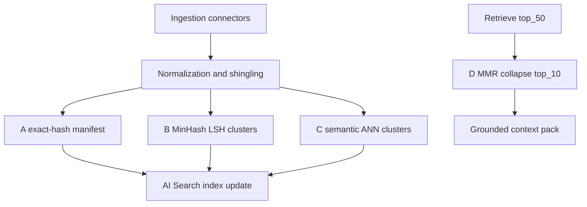
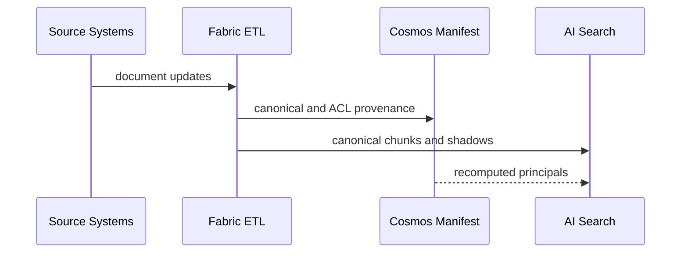
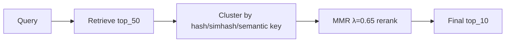

# Enterprise RAG near-duplicate corpus hygiene and ACL-safe deduplication selection FAQ: Fabric MinHash LSH vs AI Search MMR collapse vs semantic clustering

> 🌐 **Language Switch**: [中文](./enterprise-rag-near-duplicate-corpus-hygiene-acl-safe-dedup-fabric-minhash-lsh-vs-ai-search-subindex-mmr-vs-embedding-ann-clustering-selection-faq.md) | **English (current)**
> **Audience**: Cloud & AI Solution Architects, enterprise knowledge-platform teams, retrieval engineers, and security governance leads.
> **Problem frame**: SharePoint, Teams, OneDrive, Confluence, and email attachments often carry `3x–8x` redundant copies that cannibalize `top_k` slots and inflate vector-index RAM.

## 1. Why near-duplicate corpora distort enterprise RAG

Enterprise RAG systems ingest many copied policy decks, cloned wiki pages, and version-stamped attachments that differ only by tiny edits or branding deltas.

Without deduplication, retrieval windows are consumed by same-family evidence, creating apparent confidence while reducing true informational diversity.

This echo-chamber effect drives repetitive grounding, weak contradiction detection, and unstable answer synthesis for policy and contract workloads.

At scale, redundant vectors expand HNSW memory footprints and increase replica costs even before query quality degradation becomes obvious.

## 2. Four architecture options and zero-trust boundaries

Architecture A prioritizes deterministic safety by merging only byte-identical normalized chunks and recomputing ACLs from source manifests.

Architecture B addresses template forks through lexical near-duplicate clustering and span-level boilerplate/delta separation.

Architecture C captures semantic duplicates across format conversions with authority-aware canonical winner election.

Architecture D preserves strict document-level ACL isolation by avoiding ingestion merges and collapsing duplicates only at query time.

## 3. Reference architecture: offline hygiene plus online diversity collapse



This layered model allows teams to combine A/B/C offline hygiene while retaining D as an online safety and diversity guardrail.

Operationally, every canonicalization action should emit provenance fields for source ACL lineage, cluster reason, and revocation replay IDs.

## 4. Architecture A: exact normalized hash dedup with ACL recomputation

A uses normalized `SHA-256` as canonical IDs and stores per-source ACL provenance in manifest records keyed by chunk identity.

When one source document permission changes, the platform recomputes `allowed_principals` incrementally without re-embedding vectors.

The primary strength is deterministic security behavior with low algorithmic uncertainty.

The limitation is that A does not remove near-duplicates unless they are byte-identical after normalization.

## 5. Architecture B: MinHash+LSH near-duplicate clustering with delta spans

B applies k-shingling and `128`-perm MinHash signatures, then runs LSH with `b=16, r=8` to produce scalable candidate buckets.

Clustered candidates are merged via Union-Find and split into boilerplate and delta spans through diff-aware segment isolation.

Boilerplate spans may be canonicalized, while delta spans must retain source ACL ownership to prevent cross-document privilege leakage.

B is highly effective for large template-heavy corpora but requires disciplined offline data engineering and parameter governance.

## 6. Architecture C: semantic ANN clusters with authority-tier election

C identifies semantically equivalent chunks across OCR, PDF, DOCX, and paraphrased variants when lexical fingerprints diverge.

With `cosine >= 0.96` and authority hierarchy rules, canonical winners can be elected while retaining ACL-scoped shadow pointers.

If a user lacks access to the elected winner, retrieval can fall back to an authorized shadow document without breaking answer traceability.

C offers strong cross-format coverage but depends on robust governance for authority tiers and escalation review.

## 7. Architecture D: query-time over-fetch and MMR collapse

D performs no ingestion-time merge state and instead retrieves broader candidate sets such as `top_k=50` before diversity collapse.

MMR or SimHash-based collapse then produces a diversified final set, often `top_10`, while preserving native ACL enforcement.

This approach minimizes merge-related ACL risk but keeps storage overhead high and shifts work to query-time compute.

D is often a safe starting point for regulated teams before introducing offline canonicalization complexity.

## 8. Quantitative models: LSH math, MMR, diversity, and cost

LSH threshold approximation is `s* ≈ (1/b)^(1/r)`; with `b=16, r=8`, the threshold is near `0.707`.

Candidate hit probability is `1-(1-s^r)^b`, which helps estimate false-negative behavior across similarity bands.

Effective context diversity can be tracked as `ECD = unique_clusters_in_top_k / k` to quantify echo-chamber reduction.

Index footprint can be modeled as `VectorCost = VectorCount * RAM_per_vector * ReplicaFactor`, where dedup quality directly affects VectorCount.

## 9. Twelve-dimension quantitative comparison matrix

| Dimension | Architecture A: normalized hash dedup | Architecture B: MinHash+LSH clustering | Architecture C: semantic ANN clustering | Architecture D: query-time MMR collapse |
|---|---|---|---|---|
| Dedup scope | Only `Jaccard=1.0` byte-identical | `0.80–0.99` near-duplicate templates | Cross-format semantic near-duplicates | No ingestion merge, retrieval-only collapse |
| ACL leakage risk | Low with ACL recompute | Low-medium with delta-span isolation | Medium with authority election and shadow pointers | Lowest due to native ACL isolation |
| Offline complexity | `O(N)` hash scan | `O(N)` bucket candidates + Union-Find | Approx. `O(N log N)` neighborhood search | Near-zero offline compute |
| Query latency impact | Low, near baseline | Low with smaller index footprint | Medium with semantic overlay resolution | Medium-high with `top_k=50` collapse |
| HNSW RAM savings | `12%–22%` | `28%–46%` | `24%–40%` | `0%–8%` |
| False merge risk | Near zero | Parameter-sensitive (`b,r`) | Threshold and policy sensitive | No merge risk |
| Permission revocation cost | Low with reverse manifest index | Medium due to cluster/delta recompute | Medium-high due to primary-switch mechanics | Low with no merge state |
| Scale fit | `10M–200M` chunks | `50M–500M` chunks | `20M–300M` chunks | `10M–150M` chunks |
| Cross-format coverage | Low to medium | Medium, template heavy | High for OCR/PDF/DOCX paraphrase sets | High, retrieval-layer dependent |
| Engineering complexity | Medium | High | High | Medium |
| 3-year TCO | Medium-low | Medium | Medium-high | Medium-high |
| Best-fit workload | Compliance-first precise revocation | Massive template-fork hygiene | Cross-format enterprise knowledge | Zero-merge governance organizations |

## 10. Data flow and governance flow from ingestion to revocation





Teams should correlate offline canonicalization identifiers with online collapse identifiers to preserve full-path observability during incident reviews.

## 11. Production implementation: PySpark MinHash and ACL-safe split

```python
from pyspark.sql import functions as F
from pyspark.ml.feature import MinHashLSH

df = spark.read.parquet('abfss://chunks/raw')
df = df.withColumn('norm_text', F.lower(F.regexp_replace('text', '\\s+', ' ')))
df = df.withColumn('shingles', build_shingles_udf('norm_text'))
lsh = MinHashLSH(inputCol='shingles', outputCol='hashes', numHashTables=16)
fit = lsh.fit(df)
cand = fit.approxSimilarityJoin(df, df, 0.2, distCol='jaccard_dist')
clusters = union_find_from_edges(cand)
segments = split_boilerplate_and_delta(clusters)
safe = apply_acl_per_source(segments)
safe.write.mode('overwrite').parquet('abfss://chunks/safe')
```

The critical control is not clustering speed but ACL lineage integrity for every retained delta span and every replay operation.

## 12. Online implementation: AI Search MMR collapse and labels

```python
def mmr_select(candidates, query_vec, top_n=10, lam=0.65):
    selected = []
    while len(selected) < top_n and candidates:
        best = max(candidates, key=lambda d: lam*cos(query_vec, d['vec']) - (1-lam)*max_sim(d, selected))
        selected.append(best)
        candidates.remove(best)
    return selected
```

```json
{
  "search": "termination policy exception",
  "vectorQueries": [{"kind":"vector", "fields":"contentVector", "k": 50}],
  "filter": "allowed_principals/any(p: search.in(p, 'user:A,user:B'))",
  "select": "chunk_id,cluster_id,source_id,collapse_reason,score"
}
```

Production traces should emit `cluster_id` and `collapse_reason` so relevance regressions can be tied to concrete collapse decisions.

## 13. Scenario A: 10M–80M chunk template-fork governance

Scenario A covers a mixed manufacturing-retail portfolio with 10M to 80M chunks and high template reuse across subsidiaries.

The team adopted A+B and observed a vector-count reduction near 34%, with improved evidence spread in top contexts.

The practical benefit was not just lower infrastructure spend but more stable policy answers with fewer redundant citations.

Permission revocation remained deterministic because source-level ACL manifests enabled incremental recompute in minute-level windows.

## 14. Scenario B: 80M–400M chunk global corpus governance

Scenario B addresses a global service enterprise operating 80M to 400M chunks in multilingual, cross-format knowledge systems.

The platform combined C and D to detect semantic duplicates while preserving strict ACL behavior through query-time collapse safeguards.

This strategy reduced echo-chamber concentration and maintained a zero-escalation record for ACL boundary violations in regulated regions.

The three-year assessment showed higher engineering cost but better long-run balance among safety, answer quality, and operating efficiency.

### Three-year TCO (10M / 80M / 400M chunks)

| Path | 10M chunks | 80M chunks | 400M chunks | 3-year cost | Primary value |
|---|---:|---:|---:|---:|---|
| A exact dedup | 0.9M | 4.6M | 17.8M | 23.3M | Deterministic revocation and low ops friction |
| B LSH dedup | 1.2M | 5.1M | 18.9M | 25.2M | Strong near-duplicate suppression |
| C semantic clustering | 1.4M | 5.9M | 20.6M | 27.9M | Best cross-format duplicate detection |
| D query collapse | 1.1M | 6.3M | 24.4M | 31.8M | Strict ACL isolation certainty |
| A+B+C+D hybrid | 1.6M | 6.2M | 21.7M | 29.5M | Balanced safety, quality, and cost |

## 15. Rollout checklist, worked Q&A, fit boundaries, and runtime alerts

### Day-0

1. Build source-to-ACL ownership mapping for all ingestion systems.

2. Define canonical chunk and delta-span contracts with replay semantics.

3. Baseline LSH and semantic thresholds using sampled replay sets.

4. Add cluster and collapse labels to online retrieval traces.

5. Wire revocation events to manifest recomputation workflows.

6. Create dashboards for diversity, cost, and ACL risk metrics.

### Day-1

1. Track near-duplicate ratio, ECD, and collapse rates daily.

2. Sample delta spans and verify source ACL retention.

3. Review top-query evidence spread to locate echo-cluster hotspots.

4. Validate HNSW memory trend and replica budget impact.

5. Escalate ambiguous semantic winner elections for governance review.

6. Record revocation recompute latency and failure signatures.

### Day-2

1. Retune LSH bands weekly based on miss and merge telemetry.

2. Review semantic thresholds monthly with authority-policy drift analysis.

3. Optimize MMR lambda monthly using grounded answer outcomes.

4. Run quarterly ACL replay and disaster recovery drills.

5. Update quarterly TCO and capacity baselines.

6. Feed audit learnings into retrieval policy and runbooks.

### Q1: How do we estimate the LSH candidate threshold for `b=16, r=8`?

Use `s* ≈ (1/b)^(1/r)`; with these values, `s* ≈ (1/16)^(1/8) ≈ 0.707`.

This means similarity above roughly 0.7 is likely to enter candidate buckets, which fits a recall-then-rerank near-duplicate pipeline.

### Q2: How is LSH hit probability modeled?

Use `P(hit)=1-(1-s^r)^b`, where `s` is Jaccard similarity.

With `s=0.85`, `r=8`, and `b=16`, hit probability is around 0.95, which substantially reduces near-duplicate misses.

### Q3: How do we compute HNSW memory savings?

Use `Saving = (Vectors_before - Vectors_after) / Vectors_before`.

If vectors drop from 80M to 50M after deduplication, memory savings are about 37.5%, often translating directly into lower RAM and replica cost.

### Q4: How does MMR reduce echo-chamber retrieval?

Use `Score = λ*sim(q,d) - (1-λ)*max_sim(d,S)` where `S` is the selected set.

At `λ=0.65`, most deployments get a practical relevance-diversity balance and fewer slot-cannibalization clusters in final context windows.

### Q5: What is the key ACL-safety boundary for deduplication?

Merge ACLs only for byte-identical canonical chunks; treat near-duplicate deltas as isolated spans.

That boundary prevents privileged clauses from leaking even when documents share large boilerplate regions.

### Q6: How should teams choose between A/B/C/D?

Start with compliance and revocation constraints, then optimize for corpus scale and format entropy.

A/B fits lexical redundancy-heavy corpora, C fits cross-format semantic duplication, and D fits organizations that prohibit ingestion-time merge state.

### Good fit vs Not for

Good fit: enterprise RAG programs with high redundancy, strict ACL requirements, and measurable diversity and auditability objectives.

Not for: small corpora with simple permissions and low sensitivity to retrieval redundancy effects.

A staged rollout that starts with deterministic ACL-safe controls and then adds semantic optimization usually produces better operational stability than big-bang migration.

### Runtime alert dictionary

| Alert key | Trigger condition | Immediate action | Owner |
|---|---|---|---|
| `acl_recompute_lag` | ACL recomputation exceeds SLA | Trigger replay and block affected retrieval path | Retrieval Platform |
| `delta_acl_mismatch` | Delta span ACL differs from source | Quarantine cluster and run manual review | Security Governance |
| `lsh_bucket_explosion` | LSH candidate buckets surge abnormally | Rollback parameters and rerun sampled validation | Data Engineering |
| `semantic_primary_drift` | Primary winner flips too frequently | Freeze election and review authority rules | Knowledge Governance |
| `mmr_diversity_drop` | ECD remains below threshold | Increase diversity penalty and expand over-fetch | Retrieval Engineering |
| `vector_ram_spike` | Vector RAM exceeds budget | Accelerate dedup batches and trim redundant replicas | Platform Operations |
| `cross_source_leak_risk` | Cross-source ACL leak signal detected | Force query-time collapse route and alert SOC | Security Response |
| `manifest_reverse_index_gap` | Manifest reverse index missing keys | Pause revocation flow and backfill index | Data Platform |

### Source references (captured on 2026-11-24)

1. Azure AI Search vector overview: https://learn.microsoft.com/azure/search/vector-search-overview

2. Azure AI Search relevance: https://learn.microsoft.com/azure/search/search-relevance-overview

3. Microsoft Fabric Spark overview: https://learn.microsoft.com/fabric/data-engineering/spark-overview

4. Azure Event Grid overview: https://learn.microsoft.com/azure/event-grid/overview

5. Cosmos DB data modeling: https://learn.microsoft.com/azure/cosmos-db/nosql/modeling-data
