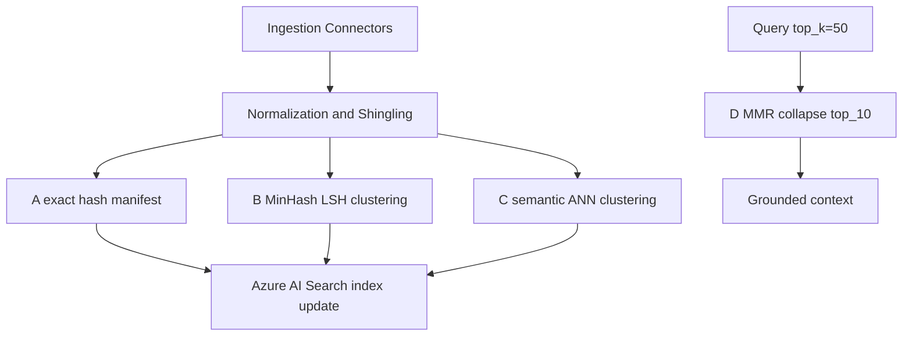
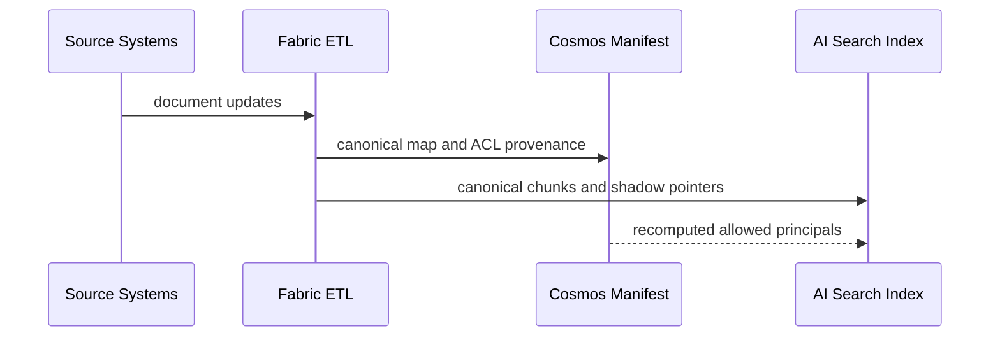

# 企业 RAG 近重复语料治理与 ACL 安全去重选型 FAQ：Fabric MinHash LSH vs AI Search 子索引 MMR vs 语义聚类

> 🌐 **Language Switch**：**中文（当前）** | [English](./enterprise-rag-near-duplicate-corpus-hygiene-acl-safe-dedup-fabric-minhash-lsh-vs-ai-search-subindex-mmr-vs-embedding-ann-clustering-selection-faq.en.md)
> **适用对象**：Cloud & AI Solution Architect、企业知识平台团队、检索与安全治理团队。
> **问题背景**：SharePoint、Teams、OneDrive、Confluence 与邮件附件中存在 `3x–8x` 复制版本，导致 `top_k` 被同源副本挤占，并放大向量索引成本。

## 1. 近重复语料为什么会让企业 RAG 失真

在企业知识库中，同一政策、演示材料和流程文档会被多部门复制并多次改名，检索系统若不处理近重复，会把上下文窗口浪费在同义副本上。

这种 slot cannibalization 让模型看到的证据看似很多，实际上信息增量很低，容易形成“回声室答案”，并掩盖真正关键的差异条款。

同时，重复副本会放大向量数量与 HNSW 常驻内存，在跨区域多副本部署下，索引成本会被重复内容持续放大。

更重要的是，若把近重复直接合并 ACL，极易出现权限上卷，把本应受限的段落暴露给原本无权访问的用户。

## 2. 四类去重架构与安全边界

架构 A 只处理字节一致副本，强调权限可追溯与权限回收确定性。

架构 B 处理模板分叉与版本漂移，核心是把共享 boilerplate 与敏感 delta 分离治理。

架构 C 解决跨格式语义重复，适合 OCR、扫描件与编辑稿并存的知识资产池。

架构 D 不做入库合并，以查询时折叠换取最强 ACL 隔离确定性。

## 3. 总体参考架构：离线治理与在线多样性折叠



该分层允许团队根据风险偏好组合使用 A/B/C，并在在线层保留 D 作为最后一道多样性与安全保险。

治理上建议把每次 canonicalization 的来源集合、ACL 映射与撤销证据写入可审计 manifest。

## 4. 架构 A：归一化哈希去重与 ACL 反向重算

A 以归一化文本的 `SHA-256` 为主键，把完全相同的 chunk 聚合到一个 canonical 节点，并记录每个来源文档的 ACL 快照。

权限回收时，只需更新 manifest 中受影响来源并重算 canonical 的 `allowed_principals`，不需要重新嵌入向量。

A 的优势是安全边界清晰、实现成本可控，适合作为所有组织的默认第一阶段治理。

A 的局限是无法处理“几乎相同但不完全相同”的模板分叉。

## 5. 架构 B：MinHash+LSH 近重复聚类与 Delta Span 拆分

B 先用 `k-shingle` 构建集合签名，再以 `128` 维 MinHash 和 `b=16, r=8` 做 LSH 候选召回。

候选簇经 Union-Find 合并后，再做 span 级 diff，把 boilerplate 与 delta 子段拆开并继承各自来源 ACL。

这种拆分避免了“模板主体共享导致敏感条款泄漏”的常见风险。

B 对超大规模模板文档库效果显著，但需要成熟的数据工程与离线调参能力。

## 6. 架构 C：语义 ANN 聚类与权威源胜者策略

C 用语义向量近邻捕获跨格式重复，例如 PDF OCR 版与 DOCX 原版、邮件正文与会议纪要摘录。

当 `cosine >= 0.96` 且权威层级明确时，可选取权威源为主副本，同时保留 ACL 受限的 shadow pointer。

若查询用户无权访问主副本，可自动降级到其有权访问的次优副本，保证答案可解释且不越权。

C 的关键在于权威层级策略必须有业务治理背书，避免纯向量相似度主导错误合并。

## 7. 架构 D：查询时 over-fetch + MMR 多样性折叠

D 在索引阶段不做合并，查询阶段先 over-fetch（例如 `top_k=50`），再通过 MMR 或 SimHash 折叠到最终 `top_10`。

这种模式几乎杜绝 ACL 状态机复杂度，适合监管场景对权限确定性要求极高的组织。

代价是索引规模与查询计算压力较高，需要更大缓存和更严谨的查询优化。

D 常作为过渡路径：先保证安全，再逐步引入 A/B/C 的离线治理能力。

## 8. 关键公式：LSH 命中概率、MMR、多样性与成本模型

LSH 阈值近似可写为 `s* ≈ (1/b)^(1/r)`；在 `b=16,r=8` 下约为 `0.707`。

候选命中概率可写为 `P(hit)=1-(1-s^r)^b`，用于评估不同相似度下的召回曲线。

多样性可定义 `ECD = unique_clusters_in_top_k / k`，用于衡量 Echo-Chamber 缓解效果。

成本可写为 `IndexCost = VectorCount * MemoryPerVector * ReplicaFactor`，去重策略直接影响 VectorCount。

## 9. 12 维定量对比矩阵

| 维度 | 架构 A：归一化哈希去重 | 架构 B：MinHash+LSH 聚类 | 架构 C：语义 ANN 聚类 | 架构 D：查询时 MMR 折叠 |
|---|---|---|---|---|
| 去重范围 | 仅 `Jaccard=1.0` 字节同一 | `0.80–0.99` 近重复模板 | 跨格式语义近似副本 | 不入库去重，仅结果折叠 |
| ACL 泄漏风险 | 低：按源 ACL 重算 | 低中：需 Delta Span 保隔离 | 中：主副本投票要影子指针 | 最低：保持原文档 ACL |
| 离线计算复杂度 | `O(N)` 哈希扫描 | `O(N)` 候选桶 + Union-Find | 近似 `O(N log N)` 邻域搜索 | 几乎无离线计算 |
| 查询时延影响 | 低，近似基线 | 低，索引规模下降 | 中，额外语义映射开销 | 中高，`top_k=50` 后折叠 |
| HNSW 内存节省 | 约 `12%–22%` | 约 `28%–46%` | 约 `24%–40%` | 约 `0%–8%` |
| 误合并概率 | 接近 `0` | 取决于 `b,r` 参数 | 取决于阈值与权威规则 | 无合并风险 |
| 权限回收成本 | 低：manifest 反向索引 | 中：簇与 delta 需重算 | 中高：主副本切换复杂 | 低：无合并状态 |
| 适配规模 | `10M–200M` chunks | `50M–500M` chunks | `20M–300M` chunks | `10M–150M` chunks |
| 跨源格式支持 | 低：同构文本最佳 | 中：对模板友好 | 高：OCR/PDF/DOCX 都可 | 高：依赖检索层 |
| 工程复杂度 | 中 | 高 | 高 | 中 |
| 三年 TCO | 中低 | 中 | 中高 | 中高 |
| 推荐场景 | 合规优先与精确回收 | 大规模模板洪泛治理 | 跨格式知识资产治理 | 零合并策略组织 |

## 10. 数据流与治理流：从摄取到权限回收




流程治理上要把“离线去重证据”和“在线折叠证据”统一进可观测标签，避免排障时只看到一半链路。

## 11. 生产实现：PySpark MinHash + ACL 安全切分

```python
from pyspark.sql import functions as F
from pyspark.ml.feature import MinHashLSH

df = spark.read.parquet('abfss://chunks/raw')
df = df.withColumn('norm_text', F.lower(F.regexp_replace('text', '\\s+', ' ')))
df = df.withColumn('shingles', build_shingles_udf('norm_text'))
model = MinHashLSH(inputCol='shingles', outputCol='hashes', numHashTables=16)
fitted = model.fit(df)
candidates = fitted.approxSimilarityJoin(df, df, 0.2, distCol='jaccard_dist')
clusters = union_find_from_edges(candidates)
delta_spans = split_boilerplate_and_delta(clusters)
safe_chunks = apply_acl_by_source(delta_spans)
safe_chunks.write.mode('overwrite').parquet('abfss://chunks/safe')
```

实现重点不是“聚得多快”，而是确保每个 delta span 都带着原始 ACL 来源，且可在权限变化时可逆重算。

## 12. 在线检索实现：AI Search MMR 折叠与告警标签

```python
def mmr_select(candidates, query_vec, top_n=10, lam=0.65):
    selected = []
    while len(selected) < top_n and candidates:
        best = max(
            candidates,
            key=lambda d: lam * cos(query_vec, d['vec']) - (1-lam) * max_sim(d, selected)
        )
        selected.append(best)
        candidates.remove(best)
    return selected
```

```json
{
  "search": "vendor termination clause",
  "vectorQueries": [{"kind":"vector", "fields":"contentVector", "k": 50}],
  "filter": "allowed_principals/any(p: search.in(p, 'user:A,user:B'))",
  "select": "chunk_id,cluster_id,source_id,allowed_principals,score"
}
```

在线层建议输出 `cluster_id` 与 `collapse_reason`，便于解释为什么某些高分副本被折叠。

## 13. 场景 A：10M–80M chunks 的跨业务模板洪泛治理

场景 A：制造与零售联合集团在 10M 到 80M chunks 范围内，模板制度文档占比高，且跨区域复制频繁。

团队采用 A+B 组合后，索引向量规模下降约 34%，`top_10` 的有效信息覆盖率明显提升。

治理收益体现在两端：一端是成本下降，另一端是答案稳定性提升并减少“同义证据堆叠”的误导。

权限审计方面，因采用 source-level ACL 映射，回收权限后可在分钟级完成重算并避免重嵌入。

## 14. 场景 B：80M–400M chunks 的全球知识副本治理

场景 B：跨国服务企业在 80M 到 400M chunks 规模下运行多语言知识底座，存在 OCR 版与编辑版并存问题。

团队采用 C+D 组合，先在语义层识别跨格式近重复，再在查询端执行 MMR 折叠确保上下文多样性。

该策略显著降低了回声室检索，并在高监管区域维持 ACL 零越界记录。

三年期评估显示，混合路径虽然工程复杂，但在高规模阶段更能平衡安全、性能与成本。

### 三年 TCO（10M / 80M / 400M chunks）

| 架构路径 | 10M chunks | 80M chunks | 400M chunks | 三年成本 | 主要收益 |
|---|---:|---:|---:|---:|---|
| A 精确去重 | 0.9M | 4.6M | 17.8M | 23.3M | 权限回收稳定、运维简单 |
| B LSH 去重 | 1.2M | 5.1M | 18.9M | 25.2M | 近重复清理效果最佳 |
| C 语义聚类 | 1.4M | 5.9M | 20.6M | 27.9M | 跨格式重复识别最强 |
| D 查询折叠 | 1.1M | 6.3M | 24.4M | 31.8M | ACL 边界最保守 |
| A+B+C+D 组合 | 1.6M | 6.2M | 21.7M | 29.5M | 安全、质量、成本平衡 |

## 15. 落地清单、Q&A、适配边界与运行告警字典

### Day-0

1. 建立数据源清单与 ACL 源头映射，明确每类文档的权限主系统。

2. 定义 canonical chunk 与 delta span 的数据契约和回收策略。

3. 完成 LSH 参数基线与语义阈值基线的离线回放。

4. 为查询链路添加 cluster_id、collapse_reason、authority_tier 标签。

5. 把权限回收事件接入 Event Grid 并联动 manifest 重算任务。

6. 建立索引成本、多样性和越权告警三类运营看板。

### Day-1

1. 每日监控近重复率、ECD、多样性折叠比例与越权事件。

2. 抽样核验 delta span 是否保持原 ACL，不允许跨源继承。

3. 复盘高频查询的 top_k 证据分布，定位回声室热点集合。

4. 观察 HNSW 内存曲线与索引副本成本是否按预期下降。

5. 对异常簇执行人工审阅并回写权威层级策略。

6. 记录每次权限回收的重算时延与失败根因。

### Day-2

1. 按周重估 LSH 参数，平衡召回与误聚类风险。

2. 按月审查语义阈值与权威策略偏差，避免误选主副本。

3. 按月优化 MMR 参数并结合业务问答质量做联动评估。

4. 按季度演练 ACL 回收与索引回放的故障恢复流程。

5. 按季度更新 TCO 模型与容量规划基线。

6. 持续把审计结论回写到检索策略与运维手册。

### Q1: `b=16, r=8` 时 LSH 的候选阈值如何估算？

可用近似阈值 `s* ≈ (1/b)^(1/r)`，代入后 `s* ≈ (1/16)^(1/8) ≈ 0.707`。

这意味着相似度高于 0.7 的文档更容易进入同桶候选，适合先召回后精排的近重复治理流程。

### Q2: LSH 候选命中概率如何计算？

命中概率可写为 `P(hit)=1-(1-s^r)^b`，其中 `s` 是 Jaccard 相似度。

当 `s=0.85`、`r=8`、`b=16` 时，命中概率接近 0.95，可显著降低近重复漏检。

### Q3: 如何估算 HNSW 内存节省？

可用 `Saving = (Vectors_before - Vectors_after) / Vectors_before`。

若去重前 80M 向量、去重后 50M 向量，则节省约 37.5%，通常可直接反映到 RAM 与索引副本成本。

### Q4: MMR 如何缓解 Echo-Chamber？

可用 `Score = λ*sim(q,d) - (1-λ)*max_sim(d,S)`，`S` 为已选集合。

当 `λ=0.65` 时，相关性与多样性较均衡，常能把同一模板族占满 `top_k` 的情况明显压低。

### Q5: ACL 安全去重的核心边界是什么？

核心边界是“只对完全同一内容做 ACL 合并，近重复只共享 boilerplate 不共享 delta”。

这样即使模板主体相同，也不会把受限条款从高权限文档泄漏到低权限副本。

### Q6: 如何判定应优先 A/B/C/D 哪条路径？

先按合规边界判断：若监管极严先选 A 或 D，再按规模与格式复杂度考虑 B/C。

当模板洪泛是主因时优先 B，当跨格式语义重复显著时优先 C，若组织拒绝入库合并则选 D。

### Good fit vs Not for

Good fit：文档重复度高、权限体系复杂、且对答案多样性与审计可解释性有硬性要求的企业 RAG 平台。

Not for：语料规模小、权限模型简单、且可接受少量重复检索误差的轻量知识问答场景。

### 运行告警字典

| 告警键 | 触发条件 | 立即动作 | 责任团队 |
|---|---|---|---|
| `acl_recompute_lag` | ACL 回收重算超时 | 触发增量回放并阻断相关查询 | 检索平台 |
| `delta_acl_mismatch` | delta span ACL 与源文档不一致 | 下线异常簇并执行人工复核 | 安全治理 |
| `lsh_bucket_explosion` | LSH 候选桶异常膨胀 | 回滚参数并重跑采样校验 | 数据工程 |
| `semantic_primary_drift` | 语义主副本切换异常频繁 | 冻结主副本选举并审阅规则 | 知识治理 |
| `mmr_diversity_drop` | ECD 连续低于阈值 | 提高多样性惩罚并扩大 over-fetch | 检索算法 |
| `vector_ram_spike` | 向量内存超预算 | 加速去重批次并下调冗余副本保留 | 平台运维 |
| `cross_source_leak_risk` | 跨源 ACL 泄漏风险命中 | 立刻切换到 D 路径并告警 | 安全响应 |
| `manifest_reverse_index_gap` | manifest 反向索引缺项 | 暂停回收流程并回填索引 | 数据平台 |

### 参考来源（抓取日期：2026-11-24）

1. Azure AI Search vector search overview: https://learn.microsoft.com/azure/search/vector-search-overview

2. Azure AI Search relevance and ranking: https://learn.microsoft.com/azure/search/search-relevance-overview

3. Microsoft Fabric Spark documentation: https://learn.microsoft.com/fabric/data-engineering/spark-overview

4. Azure Event Grid overview: https://learn.microsoft.com/azure/event-grid/overview

5. Azure Cosmos DB data modeling guidance: https://learn.microsoft.com/azure/cosmos-db/nosql/modeling-data
