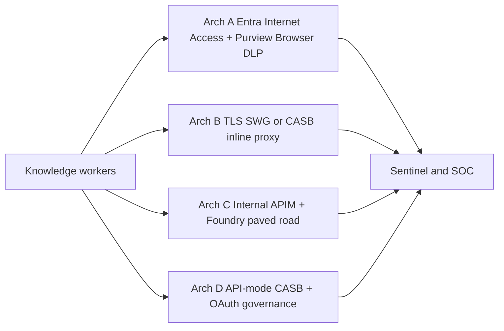
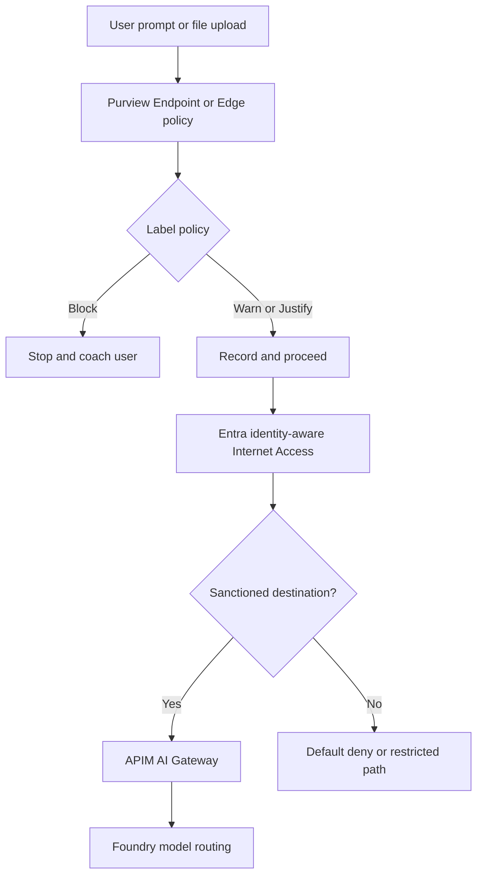
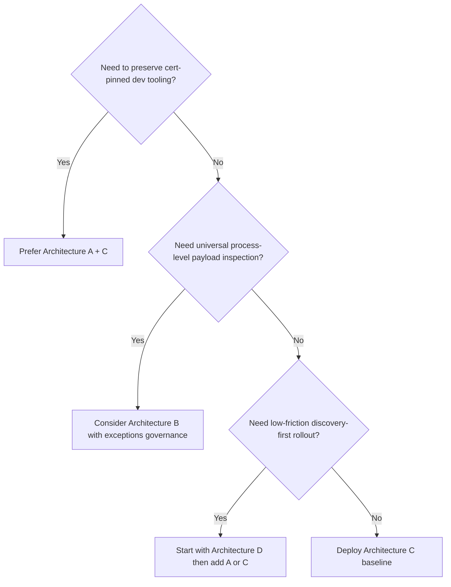

# Enterprise Shadow-AI Governance Selection FAQ: Identity-Aware Pre-TLS Browser DLP vs TLS-Decryption SWG/CASB vs APIM+Foundry Paved Road vs API-Mode CASB
> **Applies to**: enterprise CISO and AI Platform programs controlling workforce use of web GenAI, browser extensions, and OAuth-connected assistant bots.
> **Decision pressure**: stop data leakage without breaking sanctioned developer and business productivity flows.
> **Core objective**: reduce shadow-AI exfiltration while preserving a high-velocity sanctioned AI experience.

## 1. Executive summary
- Shadow AI appears when employees need capability faster than governance can provide.
- Hard domain blocking alone drives bypass behaviors and unsanctioned alternatives.
- Shared FQDNs (`chatgpt.com`, `claude.ai`) make tenant-level policy separation difficult.
- Rogue OAuth bots can receive broad scopes (`Mail.ReadWrite`, `Files.Read.All`) quickly.
- TLS MITM can inspect broad traffic but often breaks certificate-pinned developer tools.
- Pre-TLS endpoint/browser DLP can inspect prompts without root-CA breakage.
- A sanctioned internal paved road converts most shadow demand into governed demand.
- API-mode CASB remains useful for discovery and asynchronous remediation.
- Practical production design usually combines Architecture A + C with selective D.
- Architecture B is strongest for universal process coverage but has friction and breakage trade-offs.
- The right target is measurable risk reduction with stable engineering throughput.
- Governance success depends on identity, endpoint, network, and developer experience together.

## 2. Applicability and explicit non-goals
- Scope covers workforce prompts, uploads, and browser-based LLM usage governance.
- Scope covers unmanaged OAuth grants to third-party AI assistants and note takers.
- Scope includes sanctioned enterprise AI routing through APIM and Foundry.
- Scope includes endpoint policy and identity policy control loops.
- Scope is distinct from workstation local `stdio MCP` governance in 3.3 #299.
- Scope is distinct from server-side streaming output DLP in 3.3 #350.
- Scope is distinct from cloud workload exfiltration controls in 3.8 `NSP + TRv2`.
- Scope excludes replacing enterprise legal/compliance review requirements.
- Scope excludes non-enterprise consumer parental-control use cases.

## 3. Problem frame and threat mechanics
- Employees can paste source code, M&A models, and regulated PII into consumer LLM UIs.
- Browser side-panel extensions may scrape DOM text from internal applications.
- Personal accounts on shared GenAI domains bypass enterprise tenant controls.
- OAuth consent phishing can grant persistent read/write mailbox and file access.
- Blocking approved domains can degrade sanctioned SDK and portal usage.
- Policy friction creates shadow channels through BYOD, personal hotspots, and screenshots.
- Security architecture must prevent leakage while still enabling daily work.

## 4. Four architecture candidates
- **Architecture A**: Entra Internet Access + Purview Endpoint/Edge pre-TLS DLP + Defender for Cloud Apps.
- **Architecture B**: TLS-decrypting SWG/CASB inline proxy with payload parsing and header injection.
- **Architecture C**: internal sanctioned multi-model paved road using APIM AI Gateway + Foundry.
- **Architecture D**: out-of-band CASB API connectors and OAuth app governance remediation.
- Arch-A emphasizes identity-aware session controls and endpoint/browser inspection.
- Arch-B emphasizes broad network-process coverage regardless of browser choice.
- Arch-C emphasizes demand deflection through better sanctioned user experience.
- Arch-D emphasizes low-friction visibility and token-governance hygiene.

## 5. Architecture A details (identity-aware pre-TLS controls)
- Purview endpoint/browser controls inspect clipboard, file upload, and prompt submission pre-TLS.
- Sensitivity labels can enforce `Warn`, `Justify`, or `Block` policy outcomes.
- No root-CA MITM is required for developer CLI workflows.
- Entra Internet Access can apply identity-bound traffic segmentation policies.
- Defender for Cloud Apps contributes sanctioned/unsanctioned app intelligence and session controls.
- Entra risk policies can tighten consent and session posture for high-risk users.
- Shared FQDN policies can differentiate corporate and personal tenant pathways.
- Arch-A minimizes certificate-pinning disruption while preserving high-value detection points.

## 6. Architecture B details (full TLS decrypting SWG/CASB)
- Proxy decrypts HTTPS payloads for broad protocol/process visibility.
- Prompt bodies and multipart uploads can be inspected inline at network edges.
- Shared-domain workspace headers can steer allowed tenant contexts.
- Centralized telemetry can stream to Sentinel for SOC workflows.
- Certificate pinning failures affect some developer SDK/CLI and container tooling.
- QUIC downgrade and proxy traversal can add latency and troubleshooting overhead.
- SSL-bypass allowlists are often required, which can reopen exfiltration gaps.
- Arch-B offers wide coverage but carries meaningful operational friction.

## 7. Architecture C details (paved-road internal portal)
- Internal portal provides approved frontier models under enterprise governance.
- APIM AI Gateway enforces auth, quotas, content filters, and observability.
- Foundry routes across `AOAI`, Claude, Llama, and other managed offerings.
- Purview and Prompt Shields provide logging and policy layers.
- Enterprise SSO and tenant context are built in by default.
- User demand shifts from shadow tools when sanctioned alternatives are good enough.
- Deflection rates often reach `80%–90%` in mature rollouts.
- Arch-C converts control from punitive-only to productivity-plus-governance.

## 8. Architecture D details (API-mode CASB and OAuth governance)
- API connectors inventory SaaS app activity without inline traffic interception.
- OAuth governance detects over-privileged or risky third-party app grants.
- Automated token revocation can remediate discovered exposure.
- DSPM for AI helps classify where sensitive data intersects AI usage.
- No inline proxy means lower immediate end-user friction.
- Detection-to-remediation latency is asynchronous (`5–30 min` typical windows).
- Single-shot secret pastes may occur before connector-based action triggers.
- Arch-D is strong for visibility baselines and cleanup loops, not sole prevention.

## 9. Twelve-dimension architecture comparison matrix
| Dimension | Architecture A | Architecture B | Architecture C | Architecture D |
|---|---|---|---|---|
| Primary control point | Endpoint/browser + identity | Network inline proxy | Internal sanctioned app plane | SaaS API governance plane |
| TLS pinning compatibility | High | Low to medium | High | High |
| Coverage breadth (process/protocol) | Medium | Highest | Medium | Medium |
| User friction | Low to medium | Medium to high | Low | Low |
| Preventive blocking latency | Near-real-time | Inline real-time | Real-time in portal | Asynchronous |
| Shared-FQDN tenant separation | High | Medium | High | Low |
| OAuth rogue app mitigation | Medium | Low | Medium | Highest |
| Developer CLI impact | Low | High risk | Low | None |
| Exfiltration prevention strength | High | High | Medium-high | Medium |
| Deployment complexity | Medium | High | Medium | Low-medium |
| SOC observability depth | High | High | High | Medium |
| Long-run adoption sustainability | High | Medium | Highest | Medium |

## 10. Four-architecture topology overview


## 11. Pre-TLS DLP and paved-road request flow


## 12. SA decision tree


### Q1. How shared-FQDN tenant disambiguation and TLS-pinning paradox should be handled
- Shared consumer and enterprise tenants on one FQDN complicate policy decisions.
- Inline MITM can inspect traffic but breaks some cert-pinned SDK and CLI paths.
- Certificate failures push developers toward unmanaged paths and bypass channels.
- Pre-TLS endpoint/browser DLP sees cleartext interaction before encryption.
- This model avoids root-CA interception for `git`, `npm`, `uv`, `az`, and `docker`.
- Entra identity context enables user/session-aware traffic policy segmentation.
- Workspace disambiguation can rely on sanctioned portal routing and identity binding.
- Architecture A plus C addresses both risk control and productivity continuity.

### Q2. How Chromium extension and OAuth consent attack surfaces should be controlled
- Browser extensions with `<all_urls>` can scrape sensitive DOM content silently.
- Side-panel AI extensions can copy prompts and documents to unapproved backends.
- OAuth grants with `offline_access` persist risk beyond one user session.
- Intune should enforce `ExtensionInstallAllowlist` and block unknown extension IDs.
- Browser hardening should disable risky developer-mode extension sideloading.
- Entra should require admin consent workflows for high-impact delegated scopes.
- Consent policy should classify scopes by data class and blast radius.
- Risk scoring can enforce stronger MFA or re-auth before consent elevation.
- Governance metrics should track blocked extension install attempts and denied grants.

### Q3. How to model shadow-AI deflection economics and bypass probability
- Blocking-only strategy often increases `P_bypass` when sanctioned alternatives are weak.
- Let `P_bypass` be probability of users finding unmanaged channels.
- Let `U_value` represent utility gap between sanctioned and desired capability.
- A simple model: `P_bypass ≈ sigmoid(alpha*Friction + beta*U_value - gamma*Monitoring)`.
- Architecture C lowers `U_value` by supplying high-quality sanctioned options.
- Architecture A lowers friction for approved paths while increasing monitorability.
- Combined A+C typically reduces bypass more than adding stricter blocking alone.
- Deflection KPI should measure proportion of AI traffic moved to governed channels.
- Economic target is reducing incident likelihood without harming core throughput.

### Q4. What production policy configuration should look like
- Endpoint and browser controls should classify data by Purview labels first.
- Identity controls should restrict OAuth consent with explicit admin workflows.
- APIM should route sanctioned traffic by model capability, cost, and risk class.
- Foundry endpoints should separate coding, legal, and summarization workloads.
- Sentinel should receive normalized policy, consent, and gateway telemetry.

```json
{
  "intune_edge_policy": {
    "ExtensionInstallAllowlist": ["<approved-extension-id-1>", "<approved-extension-id-2>"],
    "ExtensionInstallBlocklist": ["*"],
    "SmartScreenEnabled": true,
    "PreventDeveloperModeExtensions": true
  }
}
```

```json
{
  "entra_app_consent_policy": {
    "userConsent": "restricted",
    "adminConsentRequiredScopes": [
      "Mail.ReadWrite",
      "Files.Read.All",
      "offline_access"
    ],
    "riskBasedPrompting": true
  }
}
```

```xml
<policies>
  <inbound>
    <base />
    <set-variable name="workloadClass" value="@(context.Request.Headers.GetValueOrDefault(&quot;x-workload-class&quot;,&quot;general&quot;))" />
    <choose>
      <when condition="@(context.Variables.GetValueOrDefault<string>(&quot;workloadClass&quot;) == &quot;coding&quot;)">
        <set-backend-service backend-id="foundry-coding-model-pool" />
      </when>
      <when condition="@(context.Variables.GetValueOrDefault<string>(&quot;workloadClass&quot;) == &quot;regulated&quot;)">
        <set-backend-service backend-id="foundry-regulated-model-pool" />
      </when>
      <otherwise>
        <set-backend-service backend-id="foundry-general-model-pool" />
      </otherwise>
    </choose>
    <llm-token-limit tokens-per-minute="180000" />
  </inbound>
  <backend><base /></backend>
  <outbound><base /></outbound>
</policies>
```

### Q5. Which failure modes must be explicitly tested and mitigated
- QUIC over `UDP/443` may bypass controls if only TCP inspection is enforced.
- Base64 wrappers can hide sensitive payloads from shallow regex filters.
- Screenshot OCR exfiltration can bypass text-only prompt inspection logic.
- Unmanaged BYOD devices can reach consumer LLMs outside endpoint policy scope.
- Conditional Access session controls should handle browser session risk on BYOD.
- Egress DNS and Internet Access controls should default-deny unsanctioned domains.
- Detection rules should correlate endpoint, identity, and gateway telemetry signals.
- Drill scenarios should include extension abuse, consent phishing, and split-tunnel paths.
- Recovery playbooks should include token revocation and urgent policy tightening.

### Q6. What three-year TCO and breach-exposure reduction look like
- Costs and risk outcomes vary by workforce size and control strategy mix.
- Arch-A and Arch-C usually provide best balance of control and productivity.
- Arch-B can reduce residual blind spots but often raises operating friction cost.
- Arch-D offers low-friction coverage gains but cannot be the only preventive layer.

| Workforce size | Architecture A | Architecture B | Architecture C | Architecture D |
|---|---:|---:|---:|---:|
| 1,000 workers | \$0.45M–\$0.85M | \$0.70M–\$1.20M | \$0.55M–\$0.95M | \$0.25M–\$0.50M |
| 10,000 workers | \$3.50M–\$6.20M | \$5.20M–\$8.90M | \$4.20M–\$7.00M | \$1.90M–\$3.40M |
| 50,000 workers | \$15.80M–\$28.50M | \$23.00M–\$39.00M | \$18.50M–\$31.00M | \$8.60M–\$15.20M |

| Workforce size | Estimated exposure reduction with A+C | Typical reduction with B-only | Typical reduction with D-only |
|---|---:|---:|---:|
| 1,000 workers | 55%–72% | 35%–50% | 20%–35% |
| 10,000 workers | 58%–75% | 38%–53% | 22%–37% |
| 50,000 workers | 60%–78% | 40%–55% | 25%–40% |

- Exposure reduction should be measured against verified policy-incident baselines.
- Program success includes reduced incidents and stable employee delivery throughput.
- Final choice should combine breach-loss expectation with employee productivity impacts.

## 13. Day-0 rollout checklist
- Classify AI destinations into sanctioned, tolerated, and blocked classes.
- Define Purview label policies for prompt and file controls.
- Configure Intune extension allowlist and sideload restrictions.
- Enforce Entra consent governance for high-risk delegated scopes.
- Stand up APIM+Foundry paved road with enterprise SSO.
- Connect telemetry streams to Sentinel with normalized schema.
- Set deny-by-default posture for public GenAI domains outside sanctioned policy.
- Publish user guidance and exception workflow with security coaching.

## 14. Day-2 operations checklist
- Review bypass detections and adjust endpoint/network guardrails weekly.
- Recalibrate sensitivity-label policies to reduce false positives.
- Monitor extension drift and unauthorized install attempts.
- Audit OAuth grants and revoke suspicious high-scope applications.
- Tune APIM routing and quota controls by workload demand.
- Reassess QUIC handling and DNS control effectiveness monthly.
- Run tabletop incident drills for screenshot and OCR smuggling paths.
- Track adoption, deflection, incident trend, and response SLA metrics.

## 15. Good fit versus not for
| Category | Guidance |
|---|---|
| ✅ Good fit | Enterprises balancing strict leakage control with high developer and analyst productivity. |
| ✅ Good fit | Organizations with mixed browser, SDK, and API AI usage patterns. |
| ✅ Good fit | Security programs needing measurable reduction of shadow-AI behavior. |
| ⛔ Not for | Environments expecting zero governance investment while allowing unrestricted AI use. |
| ⛔ Not for | Pure network-only models that cannot tolerate TLS pinning breakage consequences. |
| ⛔ Not for | Programs refusing sanctioned paved-road alternatives for workforce AI demand. |

## 16. Five-step implementation guide
1. Establish sanctioned AI paved road and clear destination taxonomy.
2. Enable pre-TLS endpoint/browser DLP with identity-aware traffic policy.
3. Harden extension and OAuth consent surfaces using Intune and Entra governance.
4. Add API-mode CASB discovery and remediation loops for residual blind spots.
5. Measure deflection, bypass, and incident outcomes, then iterate policies quarterly.

## 17. Operational metric pack for quarterly steering
- Track sanctioned-versus-unsanctioned AI traffic share by business unit.
- Measure blocked prompt events by Purview label category.
- Measure justified prompt events and post-justification outcomes.
- Track extension install attempts denied by Intune policy.
- Track OAuth consent requests denied by admin workflow.
- Measure time-to-revoke for risky OAuth app grants.
- Track APIM model-route distribution by workload class.
- Track APIM token utilization and quota-throttle incidents.
- Measure paved-road adoption by role archetype.
- Measure inferred bypass events from identity/network anomaly joins.
- Track unmanaged-device AI access attempts by conditional-access policy outcome.
- Track QUIC bypass detections and mitigation response time.
- Measure screenshot or OCR-smuggling detections from SOC rules.
- Track mean time to contain (MTTC) shadow-AI incidents.
- Track repeat offender rates after coaching interventions.
- Correlate incident trend with paved-road feature rollout cadence.
- Compare productivity metrics before and after strict policy changes.
- Track false-positive block rates and reduction trend.
- Track false-negative escape findings from red-team exercises.
- Measure business exception request volume and approval latency.
- Audit policy drift across regions and subsidiaries.
- Validate shared-FQDN tenant split correctness with synthetic tests.
- Track top unsanctioned AI domains by attempted access volume.
- Track model class demand to prioritize sanctioned catalog updates.
- Run monthly control efficacy scorecards for A, B, C, and D layers.
- Present quarterly risk-adjusted ROI combining loss avoidance and delivery velocity.

## 18. Provenance
- `anonymized_reported`: metrics and control patterns are synthesized from anonymized enterprise programs and reproducible architecture modeling assumptions.
