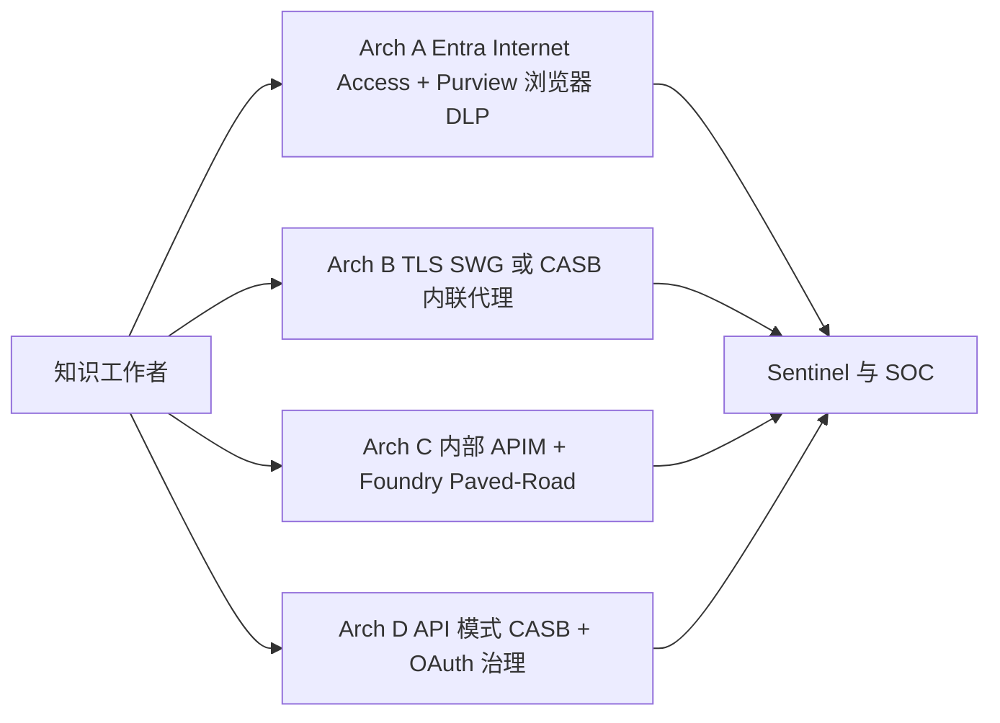
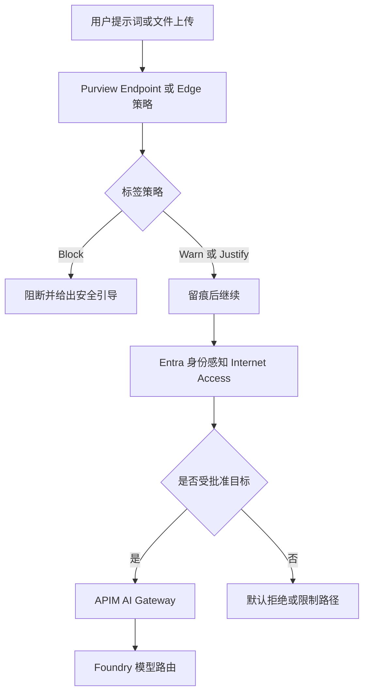
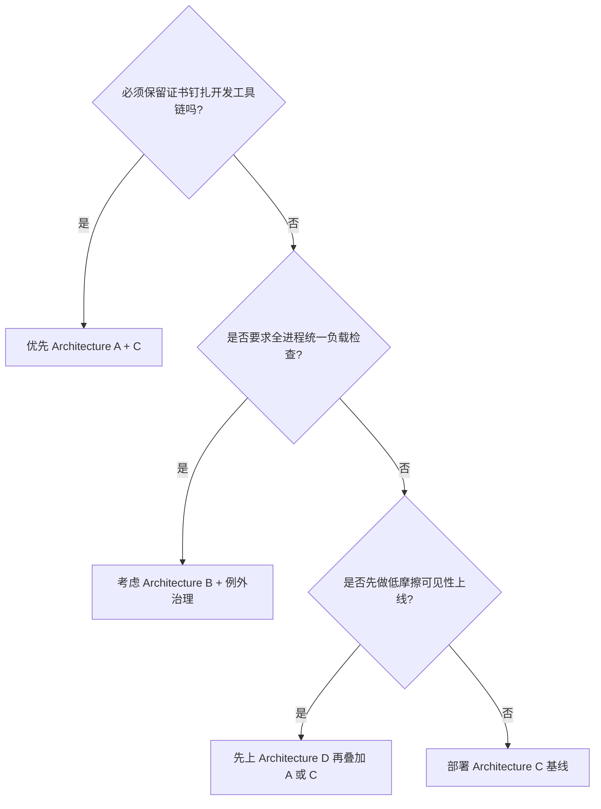

# 企业 Shadow AI 治理选型 FAQ：身份感知预 TLS 浏览器 DLP vs TLS 解密 SWG/CASB vs APIM+Foundry Paved-Road vs API 模式 CASB
> **适用场景**：企业 CISO 与 AI 平台团队治理员工 Web GenAI、浏览器扩展与 OAuth 机器人滥用风险。
> **决策压力**：既要阻断泄密，又不能破坏被批准的研发与业务效率。
> **核心目标**：在不牺牲生产力的前提下显著降低 Shadow AI 外泄概率。

## 1. 执行摘要
- Shadow AI 的本质是“需求强、供给慢”的能力缺口。
- 只做域名硬封禁会引发更高绕行与对抗行为。
- `chatgpt.com`、`claude.ai` 这类共享域名增加租户判别难度。
- Rogue OAuth 机器人可快速获得 `Mail.ReadWrite`、`Files.Read.All` 高危权限。
- TLS MITM 方案覆盖面广，但常破坏证书钉扎开发工具链。
- 预 TLS 端侧/浏览器 DLP 可在不拆证书前提下检查明文交互。
- 内部 Paved-Road 能把大量影子需求导流到受治理通道。
- API 模式 CASB 适合发现与异步修复，并非单独预防手段。
- 生产实践通常采用 Architecture A + C，并辅以 D。
- Architecture B 在覆盖广度上有优势，但运维摩擦更高。
- 成功标准是风险下降与交付效率稳定并存。
- 身份、端点、网络、开发体验必须协同治理。

## 2. 适用性与明确非目标
- 本文覆盖员工提示词、上传内容、浏览器 GenAI 使用治理。
- 本文覆盖第三方 AI 助手 OAuth 授权滥用风险。
- 本文覆盖 APIM/Foundry 的企业合规 AI 门户建设。
- 本文覆盖端侧策略与身份策略联动闭环。
- 本文不同于 3.3 #299 的本地 `stdio MCP` 治理。
- 本文不同于 3.3 #350 的服务端流式输出 DLP。
- 本文不同于 3.8 的 `NSP + TRv2` 云工作负载外泄治理。
- 本文不替代法务与合规审查流程本身。
- 本文不面向消费级家庭上网管控场景。

## 3. 问题框架与威胁机理
- 员工可把源码、并购模型、受监管 PII 直接粘贴到消费级 LLM。
- 浏览器侧栏 AI 扩展可能抓取内部应用 DOM 敏感文本。
- 共享域名下的个人账号会绕开企业租户边界。
- OAuth 同意钓鱼可获得长期离线访问与读写权限。
- 粗暴封禁批准域名会同时伤害合法 SDK 与内部工具。
- 策略摩擦会诱发 BYOD、截图、热点网络等替代通道。
- 安全架构需同时处理“泄露风险”与“可用性风险”。

## 4. 四类候选架构
- **Architecture A**：Entra Internet Access + Purview Endpoint/Edge 预 TLS DLP + Defender for Cloud Apps。
- **Architecture B**：全量 TLS 解密 SWG/CASB 内联代理与 payload 解析。
- **Architecture C**：企业内部多模型 Paved-Road（APIM AI Gateway + Foundry）。
- **Architecture D**：API 模式 CASB + OAuth App Governance 异步治理。
- Arch-A 重点是身份绑定会话控制与端侧可见性。
- Arch-B 重点是跨进程跨浏览器统一网络拦截。
- Arch-C 重点是以高体验受控替代降低影子需求。
- Arch-D 重点是低摩擦可见性与授权风险清理。

## 5. Architecture A 细节（身份感知预 TLS 控制）
- Purview 端侧/浏览器可在 TLS 前检查粘贴、上传、DOM 提交。
- 敏感标签可按 `Warn`、`Justify`、`Block` 分层处置。
- 该模式不需要企业根证书 MITM 拆解。
- Entra Internet Access 提供身份绑定的流量策略切分。
- Defender for Cloud Apps 提供 SaaS 风险洞察与会话治理。
- Entra 风险策略可对高风险用户提升同意与访问门槛。
- 在共享域名可实现企业租户与个人租户路径分离。
- Arch-A 在可用性与预防能力之间通常更平衡。

## 6. Architecture B 细节（全量 TLS 解密 SWG/CASB）
- 内联代理可解密 HTTPS 并检查多种负载格式。
- 对非 Edge 浏览器与任意进程具备更强统一覆盖。
- 可注入工作区绑定头实现共享域名租户约束。
- 可将日志统一投递 Sentinel 便于 SOC 联动。
- 证书钉扎失败常影响开发 CLI、容器与构建工具链。
- QUIC 降级与代理链路会引入额外时延与排障成本。
- SSL 白名单例外常不可避免，并形成新外泄缝隙。
- Arch-B 控制力强但组织落地阻力通常更高。

## 7. Architecture C 细节（内部 Paved-Road 门户）
- 内部门户提供被批准的前沿模型能力与统一入口。
- APIM AI Gateway 统一鉴权、配额、审计与策略治理。
- Foundry 可按场景路由 `AOAI`、Claude、Llama 等模型池。
- Prompt Shields 与 Purview 审计形成治理闭环。
- 企业 SSO 与租户上下文天然绑定，降低误用空间。
- 当体验足够好时，影子需求会明显向内部门户迁移。
- 成熟项目可实现 `80%–90%` 受治理流量转化。
- Arch-C 把“限制”升级为“可用且合规”的供给策略。

## 8. Architecture D 细节（API 模式 CASB 与 OAuth 治理）
- API 连接器可在不改网络路径下盘点 SaaS 使用行为。
- OAuth 治理可识别高权限第三方 AI 机器人授权风险。
- 自动撤销 token 可用于事后快速收敛暴露面。
- DSPM for AI 有助于定位敏感数据与 AI 流转交叉点。
- 无内联代理意味着端用户摩擦较低。
- 但检测到处置存在 `5–30 min` 异步窗口。
- 单次高敏粘贴可能先发生后修复。
- Arch-D 适合发现与补救，不适合作为唯一预防主控。

## 9. 12 维架构对比矩阵
| 维度 | Architecture A | Architecture B | Architecture C | Architecture D |
|---|---|---|---|---|
| 主控制点 | 端侧/浏览器 + 身份 | 网络内联代理 | 内部受控应用面 | SaaS API 治理面 |
| 证书钉扎兼容性 | 高 | 低到中 | 高 | 高 |
| 覆盖广度（进程/协议） | 中 | 最高 | 中 | 中 |
| 终端用户摩擦 | 低到中 | 中到高 | 低 | 低 |
| 预防阻断时延 | 近实时 | 内联实时 | 门户内实时 | 异步 |
| 共享域名租户分离 | 高 | 中 | 高 | 低 |
| OAuth 机器人治理 | 中 | 低 | 中 | 最高 |
| 开发 CLI 影响 | 低 | 高风险 | 低 | 无 |
| 外泄预防强度 | 高 | 高 | 中高 | 中 |
| 部署复杂度 | 中 | 高 | 中 | 低到中 |
| SOC 可观测深度 | 高 | 高 | 高 | 中 |
| 长期采用可持续性 | 高 | 中 | 最高 | 中 |

## 10. 四架构拓扑总览


## 11. 预 TLS DLP 与 Paved-Road 流程


## 12. 架构师决策树


### Q1. 共享域名租户判别与 TLS 钉扎悖论该怎么解
- 共享 FQDN 下企业租户与个人租户天然混杂，策略边界模糊。
- MITM 可提升可见性，但会破坏部分证书钉扎 SDK 与 CLI。
- 工具链可用性受损后，开发者往往转向非受控替代通道。
- 预 TLS 端侧/浏览器 DLP 能在加密前看到明文交互。
- 该路径无需企业根证书拦截 `git`、`npm`、`uv`、`az`、`docker`。
- Entra 身份上下文可驱动用户/会话粒度策略。
- 结合内部门户可在共享域名场景实现更稳定租户分离。
- A + C 通常是“安全与可用性”的最优折中。

### Q2. Chromium 扩展与 OAuth 同意攻击面如何控制
- `<all_urls>` 权限扩展可在浏览器中抓取敏感 DOM 内容。
- 侧栏 AI 扩展可把内部文档与提示词上传至未知后端。
- `offline_access` 授权使风险跨会话持续存在。
- Intune 应启用 `ExtensionInstallAllowlist` 并阻断未知扩展。
- 浏览器策略应禁用开发者模式侧载扩展。
- Entra 应对高危 delegated scopes 强制 admin consent。
- 同意策略应按数据级别与影响面定义审批路径。
- 风险评分可触发更强 MFA 或二次验证再授权。
- 治理指标应追踪扩展拦截率与授权拒绝率。

### Q3. Shadow AI 导流经济学与 P_bypass 如何建模
- 仅阻断而无内部门户时，`P_bypass` 往往上升。
- 定义 `P_bypass` 为员工绕开受控通道的概率。
- 定义 `U_value` 为“受控供给能力”与“真实需求能力”差距。
- 可用近似模型：`P_bypass ≈ sigmoid(alpha*Friction + beta*U_value - gamma*Monitoring)`。
- Architecture C 通过提升能力供给降低 `U_value`。
- Architecture A 在提升监测能力同时保持批准路径低摩擦。
- A+C 组合通常优于“单纯提高封禁强度”。
- 核心 KPI 应是影子流量向受控流量转化比例。
- 目标是风险下降与业务连续性并行优化。

### Q4. 生产策略配置应该长什么样
- 端侧与浏览器应先按 Purview 标签定义敏感处理规则。
- 身份侧应把 OAuth 同意治理固化为 Entra 策略。
- APIM 应按能力、成本、风险等级做多模型路由。
- Foundry 端点可按 coding/legal/summarization 做池化隔离。
- Sentinel 统一接收端侧、身份、网关三面遥测。

```json
{
  "intune_edge_policy": {
    "ExtensionInstallAllowlist": ["<approved-extension-id-1>", "<approved-extension-id-2>"],
    "ExtensionInstallBlocklist": ["*"],
    "SmartScreenEnabled": true,
    "PreventDeveloperModeExtensions": true
  }
}
```

```json
{
  "entra_app_consent_policy": {
    "userConsent": "restricted",
    "adminConsentRequiredScopes": [
      "Mail.ReadWrite",
      "Files.Read.All",
      "offline_access"
    ],
    "riskBasedPrompting": true
  }
}
```

```xml
<policies>
  <inbound>
    <base />
    <set-variable name="workloadClass" value="@(context.Request.Headers.GetValueOrDefault(&quot;x-workload-class&quot;,&quot;general&quot;))" />
    <choose>
      <when condition="@(context.Variables.GetValueOrDefault<string>(&quot;workloadClass&quot;) == &quot;coding&quot;)">
        <set-backend-service backend-id="foundry-coding-model-pool" />
      </when>
      <when condition="@(context.Variables.GetValueOrDefault<string>(&quot;workloadClass&quot;) == &quot;regulated&quot;)">
        <set-backend-service backend-id="foundry-regulated-model-pool" />
      </when>
      <otherwise>
        <set-backend-service backend-id="foundry-general-model-pool" />
      </otherwise>
    </choose>
    <llm-token-limit tokens-per-minute="180000" />
  </inbound>
  <backend><base /></backend>
  <outbound><base /></outbound>
</policies>
```

### Q5. 必须显式验证与缓解的失败模式有哪些
- QUIC `UDP/443` 若未治理，可能绕过仅 TCP 路径控制。
- base64 包裹可绕过浅层关键字过滤。
- 截图 + OCR 走图像通道可绕过文本策略。
- 非托管 BYOD 可绕开端侧 DLP 与设备策略。
- 条件访问会话控制需覆盖 BYOD 浏览器风险。
- DNS 与 Internet Access 应对非批准 GenAI 默认拒绝。
- 检测规则应关联端点、身份、网关的多源信号。
- 演练场景应覆盖扩展滥用、同意钓鱼、分流隧道。
- 处置预案需包含 token 撤销与紧急策略收紧。

### Q6. 1,000 / 10,000 / 50,000 知识员工规模下三年 TCO 与暴露面下降
- 成本与风险结果取决于组织规模和策略组合方式。
- A + C 通常能在控制力与体验之间取得更优平衡。
- B 可降低残余盲区但经常带来更高运维与体验成本。
- D 成本低且摩擦小，但不应作为唯一预防层。

| 员工规模 | Architecture A | Architecture B | Architecture C | Architecture D |
|---|---:|---:|---:|---:|
| 1,000 人 | \$0.45M–\$0.85M | \$0.70M–\$1.20M | \$0.55M–\$0.95M | \$0.25M–\$0.50M |
| 10,000 人 | \$3.50M–\$6.20M | \$5.20M–\$8.90M | \$4.20M–\$7.00M | \$1.90M–\$3.40M |
| 50,000 人 | \$15.80M–\$28.50M | \$23.00M–\$39.00M | \$18.50M–\$31.00M | \$8.60M–\$15.20M |

| 员工规模 | A+C 组合预估暴露面下降 | 仅 B 典型下降 | 仅 D 典型下降 |
|---|---:|---:|---:|
| 1,000 人 | 55%–72% | 35%–50% | 20%–35% |
| 10,000 人 | 58%–75% | 38%–53% | 22%–37% |
| 50,000 人 | 60%–78% | 40%–55% | 25%–40% |

- 暴露面下降应相对已验证基线做持续度量。
- 项目成功同时要求事故下降和产能稳定。
- 最终决策应把预期损失降低与生产率影响一并计入。

## 13. Day-0 落地清单
- 定义 AI 目标域名的批准/容忍/阻断分级清单。
- 建立 Purview 标签驱动的提示词与文件策略。
- 在 Intune 下发扩展白名单与侧载限制策略。
- 在 Entra 固化高危 OAuth scope 的同意治理流程。
- 搭建 APIM+Foundry 受控 Paved-Road 与 SSO 集成。
- 接通 Sentinel 三面遥测并统一 schema。
- 对非批准公有 GenAI 启用默认拒绝策略。
- 发布用户指南、豁免流程与安全引导机制。

## 14. Day-2 运营清单
- 周度复盘绕行告警并迭代端侧/网络策略。
- 持续校准标签规则以降低误拦截率。
- 监控扩展漂移与未授权安装尝试。
- 定期审计 OAuth 授权并撤销高风险应用。
- 依据负载优化 APIM 路由与配额策略。
- 月度复核 QUIC 与 DNS 控制有效性。
- 季度演练截图/OCR 走私与同意钓鱼场景。
- 跟踪导流率、绕行率、事故率与响应 SLA。

## 15. Good fit 与 Not for
| 分类 | 指引 |
|---|---|
| ✅ Good fit | 需要同时控制外泄风险与保障研发/分析效率的大中型企业。 |
| ✅ Good fit | 存在浏览器、SDK、API 混合 AI 使用路径的组织。 |
| ✅ Good fit | 需要可量化降低 Shadow AI 的安全治理项目。 |
| ⛔ Not for | 希望零治理投入且允许无限制外部 AI 使用的环境。 |
| ⛔ Not for | 无法承受 TLS 钉扎破坏却坚持网络 MITM 单一路径的方案。 |
| ⛔ Not for | 不愿提供内部受控替代却只依赖封禁的治理策略。 |

## 16. 五步实施路径
1. 定义受控 AI Paved-Road 与目标域名分级体系。
2. 上线预 TLS 端侧/浏览器 DLP 与身份感知访问策略。
3. 用 Intune + Entra 收紧扩展安装与 OAuth 同意面。
4. 增加 API 模式 CASB 发现与异步处置闭环。
5. 以导流率、绕行率、事故率为核心指标季度迭代。

## 17. 季度治理指标包（运营看板建议）
- 按业务单元跟踪受控与非受控 AI 流量占比变化。
- 按 Purview 标签统计被阻断提示词事件分布。
- 跟踪 Justify 放行事件及其后续审计结果。
- 跟踪 Intune 拒绝扩展安装尝试次数。
- 跟踪 Entra 管理员同意拒绝事件数量。
- 度量高风险 OAuth 授权撤销平均耗时。
- 跟踪 APIM 各 workload class 的模型路由占比。
- 跟踪 APIM token 利用率与配额节流事件。
- 按角色画像统计 Paved-Road 采用率变化。
- 结合身份与网络异常估算绕行事件趋势。
- 跟踪非托管设备 AI 访问尝试及条件访问结果。
- 跟踪 QUIC 绕过告警与处置闭环时长。
- 统计截图/OCR 走私类规则命中情况。
- 监控 Shadow-AI 事件平均遏制时长（MTTC）。
- 监控被安全辅导后重复违规率变化。
- 关联 Paved-Road 功能迭代与事件下降曲线。
- 对比策略收紧前后业务效率指标变化。
- 跟踪误拦截率与其优化收敛趋势。
- 跟踪红队发现的漏检率与整改完成率。
- 统计业务豁免申请量与审批时延。
- 审计跨区域/子公司的策略漂移一致性。
- 用合成样本验证共享域名租户分流准确率。
- 跟踪高频未批准 AI 域名访问排行。
- 跟踪模型能力需求以驱动受控目录更新。
- 对 A/B/C/D 四层控制做月度效能打分。
- 季度汇报中结合损失避免与产能指标评估 ROI。

## 18. Provenance
- `anonymized_reported`：文中指标与控制模式来自匿名化企业项目观察与可复现架构建模假设。
