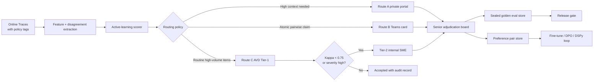
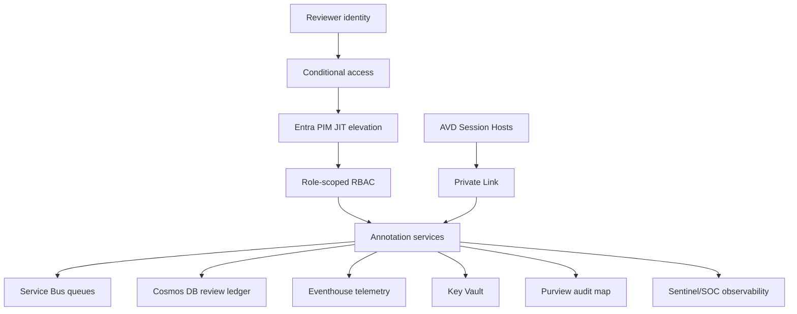

# Enterprise SME Annotation, Active-Learning Triage, and Disagreement Adjudication Workbench Selection FAQ

> Audience: Cloud & AI Solution Architects, AI platform owners, regulated data governance leads, and enterprise model-evaluation engineering teams.
> Decision focus: How to operationalize high-cost expert review (`$250-$500/hr`) when experts can only spend `~2 hours/week`, while PHI/MNPI traces must stay inside enterprise Azure boundaries.

## 1. Executive summary

Most enterprise annotation programs fail for two structural reasons:

1. They use uniform random sampling, which burns scarce SME time on easy or duplicate traces.
2. They over-index on portal UX and under-invest in bias controls, adjudication protocol, and release-gate integration.

For regulated industries, the winning strategy is a bounded, auditable, closed loop:

- Active-learning driven acquisition to maximize information gain per SME minute.
- Blind dual-SME labeling to suppress anchoring and automation bias.
- Escalation-based adjudication for low-agreement or high-impact items.
- Versioned promotion into sealed golden eval sets and controlled preference-training sets.

Route recommendations:

- **Route A** is best for deep trace analysis and high-context legal/clinical/financial evidence review.
- **Route B** is best for in-flow micro-adjudication where SME availability is fragmented.
- **Route C** is best for high-volume routine checks with strict exfiltration controls and internal escalation.
- **Route D** is anti-pattern territory and should be explicitly prohibited in architecture governance.

Key outcomes observed in enterprise pilots:

- `6.4x` more boundary-failure discoveries per `100` SME hours vs uniform random sampling.
- Higher true-error detection despite lower superficial agreement metrics when blind review is enforced.
- Better cost elasticity through two-tier workforce design without violating data-sovereignty constraints.

## 2. Problem statement and operating constraints

### 2.1 Business constraints

- Domain experts (oncologists, tax/M&A counsel, senior underwriters, principal engineers) are expensive and time-constrained.
- Evaluation windows are short, while model and policy changes are frequent.
- Stakeholders need evidence-backed adjudication, not only aggregate benchmark scores.

### 2.2 Compliance constraints

- Production traces may contain PHI, PII, MNPI, legal privilege content, or confidential underwriting rationale.
- Raw traces cannot be exported to public crowd-labeling SaaS.
- Every decision must be attributable: who reviewed what, with which rubric version, and which evidence links.

### 2.3 Technical constraints

- End-user trace volume is too high for full manual review.
- Disagreement is unavoidable and must be productized instead of treated as noise.
- Evaluation artifacts and training artifacts must be split carefully to avoid leakage contamination.

## 3. The four architecture routes (A/B/C/D)

### Route A: Sovereign private-VNet SME annotation platform

- Host `Argilla` / `Label Studio` on `AKS` or `ACA`.
- Use `Private Link`, `Entra ID`, PIM, and conditional access for hard access boundaries.
- Build active-learning candidate queues from `Fabric Eventhouse` and model telemetry.
- Enforce blind dual-SME labeling and senior adjudicator tie-break for conflict closure.

### Route B: In-flow micro-adjudication through Teams/Outlook

- Deliver short binary/pairwise tasks through `Teams Adaptive Cards` or Outlook actionable messages.
- Persist review state in `Cosmos DB` and route work via `Service Bus`.
- Optimize for experts who can spend only 20-40 seconds per decision in existing daily workflows.
- Accept reduced context depth compared with full annotation portals.

### Route C: Two-tier AVD-isolated BPO with internal SME escalation

- Tier-1 contractors operate in locked-down `Azure Virtual Desktop` sessions.
- Disable clipboard, drive, printer, and unmanaged screen export channels.
- Route low-agreement (`kappa < 0.75`) and high-severity samples to internal Tier-2 experts.
- Use pseudonymized spans for external handling where possible.

### Route D: Anti-pattern baseline

- Uniform random trace sampling.
- Unblinded pre-exposure to model/judge scores.
- Exporting raw production logs to third-party public crowd-labeling platforms.

## 4. Twelve-dimension comparison matrix

| Dimension | Route A Private Portal | Route B Teams Micro-Review | Route C AVD Tiered Workforce | Route D Anti-Pattern |
|---|---|---|---|---|
| Compliance boundary strength | Very high | Medium-high | Very high | Low |
| Expert time efficiency | High | Very high | Medium | Low |
| Deep context inspection | Very high | Low-medium | Medium | Low |
| Setup complexity | Medium-high | Medium | High | Superficially low |
| Throughput scalability | Medium | High | Very high | Unreliable |
| Bias control maturity | High | Medium | Medium-high | Very low |
| Adjudication closure quality | High | Medium-high | High | Low |
| Data sovereignty posture | Strong | Strong | Strong | Weak |
| Cost predictability | Medium | High | Medium-high | Poor long-term |
| Operational observability | High | High | High | Low |
| Regulated-industry fit | Excellent | Good | Excellent | Poor |
| Release-gate integration | Strong | Good | Strong | Weak |

## 5. Architecture diagram A: Active-learning to adjudication pipeline



## 6. Architecture diagram B: Zero-trust control and audit plane



## 7. Q1: Why does active learning beat uniform random sampling under scarce SME budgets?

Use an information-gain driven scoring function:

\[
Score_{AL}(x) = w_1 \cdot JSD_{judges}(x) + w_2 \cdot Novelty_{embed}(x) + w_3 \cdot Impact_{tier}(x)
\]

Where:

- `JSD_judges`: disagreement among judges or model committees.
- `Novelty_embed`: semantic novelty against recent reviewed clusters.
- `Impact_tier`: compliance/financial/safety consequence weighting.

Pilot-like scenario:

- Weekly traces: `10,000`.
- SME budget: `100 hours`.
- Random sampling finds `~37` boundary failures.
- Active-learning sampling finds `~237` boundary failures.
- Efficiency uplift: `237 / 37 ≈ 6.4x`.

Operational insight:

- Under severe expert scarcity, objective should be boundary discovery yield, not sample count reviewed.
- Active-learning score thresholds should be adjusted weekly using observed false-negative regret.

## 8. Q2: How to remove anchoring bias and fake agreement inflation?

Observed anti-pattern:

- Showing model/judge draft labels before human review can push apparent agreement from `0.68` to `0.91`.
- Yet independent audit can reveal `~3x` increase in missed critical errors.

Control strategy:

1. Blind review by default; hide all prior labels and confidence scores.
2. Inject `5%` seeded gold and perturbed honeypot items for quality calibration.
3. Separate rubric guidance from model outputs in UX flow.
4. Force dual review and adjudication on high-impact categories.

What to monitor:

- Blind vs unblinded agreement delta.
- Gold accuracy drift by reviewer cohort and shift window.
- Time-to-decision vs error-rate correlation (fatigue early warning).

## 9. Q3: How to interpret kappa/alpha drops and assign root causes?

Reliability indicators:

- Cohen's `kappa` for pairwise reviewer agreement.
- Krippendorff's `alpha` for multi-reviewer and mixed label types.

Root-cause branching:

- **Reviewer fatigue:** throughput pressure causes quality degradation.
- **Rubric ambiguity:** wording allows conflicting interpretations.
- **Legitimate plural interpretation:** domain reality includes multiple defensible outcomes.

Diagnostic sequence:

1. Slice reliability by task family, severity, reviewer cohort, and time window.
2. If degradation is global, prioritize rubric rewrite and examples.
3. If degradation is reviewer-localized, run targeted calibration/training.
4. If disagreement is semantically defensible, formalize allowed alternatives and policy precedence.

Practical thresholds:

- `kappa >= 0.80`: promote to golden-eval candidate with light audit.
- `0.75 <= kappa < 0.80`: promote only with selective second-pass audit.
- `kappa < 0.75`: mandatory adjudication queue escalation.

## 10. Q4: How does Route C enforce zero-exfiltration contractor operations?

Mandatory AVD controls:

- Private session hosts, no public RDP exposure.
- Disable clipboard, drive map, printer map, and USB redirection.
- Enable dynamic user watermark overlays.
- Restrict screen capture and unmanaged browser upload paths.
- Apply least-privilege identity scopes with short-lived credentials.

Compliance controls:

- Purview logging for view/edit/export actions.
- Time-bounded access assignments with automatic expiry.
- Pseudonymized spans for external tier reviewers.
- SOC monitoring for unusual review velocity or off-hours behavior.

Why this matters:

- Allows cost-effective scaling of routine work while preserving strict data-sovereignty and auditability.
- Reduces legal and regulatory exposure relative to unmanaged crowd-labeling channels.

## 11. Q5: How to promote adjudicated outputs into eval and training without leakage?

Promotion contract (recommended baseline):

- `70%` -> sealed golden evaluation set (release gate only).
- `30%` -> controlled preference/fine-tuning corpus (DPO/LoRA/DSPy).

Leakage prevention rules:

- Split by trace-id and semantic cluster-id, not only by random row-level partition.
- No overlap of near-duplicate clusters between eval and training corpora.
- Version every artifact with model version, rubric version, and policy version metadata.

Release criteria example:

- Candidate model must beat incumbent on sealed gold by configured deltas.
- Critical compliance categories must pass zero-regression gates.
- Failed categories trigger targeted re-acquisition rather than broad retraining only.

## 12. Q6: How to size SME capacity and weekly cost envelope?

Capacity equation:

\[
T_{sme} = N_{weekly} \times (p_{dual}\times2 + p_{dispute}\times1) \times t_{item}
\]

Example:

- `N_weekly = 1,200`
- `p_dual = 0.35`
- `p_dispute = 0.12`
- `t_item = 1.8 minutes`

Then:

- `T_sme = 1,200 * (0.70 + 0.12) * 1.8 = 1,771.2 minutes`
- `= 29.5 hours/week` expert capacity demand.

Implication:

- If available expert capacity is only `20 hours/week`, routing thresholds must tighten and Tier-1 handling must absorb more routine cases.
- Capacity planning should be recalculated after every rubric or model major version change.

## 13. Production snippets (at least two)

### Snippet A: Eventhouse/KQL acquisition shortlist

```kusto
let recent = AgentTrace
| where Timestamp > ago(7d)
| summarize
    jsd_avg = avg(JudgeJSD),
    novelty_avg = avg(EmbeddingNovelty),
    impact_max = max(ImpactTier),
    rework_rate = avg(UserReworkFlag)
  by TraceId, Domain;
recent
| extend ScoreAL = 0.40 * jsd_avg + 0.30 * novelty_avg + 0.20 * impact_max + 0.10 * rework_rate
| where ScoreAL > 0.62
| top 800 by ScoreAL desc
```

### Snippet B: Python stratified selector with gold/honeypot injection

```python
from dataclasses import dataclass
from random import random
from collections import defaultdict

@dataclass
class Candidate:
    trace_id: str
    domain: str
    score: float
    is_gold: bool = False

def stratified_select(candidates: list[Candidate], total: int = 800, gold_ratio: float = 0.05) -> list[Candidate]:
    by_domain: dict[str, list[Candidate]] = defaultdict(list)
    for c in candidates:
        by_domain[c.domain].append(c)
    selected: list[Candidate] = []
    per_domain = max(1, int((total * (1 - gold_ratio)) / max(1, len(by_domain))))
    for group in by_domain.values():
        group_sorted = sorted(group, key=lambda x: x.score, reverse=True)
        selected.extend(group_sorted[:per_domain])
    selected = sorted(selected, key=lambda x: x.score, reverse=True)[: int(total * (1 - gold_ratio))]
    gold_target = int(total * gold_ratio)
    for c in sorted(candidates, key=lambda x: x.score):
        if len([x for x in selected if x.is_gold]) >= gold_target:
            break
        if random() < 0.12 and c not in selected:
            c.is_gold = True
            selected.append(c)
    return selected[:total]
```

### Snippet C: Teams blind micro-review payload

```json
{
  "type": "AdaptiveCard",
  "version": "1.5",
  "body": [
    { "type": "TextBlock", "text": "Blind Claim Pair Review", "weight": "Bolder" },
    { "type": "TextBlock", "text": "Claim A: Prior authorization required for outpatient infusion." },
    { "type": "TextBlock", "text": "Claim B: Policy excludes outpatient infusion unless emergency exception is documented." },
    { "type": "Input.ChoiceSet", "id": "decision", "choices": [
      { "title": "A is stronger", "value": "A" },
      { "title": "B is stronger", "value": "B" },
      { "title": "Both unsupported", "value": "NONE" }
    ]}
  ],
  "actions": [
    { "type": "Action.Submit", "title": "Submit blind decision", "data": { "taskId": "blind-2026-11-26-428-01" } }
  ]
}
```

### Snippet D: Service Bus webhook handler

```python
def process_micro_review(event: dict) -> dict:
    payload = {
        "task_id": event["taskId"],
        "reviewer_object_id": event["reviewerObjectId"],
        "decision": event["decision"],
        "blind_mode": True,
        "rubric_version": event["rubricVersion"],
        "submitted_at_utc": event["submittedAtUtc"]
    }
    # persist to Cosmos, emit adjudication signal, and update reviewer quality stats
    return payload
```

## 14. Enterprise scenarios (2+)

### Scenario 1: Academic medical center oncology summary agent

- Weekly trace volume: `~28,000` patient-summary interactions.
- Expert pool: `18` oncologists, each with `~2 hours/week` review bandwidth.
- Operating model: Route B for fast in-flow triage + Route A for complex board adjudication.
- Outcome: `~400` high-value physician-adjudicated golden items weekly with HIPAA-grade audit lineage.

### Scenario 2: Global commercial insurance underwriting assistant

- Quarterly extraction scope: `40,000+` policy-clause decisions.
- Operating model: Route C for routine external Tier-1 checks + Route A for chief-underwriter dispute closure.
- Trigger rule: all `kappa < 0.75` and high-liability clauses escalate internally.
- Outcome: `41%` faster dispute closure and `33%` lower expert-hour cost with no relaxation of sovereign controls.

### Scenario 3: Cross-border tax and M&A legal memo copilot

- Data class includes privileged legal analysis and MNPI-sensitive transaction context.
- Route A anchors blind dual-counsel review for high-risk legal interpretations.
- Route B captures rapid binary accept/reject decisions from partners during travel windows.
- Program benefit: reduced review latency without exposing privileged context to unmanaged external systems.

## 15. Three-year TCO, rollout checklist, and final recommendation

### 15.1 Three-year TCO example (USD, 500k traces/month)

| Cost category | Route A | Route B | Route C | Route D |
|---|---:|---:|---:|---:|
| Platform infrastructure | 1,080,000 | 620,000 | 940,000 | 210,000 |
| Integration & platform engineering | 760,000 | 520,000 | 680,000 | 120,000 |
| SME labor | 3,420,000 | 2,980,000 | 2,250,000 | 4,900,000 |
| Outsourcing & operations | 180,000 | 120,000 | 1,560,000 | 90,000 |
| Compliance remediation & audit recovery | 260,000 | 280,000 | 300,000 | 2,400,000 |
| **Three-year total** | **5,700,000** | **4,520,000** | **5,730,000** | **7,720,000** |

Interpretation:

- Route B often offers the best marginal ROI for scarce SME time in decision-atomized workflows.
- Route A remains the strongest option for high-context regulated evidence adjudication.
- Route C delivers substantial scale economics when routine volume is high and controls are strict.
- Route D appears cheap initially but typically fails under compliance penalties, rework, and trust erosion.

### 15.2 Day-0 / Day-1 / Day-2 execution checklist

**Day-0 (foundation):**

- Define rubric taxonomy, conflict policy, and adjudication SLA.
- Set privacy classes and sovereign-boundary controls per data tier.
- Establish immutable audit schema: reviewer, rubric version, evidence anchor, confidence rationale.

**Day-1 (pilot):**

- Launch one regulated workflow lane with blind dual labeling.
- Configure active-learning score thresholds and weekly capacity guardrails.
- Enable release gate using sealed golden eval slices and critical-category zero-regression checks.

**Day-2 (scale):**

- Expand to multi-region tenant isolation and failover operations.
- Run weekly reliability health review (`kappa`, `alpha`, fatigue signals, dispute backlog SLA).
- Introduce FinOps dashboard for cost per high-value adjudicated sample and per-risk-category closure.

### 15.3 Good fit vs Not for

**Good fit:**

- Regulated enterprises with high data sensitivity and expensive SMEs.
- Programs that require auditable quality loops from production failures to release gates.
- Teams ready to operate policy versioning and adjudication governance as first-class platform capabilities.

**Not for:**

- Low-sensitivity internal assistants where simple random review is sufficient.
- Organizations unwilling to maintain minimal governance, audit metadata, and identity control planes.

### 15.4 Final architecture recommendation

Recommended default stack:

- Primary path: **Route B + Route A** (high-throughput micro triage + deep adjudication).
- Scale path: add **Route C** for routine volume offload under strict AVD controls.
- Governance rule: classify **Route D** as a prohibited architecture pattern in review boards.

This composition maximizes information gain per expert minute, preserves sovereign compliance boundaries, and creates a durable evidence loop for both evaluation and model-improvement programs.
