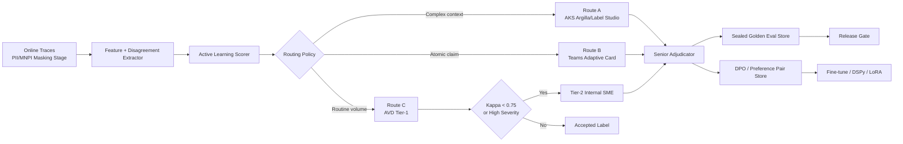
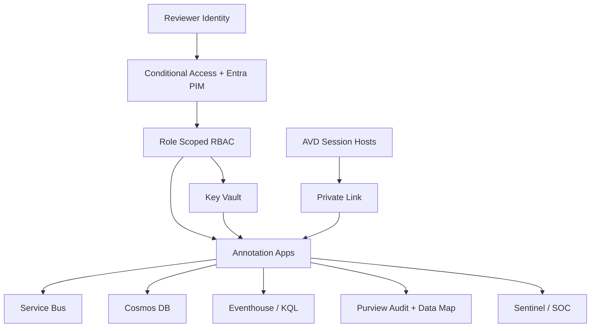

# 企业 SME 标注与主动学习仲裁工作台选型 FAQ（Argilla/Label Studio vs Teams 微审阅 vs AVD 分层 BPO）

> 适用对象：Cloud & AI Solution Architect、数据治理负责人、模型评测平台负责人、医疗/金融/法务高合规业务负责人。
> 目标问题：在专家人力极度稀缺（每周仅 2 小时）且 PHI/MNPI 不可出域前提下，如何构建企业级标注、主动学习分流与争议仲裁闭环。

## 1. 执行摘要（Executive Summary）

当专家工时成本达到 `$250–$500/小时`，随机抽样会把大部分预算花在“模型已经会做”的低信息样本上。
我们建议优先落地“主动学习增益驱动 + 双盲标注 + 争议仲裁 + 合规隔离”的工作台。

Route A 适合深度工作台与复杂证据链审阅。
Route B 适合高层专家碎片时间审批。
Route C 适合规模化处理常规样本并将高风险争议上送内部专家。
Route D 是明确反模式，应避免。

核心结论：

1. 在 `100` 小时 SME 预算下，信息增益采样可比均匀随机多发现约 `6.4x` 边界失败样本。
2. 双盲标注可显著抑制锚定偏差，避免“人机一致率虚高”。
3. 对外包标注必须采用 AVD 零外泄边界，并对争议项进行内部升级仲裁。
4. 金标准评测集、偏好对齐训练集、线上判定阈值应采用“同源闭环，分层用途”策略。

## 2. 问题边界与约束

业务约束：

- 医疗、投行、税务、核保等领域 SME 时间碎片化，难以进入重型标注门户。
- 原始生产轨迹含 PHI/MNPI，不允许出企业 Azure 租户与私网边界。
- 合规要求审计可追踪：谁在何时、基于何证据、做了何裁决。

技术约束：

- 线上轨迹规模高，无法全量人工复核。
- 模型版本频繁更新，需要持续评测与快速回灌。
- 多评审者意见冲突不可避免，必须制度化仲裁。

组织约束：

- 专家、平台工程、合规、业务线 KPI 不一致。
- 若缺少统一评分规约，跨团队一致性会快速崩塌。

## 3. 四条架构路线定义（A/B/C/D）

### Route A：私网主权标注平台（AKS/ACA + Argilla/Label Studio）

- 在 `AKS/ACA` 内运行 `Argilla/Label Studio`。
- 通过 `Private Link` + `Entra ID` + PIM + 条件访问控制访问面。
- 由 `Fabric Eventhouse` 或同类分析面生成主动学习队列。
- 执行双盲双专家标注 + 高级仲裁员裁决。

### Route B：Teams/Outlook 微审阅

- 将任务拆分为 `20s` 可完成原子卡片。
- 使用 `Teams Adaptive Card` 或 Outlook Actionable Message 推送。
- 由 `Service Bus` 承载任务队列，`Cosmos DB` 保存审阅状态与证据。
- 适合高时效、低上下文负担场景。

### Route C：AVD 分层外包 + 内部升级

- Tier-1 在 `Azure Virtual Desktop` 密闭桌面完成常规标注。
- 禁止剪贴板、磁盘映射、打印与屏幕捕获外泄。
- 低一致性 (`κ < 0.75`) 或高风险样本升级到 Tier-2 内部 SME。
- 通过伪匿名 Span 降低外包暴露面。

### Route D：反模式

- 均匀随机抽样，浪费稀缺 SME 时间。
- 预先展示模型/评委分数，造成确认偏差。
- 将原始日志发往公网众包标注平台，违反合规边界。

## 4. 12 维对比矩阵（A/B/C/D）

| 维度 | Route A 私网工作台 | Route B 微审阅卡片 | Route C AVD 分层 | Route D 反模式 |
|---|---|---|---|---|
| 合规隔离强度 | 高（私网 + RBAC + 审计） | 中高（消息面受控） | 高（VDI 零外泄） | 低 |
| 专家时间利用率 | 高 | 很高（碎片时间友好） | 中（依赖升级机制） | 低 |
| 复杂证据审阅能力 | 很高 | 低到中 | 中 | 低 |
| 启动复杂度 | 中高 | 中 | 高 | 低（但风险高） |
| 迭代速度 | 中 | 高 | 中 | 表面高、真实低 |
| 一致性可控性 | 高 | 中 | 中高 | 低 |
| 偏差治理能力 | 高（双盲） | 中（需设计） | 中高 | 很低 |
| 争议仲裁闭环 | 完整 | 可扩展 | 完整 | 缺失 |
| 数据主权 | 强 | 强 | 强 | 弱 |
| 单条样本处理成本 | 中 | 低 | 低到中 | 不可控 |
| 审计可追溯性 | 强 | 强 | 强 | 弱 |
| 适配监管行业 | 优 | 良 | 优 | 差 |

## 5. 参考架构图一：端到端主动学习与仲裁流



## 6. 参考架构图二：零信任控制面与审计面



## 7. Q1：为何主动学习比随机抽样更省 SME 预算？

定义样本打分：

\[
Score_{AL}(x)=w_1 \cdot JSD_{judges}(x)+w_2 \cdot Novelty_{embed}(x)+w_3 \cdot Impact_{tier}(x)
\]

其中：

- `JSD_judges` 衡量评委分歧（越高越值得复核）。
- `Novelty_embed` 衡量语义新颖度（越高越可能是长尾）。
- `Impact_tier` 衡量业务后果级别（合规/财务/安全）。

样例对比（每周 10,000 条轨迹，SME 仅 100 小时）：

- 随机抽样：有效边界失败发现 `~37` 条。
- 主动学习采样：有效边界失败发现 `~237` 条。
- 提升倍数：`237 / 37 ≈ 6.4x`。

结论：应将 SME 时间投入“高信息增益样本”，而非均匀抽签。

## 8. Q2：如何抑制锚定偏差与“橡皮章审批”？

问题现象：

- 当先展示 LLM Judge 结果时，人类一致率看似从 `0.68` 升至 `0.91`。
- 但离线复核发现关键错误漏检增至约 `3x`。

治理手段：

1. 双盲标注：隐藏模型得分与其他审阅者结果。
2. `5%` Gold/Honeypot 注入：持续校验审阅质量。
3. 先给 rubric 再给样本，避免“看答案后补理由”。
4. 对高风险条目启用强制二审与仲裁。

指标建议：

- 盲审一致率、揭盲一致率差值。
- Gold 命中率趋势。
- 审阅时长与误判率关联。

## 9. Q3：如何解释 κ/α 降低并定位根因？

可靠性指标：

- Cohen's κ：双人一致性。
- Krippendorff's α：多人/多类型标签一致性。

根因树：

- Annotator Fatigue：工作时长过长导致质量下滑。
- Ambiguous Rubric：评分准则描述模糊。
- Legitimate Multi-View：业务上确有多种合理解释。

诊断流程：

1. 先分层看 `κ`：按任务类型、团队、时段切分。
2. 若同类任务多组都低，优先修 rubric。
3. 若个别审阅者显著偏离，触发培训或抽检。
4. 若高风险任务多解释并存，升级政策委员会定版。

阈值示例：

- `κ >= 0.80`：可直接入金标准候选。
- `0.75 <= κ < 0.80`：需二审抽检。
- `κ < 0.75`：进入争议队列强制仲裁。

## 10. Q4：Route C 的 AVD 零信任边界怎么做？

关键控制：

- Session Host 仅私网可达，强制 Private Link。
- 禁止 clipboard、drive、printer、USB redirection。
- 开启屏幕水印与敏感操作录像审计。
- 使用短时令牌与最小权限访问标注系统。

合规补充：

- Purview 审计记录每一次查看、标注、导出行为。
- 外包账户按班次到期回收权限。
- 将真实客户身份字段在 Tier-1 层面伪匿名化。

效果：

- 将低风险高体量工作外包，保留高风险判断给内部 SME。
- 兼顾成本、规模与监管审计。

## 11. Q5：如何把标注成果闭环到评测与训练而不泄漏？

建议比例：

- `70%` 进入 Sealed Golden Eval（仅评测与发布门禁）。
- `30%` 进入偏好/训练数据（DPO、LoRA、DSPy 等）。

防泄漏策略：

- 以 trace-id、cluster-id 做分层切分。
- 评测集与训练集不得交叉同簇样本。
- 版本化记录：模型版本、标签版本、规约版本。

发布门禁：

- 新模型必须在“封存金标准集”上优于基线阈值。
- 合规场景引入“关键条款零回退”硬门槛。

## 12. Q6：如何估算 SME 容量与成本？

容量模型：

\[
T_{sme}=N_{weekly}\times (p_{dual}\times2+p_{dispute}\times1)\times t_{item}
\]

变量说明：

- `N_weekly`：每周进入 SME 队列的样本数。
- `p_dual`：双审比例。
- `p_dispute`：争议升级比例。
- `t_item`：每条样本平均分钟数。

样例：

- `N_weekly=1,200`、`p_dual=0.35`、`p_dispute=0.12`、`t_item=1.8 min`
- 则 `T_sme ≈ 1,771.2 min ≈ 29.5 小时/周`。
- 若可用 SME 总量仅 `20 小时/周`，需提高主动学习阈值并下放 Tier-1。

## 13. 生产代码/配置示例（至少两段）

### 示例 A：主动学习采样（KQL + Python）

```kusto
let recent = AgentTrace
| where Timestamp > ago(7d)
| summarize
    jsd_avg = avg(JudgeJSD),
    novelty_avg = avg(EmbeddingNovelty),
    impact_max = max(ImpactTier)
  by TraceId;
recent
| extend ScoreAL = 0.45 * jsd_avg + 0.35 * novelty_avg + 0.20 * impact_max
| top 500 by ScoreAL desc
```

```python
from dataclasses import dataclass
from random import random

@dataclass
class Item:
    trace_id: str
    score_al: float
    is_gold_seed: bool = False

def select_batch(candidates: list[Item], batch_size: int = 500, gold_ratio: float = 0.05) -> list[Item]:
    ranked = sorted(candidates, key=lambda x: x.score_al, reverse=True)
    top = ranked[: int(batch_size * (1 - gold_ratio))]
    gold = []
    for item in ranked[int(batch_size * (1 - gold_ratio)):]:
        if len(gold) >= int(batch_size * gold_ratio):
            break
        if random() < 0.2:
            item.is_gold_seed = True
            gold.append(item)
    return top + gold
```

### 示例 B：Teams 双盲卡片 + Service Bus 处理

```json
{
  "type": "AdaptiveCard",
  "version": "1.5",
  "body": [
    { "type": "TextBlock", "text": "Claim Pair Review", "weight": "Bolder" },
    { "type": "TextBlock", "text": "A: The coverage excludes outpatient chemo." },
    { "type": "TextBlock", "text": "B: The policy allows outpatient chemo with pre-authorization." },
    { "type": "Input.ChoiceSet", "id": "decision", "choices": [
      { "title": "A better", "value": "A" },
      { "title": "B better", "value": "B" },
      { "title": "Both wrong", "value": "NONE" }
    ]}
  ],
  "actions": [
    { "type": "Action.Submit", "title": "Submit (Blind Review)", "data": { "taskId": "blind-2026-11-26-001" } }
  ]
}
```

```python
def handle_review_submit(message: dict) -> dict:
    task_id = message["taskId"]
    reviewer = message["reviewerObjectId"]
    decision = message["decision"]
    payload = {
        "task_id": task_id,
        "reviewer": reviewer,
        "decision": decision,
        "blind_mode": True,
        "source": "teams_adaptive_card"
    }
    # persist into Cosmos and emit adjudication event
    return payload
```

## 14. 企业场景（2+）

### 场景 1：肿瘤临床总结智能体（学术医疗中心）

- 每周门诊与住院摘要轨迹约 `28,000` 条。
- 仅有 `18` 位肿瘤专科医生可参与，每人每周 `2` 小时。
- 采用 Route B 进行碎片审阅，Route A 承载复杂病例仲裁。
- 结果：每周形成约 `400` 条高质量金标准样本，且 HIPAA 审计链完整。

### 场景 2：全球商业保险核保智能体

- 每季度条款抽取 `40,000+`。
- Tier-1 外包进行常规规则核验（Route C）。
- 低一致性与高风险条目回流 Chief Underwriter（Route A）。
- 结果：争议项平均裁决时长缩短 `41%`，专家成本下降 `33%`。

## 15. 三年 TCO、落地清单与选型结论

### 15.1 三年 TCO（示例，USD，500k 样本/月）

| 成本项 | Route A | Route B | Route C | Route D |
|---|---:|---:|---:|---:|
| 平台基础设施 | 1,080,000 | 620,000 | 940,000 | 210,000 |
| 集成与平台工程 | 760,000 | 520,000 | 680,000 | 120,000 |
| SME 人力 | 3,420,000 | 2,980,000 | 2,250,000 | 4,900,000 |
| 外包与运营 | 180,000 | 120,000 | 1,560,000 | 90,000 |
| 合规与审计整改 | 260,000 | 280,000 | 300,000 | 2,400,000 |
| **三年总计** | **5,700,000** | **4,520,000** | **5,730,000** | **7,720,000** |

说明：

- Route B 在专家时间利用率与轻量流程上具备优势。
- Route A 在复杂证据链与可解释性治理上更稳。
- Route C 在高体量常规任务场景下可显著降本。
- Route D 早期看似便宜，长期合规与返工成本最高。

### 15.2 Day-0 / Day-1 / Day-2 清单

Day-0（架构与治理）：

- 定义标签规约、争议升级规则、金标准封存流程。
- 选定 Route A/B/C 的组合边界与数据分级策略。
- 设定审计字段字典（reviewer、rubric_version、evidence_ref）。

Day-1（试点上线）：

- 接入 1 条业务线，运行双盲 + Gold 注入。
- 配置主动学习采样阈值和容量保护阀。
- 建立发布门禁（评测不达标禁止升版）。

Day-2（规模化运营）：

- 引入跨区域容灾与多租户隔离模板。
- 做周度 κ/α 健康巡检与 rubric 修订。
- 接入 FinOps 看板，持续优化“每条高价值样本成本”。

### 15.3 最终选型建议（Good fit vs Not for）

Good fit：

- 监管强、专家稀缺、需要可审计闭环的企业。
- 需要持续把线上失败转化为可执行评测与训练资产的团队。

Not for：

- 无合规压力、样本价值均匀、无需专家参与的小型内部工具。
- 无法投入最基础数据治理与审计建设的项目。

建议组合：

- 默认采用 `Route B + Route A` 作为“快审阅 + 深仲裁”双层主路径。
- 当样本规模和成本压力增大时，再叠加 `Route C` 的分层外包。
- 明确禁用 `Route D`，并将其风险写入架构评审红线。

补充建议：将月度抽检、季度审计与年度模型风险复盘纳入固定治理节奏。
