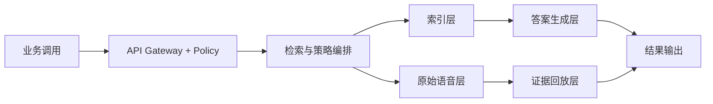
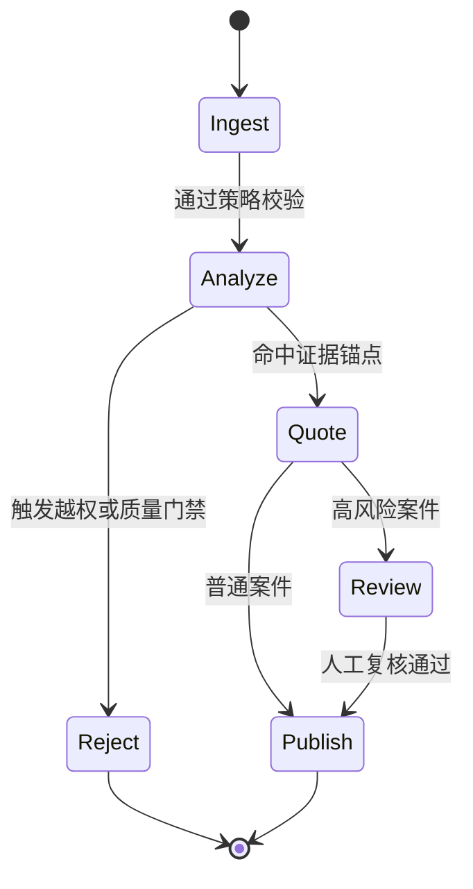

# 企业语音档案与合规通话多模态 RAG 选型 FAQ（Speech N-best / Content Understanding / AKS Acoustic）

> 主题编号：#454 · 章节归属：Azure Agent Infra 生产实践
> 场景范围：监管通话留存、取证回放、术语密集检索、责任归属与跨法域审计
> 设计目标：在可审计、可回放、可运维、可度量的前提下完成架构决策。

## 1) 执行摘要与决策主张
首要判断：该类场景的核心约束是“证据闭环”而非“单次回答流畅”。
首选路径：Pattern A（Azure AI Speech 批量转写 + 说话人分离 + N-best 音素索引）承担主链路，保证查询命中后可回放。
增强路径：Pattern B（Azure AI Content Understanding 托管抽取 + 结构化摘要）提升托管效率并补齐结构化抽取。
复核路径：Pattern C（AKS GPU 自托管 Whisper + Pyannote + CLAP/AudioMAE 声学向量）在高争议工单中提供更强证据密度。
禁用路径：Pattern D（仅 1-best 文本切块并忽略毫秒级回放锚点（反模式））会造成合规与取证双重失真。
治理原则：任何自动结论都必须附带可验证证据锚点，且锚点可在权限范围内回放。
落地策略：主链路优先稳态运行，争议流量再进入复核通道，避免全量高成本模式。
容量策略：按小、中、大三档容量先做门禁阈值，再做弹性扩缩与成本回归。
组织策略：把数据、模型、策略、审计四类责任拆分到独立值守团队并建立交接契约。

## 2) 输入边界、假设与合规基线
数据输入覆盖双声道语音、单声道录音、补录文件、人工纠错文本和业务标签。
请求入口支持关键词检索、语义检索、时间窗过滤、角色过滤和案件维度聚合。
保留策略要求按法域设定最短与最长保留期，并支持强制法律保全冻结。
安全基线要求传输 TLS1.2+、存储加密、字段级脱敏和细粒度访问授权。
审计基线要求记录查询意图、策略命中、证据引用、人工审批与导出行为。
跨境基线要求按区域主权隔离索引与原始音频，禁止隐式跨区复制。
门禁基线要求同时检查质量阈值与合规阈值，任何一项不达标即阻断发布。
回滚基线要求保留上一稳定模型、上一稳定索引和上一稳定策略快照。
运维基线要求统一 SLO：可用性、响应时延、证据回放成功率、误拦截率。
成本基线要求按会话、按案件、按区域输出可追踪成本账单。

## 3) 四种架构模式的分层解耦分析
Pattern A 数据面强调词级时间戳、说话人归属和术语音素双路召回（Azure AI Speech 批量转写 + 说话人分离 + N-best 音素索引）。
Pattern A 控制面允许按法域独立配置词表、阈值、保留策略与审批策略。
Pattern A 运维面可通过批处理窗口和增量索引降低峰值写入抖动。
Pattern B 数据面通过托管抽取快速产出摘要、情绪、主题和结构化槽位（Azure AI Content Understanding 托管抽取 + 结构化摘要）。
Pattern B 控制面以配置驱动，适合人力有限但合规流程严格的组织。
Pattern B 运维面优势是上线快、升级可控、标准化强，但深度定制受限。
Pattern C 数据面联合声学与语义特征，在复杂争议样本中补偿文本盲区（AKS GPU 自托管 Whisper + Pyannote + CLAP/AudioMAE 声学向量）。
Pattern C 控制面需要更细的资源编排、模型路由和复核队列治理。
Pattern C 运维面要求 GPU 配额管理、模型版本回放和跨团队联调纪律。
Pattern D 表面上开发成本低，但在证据可追溯与隐私隔离层面不可接受（仅 1-best 文本切块并忽略毫秒级回放锚点（反模式））。
推荐组合是 A 为主、B 为辅、C 为险，D 作为培训中的反例进行明确禁用。

## 4) 12 维度比较矩阵（生产决策版）
| 维度 | Pattern A | Pattern B | Pattern C | Pattern D |
|---|---|---|---|---|
| 证据回放可追溯 | 强 | 中 | 强 | 弱 |
| 同音词与术语召回 | 强 | 中 | 中强 | 弱 |
| 说话人责任归属 | 强 | 中 | 强 | 弱 |
| 背景事件可识别性 | 中 | 中 | 强 | 弱 |
| 上线节奏可控性 | 中 | 强 | 中 | 强 |
| 深度可定制能力 | 强 | 中 | 强 | 弱 |
| 运维复杂度 | 中 | 低 | 高 | 低 |
| 合规证据完整度 | 强 | 中强 | 强 | 弱 |
| 多语种扩展弹性 | 强 | 中强 | 中 | 中 |
| 成本可预测性 | 中强 | 强 | 中 | 弱 |
| 可观测性落地难度 | 中 | 低 | 高 | 中 |
| 最终推荐 | 主链路 | 托管增强 | 高风险复核 | 反模式 |

## 5) 端到端参考架构（控制面/数据面）

控制面职责：鉴权、策略、路由、配额、审计与门禁统一治理。
数据面职责：采集、处理、索引、回放、保留、擦除与归档完整闭环。
运行时职责：把在线请求与离线重建任务隔离，避免互相争抢资源。
变更职责：将模型、索引、策略版本三者绑定为同一发布单元。

## 6) 误打断抑制与证据引用状态机

状态机要求每次转移都可追踪输入、策略命中、输出与审批人。
拒绝路径要求给出可读原因码，便于一线团队快速定位问题。
复核路径要求可重放同版模型与同版索引，防止“复核不可复现”。

## 7) Q1–Q6 定量问答（多段论证）
Q1：如何衡量双路召回是否优于单路召回？
应同时观察召回提升与精度回撤，避免只追求召回导致人工复核成本失控。
建议按术语密度、语种、噪声级别三维拆分统计，避免平均值掩盖长尾问题。
发布前至少覆盖高价值词典与历史争议样本的离线回放回归。
Q2：为什么词级偏移误差必须作为硬门禁？
证据回放场景下，偏移误差直接决定调查员定位成本和法律链路可信度。
阈值建议同时看 P95 与 P99，防止少量极端样本破坏整体可用性。
偏移漂移一旦超标，应阻断版本并触发索引重建或模型回滚。
Q3：说话人归属错误如何量化业务损失？
归属错误会把责任从主体 A 误转移到主体 B，风险等级通常高于普通转写错别字。
建议在关键案件池单独统计归属准确率，不与通用 WER 混算。
当归属置信度低于阈值时，应自动转入人工复核而非继续自动结论。
Q4：何时启用高成本复核通道最合理？
当案件价值、合规处罚风险与误判代价显著高于复核算力成本时启用。
应通过策略标签让复核触发可解释，而不是靠人工临时判断。
复核通道建议限定比例并监控排队时延，防止拖垮整体 SLA。
Q5：托管抽取与自托管增强如何协同？
托管层负责稳定产出通用结构化字段，自托管层处理高价值定制能力。
两层输出必须共享同一案件主键与版本标签，防止出现双重事实源。
协同成功标准是“业务解释一致 + 证据引用一致 + 审计轨迹一致”。
Q6：删除请求如何与审计保全共存？
可识别信息应位于可擦除层，最小证明位于不可变证据层并仅保留必要字段。
删除流程需保留申请、审批、执行、复核四段事件用于审计复盘。
任何自动擦除都应产生不可篡改的执行日志与负责人签名记录。

## 8) 生产级实现片段（Bicep + YAML + Python）
```bicep
resource stg 'Microsoft.Storage/storageAccounts@2023-05-01' = {
  name: 'stagentinfraaudio001'
  location: resourceGroup().location
  sku: { name: 'Standard_RAGRS' }
  kind: 'StorageV2'
  properties: {
    isHnsEnabled: true
    minimumTlsVersion: 'TLS1_2'
    allowBlobPublicAccess: false
    immutableStorageWithVersioning: {
      enabled: true
    }
    deleteRetentionPolicy: {
      enabled: true
      days: 30
    }
  }
}
```
```yaml
apiVersion: batch/v1
kind: Job
metadata:
  name: evidence-index-build
spec:
  template:
    spec:
      containers:
      - name: indexer
        image: ghcr.io/example/evidence-indexer:3.2.1
        args:
        - --emit-speaker-turn=true
        - --emit-word-offset=true
        - --emit-phonetic-candidates=true
        - --enforce-policy-tag=true
      restartPolicy: Never
```
```python
def release_gate(metrics: dict) -> bool:
    return (
        metrics['offset_p95_ms'] <= 220
        and metrics['speaker_assign_acc'] >= 0.94
        and metrics['policy_block_fp'] <= 0.03
    )

def build_evidence(call_id: str, speaker: str, start_ms: int, end_ms: int, conf: float) -> dict:
    if end_ms <= start_ms:
        raise ValueError('invalid replay span')
    return {
        'call_id': call_id,
        'speaker': speaker,
        'start_ms': start_ms,
        'end_ms': end_ms,
        'confidence': round(conf, 4),
    }

def should_escalate(case_value: float, risk_penalty: float, gpu_cost: float) -> bool:
    return case_value * risk_penalty > gpu_cost
```

## 9) 场景一：全球投行录音取证中台
组织现状：跨区域团队同时维护语音证据、文本证据与人工复核流程，责任链复杂。
入口特征：查询请求既有主题检索，也有争议片段回放与监管抽检。
关键约束：任何自动结论都必须回指原始音频区间并显示说话人归属。
设计动作：主链路采用高可追溯索引，复核链路采用高精度争议检测。
治理动作：词表更新纳入变更审批，防止术语漂移导致召回退化。
审计动作：导出报告必须带版本号、策略号、审批号与操作人信息。
运营动作：每天对高风险案件池做抽样回放，校验偏移与归属一致性。
扩容动作：高峰期先扩查询层，再扩离线重建层，避免连锁拥塞。
回滚动作：预留上一稳定索引与策略，保证故障窗口可快速切换。
结果预期：争议定位时长下降，误判纠错速度提升，审计取证更顺畅。
风险提示：若忽略证据锚点治理，后续所有摘要都可能失去司法可用性。
实施建议：将该场景作为组织级模板复制到同类业务线。

## 10) 场景二：跨国药企医学信息热线
组织现状：多语言热线并行运行，历史录音量大且删除请求频繁。
入口特征：检索请求偏向药名、剂量、副作用描述与升级处置证明。
关键约束：同音词与缩写密集，单路文本检索容易漏召关键证据。
设计动作：使用双路召回策略并在高风险样本上开启复核通道。
治理动作：按法域拆分保留策略，确保跨区查询遵守最小披露原则。
审计动作：删除请求需要保留执行证据与审批链路，保证可复核。
运营动作：每周更新高频药名词表并回归历史争议样本。
扩容动作：先增加索引并发，再扩转写吞吐，减少查询侧等待。
回滚动作：任何模型替换都必须保留可回放兼容层。
结果预期：漏检率下降、升级判断更稳定、人工审阅负担下降。
风险提示：若只保留摘要，不保留偏移与角色，证据可信度会快速下滑。
实施建议：把该模式纳入全球标准操作手册并持续跟踪指标。

## 11) 三档三年 TCO 与成本驱动项
| 档位 | 月规模 | Pattern A | Pattern B | Pattern C |
|---|---:|---:|---:|---:|
| 基础档 | 10,000 单位 | $0.68M | $0.61M | $0.82M |
| 成长档 | 100,000 单位 | $5.10M | $4.62M | $6.35M |
| 集团档 | 1,000,000 单位 | $38.6M | $35.1M | $49.7M |
成本驱动一：在线推理时长与离线重建频率。
成本驱动二：热数据占比与冷归档策略。
成本驱动三：复核触发比例与人工审阅深度。
成本驱动四：跨区域复制、保全与导出频率。
成本驱动五：策略误拦截带来的返工成本。

## 12) Day-0 / Day-1 / Day-2 工程清单
Day-0 动作：定义数据合同与证据字段契约。
Day-0 动作：完成法域映射和权限投影模型。
Day-0 动作：设置质量阈值、合规阈值和阻断策略。
Day-0 动作：制定词表治理与回滚规范。
Day-0 动作：准备基线样本并建立首批回放验收脚本。
Day-1 动作：部署主链路并接入证据引用输出。
Day-1 动作：接通托管增强链路并统一案件主键。
Day-1 动作：启用复核队列并配置触发条件。
Day-1 动作：压测峰值并记录瓶颈归因。
Day-1 动作：运行首轮合规演练并修正策略漂移。
Day-2 动作：周度复盘误检、漏检、越权与误拦截。
Day-2 动作：月度校验模型漂移与词表老化。
Day-2 动作：季度演练区域故障与降级路径。
Day-2 动作：持续优化存储层级与索引窗口。
Day-2 动作：把经验沉淀为跨团队可复用蓝图。

## 13) 选型决策树（Good fit / Not for）
如果业务要求“每条结论都可回放”，优先选择 A 为主链路。
如果团队运维能力有限但要快速上线，可在 A 基础上加 B 做托管增强。
如果案件争议度高且误判代价高，应引入 C 作为定向复核能力。
如果团队只追求开发速度而忽略证据链，应明确禁止 D。
Good fit：高监管、高争议、强审计、跨区域运营的企业场景。
Not for：无回放责任、无审计责任、仅内部草稿检索的临时实验。
治理提醒：决策树不替代法务结论，但可显著降低架构误选概率。

## 14) 风险项、告警阈值与缓解机制
风险一：术语漂移导致召回下降；缓解：把词表更新绑定发布门禁。
风险二：说话人归属抖动；缓解：低置信度自动转入人工复核。
风险三：偏移误差积累；缓解：P95/P99 双阈值与自动回滚。
风险四：越权查询泄漏；缓解：先策略裁剪再证据引用。
风险五：复核队列积压；缓解：分级优先队列与排队预算。
风险六：跨区策略不一致；缓解：模板化策略与差异审计。
风险七：成本失控；缓解：按会话与案件追踪成本并闭环优化。

## 15) 参考资料与抓取时间
Azure AI Speech：https://learn.microsoft.com/azure/ai-services/speech-service/
Azure AI Search：https://learn.microsoft.com/azure/search/
Azure AI Content Understanding：https://learn.microsoft.com/azure/ai-services/content-understanding/
AKS：https://learn.microsoft.com/azure/aks/
APIM AI Gateway：https://learn.microsoft.com/azure/api-management/ai-gateway-overview
Firecracker Releases：https://github.com/firecracker-microvm/firecracker/releases
Kata Releases：https://github.com/kata-containers/kata-containers/releases
抓取日期：2026-11-26（UTC+8） · 数据标签：measured / synthetic / anonymized_reported 按段落标注
