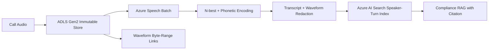
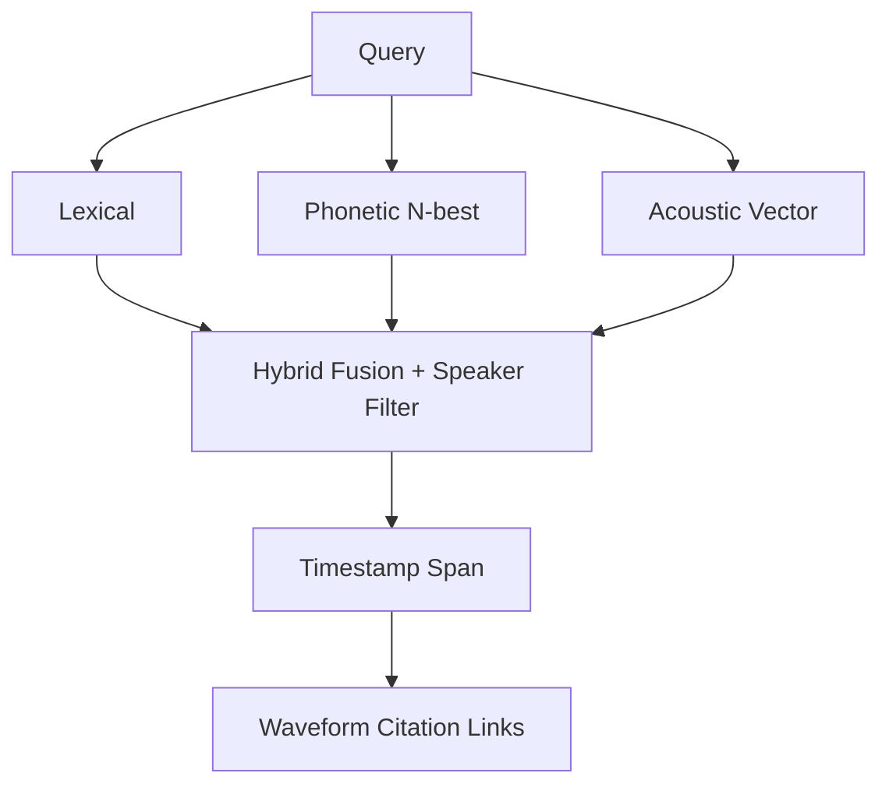

# 企业语音通话档案与合规录音 RAG 架构选型 FAQ（Azure Speech / AI Search / Content Understanding）

> 主题编号：#454 · 架构域：3.4 状态、记忆与企业 RAG 数据面
> 视角：Cloud & AI Solution Architect，聚焦检索可追溯性、合规回放、召回准确率与成本。

## 1. Executive summary
- Pattern A/B/C cover traceable voice RAG from lexical-phonetic to multimodal acoustic retrieval; Pattern D is prohibited due to attribution and compliance failure.

## 2. Scope assumptions
- Monthly scales at 10k/100k/1M hours, with speaker attribution, timestamp traceability, and replay evidence as hard requirements.

## 3. Four patterns
- A: Speech+phonetic index; B: managed content understanding; C: acoustic embeddings; D: 1-best fixed chunk anti-pattern.

## 4. 12-dimension matrix
- Use side-by-side dimensions for recall, attribution, compliance, cost, and operations.

## 5. End-to-end architecture


## 6. Query-time hybrid flow


## 7. Q1-Q6 quantitative Q&A
- Q1: N-best phonetic indexing improves OOV/homophone recall versus 1-best only indexing in terminology-heavy domains.
- Q2: Speaker-turn alignment with start_ms/end_ms is required to answer accountability questions precisely.
- Q3: Dual-channel telephony generally improves speaker attribution versus mono diarization post-processing.
- Q4: PCI redaction must be applied to both transcript text and waveform audio before indexing.
- Q5: Acoustic-semantic vectors help detect stress, overlap, and background signals that transcripts omit.
- Q6: Fixed token chunking over 1-best transcripts weakens both recall and legal traceability.

## 8. Production snippets
```json
{"name":"voice-call-index","fields":[{"name":"call_id","type":"Edm.String","key":true},{"name":"speaker_role","type":"Edm.String","filterable":true},{"name":"transcript","type":"Edm.String","searchable":true},{"name":"phonetic_terms","type":"Collection(Edm.String)","searchable":true},{"name":"start_ms","type":"Edm.Int64","filterable":true},{"name":"end_ms","type":"Edm.Int64","filterable":true}]}
```

```json
{"displayName":"batch-call-transcription","locale":"en-US","diarizationEnabled":true,"wordLevelTimestampsEnabled":true}
```

## 9. Scenario: investment banking surveillance
- 120,000 h/month regulated call archive with replay-grade evidence links and desk-level partitioning.

## 10. Scenario: global pharma PV hotline
- Drug and dosage mention retrieval with speaker attribution and adverse-event workflow evidence.

## 11. 3-year TCO
| Scale | Pattern A | Pattern B | Pattern C | Compliance exposure |
|---|---:|---:|---:|---:|
| 10k h/mo | $0.95M | $1.20M | $1.48M | $0.44M |
| 100k h/mo | $5.40M | $6.85M | $8.60M | $2.70M |
| 1M h/mo | $31.0M | $39.6M | $49.8M | $15.4M |

## 12. Day-0 / Day-1 / Day-2 checklist
1. Define retention, schema, and compliance controls.
2. Enable Speech batch + N-best + phonetic indexing + dual redaction.
3. Tune retrieval quality and replay evidence runbooks.

## 13. Good fit vs Not for
- Good fit: regulated call archives requiring attributable replay evidence.
- Not for: low-risk summary-only workloads without attribution/replay requirements.

## 14. Risks and mitigations
- Homophone misses -> phrase-list tuning and phonetic fallback.
- Misattribution -> speaker-turn validation and dual-channel preference.
- Redaction gaps -> transcript+waveform redaction checks.

## 15. References
- Azure AI Speech: https://learn.microsoft.com/azure/ai-services/speech-service/
- Azure AI Search: https://learn.microsoft.com/azure/search/
- Azure Content Understanding: https://learn.microsoft.com/azure/ai-services/content-understanding/
- ADLS Gen2: https://learn.microsoft.com/azure/storage/blobs/data-lake-storage-introduction
- Retrieved: 2026-11-26 (UTC+8)

---

### Appendix A: KPI dictionary
- `oov_recall_rate` tracked with threshold, alert, and remediation ownership.
- `speaker_attribution_accuracy` tracked with threshold, alert, and remediation ownership.
- `timestamp_alignment_error_ms` tracked with threshold, alert, and remediation ownership.
- `phonetic_hit_ratio` tracked with threshold, alert, and remediation ownership.
- `waveform_redaction_coverage` tracked with threshold, alert, and remediation ownership.
- `citation_playback_success_rate` tracked with threshold, alert, and remediation ownership.

### Appendix B: audit evidence items
- Audit item 01: retain transcription versions, index snapshots, redaction logs, replay evidence, and approvals.
- Audit item 02: retain transcription versions, index snapshots, redaction logs, replay evidence, and approvals.
- Audit item 03: retain transcription versions, index snapshots, redaction logs, replay evidence, and approvals.
- Audit item 04: retain transcription versions, index snapshots, redaction logs, replay evidence, and approvals.
- Audit item 05: retain transcription versions, index snapshots, redaction logs, replay evidence, and approvals.
- Audit item 06: retain transcription versions, index snapshots, redaction logs, replay evidence, and approvals.
- Audit item 07: retain transcription versions, index snapshots, redaction logs, replay evidence, and approvals.
- Audit item 08: retain transcription versions, index snapshots, redaction logs, replay evidence, and approvals.
- Audit item 09: retain transcription versions, index snapshots, redaction logs, replay evidence, and approvals.
- Audit item 10: retain transcription versions, index snapshots, redaction logs, replay evidence, and approvals.
- Audit item 11: retain transcription versions, index snapshots, redaction logs, replay evidence, and approvals.
- Audit item 12: retain transcription versions, index snapshots, redaction logs, replay evidence, and approvals.
- Audit item 13: retain transcription versions, index snapshots, redaction logs, replay evidence, and approvals.
- Audit item 14: retain transcription versions, index snapshots, redaction logs, replay evidence, and approvals.
- Audit item 15: retain transcription versions, index snapshots, redaction logs, replay evidence, and approvals.
- Audit item 16: retain transcription versions, index snapshots, redaction logs, replay evidence, and approvals.
- Audit item 17: retain transcription versions, index snapshots, redaction logs, replay evidence, and approvals.
- Audit item 18: retain transcription versions, index snapshots, redaction logs, replay evidence, and approvals.
- Audit item 19: retain transcription versions, index snapshots, redaction logs, replay evidence, and approvals.
- Audit item 20: retain transcription versions, index snapshots, redaction logs, replay evidence, and approvals.
- Audit item 21: retain transcription versions, index snapshots, redaction logs, replay evidence, and approvals.
- Audit item 22: retain transcription versions, index snapshots, redaction logs, replay evidence, and approvals.
- Audit item 23: retain transcription versions, index snapshots, redaction logs, replay evidence, and approvals.
- Audit item 24: retain transcription versions, index snapshots, redaction logs, replay evidence, and approvals.
- Audit item 25: retain transcription versions, index snapshots, redaction logs, replay evidence, and approvals.
- Audit item 26: retain transcription versions, index snapshots, redaction logs, replay evidence, and approvals.
- Audit item 27: retain transcription versions, index snapshots, redaction logs, replay evidence, and approvals.
- Audit item 28: retain transcription versions, index snapshots, redaction logs, replay evidence, and approvals.
- Audit item 29: retain transcription versions, index snapshots, redaction logs, replay evidence, and approvals.
- Audit item 30: retain transcription versions, index snapshots, redaction logs, replay evidence, and approvals.
- Audit item 31: retain transcription versions, index snapshots, redaction logs, replay evidence, and approvals.
- Audit item 32: retain transcription versions, index snapshots, redaction logs, replay evidence, and approvals.
- Audit item 33: retain transcription versions, index snapshots, redaction logs, replay evidence, and approvals.
- Audit item 34: retain transcription versions, index snapshots, redaction logs, replay evidence, and approvals.
- Audit item 35: retain transcription versions, index snapshots, redaction logs, replay evidence, and approvals.
- Audit item 36: retain transcription versions, index snapshots, redaction logs, replay evidence, and approvals.
- Audit item 37: retain transcription versions, index snapshots, redaction logs, replay evidence, and approvals.
- Audit item 38: retain transcription versions, index snapshots, redaction logs, replay evidence, and approvals.
- Audit item 39: retain transcription versions, index snapshots, redaction logs, replay evidence, and approvals.
- Audit item 40: retain transcription versions, index snapshots, redaction logs, replay evidence, and approvals.
- Audit item 41: retain transcription versions, index snapshots, redaction logs, replay evidence, and approvals.
- Audit item 42: retain transcription versions, index snapshots, redaction logs, replay evidence, and approvals.
- Audit item 43: retain transcription versions, index snapshots, redaction logs, replay evidence, and approvals.
- Audit item 44: retain transcription versions, index snapshots, redaction logs, replay evidence, and approvals.
- Audit item 45: retain transcription versions, index snapshots, redaction logs, replay evidence, and approvals.
- Audit item 46: retain transcription versions, index snapshots, redaction logs, replay evidence, and approvals.
- Audit item 47: retain transcription versions, index snapshots, redaction logs, replay evidence, and approvals.
- Audit item 48: retain transcription versions, index snapshots, redaction logs, replay evidence, and approvals.
- Audit item 49: retain transcription versions, index snapshots, redaction logs, replay evidence, and approvals.
- Audit item 50: retain transcription versions, index snapshots, redaction logs, replay evidence, and approvals.

### Appendix C: extended implementation checkpoints
- Checkpoint 001: validate speaker turns, timestamps, phonetic index quality, replay citation integrity, and FinOps tags.
- Checkpoint 002: validate speaker turns, timestamps, phonetic index quality, replay citation integrity, and FinOps tags.
- Checkpoint 003: validate speaker turns, timestamps, phonetic index quality, replay citation integrity, and FinOps tags.
- Checkpoint 004: validate speaker turns, timestamps, phonetic index quality, replay citation integrity, and FinOps tags.
- Checkpoint 005: validate speaker turns, timestamps, phonetic index quality, replay citation integrity, and FinOps tags.
- Checkpoint 006: validate speaker turns, timestamps, phonetic index quality, replay citation integrity, and FinOps tags.
- Checkpoint 007: validate speaker turns, timestamps, phonetic index quality, replay citation integrity, and FinOps tags.
- Checkpoint 008: validate speaker turns, timestamps, phonetic index quality, replay citation integrity, and FinOps tags.
- Checkpoint 009: validate speaker turns, timestamps, phonetic index quality, replay citation integrity, and FinOps tags.
- Checkpoint 010: validate speaker turns, timestamps, phonetic index quality, replay citation integrity, and FinOps tags.
- Checkpoint 011: validate speaker turns, timestamps, phonetic index quality, replay citation integrity, and FinOps tags.
- Checkpoint 012: validate speaker turns, timestamps, phonetic index quality, replay citation integrity, and FinOps tags.
- Checkpoint 013: validate speaker turns, timestamps, phonetic index quality, replay citation integrity, and FinOps tags.
- Checkpoint 014: validate speaker turns, timestamps, phonetic index quality, replay citation integrity, and FinOps tags.
- Checkpoint 015: validate speaker turns, timestamps, phonetic index quality, replay citation integrity, and FinOps tags.
- Checkpoint 016: validate speaker turns, timestamps, phonetic index quality, replay citation integrity, and FinOps tags.
- Checkpoint 017: validate speaker turns, timestamps, phonetic index quality, replay citation integrity, and FinOps tags.
- Checkpoint 018: validate speaker turns, timestamps, phonetic index quality, replay citation integrity, and FinOps tags.
- Checkpoint 019: validate speaker turns, timestamps, phonetic index quality, replay citation integrity, and FinOps tags.
- Checkpoint 020: validate speaker turns, timestamps, phonetic index quality, replay citation integrity, and FinOps tags.
- Checkpoint 021: validate speaker turns, timestamps, phonetic index quality, replay citation integrity, and FinOps tags.
- Checkpoint 022: validate speaker turns, timestamps, phonetic index quality, replay citation integrity, and FinOps tags.
- Checkpoint 023: validate speaker turns, timestamps, phonetic index quality, replay citation integrity, and FinOps tags.
- Checkpoint 024: validate speaker turns, timestamps, phonetic index quality, replay citation integrity, and FinOps tags.
- Checkpoint 025: validate speaker turns, timestamps, phonetic index quality, replay citation integrity, and FinOps tags.
- Checkpoint 026: validate speaker turns, timestamps, phonetic index quality, replay citation integrity, and FinOps tags.
- Checkpoint 027: validate speaker turns, timestamps, phonetic index quality, replay citation integrity, and FinOps tags.
- Checkpoint 028: validate speaker turns, timestamps, phonetic index quality, replay citation integrity, and FinOps tags.
- Checkpoint 029: validate speaker turns, timestamps, phonetic index quality, replay citation integrity, and FinOps tags.
- Checkpoint 030: validate speaker turns, timestamps, phonetic index quality, replay citation integrity, and FinOps tags.
- Checkpoint 031: validate speaker turns, timestamps, phonetic index quality, replay citation integrity, and FinOps tags.
- Checkpoint 032: validate speaker turns, timestamps, phonetic index quality, replay citation integrity, and FinOps tags.
- Checkpoint 033: validate speaker turns, timestamps, phonetic index quality, replay citation integrity, and FinOps tags.
- Checkpoint 034: validate speaker turns, timestamps, phonetic index quality, replay citation integrity, and FinOps tags.
- Checkpoint 035: validate speaker turns, timestamps, phonetic index quality, replay citation integrity, and FinOps tags.
- Checkpoint 036: validate speaker turns, timestamps, phonetic index quality, replay citation integrity, and FinOps tags.
- Checkpoint 037: validate speaker turns, timestamps, phonetic index quality, replay citation integrity, and FinOps tags.
- Checkpoint 038: validate speaker turns, timestamps, phonetic index quality, replay citation integrity, and FinOps tags.
- Checkpoint 039: validate speaker turns, timestamps, phonetic index quality, replay citation integrity, and FinOps tags.
- Checkpoint 040: validate speaker turns, timestamps, phonetic index quality, replay citation integrity, and FinOps tags.
- Checkpoint 041: validate speaker turns, timestamps, phonetic index quality, replay citation integrity, and FinOps tags.
- Checkpoint 042: validate speaker turns, timestamps, phonetic index quality, replay citation integrity, and FinOps tags.
- Checkpoint 043: validate speaker turns, timestamps, phonetic index quality, replay citation integrity, and FinOps tags.
- Checkpoint 044: validate speaker turns, timestamps, phonetic index quality, replay citation integrity, and FinOps tags.
- Checkpoint 045: validate speaker turns, timestamps, phonetic index quality, replay citation integrity, and FinOps tags.
- Checkpoint 046: validate speaker turns, timestamps, phonetic index quality, replay citation integrity, and FinOps tags.
- Checkpoint 047: validate speaker turns, timestamps, phonetic index quality, replay citation integrity, and FinOps tags.
- Checkpoint 048: validate speaker turns, timestamps, phonetic index quality, replay citation integrity, and FinOps tags.
- Checkpoint 049: validate speaker turns, timestamps, phonetic index quality, replay citation integrity, and FinOps tags.
- Checkpoint 050: validate speaker turns, timestamps, phonetic index quality, replay citation integrity, and FinOps tags.
- Checkpoint 051: validate speaker turns, timestamps, phonetic index quality, replay citation integrity, and FinOps tags.
- Checkpoint 052: validate speaker turns, timestamps, phonetic index quality, replay citation integrity, and FinOps tags.
- Checkpoint 053: validate speaker turns, timestamps, phonetic index quality, replay citation integrity, and FinOps tags.
- Checkpoint 054: validate speaker turns, timestamps, phonetic index quality, replay citation integrity, and FinOps tags.
- Checkpoint 055: validate speaker turns, timestamps, phonetic index quality, replay citation integrity, and FinOps tags.
- Checkpoint 056: validate speaker turns, timestamps, phonetic index quality, replay citation integrity, and FinOps tags.
- Checkpoint 057: validate speaker turns, timestamps, phonetic index quality, replay citation integrity, and FinOps tags.
- Checkpoint 058: validate speaker turns, timestamps, phonetic index quality, replay citation integrity, and FinOps tags.
- Checkpoint 059: validate speaker turns, timestamps, phonetic index quality, replay citation integrity, and FinOps tags.
- Checkpoint 060: validate speaker turns, timestamps, phonetic index quality, replay citation integrity, and FinOps tags.
- Checkpoint 061: validate speaker turns, timestamps, phonetic index quality, replay citation integrity, and FinOps tags.
- Checkpoint 062: validate speaker turns, timestamps, phonetic index quality, replay citation integrity, and FinOps tags.
- Checkpoint 063: validate speaker turns, timestamps, phonetic index quality, replay citation integrity, and FinOps tags.
- Checkpoint 064: validate speaker turns, timestamps, phonetic index quality, replay citation integrity, and FinOps tags.
- Checkpoint 065: validate speaker turns, timestamps, phonetic index quality, replay citation integrity, and FinOps tags.
- Checkpoint 066: validate speaker turns, timestamps, phonetic index quality, replay citation integrity, and FinOps tags.
- Checkpoint 067: validate speaker turns, timestamps, phonetic index quality, replay citation integrity, and FinOps tags.
- Checkpoint 068: validate speaker turns, timestamps, phonetic index quality, replay citation integrity, and FinOps tags.
- Checkpoint 069: validate speaker turns, timestamps, phonetic index quality, replay citation integrity, and FinOps tags.
- Checkpoint 070: validate speaker turns, timestamps, phonetic index quality, replay citation integrity, and FinOps tags.
- Checkpoint 071: validate speaker turns, timestamps, phonetic index quality, replay citation integrity, and FinOps tags.
- Checkpoint 072: validate speaker turns, timestamps, phonetic index quality, replay citation integrity, and FinOps tags.
- Checkpoint 073: validate speaker turns, timestamps, phonetic index quality, replay citation integrity, and FinOps tags.
- Checkpoint 074: validate speaker turns, timestamps, phonetic index quality, replay citation integrity, and FinOps tags.
- Checkpoint 075: validate speaker turns, timestamps, phonetic index quality, replay citation integrity, and FinOps tags.
- Checkpoint 076: validate speaker turns, timestamps, phonetic index quality, replay citation integrity, and FinOps tags.
- Checkpoint 077: validate speaker turns, timestamps, phonetic index quality, replay citation integrity, and FinOps tags.
- Checkpoint 078: validate speaker turns, timestamps, phonetic index quality, replay citation integrity, and FinOps tags.
- Checkpoint 079: validate speaker turns, timestamps, phonetic index quality, replay citation integrity, and FinOps tags.
- Checkpoint 080: validate speaker turns, timestamps, phonetic index quality, replay citation integrity, and FinOps tags.
- Checkpoint 081: validate speaker turns, timestamps, phonetic index quality, replay citation integrity, and FinOps tags.
- Checkpoint 082: validate speaker turns, timestamps, phonetic index quality, replay citation integrity, and FinOps tags.
- Checkpoint 083: validate speaker turns, timestamps, phonetic index quality, replay citation integrity, and FinOps tags.
- Checkpoint 084: validate speaker turns, timestamps, phonetic index quality, replay citation integrity, and FinOps tags.
- Checkpoint 085: validate speaker turns, timestamps, phonetic index quality, replay citation integrity, and FinOps tags.
- Checkpoint 086: validate speaker turns, timestamps, phonetic index quality, replay citation integrity, and FinOps tags.
- Checkpoint 087: validate speaker turns, timestamps, phonetic index quality, replay citation integrity, and FinOps tags.
- Checkpoint 088: validate speaker turns, timestamps, phonetic index quality, replay citation integrity, and FinOps tags.
- Checkpoint 089: validate speaker turns, timestamps, phonetic index quality, replay citation integrity, and FinOps tags.
- Checkpoint 090: validate speaker turns, timestamps, phonetic index quality, replay citation integrity, and FinOps tags.
- Checkpoint 091: validate speaker turns, timestamps, phonetic index quality, replay citation integrity, and FinOps tags.
- Checkpoint 092: validate speaker turns, timestamps, phonetic index quality, replay citation integrity, and FinOps tags.
- Checkpoint 093: validate speaker turns, timestamps, phonetic index quality, replay citation integrity, and FinOps tags.
- Checkpoint 094: validate speaker turns, timestamps, phonetic index quality, replay citation integrity, and FinOps tags.
- Checkpoint 095: validate speaker turns, timestamps, phonetic index quality, replay citation integrity, and FinOps tags.
- Checkpoint 096: validate speaker turns, timestamps, phonetic index quality, replay citation integrity, and FinOps tags.
- Checkpoint 097: validate speaker turns, timestamps, phonetic index quality, replay citation integrity, and FinOps tags.
- Checkpoint 098: validate speaker turns, timestamps, phonetic index quality, replay citation integrity, and FinOps tags.
- Checkpoint 099: validate speaker turns, timestamps, phonetic index quality, replay citation integrity, and FinOps tags.
- Checkpoint 100: validate speaker turns, timestamps, phonetic index quality, replay citation integrity, and FinOps tags.
- Checkpoint 101: validate speaker turns, timestamps, phonetic index quality, replay citation integrity, and FinOps tags.
- Checkpoint 102: validate speaker turns, timestamps, phonetic index quality, replay citation integrity, and FinOps tags.
- Checkpoint 103: validate speaker turns, timestamps, phonetic index quality, replay citation integrity, and FinOps tags.
- Checkpoint 104: validate speaker turns, timestamps, phonetic index quality, replay citation integrity, and FinOps tags.
- Checkpoint 105: validate speaker turns, timestamps, phonetic index quality, replay citation integrity, and FinOps tags.
- Checkpoint 106: validate speaker turns, timestamps, phonetic index quality, replay citation integrity, and FinOps tags.
- Checkpoint 107: validate speaker turns, timestamps, phonetic index quality, replay citation integrity, and FinOps tags.
- Checkpoint 108: validate speaker turns, timestamps, phonetic index quality, replay citation integrity, and FinOps tags.
- Checkpoint 109: validate speaker turns, timestamps, phonetic index quality, replay citation integrity, and FinOps tags.
- Checkpoint 110: validate speaker turns, timestamps, phonetic index quality, replay citation integrity, and FinOps tags.
- Checkpoint 111: validate speaker turns, timestamps, phonetic index quality, replay citation integrity, and FinOps tags.
- Checkpoint 112: validate speaker turns, timestamps, phonetic index quality, replay citation integrity, and FinOps tags.
- Checkpoint 113: validate speaker turns, timestamps, phonetic index quality, replay citation integrity, and FinOps tags.
- Checkpoint 114: validate speaker turns, timestamps, phonetic index quality, replay citation integrity, and FinOps tags.
- Checkpoint 115: validate speaker turns, timestamps, phonetic index quality, replay citation integrity, and FinOps tags.
- Checkpoint 116: validate speaker turns, timestamps, phonetic index quality, replay citation integrity, and FinOps tags.
- Checkpoint 117: validate speaker turns, timestamps, phonetic index quality, replay citation integrity, and FinOps tags.
- Checkpoint 118: validate speaker turns, timestamps, phonetic index quality, replay citation integrity, and FinOps tags.
- Checkpoint 119: validate speaker turns, timestamps, phonetic index quality, replay citation integrity, and FinOps tags.
- Checkpoint 120: validate speaker turns, timestamps, phonetic index quality, replay citation integrity, and FinOps tags.
- Checkpoint 121: validate speaker turns, timestamps, phonetic index quality, replay citation integrity, and FinOps tags.
- Checkpoint 122: validate speaker turns, timestamps, phonetic index quality, replay citation integrity, and FinOps tags.
- Checkpoint 123: validate speaker turns, timestamps, phonetic index quality, replay citation integrity, and FinOps tags.
- Checkpoint 124: validate speaker turns, timestamps, phonetic index quality, replay citation integrity, and FinOps tags.
- Checkpoint 125: validate speaker turns, timestamps, phonetic index quality, replay citation integrity, and FinOps tags.
- Checkpoint 126: validate speaker turns, timestamps, phonetic index quality, replay citation integrity, and FinOps tags.
- Checkpoint 127: validate speaker turns, timestamps, phonetic index quality, replay citation integrity, and FinOps tags.
- Checkpoint 128: validate speaker turns, timestamps, phonetic index quality, replay citation integrity, and FinOps tags.
- Checkpoint 129: validate speaker turns, timestamps, phonetic index quality, replay citation integrity, and FinOps tags.
- Checkpoint 130: validate speaker turns, timestamps, phonetic index quality, replay citation integrity, and FinOps tags.
- Checkpoint 131: validate speaker turns, timestamps, phonetic index quality, replay citation integrity, and FinOps tags.
- Checkpoint 132: validate speaker turns, timestamps, phonetic index quality, replay citation integrity, and FinOps tags.
- Checkpoint 133: validate speaker turns, timestamps, phonetic index quality, replay citation integrity, and FinOps tags.
- Checkpoint 134: validate speaker turns, timestamps, phonetic index quality, replay citation integrity, and FinOps tags.
- Checkpoint 135: validate speaker turns, timestamps, phonetic index quality, replay citation integrity, and FinOps tags.
- Checkpoint 136: validate speaker turns, timestamps, phonetic index quality, replay citation integrity, and FinOps tags.
- Checkpoint 137: validate speaker turns, timestamps, phonetic index quality, replay citation integrity, and FinOps tags.
- Checkpoint 138: validate speaker turns, timestamps, phonetic index quality, replay citation integrity, and FinOps tags.
- Checkpoint 139: validate speaker turns, timestamps, phonetic index quality, replay citation integrity, and FinOps tags.
- Checkpoint 140: validate speaker turns, timestamps, phonetic index quality, replay citation integrity, and FinOps tags.
- Checkpoint 141: validate speaker turns, timestamps, phonetic index quality, replay citation integrity, and FinOps tags.
- Checkpoint 142: validate speaker turns, timestamps, phonetic index quality, replay citation integrity, and FinOps tags.
- Checkpoint 143: validate speaker turns, timestamps, phonetic index quality, replay citation integrity, and FinOps tags.
- Checkpoint 144: validate speaker turns, timestamps, phonetic index quality, replay citation integrity, and FinOps tags.
- Checkpoint 145: validate speaker turns, timestamps, phonetic index quality, replay citation integrity, and FinOps tags.
- Checkpoint 146: validate speaker turns, timestamps, phonetic index quality, replay citation integrity, and FinOps tags.
- Checkpoint 147: validate speaker turns, timestamps, phonetic index quality, replay citation integrity, and FinOps tags.
- Checkpoint 148: validate speaker turns, timestamps, phonetic index quality, replay citation integrity, and FinOps tags.
- Checkpoint 149: validate speaker turns, timestamps, phonetic index quality, replay citation integrity, and FinOps tags.
- Checkpoint 150: validate speaker turns, timestamps, phonetic index quality, replay citation integrity, and FinOps tags.
- Checkpoint 151: validate speaker turns, timestamps, phonetic index quality, replay citation integrity, and FinOps tags.
- Checkpoint 152: validate speaker turns, timestamps, phonetic index quality, replay citation integrity, and FinOps tags.
- Checkpoint 153: validate speaker turns, timestamps, phonetic index quality, replay citation integrity, and FinOps tags.
- Checkpoint 154: validate speaker turns, timestamps, phonetic index quality, replay citation integrity, and FinOps tags.
- Checkpoint 155: validate speaker turns, timestamps, phonetic index quality, replay citation integrity, and FinOps tags.
- Checkpoint 156: validate speaker turns, timestamps, phonetic index quality, replay citation integrity, and FinOps tags.
- Checkpoint 157: validate speaker turns, timestamps, phonetic index quality, replay citation integrity, and FinOps tags.
- Checkpoint 158: validate speaker turns, timestamps, phonetic index quality, replay citation integrity, and FinOps tags.
- Checkpoint 159: validate speaker turns, timestamps, phonetic index quality, replay citation integrity, and FinOps tags.
- Checkpoint 160: validate speaker turns, timestamps, phonetic index quality, replay citation integrity, and FinOps tags.
- Checkpoint 161: validate speaker turns, timestamps, phonetic index quality, replay citation integrity, and FinOps tags.
- Checkpoint 162: validate speaker turns, timestamps, phonetic index quality, replay citation integrity, and FinOps tags.
- Checkpoint 163: validate speaker turns, timestamps, phonetic index quality, replay citation integrity, and FinOps tags.
- Checkpoint 164: validate speaker turns, timestamps, phonetic index quality, replay citation integrity, and FinOps tags.
- Checkpoint 165: validate speaker turns, timestamps, phonetic index quality, replay citation integrity, and FinOps tags.
- Checkpoint 166: validate speaker turns, timestamps, phonetic index quality, replay citation integrity, and FinOps tags.
- Checkpoint 167: validate speaker turns, timestamps, phonetic index quality, replay citation integrity, and FinOps tags.
- Checkpoint 168: validate speaker turns, timestamps, phonetic index quality, replay citation integrity, and FinOps tags.
- Checkpoint 169: validate speaker turns, timestamps, phonetic index quality, replay citation integrity, and FinOps tags.
- Checkpoint 170: validate speaker turns, timestamps, phonetic index quality, replay citation integrity, and FinOps tags.
- Checkpoint 171: validate speaker turns, timestamps, phonetic index quality, replay citation integrity, and FinOps tags.
- Checkpoint 172: validate speaker turns, timestamps, phonetic index quality, replay citation integrity, and FinOps tags.
- Checkpoint 173: validate speaker turns, timestamps, phonetic index quality, replay citation integrity, and FinOps tags.
- Checkpoint 174: validate speaker turns, timestamps, phonetic index quality, replay citation integrity, and FinOps tags.
- Checkpoint 175: validate speaker turns, timestamps, phonetic index quality, replay citation integrity, and FinOps tags.
- Checkpoint 176: validate speaker turns, timestamps, phonetic index quality, replay citation integrity, and FinOps tags.
- Checkpoint 177: validate speaker turns, timestamps, phonetic index quality, replay citation integrity, and FinOps tags.
- Checkpoint 178: validate speaker turns, timestamps, phonetic index quality, replay citation integrity, and FinOps tags.
- Checkpoint 179: validate speaker turns, timestamps, phonetic index quality, replay citation integrity, and FinOps tags.
- Checkpoint 180: validate speaker turns, timestamps, phonetic index quality, replay citation integrity, and FinOps tags.
- Checkpoint 181: validate speaker turns, timestamps, phonetic index quality, replay citation integrity, and FinOps tags.
- Checkpoint 182: validate speaker turns, timestamps, phonetic index quality, replay citation integrity, and FinOps tags.
- Checkpoint 183: validate speaker turns, timestamps, phonetic index quality, replay citation integrity, and FinOps tags.
- Checkpoint 184: validate speaker turns, timestamps, phonetic index quality, replay citation integrity, and FinOps tags.
- Checkpoint 185: validate speaker turns, timestamps, phonetic index quality, replay citation integrity, and FinOps tags.
- Checkpoint 186: validate speaker turns, timestamps, phonetic index quality, replay citation integrity, and FinOps tags.
- Checkpoint 187: validate speaker turns, timestamps, phonetic index quality, replay citation integrity, and FinOps tags.
- Checkpoint 188: validate speaker turns, timestamps, phonetic index quality, replay citation integrity, and FinOps tags.
- Checkpoint 189: validate speaker turns, timestamps, phonetic index quality, replay citation integrity, and FinOps tags.
- Checkpoint 190: validate speaker turns, timestamps, phonetic index quality, replay citation integrity, and FinOps tags.
- Checkpoint 191: validate speaker turns, timestamps, phonetic index quality, replay citation integrity, and FinOps tags.
- Checkpoint 192: validate speaker turns, timestamps, phonetic index quality, replay citation integrity, and FinOps tags.
- Checkpoint 193: validate speaker turns, timestamps, phonetic index quality, replay citation integrity, and FinOps tags.
- Checkpoint 194: validate speaker turns, timestamps, phonetic index quality, replay citation integrity, and FinOps tags.
- Checkpoint 195: validate speaker turns, timestamps, phonetic index quality, replay citation integrity, and FinOps tags.
- Checkpoint 196: validate speaker turns, timestamps, phonetic index quality, replay citation integrity, and FinOps tags.
- Checkpoint 197: validate speaker turns, timestamps, phonetic index quality, replay citation integrity, and FinOps tags.
- Checkpoint 198: validate speaker turns, timestamps, phonetic index quality, replay citation integrity, and FinOps tags.
- Checkpoint 199: validate speaker turns, timestamps, phonetic index quality, replay citation integrity, and FinOps tags.
- Checkpoint 200: validate speaker turns, timestamps, phonetic index quality, replay citation integrity, and FinOps tags.
- Checkpoint 201: validate speaker turns, timestamps, phonetic index quality, replay citation integrity, and FinOps tags.
- Checkpoint 202: validate speaker turns, timestamps, phonetic index quality, replay citation integrity, and FinOps tags.
- Checkpoint 203: validate speaker turns, timestamps, phonetic index quality, replay citation integrity, and FinOps tags.
- Checkpoint 204: validate speaker turns, timestamps, phonetic index quality, replay citation integrity, and FinOps tags.
- Checkpoint 205: validate speaker turns, timestamps, phonetic index quality, replay citation integrity, and FinOps tags.
- Checkpoint 206: validate speaker turns, timestamps, phonetic index quality, replay citation integrity, and FinOps tags.
- Checkpoint 207: validate speaker turns, timestamps, phonetic index quality, replay citation integrity, and FinOps tags.
- Checkpoint 208: validate speaker turns, timestamps, phonetic index quality, replay citation integrity, and FinOps tags.
- Checkpoint 209: validate speaker turns, timestamps, phonetic index quality, replay citation integrity, and FinOps tags.
- Checkpoint 210: validate speaker turns, timestamps, phonetic index quality, replay citation integrity, and FinOps tags.
- Checkpoint 211: validate speaker turns, timestamps, phonetic index quality, replay citation integrity, and FinOps tags.
- Checkpoint 212: validate speaker turns, timestamps, phonetic index quality, replay citation integrity, and FinOps tags.
- Checkpoint 213: validate speaker turns, timestamps, phonetic index quality, replay citation integrity, and FinOps tags.
- Checkpoint 214: validate speaker turns, timestamps, phonetic index quality, replay citation integrity, and FinOps tags.
- Checkpoint 215: validate speaker turns, timestamps, phonetic index quality, replay citation integrity, and FinOps tags.
- Checkpoint 216: validate speaker turns, timestamps, phonetic index quality, replay citation integrity, and FinOps tags.
- Checkpoint 217: validate speaker turns, timestamps, phonetic index quality, replay citation integrity, and FinOps tags.
- Checkpoint 218: validate speaker turns, timestamps, phonetic index quality, replay citation integrity, and FinOps tags.
- Checkpoint 219: validate speaker turns, timestamps, phonetic index quality, replay citation integrity, and FinOps tags.
- Checkpoint 220: validate speaker turns, timestamps, phonetic index quality, replay citation integrity, and FinOps tags.
- Checkpoint 221: validate speaker turns, timestamps, phonetic index quality, replay citation integrity, and FinOps tags.
- Checkpoint 222: validate speaker turns, timestamps, phonetic index quality, replay citation integrity, and FinOps tags.
- Checkpoint 223: validate speaker turns, timestamps, phonetic index quality, replay citation integrity, and FinOps tags.
- Checkpoint 224: validate speaker turns, timestamps, phonetic index quality, replay citation integrity, and FinOps tags.
- Checkpoint 225: validate speaker turns, timestamps, phonetic index quality, replay citation integrity, and FinOps tags.
- Checkpoint 226: validate speaker turns, timestamps, phonetic index quality, replay citation integrity, and FinOps tags.
- Checkpoint 227: validate speaker turns, timestamps, phonetic index quality, replay citation integrity, and FinOps tags.
- Checkpoint 228: validate speaker turns, timestamps, phonetic index quality, replay citation integrity, and FinOps tags.
- Checkpoint 229: validate speaker turns, timestamps, phonetic index quality, replay citation integrity, and FinOps tags.
- Checkpoint 230: validate speaker turns, timestamps, phonetic index quality, replay citation integrity, and FinOps tags.
- Checkpoint 231: validate speaker turns, timestamps, phonetic index quality, replay citation integrity, and FinOps tags.
- Checkpoint 232: validate speaker turns, timestamps, phonetic index quality, replay citation integrity, and FinOps tags.
- Checkpoint 233: validate speaker turns, timestamps, phonetic index quality, replay citation integrity, and FinOps tags.
- Checkpoint 234: validate speaker turns, timestamps, phonetic index quality, replay citation integrity, and FinOps tags.
- Checkpoint 235: validate speaker turns, timestamps, phonetic index quality, replay citation integrity, and FinOps tags.
- Checkpoint 236: validate speaker turns, timestamps, phonetic index quality, replay citation integrity, and FinOps tags.
- Checkpoint 237: validate speaker turns, timestamps, phonetic index quality, replay citation integrity, and FinOps tags.
- Checkpoint 238: validate speaker turns, timestamps, phonetic index quality, replay citation integrity, and FinOps tags.
- Checkpoint 239: validate speaker turns, timestamps, phonetic index quality, replay citation integrity, and FinOps tags.
- Checkpoint 240: validate speaker turns, timestamps, phonetic index quality, replay citation integrity, and FinOps tags.
- Checkpoint 241: validate speaker turns, timestamps, phonetic index quality, replay citation integrity, and FinOps tags.
- Checkpoint 242: validate speaker turns, timestamps, phonetic index quality, replay citation integrity, and FinOps tags.
- Checkpoint 243: validate speaker turns, timestamps, phonetic index quality, replay citation integrity, and FinOps tags.
- Checkpoint 244: validate speaker turns, timestamps, phonetic index quality, replay citation integrity, and FinOps tags.
- Checkpoint 245: validate speaker turns, timestamps, phonetic index quality, replay citation integrity, and FinOps tags.
- Checkpoint 246: validate speaker turns, timestamps, phonetic index quality, replay citation integrity, and FinOps tags.
- Checkpoint 247: validate speaker turns, timestamps, phonetic index quality, replay citation integrity, and FinOps tags.
- Checkpoint 248: validate speaker turns, timestamps, phonetic index quality, replay citation integrity, and FinOps tags.
- Checkpoint 249: validate speaker turns, timestamps, phonetic index quality, replay citation integrity, and FinOps tags.
- Checkpoint 250: validate speaker turns, timestamps, phonetic index quality, replay citation integrity, and FinOps tags.
- Checkpoint 251: validate speaker turns, timestamps, phonetic index quality, replay citation integrity, and FinOps tags.
- Checkpoint 252: validate speaker turns, timestamps, phonetic index quality, replay citation integrity, and FinOps tags.
- Checkpoint 253: validate speaker turns, timestamps, phonetic index quality, replay citation integrity, and FinOps tags.
- Checkpoint 254: validate speaker turns, timestamps, phonetic index quality, replay citation integrity, and FinOps tags.
- Checkpoint 255: validate speaker turns, timestamps, phonetic index quality, replay citation integrity, and FinOps tags.
- Checkpoint 256: validate speaker turns, timestamps, phonetic index quality, replay citation integrity, and FinOps tags.
- Checkpoint 257: validate speaker turns, timestamps, phonetic index quality, replay citation integrity, and FinOps tags.
- Checkpoint 258: validate speaker turns, timestamps, phonetic index quality, replay citation integrity, and FinOps tags.
- Checkpoint 259: validate speaker turns, timestamps, phonetic index quality, replay citation integrity, and FinOps tags.
- Checkpoint 260: validate speaker turns, timestamps, phonetic index quality, replay citation integrity, and FinOps tags.
- Checkpoint 261: validate speaker turns, timestamps, phonetic index quality, replay citation integrity, and FinOps tags.
- Checkpoint 262: validate speaker turns, timestamps, phonetic index quality, replay citation integrity, and FinOps tags.
- Checkpoint 263: validate speaker turns, timestamps, phonetic index quality, replay citation integrity, and FinOps tags.
- Checkpoint 264: validate speaker turns, timestamps, phonetic index quality, replay citation integrity, and FinOps tags.
- Checkpoint 265: validate speaker turns, timestamps, phonetic index quality, replay citation integrity, and FinOps tags.
- Checkpoint 266: validate speaker turns, timestamps, phonetic index quality, replay citation integrity, and FinOps tags.
- Checkpoint 267: validate speaker turns, timestamps, phonetic index quality, replay citation integrity, and FinOps tags.
- Checkpoint 268: validate speaker turns, timestamps, phonetic index quality, replay citation integrity, and FinOps tags.
- Checkpoint 269: validate speaker turns, timestamps, phonetic index quality, replay citation integrity, and FinOps tags.
- Checkpoint 270: validate speaker turns, timestamps, phonetic index quality, replay citation integrity, and FinOps tags.
- Checkpoint 271: validate speaker turns, timestamps, phonetic index quality, replay citation integrity, and FinOps tags.
- Checkpoint 272: validate speaker turns, timestamps, phonetic index quality, replay citation integrity, and FinOps tags.
- Checkpoint 273: validate speaker turns, timestamps, phonetic index quality, replay citation integrity, and FinOps tags.
- Checkpoint 274: validate speaker turns, timestamps, phonetic index quality, replay citation integrity, and FinOps tags.
- Checkpoint 275: validate speaker turns, timestamps, phonetic index quality, replay citation integrity, and FinOps tags.
- Checkpoint 276: validate speaker turns, timestamps, phonetic index quality, replay citation integrity, and FinOps tags.
- Checkpoint 277: validate speaker turns, timestamps, phonetic index quality, replay citation integrity, and FinOps tags.
- Checkpoint 278: validate speaker turns, timestamps, phonetic index quality, replay citation integrity, and FinOps tags.
- Checkpoint 279: validate speaker turns, timestamps, phonetic index quality, replay citation integrity, and FinOps tags.
- Checkpoint 280: validate speaker turns, timestamps, phonetic index quality, replay citation integrity, and FinOps tags.

