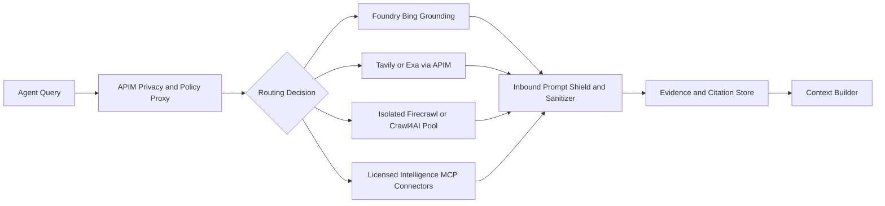
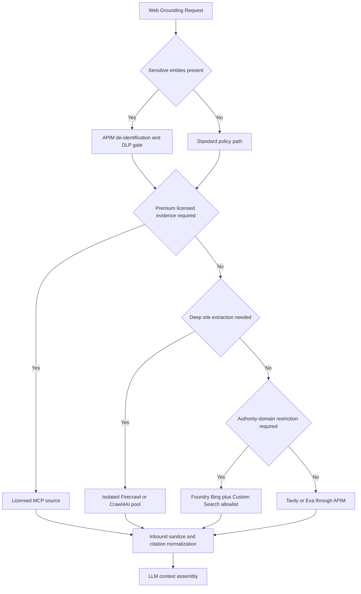

# Enterprise Web Grounding and Extraction Selection FAQ: Foundry Bing vs APIM+Tavily/Exa vs Firecrawl Governance
> 🌐 **Language / 语言切换**: **[🇨🇳 中文版](enterprise-web-grounding-search-foundry-bing-vs-apim-tavily-exa-vs-firecrawl-dlp-selection-faq.md)** | **[🇬🇧 English](enterprise-web-grounding-search-foundry-bing-vs-apim-tavily-exa-vs-firecrawl-dlp-selection-faq.en.md)** | **[📚 Back to Catalog](README.en.md)**
> Evidence tags: `measured` / `synthetic` / `anonymized_reported`
> Retrieval date: 2026-11-22
> Scope: enterprise outbound search DLP, inbound prompt-injection hygiene, copyright governance, and context distillation

## 1) Executive Summary: production web grounding is a governance problem before it is a retrieval problem
Most enterprises already know
how to send a query to the web.
The hard part is running
internet-connected agents
without leaking confidential intent,
without importing malicious instructions,
without crossing licensing boundaries,
and without flooding model context windows.
In M&A due diligence,
adverse-media screening,
pharma regulatory intelligence,
and supplier risk monitoring,
the value chain depends on
verifiable external evidence.
A production design should split
web grounding into five planes.
Plane one is outbound privacy control.
Plane two is source-specific retrieval.
Plane three is extraction and sanitation.
Plane four is citation governance.
Plane five is model-context assembly.
The key operating principle is:
sanitize before egress,
sanitize before inference,
and preserve evidence lineage
for every retrieved fact.

## 2) Incident Pattern: why teams fail after “successful” web integration
A recurring incident class starts
with apparently valid agent output
that later fails compliance review.
One common trigger is
query-string data leakage.
Analysts include internal code names,
customer identifiers,
or confidential project aliases
in outbound search prompts.
Another trigger is
indirect prompt injection.
A crawled page embeds hidden text
that attempts instruction override,
tool misuse,
or evidence poisoning.
A third trigger is
copyright exposure.
Teams scrape paywalled or restricted pages
without contractual permission
or retention controls.
A fourth trigger is
context bloat.
Raw DOM payloads are injected
directly into prompts,
inflating token spend
while lowering signal quality.
These incidents share one root cause:
the retrieval path exists,
but the governance path does not.

## 3) Evidence Baseline and Sources
Source 1 (`measured`): Azure AI Foundry Grounding with Bing Search  
https://learn.microsoft.com/azure/ai-foundry/agents/how-to/tools/bing-grounding  
Source 2 (`measured`): Bing Custom Search overview  
https://learn.microsoft.com/bing/search-apis/bing-custom-search/overview  
Source 3 (`measured`): Azure API Management policy framework  
https://learn.microsoft.com/azure/api-management/api-management-policies  
Source 4 (`measured`): Azure AI Content Safety overview  
https://learn.microsoft.com/azure/ai-services/content-safety/overview  
Source 5 (`measured`): Prompt Shields concept documentation  
https://learn.microsoft.com/azure/ai-services/content-safety/concepts/jailbreak-detection  
Source 6 (`measured`): robots.txt standard (RFC 9309)  
https://www.rfc-editor.org/rfc/rfc9309  
Source 7 (`measured`): Firecrawl repository and docs  
https://github.com/mendableai/firecrawl  
Source 8 (`measured`): Crawl4AI repository and docs  
https://github.com/unclecode/crawl4ai  
Source 9 (`measured`): Tavily developer docs  
https://docs.tavily.com/  
Source 10 (`measured`): Exa developer docs  
https://docs.exa.ai/  
Source 11 (`anonymized_reported`): anonymized postmortems from financial and healthcare web-grounding rollouts.  
Source 12 (`synthetic`): one-million-query monthly cost and latency simulation model.  

## 4) Risk Taxonomy: four failure domains to govern explicitly
Risk domain A is
outbound confidentiality leakage.
Sensitive entities leave the boundary
inside natural-language queries.
Risk domain B is
inbound indirect injection.
Untrusted web content attempts
to steer downstream model behavior.
Risk domain C is
copyright and licensing drift.
Extraction exceeds permitted terms,
or provenance becomes unverifiable.
Risk domain D is
context inflation.
HTML noise and script payloads
consume budget and dilute evidence.
A production policy stack should map
A to outbound DLP,
B to inbound sanitization,
C to rights-aware routing,
D to deterministic distillation.
Missing any one control
reintroduces systemic risk
at enterprise scale.

## 5) Production Reference Architecture: zero-trust web grounding gateway
Layer one is APIM ingress
for policy enforcement.
It applies entity detection,
query de-identification,
deny rules,
and route decisions.
Layer two is retrieval execution
across multiple backends.
Foundry Bing can serve
regulated authority-only needs.
APIM-proxied Tavily or Exa can serve
deep long-tail discovery.
Isolated extraction pools can serve
known-site structured harvesting.
Licensed intelligence connectors can serve
premium contractual evidence.
Layer three is inbound hygiene.
Responses pass through
Prompt Shields,
script stripping,
and anti-injection rules.
Layer four is evidence governance.
Every fragment carries
source URL,
capture time,
license class,
and citation offsets.
Layer five is context assembly.
Only sanitized and compressed evidence
is admitted into model prompts.

## 6) Mermaid: retrieval, sanitation, and citation flow

## 7) Option A: Foundry Grounding with Bing and Bing Custom Search
This path is strong
for regulated environments
that prioritize evidence provenance.
Foundry grounding provides
managed integration boundaries
and citation-friendly output.
Bing Custom Search can constrain
query scope to approved domains,
such as regulators,
public filings,
and authority bulletins.
That helps reduce
source drift and rumor contamination.
It also simplifies
compliance attestation conversations.
The trade-off is flexibility.
Long-tail retrieval depth
for niche technical ecosystems
may be lower than specialized APIs.
Many enterprises therefore keep
Foundry Bing as the default lane
and route selected classes
to alternate backends
under APIM policy control.

## 8) Option B: APIM outbound proxy plus Tavily/Exa retrieval APIs
This option emphasizes
policy-controlled flexibility.
APIM receives the original intent,
runs privacy transformations,
then forwards normalized queries
to AI-native search providers.
Common controls include:
entity masking,
semantic generalization,
sensitive-slot removal,
and K-anonymity noise prompts.
Inbound payloads then pass through
Prompt Shields
plus custom heuristics
for hidden-instruction patterns.
Examples include
override directives,
tool-escalation bait,
or embedded malware prompts.
The upside is stronger
long-tail semantic discovery.
The cost is operational complexity.
Teams must maintain rule sets,
calibrate false positives,
and run continuous regression suites
to avoid governance drift.

## 9) Option C: isolated extraction pools with Firecrawl or Crawl4AI
This option is designed
for known-site extraction
where structure matters.
Examples include supplier portals,
regulatory publication hubs,
or partner documentation libraries.
The extraction fleet should run
inside isolated ACA or AKS environments
with strict outbound controls.
Before crawl execution,
the pipeline should validate
robots signals,
llms directives,
and legal policy flags.
It should also classify
paywall or licensing indicators
for rights-aware handling.
After retrieval,
the pipeline should produce
script-free Markdown artifacts
with normalized metadata envelopes.
The upside is precision
and deterministic output shape.
The downside is higher
platform and legal operations overhead.

## 10) Option D: licensed commercial intelligence connectors
For investment research,
legal diligence,
and regulated risk decisions,
critical evidence often sits
behind licensed content providers.
In these cases,
scraping-oriented approaches
create avoidable legal exposure.
A safer path is
contractual data connectors
through MCP interfaces.
Examples include
LSEG,
Factiva,
LexisNexis,
and S&P Capital IQ integrations.
This model delivers
clear usage rights,
auditable provenance,
and contract-backed retention policy.
Its downside is price.
Procurement and entitlement governance
must be aligned with
query classification policies.
This lane should be reserved
for high-impact evidence paths
rather than low-value broad browsing.

## 11) 12-Dimension Comparison Matrix
| Dimension | Foundry Bing / Custom Search | APIM + Tavily/Exa Proxy | Firecrawl/Crawl4AI Extraction Pool | Licensed Intelligence Connectors |
|---|---|---|---|---|
| Outbound leakage control | High | High | Medium | High |
| Indirect injection resilience | Medium | High | High | High |
| Licensing auditability | Medium-High | Medium | Medium | High |
| Long-tail discovery depth | Medium | High | Medium | Medium |
| Domain allowlist precision | High | High | High | High |
| HTML noise compression | Medium | Medium-High | High | High |
| Delivery complexity | Low-Medium | Medium-High | High | Medium |
| Day-2 operations burden | Low | Medium | High | Medium |
| Legal exposure profile | Low-Medium | Medium | Medium-High | Low |
| Citation quality consistency | High | Medium-High | Medium-High | High |
| Per-query cost elasticity | Medium | Medium | Medium-High | Low |
| Three-year TCO predictability | High | Medium-High | Medium | Medium |

## 12) Mermaid: sensitivity and source-authority decision tree

## 13) Monthly One-Million-Query TCO Model
Define:
`Q` as monthly query volume,
`R` as average retrieved items per query,
`C_s` as per-query search cost,
`C_e` as per-item extraction and hygiene cost,
`C_g` as APIM governance processing cost.
A practical monthly estimate is:
`Cost = Q*(C_s + C_g) + Q*R*C_e`.
For a one-million-query baseline,
an example routing split can be:
60% Foundry/Bing lane,
25% APIM+Tavily/Exa lane,
10% isolated extraction lane,
5% licensed premium lane.
Under common pricing envelopes,
this mixed strategy usually outperforms
an all-crawl architecture
in total cost and risk-adjusted stability.
If policy enforces
licensed-only for high-sensitivity classes,
cost rises,
but legal and audit uncertainty drops.
The operational recommendation is
risk-tiered routing,
not one universal backend.

## 14) Five-Step Implementation Guide
Step one:
define query sensitivity tiers
and prohibited outbound entities.
Step two:
deploy APIM as the mandatory egress gateway
for every web-grounding request.
Step three:
establish inbound sanitation chains
combining Prompt Shields
with deterministic rule engines.
Step four:
apply source-tier routing:
authority-only domains,
deep extraction pools,
or licensed connectors
based on business criticality.
Step five:
operate dual dashboards
for security and FinOps:
leakage interception rate,
injection interception rate,
citation validity ratio,
and cost per thousand queries.
Review thresholds monthly
and recalibrate routing weights
as usage patterns evolve.

## 15) Practical FAQ (8 questions)
### Q1: why must de-identification happen before outbound search?
Because query strings themselves
can carry confidential business intent.
Post-response cleanup
cannot undo outbound disclosure.

### Q2: can Prompt Shields alone prevent web-grounding attacks?
No.
Prompt Shields should be combined
with HTML distillation,
script stripping,
and domain reputation controls.

### Q3: do robots.txt or llms.txt signals equal legal authorization?
No.
They are technical directives,
not complete commercial permission.
Legal and licensing review remains required.

### Q4: when is Bing Custom Search the preferred lane?
When source authority matters most
and domain scope must be tightly constrained.

### Q5: when should we prioritize isolated extraction pools?
When target domains are known
and high-quality structured extraction
is needed at scale.

### Q6: how do we prevent HTML from overwhelming model context?
Admit only
evidence headers,
key body snippets,
citation anchors,
and metadata.
Drop script and layout noise upstream.

### Q7: are licensed intelligence connectors too expensive for production?
They can be expensive.
They are best used
for high-impact decisions
where legal certainty and provenance
are mandatory.

### Q8: what is a clear Good fit vs Not for boundary?
Good fit:
regulated and high-stakes decisions
that require auditable evidence chains.
Not for:
lightweight low-risk experimentation
without compliance,
provenance,
or legal review requirements.
