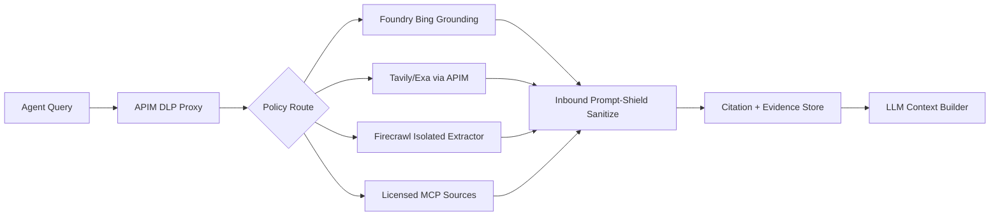
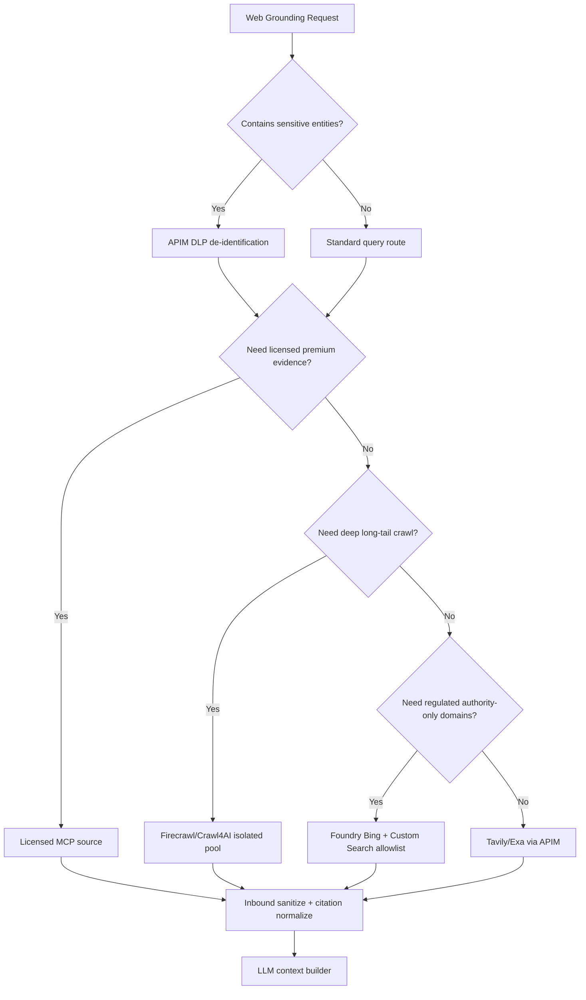

# 企业公网联网检索与网页提取选型 FAQ：Foundry Bing vs APIM+Tavily/Exa vs Firecrawl 合规提取网关
> 🌐 **Language / 语言切换**: **[🇨🇳 中文版](enterprise-web-grounding-search-foundry-bing-vs-apim-tavily-exa-vs-firecrawl-dlp-selection-faq.md)** | **[🇬🇧 English](enterprise-web-grounding-search-foundry-bing-vs-apim-tavily-exa-vs-firecrawl-dlp-selection-faq.en.md)** | **[📚 返回目录](README.md)**
> 证据标签：`measured` / `synthetic` / `anonymized_reported`
> 抓取日期：2026-11-22
> 主题边界：聚焦企业联网检索、网页提取、出站 DLP 与入站投毒防护，不讨论包供应链钉扎专题

## 1) 执行摘要：企业联网智能体的关键不是“能搜到”，而是“可合规地搜到”
投行并购尽调、
反洗钱负面舆情筛查、
医药法规追踪、
供应商外部风险监控，
都需要联网检索。
许多团队把“能访问公网”
误当成“已经可生产”。
真正难点有四个：
查询词泄密、
网页间接提示词注入、
版权与爬取合规、
HTML 噪音上下文膨胀。
推荐架构是分层治理。
可信搜索连接器负责
权威外部检索。
APIM 隐私代理负责
查询脱敏与策略编排。
隔离提取池负责
站点级结构化蒸馏。
授权商业情报连接器负责
高价值付费信源。
核心原则是
“先治理，再联网；
先净化，再入模”。

## 2) 事故画像：联网能力上线后，风险常从正确性转向合规性
某并购项目中，
分析师把标的代号
直接拼进智能体查询。
请求进入外部搜索后，
内部敏感线索出站。
另一个高频问题是
网页隐藏文本注入。
页面脚本或注释里嵌入
“忽略系统指令”类诱导语。
抓取链路若不清洗，
模型会把恶意段落当可信证据。
第三类问题来自版权边界。
工具抓取了受限站点正文，
却没有商业授权凭证。
第四类问题是上下文污染。
原始 DOM 直接送入提示词，
Token 成本陡增，
且有效证据密度下降。
这些问题共性是
“数据面可达，治理面缺席”。

## 3) 可验证来源与证据基线
来源 1（`measured`）：Azure AI Foundry Grounding with Bing Search  
https://learn.microsoft.com/azure/ai-foundry/agents/how-to/tools/bing-grounding  
来源 2（`measured`）：Bing Custom Search API 概览  
https://learn.microsoft.com/bing/search-apis/bing-custom-search/overview  
来源 3（`measured`）：Azure API Management 策略能力  
https://learn.microsoft.com/azure/api-management/api-management-policies  
来源 4（`measured`）：Azure AI Content Safety 文档  
https://learn.microsoft.com/azure/ai-services/content-safety/overview  
来源 5（`measured`）：Prompt Shields 概念说明  
https://learn.microsoft.com/azure/ai-services/content-safety/concepts/jailbreak-detection  
来源 6（`measured`）：robots.txt RFC 9309  
https://www.rfc-editor.org/rfc/rfc9309  
来源 7（`measured`）：Firecrawl 项目与文档  
https://github.com/mendableai/firecrawl  
来源 8（`measured`）：Crawl4AI 项目与文档  
https://github.com/unclecode/crawl4ai  
来源 9（`measured`）：Tavily 开发者文档  
https://docs.tavily.com/  
来源 10（`measured`）：Exa 开发者文档  
https://docs.exa.ai/  
来源 11（`anonymized_reported`）：匿名化金融与医药联网检索合规复盘。  
来源 12（`synthetic`）：百万次联网核验成本与延迟仿真模型。  

## 4) 风险分类学：出站泄密、入站投毒、版权越界、上下文膨胀
风险 A：查询词泄密。
未脱敏实体被直接出网。
包括客户姓名、
交易代号、
未披露产品名。
风险 B：间接注入。
恶意网页通过隐藏文本
向模型注入执行指令。
风险 C：版权越界。
抓取受限内容却无授权链路。
风险 D：上下文膨胀。
原始 HTML 噪音远超有效文本。
架构应将四类风险映射到四道护栏：
出站 DLP、
入站净化、
授权校验、
蒸馏压缩。
只有四道同时生效，
联网智能体才具备生产可审计性。

## 5) 生产级参考架构：零信任联网搜索网关与分层提取面
第一层是查询入口网关。
通过 APIM 接收智能体请求，
执行 PII 检测、
实体泛化、
K-匿名噪声查询策略。
第二层是检索执行层。
可路由到 Foundry Bing、
Tavily、
Exa、
或授权商业源。
第三层是提取净化层。
对返回网页执行
脚本剥离、
可疑注入片段检测、
HTML-to-Markdown 蒸馏。
第四层是证据治理层。
记录来源域名、
抓取时间、
授权状态、
引用偏移锚点。
第五层是模型消费层。
仅接收净化后的结构化片段，
并附带证据元数据。
这种分层可以把合规与推理解耦，
避免“模型直接面对原始互联网”。

## 6) Mermaid：联网搜索与提取治理拓扑

## 7) 方案一：Foundry Grounding with Bing / Bing Custom Search
该方案适合高合规场景。
优势在于托管连接器边界清晰，
并可输出带锚点的引用片段。
配合 Bing Custom Search
可将检索限制在白名单域。
例如 SEC EDGAR、
FDA 公告、
央行与监管网站。
这能显著降低信源漂移。
并减少低质站点噪音。
对于金融与政务，
该路径便于审计说明。
短板是长尾深度检索灵活性较弱。
尤其在垂直小众技术社区，
召回覆盖不一定最优。
因此常与 APIM 代理混用，
由策略决定何时切换到其他搜索后端。

## 8) 方案二：APIM 出站隐私代理 + Tavily/Exa 等检索 API
该方案强调可编排与可控灵活性。
APIM 先做查询脱敏，
再将请求转发到外部检索服务。
脱敏策略可包括：
实体哈希替换、
语义泛化、
敏感字段脱钩、
噪声查询混淆。
入站结果再经过 Prompt Shields
与自定义规则清洗。
比如移除“系统提示覆盖”类文本、
脚本内隐藏指令、
可疑嵌入链接。
优势是召回深度更强，
适合 Deep Research。
短板是策略维护复杂度更高。
需要稳定的 DLP 规则运营，
以及持续回归测试。

## 9) 方案三：ACA/AKS 隔离沙箱自建提取集群（Firecrawl/Crawl4AI）
该方案适合目标站点明确、
需深度结构化抽取的任务。
例如合作伙伴公告站、
法规数据库、
企业官网文档中心。
提取池运行在隔离网络。
执行 robots.txt 与 llms.txt 策略检查。
对 402/付费墙响应做授权分流。
抓取后执行无脚本蒸馏，
输出洁净 Markdown 与证据元数据。
优势是可控度高，
可定制提取模板。
短板是运维与法律治理成本上升。
需要维护 IP 信誉池、
速率礼貌策略、
授权台账与审计日志。

## 10) 方案四：授权商业情报源 MCP 连接器
在投研、法务、合规场景，
高价值信息常处于付费墙之后。
此时抓取型方案风险高。
更稳妥路径是
接入授权商业情报源。
例如 LSEG、
Factiva、
LexisNexis、
S&P Capital IQ。
通过 MCP 工具契约，
可保留引用与许可凭证。
审计可回放，
法务边界清晰。
优势是合规强、
证据可信度高。
短板是采购成本明显高于通用搜索。
适用于高风险高价值决策链路，
不宜用于全部低价值查询。

## 11) 12 维选型对比：合规强度、覆盖能力与成本结构
| 对比维度 | Foundry Bing/Custom Search | APIM + Tavily/Exa 代理 | Firecrawl/Crawl4AI 提取池 | 授权商业情报连接器 |
|---|---|---|---|---|
| 查询词泄密防护 | 高（托管边界） | 高（可编排 DLP） | 中（依赖自建规则） | 高 |
| 间接注入防护 | 中（需叠加清洗） | 高（可组合 Shields） | 高（可深度净化） | 高（结构化源） |
| 版权与授权可审计性 | 中高 | 中 | 中 | 高 |
| 检索长尾覆盖 | 中 | 高 | 中 | 中 |
| 白名单域精确控制 | 高 | 高 | 高 | 高 |
| HTML 噪音压缩能力 | 中 | 中高 | 高 | 高 |
| 实施复杂度 | 低到中 | 中高 | 高 | 中 |
| 运维复杂度 | 低 | 中 | 高 | 中 |
| 法务风险暴露 | 低到中 | 中 | 中高 | 低 |
| 证据引用质量 | 高 | 中高 | 中高 | 高 |
| 单次查询成本弹性 | 中 | 中 | 中高 | 低 |
| 三年 TCO 稳定性 | 高 | 中高 | 中 | 中 |

## 12) Mermaid：敏感度与信源权威性决策树

## 13) 月度百万次联网核验 TCO 测算
设：
`Q` 为月度查询量，
`R` 为平均检索回包条目，
`C_s` 为搜索 API 单次成本，
`C_e` 为提取与净化单次成本，
`C_g` 为网关策略处理成本。
月度成本近似：
`Cost = Q*(C_s + C_g) + Q*R*C_e`。
若按 100 万次查询估算，
并假设混合路由策略：
60% Foundry/Bing，
25% APIM+Tavily/Exa，
10% 提取池，
5% 商业授权源。
在常见价格带下，
总成本通常低于
“全部走深度抓取”方案。
同时可以显著降低
法务与泄密事件期望损失。
若企业内部策略要求
对高敏查询统一走授权源，
成本会抬升，
但可换取更强可审计性。
因此应将查询按敏感等级分层，
而非单一路由。

## 14) 五步落地指南：从可用联网到可治理联网
步骤一：建立查询分级标准。
定义敏感实体词典、
业务机密等级、
不可出网字段。
步骤二：部署 APIM 出站代理。
强制 DLP 与脱敏策略前置。
步骤三：建设入站净化链。
把 Prompt Shields 与规则引擎接入回包路径。
步骤四：信源分层路由。
监管权威域走白名单搜索，
高价值证据走授权源，
深度抽取走隔离提取池。
步骤五：上线审计与成本双看板。
监控泄密拦截率、
注入拦截率、
引用有效率、
千次查询成本。
按月回顾策略阈值并调整分流比例。

## 15) 实战 FAQ（8 问）
### Q1：为什么必须在出站前做查询脱敏？
因为查询词本身就可能是机密载体。
若不前置脱敏，
后续再清洗回包也无法弥补泄漏。

### Q2：Prompt Shields 是否能单独解决网页注入？
不能。
它应与 HTML 蒸馏、
脚本剥离、
域名信誉策略联合使用。

### Q3：llms.txt/robots.txt 是否等于法律授权？
不是。
它们是协定与技术信号。
商业使用仍需法务与授权策略确认。

### Q4：何时优先 Bing Custom Search 白名单？
当业务要求权威可验证来源，
且希望严格限制检索域名边界时。

### Q5：何时应使用自建提取池？
当目标站点已知且结构稳定，
需要深度结构化抽取与格式蒸馏时。

### Q6：如何避免 HTML 撑爆上下文？
仅保留标题、
正文要点、
证据锚点、
来源元数据。
其余 DOM 噪音应在提取层剥离。

### Q7：授权商业情报源是否会显著增本？
会。
但在高风险决策链路，
它能降低法律与合规不确定性成本。

### Q8：Good fit 与 Not for 如何划线？
Good fit：
对外部证据可信度和合规性要求高，
且查询量大的企业研究与风控场景。
Not for：
仅做低风险公开信息浏览，
无审计要求的轻量问答原型。
