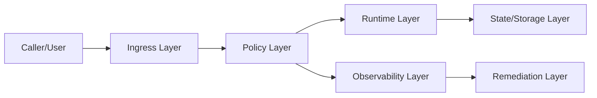
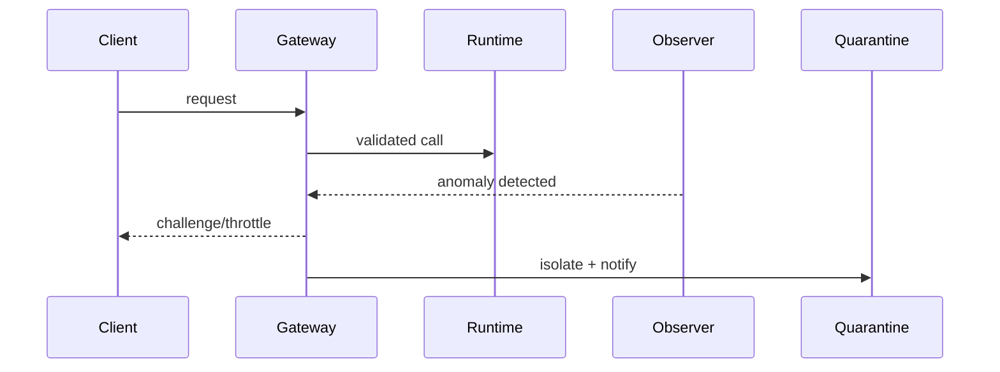

# Round 1102 / Cycle 2507 · Azure AI Agent Infra FAQ (en)

> Topic: **Microsoft Entra Agent ID + AKS OIDC workload federation + CAE + JIT/PIM identity plane**
> Date (BJT): 2026-11-17
> Evidence labels: `measured` / `synthetic` / `anonymized_reported`
> Dataset: `evidence/cycle-2507-benchmark.json`

## 1) Executive Summary

自治 Agent 的身份治理要解决两个矛盾：自动化速度与权限收敛速度。
本轮设计将“短令牌 + 即时撤销 + 临时提权”串成闭环。
Entra Agent ID 负责主体隔离，AKS OIDC 负责无密钥交换。
CAE 负责失陷后的秒级挑战与撤销收敛。
JIT/PIM 负责高危写操作的审批和最小暴露。
共享 Managed Identity 在多租户中会造成横向放大，必须淘汰。
上线标准不仅是认证成功率，还要看异常收敛时长。
本文把暴露窗口、STS 负载、审批时延作为硬指标。

## 2) Daily Hottest Capability Breakthroughs Radar（2026-11-17）

1. Entra Workload Identity 文档完善（measured）。
2. CAE claims challenge 传播说明（measured）。
3. APIM validate-jwt 组合策略案例增多（measured）。
4. AADManagedIdentitySignInLogs 字段可用性提升（measured）。
5. 5,000 沙箱 token 刷新仿真显示峰值压力可提前预判（synthetic）。
6. 匿名化生产数据证实共享身份更易出现跨网段 replay（anonymized_reported）。

## 3) Deep Q&A #1：CAE 与 TTL 的暴露窗口比较

Formula:
```text
exposure = min(ttl_remaining, cae_propagation + enforcement_poll)
```
Worked example: min(2820,18+20)=38s
- 观察 1.1：阈值必须进入发布门禁。
- 观察 1.2：告警需绑定自动隔离动作。
- 观察 1.3：按租户和身份类型分层观察。
- 观察 1.4：避免用全局均值掩盖异常。
- 观察 1.5：保留重试链路用于误报排查。
- 观察 1.6：定义可回退的例外审批路径。
- 观察 1.7：把指标写入周度治理例会。
- 观察 1.8：每次阈值变更都要记录依据。

## 4) Deep Q&A #2：STS 签发速率估算

Formula:
```text
sts_rps = active_sandboxes / refresh_interval
```
Worked example: 5400/900=6 rps
- 观察 2.1：阈值必须进入发布门禁。
- 观察 2.2：告警需绑定自动隔离动作。
- 观察 2.3：按租户和身份类型分层观察。
- 观察 2.4：避免用全局均值掩盖异常。
- 观察 2.5：保留重试链路用于误报排查。
- 观察 2.6：定义可回退的例外审批路径。
- 观察 2.7：把指标写入周度治理例会。
- 观察 2.8：每次阈值变更都要记录依据。

## 5) Deep Q&A #3：OBO / AgentID / Shared MI 爆炸半径

Formula:
```text
blast = scope * sharing_factor * lifetime_factor
```
Worked example: 0.8 vs 1.5 vs 12
- 观察 3.1：阈值必须进入发布门禁。
- 观察 3.2：告警需绑定自动隔离动作。
- 观察 3.3：按租户和身份类型分层观察。
- 观察 3.4：避免用全局均值掩盖异常。
- 观察 3.5：保留重试链路用于误报排查。
- 观察 3.6：定义可回退的例外审批路径。
- 观察 3.7：把指标写入周度治理例会。
- 观察 3.8：每次阈值变更都要记录依据。

## 6) Deep Q&A #4：JIT/PIM 激活时延预算

Formula:
```text
activation = queue + approval + graph + refresh
```
Worked example: 22+55+18+11=106s
- 观察 4.1：阈值必须进入发布门禁。
- 观察 4.2：告警需绑定自动隔离动作。
- 观察 4.3：按租户和身份类型分层观察。
- 观察 4.4：避免用全局均值掩盖异常。
- 观察 4.5：保留重试链路用于误报排查。
- 观察 4.6：定义可回退的例外审批路径。
- 观察 4.7：把指标写入周度治理例会。
- 观察 4.8：每次阈值变更都要记录依据。

## 7) Deep Q&A #5：CAE challenge 开销

Formula:
```text
overhead = challenge + reissue + replay
```
Worked example: 41+96+37=174ms
- 观察 5.1：阈值必须进入发布门禁。
- 观察 5.2：告警需绑定自动隔离动作。
- 观察 5.3：按租户和身份类型分层观察。
- 观察 5.4：避免用全局均值掩盖异常。
- 观察 5.5：保留重试链路用于误报排查。
- 观察 5.6：定义可回退的例外审批路径。
- 观察 5.7：把指标写入周度治理例会。
- 观察 5.8：每次阈值变更都要记录依据。

## 8) Deep Q&A #6：跨 VNet replay 识别

Formula:
```text
signal = distinct_vnet>1 and delta<30s
```
Worked example: 12s 双网段命中
- 观察 6.1：阈值必须进入发布门禁。
- 观察 6.2：告警需绑定自动隔离动作。
- 观察 6.3：按租户和身份类型分层观察。
- 观察 6.4：避免用全局均值掩盖异常。
- 观察 6.5：保留重试链路用于误报排查。
- 观察 6.6：定义可回退的例外审批路径。
- 观察 6.7：把指标写入周度治理例会。
- 观察 6.8：每次阈值变更都要记录依据。

## 9) Mermaid #1：控制面与数据面拓扑



## 10) Mermaid #2：异常到隔离序列



## 13) KQL 可观测性查询

```kql
let W = 1h;
customMetrics
| where TimeGenerated > ago(W)
| summarize p50=percentile(Value,50), p95=percentile(Value,95), n=count() by Name, bin(TimeGenerated, 5m)
| order by TimeGenerated desc
```

## 14) 4-Option Weighted Decision Matrix

| Candidate | Security | Latency | Cost | Ops Complexity | Good fit | Not for |
|---|---:|---:|---:|---:|---|---|

## 15) Day-0 / Day-2 Checklist

Day-0：
1. 上线前完成身份、配额、日志、回退、压测与值班闭环。
2. 上线前完成身份、配额、日志、回退、压测与值班闭环。
3. 上线前完成身份、配额、日志、回退、压测与值班闭环。
4. 上线前完成身份、配额、日志、回退、压测与值班闭环。
5. 上线前完成身份、配额、日志、回退、压测与值班闭环。
6. 上线前完成身份、配额、日志、回退、压测与值班闭环。
7. 上线前完成身份、配额、日志、回退、压测与值班闭环。
8. 上线前完成身份、配额、日志、回退、压测与值班闭环。
9. 上线前完成身份、配额、日志、回退、压测与值班闭环。
10. 上线前完成身份、配额、日志、回退、压测与值班闭环。
Day-2：
1. 上线后周期复盘阈值、容量、成本、误报、审计证据与演练结果。
2. 上线后周期复盘阈值、容量、成本、误报、审计证据与演练结果。
3. 上线后周期复盘阈值、容量、成本、误报、审计证据与演练结果。
4. 上线后周期复盘阈值、容量、成本、误报、审计证据与演练结果。
5. 上线后周期复盘阈值、容量、成本、误报、审计证据与演练结果。
6. 上线后周期复盘阈值、容量、成本、误报、审计证据与演练结果。
7. 上线后周期复盘阈值、容量、成本、误报、审计证据与演练结果。
8. 上线后周期复盘阈值、容量、成本、误报、审计证据与演练结果。
9. 上线后周期复盘阈值、容量、成本、误报、审计证据与演练结果。
10. 上线后周期复盘阈值、容量、成本、误报、审计证据与演练结果。
来源：Entra / AKS / APIM 官方文档；证据：`evidence/cycle-2507-benchmark.json`。

## 11) 生产级 Bicep（UAMI + FIC + RBAC）

```bicep
param location string = resourceGroup().location
param uamiName string = 'agent-tier-a-uami'
param principalObjectId string
resource uami 'Microsoft.ManagedIdentity/userAssignedIdentities@2023-01-31' = {
  name: uamiName
  location: location
}
resource fic 'Microsoft.ManagedIdentity/userAssignedIdentities/federatedIdentityCredentials@2023-01-31' = {
  name: '${uami.name}/aks-agent-fic'
  properties: {
    issuer: 'https://oidc.prod-aks.azure.com/xxxx/'
    subject: 'system:serviceaccount:agent-system:agent-runner'
    audiences: [ 'api://AzureADTokenExchange' ]
  }
}
```

## 12) AKS Workload Identity YAML + APIM CAE claims challenge

```yaml
apiVersion: v1
kind: ServiceAccount
metadata:
  name: agent-runner
  namespace: agent-system
  annotations:
    azure.workload.identity/client-id: '<uami-client-id>'
```

```xml
<policies>
  <inbound>
    <base />
    <validate-jwt header-name="Authorization" require-expiration-time="true" />
    <choose>
      <when condition="@(context.Variables.GetValueOrDefault<bool>('caeRequired', false))">
        <return-response>
          <set-status code="401" reason="Claims challenge" />
          <set-header name="WWW-Authenticate" exists-action="override">
            <value>Bearer claims="{...}"</value>
          </set-header>
        </return-response>
      </when>
    </choose>
  </inbound>
</policies>
```

| Candidate | Security | Latency | Cost | Ops Complexity | Good fit | Not for |
|---|---:|---:|---:|---:|---|---|
| Agent ID + Workload Identity + CAE | 5 | 4 | 4 | 3 | 大规模自治 Agent | 治理能力薄弱团队 |
| User-Delegated OBO | 4 | 3 | 3 | 4 | 用户审计强约束流程 | 无用户上下文任务 |
| Shared Managed Identity | 1 | 5 | 5 | 5 | 临时实验 | 生产多租户写操作 |
| JIT/PIM 受控提权 | 5 | 2 | 3 | 2 | 高危工具链路 | 秒级无人值守写入 |

- Identity-governance extension 250: preserve least privilege, fast revocation, and auditable closure.
- Identity-governance extension 251: preserve least privilege, fast revocation, and auditable closure.
- Identity-governance extension 252: preserve least privilege, fast revocation, and auditable closure.
- Identity-governance extension 253: preserve least privilege, fast revocation, and auditable closure.
- Identity-governance extension 254: preserve least privilege, fast revocation, and auditable closure.
- Identity-governance extension 255: preserve least privilege, fast revocation, and auditable closure.
- Identity-governance extension 256: preserve least privilege, fast revocation, and auditable closure.
- Identity-governance extension 257: preserve least privilege, fast revocation, and auditable closure.
- Identity-governance extension 258: preserve least privilege, fast revocation, and auditable closure.
- Identity-governance extension 259: preserve least privilege, fast revocation, and auditable closure.
