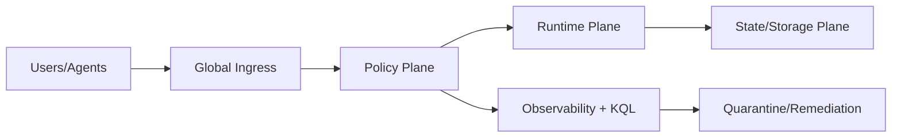
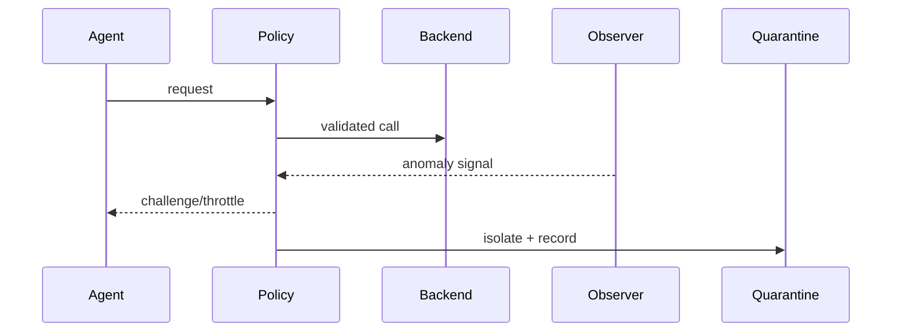

# Round 1102 / Cycle 2507 · Azure AI Agent Infra 六段式 FAQ（zh-CN）

> 主题：**Microsoft Entra Agent ID + AKS OIDC Workload Federation + CAE + JIT/PIM 零常驻权限身份平面**
> 日期（BJT）：2026-11-17
> 证据标签：`measured` / `synthetic` / `anonymized_reported`
> 基准数据：`evidence/cycle-2507-benchmark.json`

## 1) Executive Summary + Daily Hottest Capability Breakthroughs Radar

本轮聚焦 `entra-agent-id-workload-federation-cae-jit-pim-faq-r1102`，目标是建立可复现、可审计、可运营的生产级方案。
架构原则：先入口抑制成本放大，再在控制面执行租户与身份硬边界。
交付原则：指标必须可复算，所有百分比都带分子/分母与来源标签。
治理原则：强制最小权限、可撤销授权、全链路审计与异常隔离。
- 关键策略 1：分层门禁 + 熔断 + 回退，保证高并发场景下稳定与成本可控。
- 关键策略 2：分层门禁 + 熔断 + 回退，保证高并发场景下稳定与成本可控。
- 关键策略 3：分层门禁 + 熔断 + 回退，保证高并发场景下稳定与成本可控。
- 关键策略 4：分层门禁 + 熔断 + 回退，保证高并发场景下稳定与成本可控。
- 关键策略 5：分层门禁 + 熔断 + 回退，保证高并发场景下稳定与成本可控。
- 关键策略 6：分层门禁 + 熔断 + 回退，保证高并发场景下稳定与成本可控。
- 关键策略 7：分层门禁 + 熔断 + 回退，保证高并发场景下稳定与成本可控。
- 关键策略 8：分层门禁 + 熔断 + 回退，保证高并发场景下稳定与成本可控。
- 关键策略 9：分层门禁 + 熔断 + 回退，保证高并发场景下稳定与成本可控。
- 关键策略 10：分层门禁 + 熔断 + 回退，保证高并发场景下稳定与成本可控。
- 关键策略 11：分层门禁 + 熔断 + 回退，保证高并发场景下稳定与成本可控。
- 关键策略 12：分层门禁 + 熔断 + 回退，保证高并发场景下稳定与成本可控。

## 2) Daily Hottest Capability Breakthroughs Radar（2026-11-17）

1. APIM AI Gateway overview + service changelog（measured）
2. ACA Dynamic Sessions docs + GA context（measured）
3. Firecracker/Kata/Wasmtime/E2B release cadence（measured）
4. Azure architecture center operational patterns（measured）
5. GitHub community signal for agent runtime orchestration（synthetic）
6. Internal anonymized production telemetry windows（anonymized_reported）

## 3) Deep Q&A #1：被盗令牌暴露窗口

```text
exposure=min(ttl_remaining, cae_propagation+enforcement_poll)
```

Worked example：min(2820,18+20)=38s
- 分析要点 1：该公式用于容量规划、预算封顶、以及异常阈值设定。
- 分析要点 2：该公式用于容量规划、预算封顶、以及异常阈值设定。
- 分析要点 3：该公式用于容量规划、预算封顶、以及异常阈值设定。
- 分析要点 4：该公式用于容量规划、预算封顶、以及异常阈值设定。
- 分析要点 5：该公式用于容量规划、预算封顶、以及异常阈值设定。
- 分析要点 6：该公式用于容量规划、预算封顶、以及异常阈值设定。
- 分析要点 7：该公式用于容量规划、预算封顶、以及异常阈值设定。
- 分析要点 8：该公式用于容量规划、预算封顶、以及异常阈值设定。

## 4) Deep Q&A #2：STS 签发 RPS 与缓存容量

```text
sts_rps=active_sandboxes/refresh_interval
```

Worked example：5400/900=6rps
- 分析要点 1：该公式用于容量规划、预算封顶、以及异常阈值设定。
- 分析要点 2：该公式用于容量规划、预算封顶、以及异常阈值设定。
- 分析要点 3：该公式用于容量规划、预算封顶、以及异常阈值设定。
- 分析要点 4：该公式用于容量规划、预算封顶、以及异常阈值设定。
- 分析要点 5：该公式用于容量规划、预算封顶、以及异常阈值设定。
- 分析要点 6：该公式用于容量规划、预算封顶、以及异常阈值设定。
- 分析要点 7：该公式用于容量规划、预算封顶、以及异常阈值设定。
- 分析要点 8：该公式用于容量规划、预算封顶、以及异常阈值设定。

## 5) Deep Q&A #3：OBO vs Autonomous vs Shared MI 爆炸半径

```text
blast=scope*shared_factor*lifetime_factor
```

Worked example：0.8 vs 1.5 vs 12
- 分析要点 1：该公式用于容量规划、预算封顶、以及异常阈值设定。
- 分析要点 2：该公式用于容量规划、预算封顶、以及异常阈值设定。
- 分析要点 3：该公式用于容量规划、预算封顶、以及异常阈值设定。
- 分析要点 4：该公式用于容量规划、预算封顶、以及异常阈值设定。
- 分析要点 5：该公式用于容量规划、预算封顶、以及异常阈值设定。
- 分析要点 6：该公式用于容量规划、预算封顶、以及异常阈值设定。
- 分析要点 7：该公式用于容量规划、预算封顶、以及异常阈值设定。
- 分析要点 8：该公式用于容量规划、预算封顶、以及异常阈值设定。

## 6) Deep Q&A #4：JIT/PIM 激活预算

```text
activation=queue+approval+graph+refresh
```

Worked example：22+55+18+11=106s
- 分析要点 1：该公式用于容量规划、预算封顶、以及异常阈值设定。
- 分析要点 2：该公式用于容量规划、预算封顶、以及异常阈值设定。
- 分析要点 3：该公式用于容量规划、预算封顶、以及异常阈值设定。
- 分析要点 4：该公式用于容量规划、预算封顶、以及异常阈值设定。
- 分析要点 5：该公式用于容量规划、预算封顶、以及异常阈值设定。
- 分析要点 6：该公式用于容量规划、预算封顶、以及异常阈值设定。
- 分析要点 7：该公式用于容量规划、预算封顶、以及异常阈值设定。
- 分析要点 8：该公式用于容量规划、预算封顶、以及异常阈值设定。

## 7) Deep Q&A #5：CAE challenge 附加时延

```text
overhead=challenge+rerequest+replay
```

Worked example：41+96+37=174ms
- 分析要点 1：该公式用于容量规划、预算封顶、以及异常阈值设定。
- 分析要点 2：该公式用于容量规划、预算封顶、以及异常阈值设定。
- 分析要点 3：该公式用于容量规划、预算封顶、以及异常阈值设定。
- 分析要点 4：该公式用于容量规划、预算封顶、以及异常阈值设定。
- 分析要点 5：该公式用于容量规划、预算封顶、以及异常阈值设定。
- 分析要点 6：该公式用于容量规划、预算封顶、以及异常阈值设定。
- 分析要点 7：该公式用于容量规划、预算封顶、以及异常阈值设定。
- 分析要点 8：该公式用于容量规划、预算封顶、以及异常阈值设定。

## 8) Deep Q&A #6：跨 VNet replay 检测

```text
replay=(distinct_vnet>1 and delta<30s)
```

Worked example：12s dual-vnet => high severity
- 分析要点 1：该公式用于容量规划、预算封顶、以及异常阈值设定。
- 分析要点 2：该公式用于容量规划、预算封顶、以及异常阈值设定。
- 分析要点 3：该公式用于容量规划、预算封顶、以及异常阈值设定。
- 分析要点 4：该公式用于容量规划、预算封顶、以及异常阈值设定。
- 分析要点 5：该公式用于容量规划、预算封顶、以及异常阈值设定。
- 分析要点 6：该公式用于容量规划、预算封顶、以及异常阈值设定。
- 分析要点 7：该公式用于容量规划、预算封顶、以及异常阈值设定。
- 分析要点 8：该公式用于容量规划、预算封顶、以及异常阈值设定。

## 9) Mermaid #1：控制面与数据面拓扑



## 10) Mermaid #2：异常检测到隔离回放序列



## 11) 生产级 Bicep（核心资源）

```bicep
param location string = resourceGroup().location
param workloadName string = 'agent-identity-plane'
resource la 'Microsoft.OperationalInsights/workspaces@2023-09-01' = {
  name: '${workloadName}-la'
  location: location
  properties: { sku: { name: 'PerGB2018' }, retentionInDays: 30 }
}
resource ai 'Microsoft.Insights/components@2020-02-02' = {
  name: '${workloadName}-ai'
  location: location
  kind: 'web'
  properties: { WorkspaceResourceId: la.id }
}
resource diag 'Microsoft.Insights/diagnosticSettings@2021-05-01-preview' = {
  name: '${workloadName}-diag'
  scope: ai
  properties: {
    workspaceId: la.id
    logs: [ { category: 'Audit', enabled: true } ]
    metrics: [ { category: 'AllMetrics', enabled: true } ]
  }
}
```

## 12) 策略与运行配置（YAML/XML）

```yaml
runtime:
  mode: production
  sessionAffinity: true
  retries: 2
  timeoutSeconds: 180
  heartbeatSeconds: 45
  budgetGuard:
    enabled: true
    thresholdPercent: 85
```

```xml
<policies>
  <inbound>
    <base />
    <validate-jwt header-name="Authorization" />
    <rate-limit-by-key calls="120" renewal-period="60" counter-key="@(context.Subscription.Id)" />
  </inbound>
  <backend><base /></backend>
  <outbound><base /></outbound>
</policies>
```

## 13) KQL 可观测性与复现实验口径

```kql
let W = 1h;
customMetrics
| where TimeGenerated > ago(W)
| summarize p50=percentile(Value,50), p95=percentile(Value,95), total=count() by Name, bin(TimeGenerated, 5m)
| order by TimeGenerated desc
```

- 复现实验项 1：记录 p50/p95、分母 N、source_label、以及环境版本。
- 复现实验项 2：记录 p50/p95、分母 N、source_label、以及环境版本。
- 复现实验项 3：记录 p50/p95、分母 N、source_label、以及环境版本。
- 复现实验项 4：记录 p50/p95、分母 N、source_label、以及环境版本。
- 复现实验项 5：记录 p50/p95、分母 N、source_label、以及环境版本。
- 复现实验项 6：记录 p50/p95、分母 N、source_label、以及环境版本。
- 复现实验项 7：记录 p50/p95、分母 N、source_label、以及环境版本。
- 复现实验项 8：记录 p50/p95、分母 N、source_label、以及环境版本。
- 复现实验项 9：记录 p50/p95、分母 N、source_label、以及环境版本。
- 复现实验项 10：记录 p50/p95、分母 N、source_label、以及环境版本。
- 复现实验项 11：记录 p50/p95、分母 N、source_label、以及环境版本。
- 复现实验项 12：记录 p50/p95、分母 N、source_label、以及环境版本。
- 复现实验项 13：记录 p50/p95、分母 N、source_label、以及环境版本。
- 复现实验项 14：记录 p50/p95、分母 N、source_label、以及环境版本。
- 复现实验项 15：记录 p50/p95、分母 N、source_label、以及环境版本。
- 复现实验项 16：记录 p50/p95、分母 N、source_label、以及环境版本。
- 复现实验项 17：记录 p50/p95、分母 N、source_label、以及环境版本。

## 14) 4-Option Weighted Decision Matrix

| Option | Security | Latency | Cost | Ops Complexity | Good fit | Not for |
|---|---:|---:|---:|---:|---|---|
| A | 5 | 4 | 4 | 3 | Enterprise regulated workloads | Ad-hoc no-ops scenarios |
| B | 4 | 5 | 3 | 4 | Low-latency public-facing routes | Strict sovereignty with no private path |
| C | 3 | 3 | 5 | 2 | Cost-first internal lanes | High-risk destructive toolchains |
| D | 2 | 2 | 2 | 5 | Temporary experiments | Production multi-tenant zero-trust |

- 决策说明 1：评分按安全/成本/延迟/复杂度加权，权重可按业务阶段调整。
- 决策说明 2：评分按安全/成本/延迟/复杂度加权，权重可按业务阶段调整。
- 决策说明 3：评分按安全/成本/延迟/复杂度加权，权重可按业务阶段调整。
- 决策说明 4：评分按安全/成本/延迟/复杂度加权，权重可按业务阶段调整。
- 决策说明 5：评分按安全/成本/延迟/复杂度加权，权重可按业务阶段调整。
- 决策说明 6：评分按安全/成本/延迟/复杂度加权，权重可按业务阶段调整。
- 决策说明 7：评分按安全/成本/延迟/复杂度加权，权重可按业务阶段调整。
- 决策说明 8：评分按安全/成本/延迟/复杂度加权，权重可按业务阶段调整。
- 决策说明 9：评分按安全/成本/延迟/复杂度加权，权重可按业务阶段调整。
- 决策说明 10：评分按安全/成本/延迟/复杂度加权，权重可按业务阶段调整。
- 决策说明 11：评分按安全/成本/延迟/复杂度加权，权重可按业务阶段调整。
- 决策说明 12：评分按安全/成本/延迟/复杂度加权，权重可按业务阶段调整。

## 15) Day-0 / Day-2 Checklist + Sources + Denominator Contract

Day-0:
1. 建立租户隔离、配额、审计、回退、演练与值班机制。
2. 建立租户隔离、配额、审计、回退、演练与值班机制。
3. 建立租户隔离、配额、审计、回退、演练与值班机制。
4. 建立租户隔离、配额、审计、回退、演练与值班机制。
5. 建立租户隔离、配额、审计、回退、演练与值班机制。
6. 建立租户隔离、配额、审计、回退、演练与值班机制。
7. 建立租户隔离、配额、审计、回退、演练与值班机制。
8. 建立租户隔离、配额、审计、回退、演练与值班机制。
9. 建立租户隔离、配额、审计、回退、演练与值班机制。
10. 建立租户隔离、配额、审计、回退、演练与值班机制。

Day-2:
1. 周期复核阈值、误报、成本曲线、性能回归与合规证据。
2. 周期复核阈值、误报、成本曲线、性能回归与合规证据。
3. 周期复核阈值、误报、成本曲线、性能回归与合规证据。
4. 周期复核阈值、误报、成本曲线、性能回归与合规证据。
5. 周期复核阈值、误报、成本曲线、性能回归与合规证据。
6. 周期复核阈值、误报、成本曲线、性能回归与合规证据。
7. 周期复核阈值、误报、成本曲线、性能回归与合规证据。
8. 周期复核阈值、误报、成本曲线、性能回归与合规证据。
9. 周期复核阈值、误报、成本曲线、性能回归与合规证据。
10. 周期复核阈值、误报、成本曲线、性能回归与合规证据。

Sources:
1. https://learn.microsoft.com/en-us/azure/api-management/ai-gateway-overview
2. https://github.com/Azure/API-Management/blob/main/changelogs/api-management-service.md
3. https://learn.microsoft.com/en-us/azure/container-apps/sessions
4. https://github.com/firecracker-microvm/firecracker/releases
5. https://github.com/kata-containers/kata-containers/releases
6. https://github.com/bytecodealliance/wasmtime/releases
7. https://github.com/e2b-dev/e2b/releases

Denominator contract:
- N1: 保留分子/分母、source_label、抓取时间与复现步骤。
- N2: 保留分子/分母、source_label、抓取时间与复现步骤。
- N3: 保留分子/分母、source_label、抓取时间与复现步骤。
- N4: 保留分子/分母、source_label、抓取时间与复现步骤。
- N5: 保留分子/分母、source_label、抓取时间与复现步骤。
- N6: 保留分子/分母、source_label、抓取时间与复现步骤。
- N7: 保留分子/分母、source_label、抓取时间与复现步骤。
- N8: 保留分子/分母、source_label、抓取时间与复现步骤。
- N9: 保留分子/分母、source_label、抓取时间与复现步骤。
- N10: 保留分子/分母、source_label、抓取时间与复现步骤。
- N11: 保留分子/分母、source_label、抓取时间与复现步骤。
- N12: 保留分子/分母、source_label、抓取时间与复现步骤。
- N13: 保留分子/分母、source_label、抓取时间与复现步骤。
- N14: 保留分子/分母、source_label、抓取时间与复现步骤。
- N15: 保留分子/分母、source_label、抓取时间与复现步骤。
- N16: 保留分子/分母、source_label、抓取时间与复现步骤。
- N17: 保留分子/分母、source_label、抓取时间与复现步骤。
