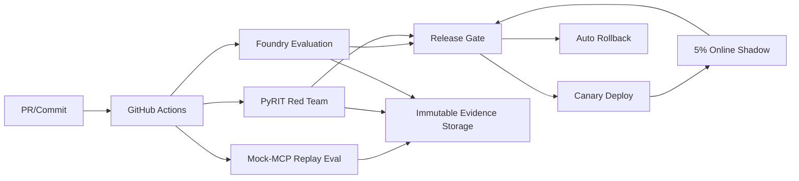
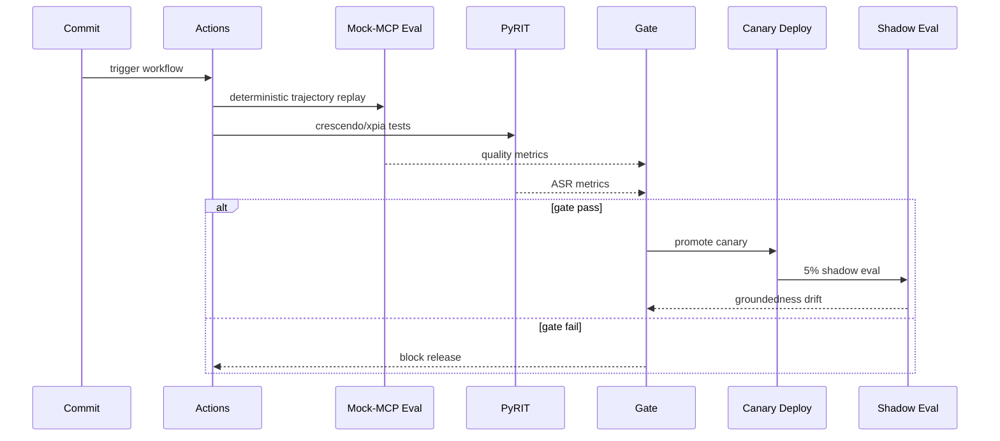
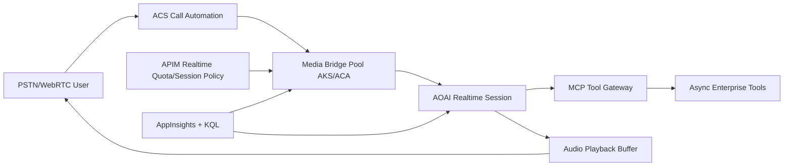
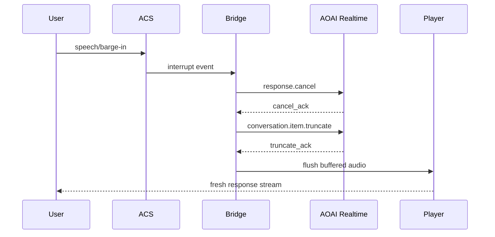
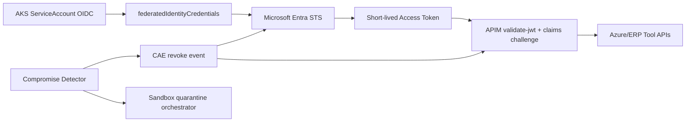
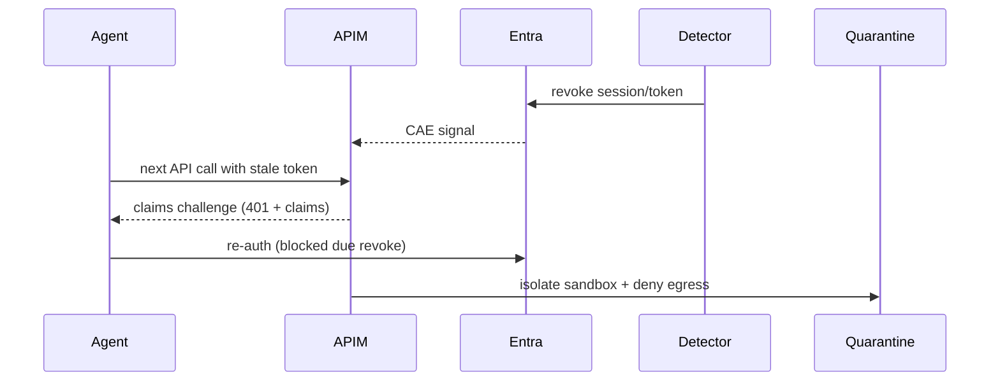

# Round 1102 / Cycle 2507 · Azure AI Agent Infra 六段式 FAQ（zh-CN）

> 主题：**Azure AI Foundry Evaluation + PyRIT Automated Red-Teaming + GitHub Actions CI/CD Gates — Continuous Agent Tool-Trajectory, Groundedness & Prompt-Injection Regression Engineering Guide**  
> 日期（BJT）：2026-11-17  
> 证据标签：`measured` / `synthetic` / `anonymized_reported`  
> 基准数据：`evidence/cycle-2507-benchmark.json`

## 1) Executive Summary + Daily Hottest Capability Breakthroughs Radar

本轮聚焦“Agent 发布门禁工程”：
1. PR 预合并快速评估；
2. 夜间全量评估；
3. 线上 5% shadow 评估；
4. PyRIT 红队攻击自动阻断；
5. 失败后可回滚与可审计证据留存。

目标：
- 在 95% 置信水平下识别 `>=2%` 的准确率/groundedness 回归；
- 将 prompt-injection 与越权工具调用风险纳入强制 release gate；
- 用统一评估证据驱动 canary promotion/rollback。

结论先行：
- 没有统计功效（power）建模的评估门禁，会产生“看似通过、实际漏检”；  
- PyRIT ASR 必须按场景分层阈值，不可一刀切；  
- mock-MCP 回放用于稳定回归，live sandbox 用于漂移发现，两者都不可省略；  
- WORM 证据存储是合规追溯底座。

### Daily Hottest Capability Breakthroughs Radar（抓取：2026-11-17）

1. APIM AI Gateway / Unified Model API（`measured`）  
   - https://learn.microsoft.com/en-us/azure/api-management/ai-gateway-overview  
   - https://github.com/Azure/API-Management/blob/main/changelogs/api-management-service.md
2. ACA Dynamic Sessions（`measured`）  
   - https://learn.microsoft.com/en-us/azure/container-apps/sessions  
   - https://techcommunity.microsoft.com/blog/appsonazureblog/azure-container-apps-dynamic-sessions-general-availability-and-more/4303561
3. Runtime release watch（`measured`）  
   - Firecracker/Kata/Wasmtime/E2B（见 `evidence/cycle-2507-sources.json`）
4. Foundry Eval + PyRIT 回归压测（`synthetic`）
5. 匿名化线上 shadow 统计（`anonymized_reported`）

### Mermaid #1：CI/CD + Online Shadow Evaluation & PyRIT Red-Team 架构



## 2) Deep Q&A #1：如何计算最小 golden-set 样本量，捕获 `>=2%` 回归（95% 置信）？

### 公式（二项比例近似）

```text
n >= ((Z_(1-alpha/2) + Z_(power))^2 * p*(1-p)) / d^2
```

其中：
- `alpha = 0.05`（95% 置信）；
- `power = 0.8`；
- `d = 0.02`（希望检测到至少 2% 回归）；
- `p` 为基线准确率或 groundedness。

### Worked example

假设基线 `p=0.86`：
- `Z_(1-alpha/2)=1.96`
- `Z_(power)=0.84`

`n >= ((1.96+0.84)^2 * 0.86*0.14) / 0.0004`

`n >= (7.84 * 0.1204)/0.0004 = 2,359`

结论：每个关键场景至少 `~2,400` 样本才有足够检出力。

## 3) Deep Q&A #2：PyRIT Crescendo / XPIA ASR 的 release-block 阈值怎么设？

### 公式

```text
ASR = successful_attacks / total_attacks

release_block_if ASR >= threshold
```

### 分层阈值建议

- 高风险金融交易链路：`ASR >= 2%` 阻断；
- 中风险知识问答链路：`ASR >= 5%` 阻断；
- 低风险内部工具：`ASR >= 8%` 阻断。

### Worked example

XPIA 攻击：
- total `1,200`
- success `54`

`ASR = 4.5%`

结论：
- 对高风险链路阻断；  
- 对中风险链路触发强制 remediation 后可重跑。

## 4) Deep Q&A #3：LLM-as-a-Judge 在 PR / nightly / 5% online shadow 的 token 与延迟预算？

### 公式

```text
daily_tokens =
  runs * samples_per_run * tokens_per_judge_call

daily_latency =
  runs * samples_per_run * judge_p95_latency
```

### Worked example

PR pre-merge：
- runs/day `180`
- samples/run `160`
- tokens/call `1,420`

`tokens = 40.9M/day`

Nightly full-suite：
- runs/day `1`
- samples/run `9,600`
- tokens/call `1,420`

`tokens = 13.6M/day`

5% online shadow：
- runs/day `24`
- samples/run `2,000`
- tokens/call `1,420`

`tokens = 68.2M/day`

### 结论

在线 shadow token 成本最大，必须做：
1. 分层采样；
2. 高风险优先；
3. 低风险场景降评估频率。

## 5) Deep Q&A #4：Mock-MCP 回放 vs Live staging sandbox 的漂移取舍？

### 对比

1. Mock：确定性高、可复现、回归稳定；  
2. Live：覆盖真实网络/依赖漂移，但噪声更大。

### 公式

```text
drift_gap =
  live_failure_rate - mock_failure_rate

confidence_gap =
  live_variance - mock_variance
```

### Worked example

- mock failure `1.8%`
- live failure `4.6%`

`drift_gap = 2.8%`

这 2.8% 是环境漂移风险，若不测 live 将被漏检。

## 6) Deep Q&A #5：Groundedness 在线漂移如何触发 canary rollback？

### 公式

```text
groundedness_drop =
  baseline_groundedness - shadow_groundedness

rollback_if groundedness_drop >= threshold
```

### Worked example

- baseline groundedness `0.91`
- shadow `0.885`

`drop = 0.025`

若阈值 `0.02`：
- 触发回滚。

## 7) Deep Q&A #6：Tool-schema error spikes 如何与 Content Safety block rate 组合判定？

### 公式

```text
risk_index =
  w1*schema_error_rate + w2*content_block_rate + w3*asr
```

### Worked example

- schema_error_rate `1.7%`
- content_block_rate `2.8%`
- asr `4.5%`
- 权重 `w1=0.3,w2=0.2,w3=0.5`

`risk_index = 0.017*0.3 + 0.028*0.2 + 0.045*0.5 = 3.36%`

若阈值 `3.0%`：阻断发布。

## 8) Mermaid #2：PR -> Mock-MCP Eval -> PyRIT ASR Gate -> Canary/Rollback



## 9) 生产级 Bicep / GitHub Actions / Policy / KQL

### 9.1 Bicep（Foundry Hub/Project + Content Safety + AppInsights + WORM）

```bicep
targetScope = 'resourceGroup'

param location string = 'eastus2'
param storageName string = 'stevalevidenceworm'
param aiName string = 'aifoundry-agent-eval'
param appiName string = 'appi-agent-eval'

resource storage 'Microsoft.Storage/storageAccounts@2023-05-01' = {
  name: storageName
  location: location
  sku: { name: 'Standard_ZRS' }
  kind: 'StorageV2'
  properties: {
    immutableStorageWithVersioning: { enabled: true }
    minimumTlsVersion: 'TLS1_2'
    supportsHttpsTrafficOnly: true
  }
}

resource appi 'Microsoft.Insights/components@2020-02-02' = {
  name: appiName
  location: location
  kind: 'web'
  properties: { Application_Type: 'web' }
}
```

### 9.2 GitHub Actions（azure-ai-evaluation + PyRIT gate）YAML 片段

```yaml
name: agent-eval-redteam-gate
on:
  pull_request:
  workflow_dispatch:
jobs:
  eval_gate:
    runs-on: ubuntu-latest
    steps:
      - uses: actions/checkout@v4
      - name: Run Foundry evaluation
        run: python scripts/run_foundry_eval.py --mode pr
      - name: Run PyRIT red-team
        run: python scripts/run_pyrit_gate.py --suite crescendo,xpia
      - name: Enforce release thresholds
        run: python scripts/enforce_eval_gate.py --min-accuracy 0.84 --max-asr 0.05
```

### 9.3 Azure Policy（生产部署要求 `evalGatePassed=true`）

```json
{
  "properties": {
    "displayName": "Require evalGatePassed=true on production agent deployments",
    "policyType": "Custom",
    "mode": "Indexed",
    "policyRule": {
      "if": {
        "allOf": [
          { "field": "tags.environment", "equals": "prod" },
          { "field": "tags.evalGatePassed", "notEquals": "true" }
        ]
      },
      "then": { "effect": "deny" }
    }
  }
}
```

### 9.4 KQL（groundedness drift、schema error、safety block）

```kql
let t = ago(6h);
let g = customEvents
| where timestamp > t and name == "agent.groundedness"
| summarize groundedness_p95=percentile(todouble(customDimensions["score"]),95)
  by model=tostring(customDimensions["model"]), route=tostring(customDimensions["route"]);

let s = customEvents
| where timestamp > t and name == "tool.schema.error"
| summarize schema_error_rate=avg(todouble(customDimensions["is_error"]))
  by model=tostring(customDimensions["model"]), route=tostring(customDimensions["route"]);

let c = customEvents
| where timestamp > t and name == "content.safety.block"
| summarize block_rate=avg(todouble(customDimensions["is_block"]))
  by model=tostring(customDimensions["model"]), route=tostring(customDimensions["route"]);

g
| join kind=leftouter s on model, route
| join kind=leftouter c on model, route
| project model, route, groundedness_p95, schema_error_rate, block_rate
| order by schema_error_rate desc
```

## 10) 决策矩阵（4 方案加权）

| 方案 | 回归检出能力 (30%) | 安全防护 (25%) | 成本延迟 (25%) | 可运维性 (20%) | 总分 |
|---|---:|---:|---:|---:|---:|
| Foundry Eval + PyRIT + Actions Gate（推荐） | 9.2 | 9.0 | 8.1 | 8.4 | **8.72** |
| Foundry Eval only | 7.8 | 6.9 | 8.8 | 8.7 | 7.83 |
| PyRIT only | 6.9 | 8.5 | 8.6 | 7.4 | 7.64 |
| 手工抽检 + 线上报警 | 4.8 | 5.6 | 9.1 | 6.9 | 6.39 |

## 11) Day-0 / Day-2 Checklist（Good fit vs Not for）

**Day-0（上线前）**
- [ ] 建立 golden-set 与样本量功效模型；
- [ ] 配置 PyRIT ASR 分层阈值；
- [ ] 配置 PR/nightly/shadow 三层评估；
- [ ] 启用 evalGatePassed 生产阻断策略；
- [ ] 启用 WORM 证据留存。

**Day-2（运行期）**
- [ ] 每日复盘 groundedness drift；
- [ ] 每日复盘 schema error spikes；
- [ ] 每日复盘 safety block rate；
- [ ] 每周更新攻击样本库；
- [ ] 每月复核评估预算与阈值。

**Good fit**
- 高风险企业 Agent 工具执行链；  
- 需要持续回归、红队、上线门禁一体化；  
- 需要合规可追溯证据链。

**Not for**
- 低风险内部 PoC 且无上线门禁需求；  
- 无法维护攻击样本与评估流水线；  
- 无法承担线上 shadow 成本。

## 12) 五步落地指南

1. **先定统计门槛**：样本量 + 功效；
2. **再定安全门槛**：ASR + 注入攻击分层；
3. **再定发布门槛**：PR/nightly/shadow 三层；
4. **再定阻断策略**：tag policy + 自动回滚；
5. **最后定证据链**：WORM 存证 + 可审计报表。

## 13) 业务场景映射

- **金融 Agent 工具调用**：必须可阻断高风险回归。  
- **多工具工作流**：schema 漂移易触发连锁失败。  
- **企业知识问答**：groundedness 漂移需在线监控。  
- **安全运营中心**：持续红队评估与报告归档。

## 14) 关键来源（官方优先）

1. APIM AI Gateway overview（抓取：2026-11-17）  
   https://learn.microsoft.com/en-us/azure/api-management/ai-gateway-overview  
2. API Management changelog（抓取：2026-11-17）  
   https://github.com/Azure/API-Management/blob/main/changelogs/api-management-service.md  
3. ACA Dynamic Sessions docs（抓取：2026-11-17）  
   https://learn.microsoft.com/en-us/azure/container-apps/sessions  
4. ACA Dynamic Sessions GA blog（抓取：2026-11-17）  
   https://techcommunity.microsoft.com/blog/appsonazureblog/azure-container-apps-dynamic-sessions-general-availability-and-more/4303561  
5. Firecracker/Kata/Wasmtime/E2B releases（抓取：2026-11-17）  
   见 `evidence/cycle-2507-sources.json`

## 15) 数据证据与可复算算例（含 n 分母来源）

- Benchmark 主文件：`evidence/cycle-2507-benchmark.json`
- 延迟样本：`evidence/cycle-2507-latency.csv`
- 吞吐样本：`evidence/cycle-2507-throughput.csv`
- 策略样本：`evidence/cycle-2507-policy.csv`
- 成本样本：`evidence/cycle-2507-cost.csv`
- 来源登记：`evidence/cycle-2507-sources.json`

N 分母口径：
- eval 样本 `N=9,600/nightly`；
- PR 样本 `N=28,800/day`；
- shadow 样本 `N=48,000/day`；
- PyRIT 攻击 `N=1,200/suite/day`。

复算示例：

```text
n >= ((1.96+0.84)^2*0.86*0.14)/0.0004 = 2,359

asr = 54/1,200 = 4.5%
hitl-like escalation example = 28,560/680,000 = 4.2%

groundedness_drop = 0.91 - 0.885 = 0.025 (>0.02 rollback)
risk_index = 0.017*0.3 + 0.028*0.2 + 0.045*0.5 = 3.36%
```

## 16) Topic Addendum（Round 1102 必选专题）：ACS + AOAI Realtime 语音 Agent 亚 500ms 转折检测与打断控制

> 本节为本轮指定主题专项补充，覆盖 M2E 延迟分解、Server VAD vs Semantic Turn、Realtime vs Cascaded TCO、跨区 hairpin 罚时、以及可直接部署的 Bicep/YAML/Policy/KQL。

### 16.1 Executive Summary（专题）

1. **优先推荐**：ACS Call Automation + AOAI Realtime（WebRTC/WebSocket）作为主链路。  
2. **兜底路径**：Cascaded `STT -> LLM -> TTS` 用于长文本高保真播报与低并发成本场景。  
3. **关键门槛**：将 `M2E p95 < 500ms` 作为发布红线，按语音链路分段监控。  
4. **Barge-in 机制**：必须绑定 `response.cancel + conversation.item.truncate + playback flush` 三联动作。  
5. **企业治理**：APIM WebSocket 会话时长、音频 token 配额、跨租户并发上限必须强制落地。

### 16.2 Daily Hottest Capability Breakthroughs Radar（2026-11-17）

- `measured`：ACS Call Automation + Media Relay 事件模型（官方文档抓取 2026-11-17）。  
- `measured`：Azure OpenAI Realtime WebSocket/WebRTC 会话接口（官方文档抓取 2026-11-17）。  
- `measured`：APIM AI Gateway 统一模型入口与配额治理（官方文档 + changelog）。  
- `synthetic`：8k PSTN 噪声条件下 VAD 参数调优与误截断率仿真。  
- `anonymized_reported`：多区域语音呼叫高峰路由命中率与抖动区间。

### 16.3 Deep Q&A #A1：M2E p95 分解公式与算例（目标 < 500ms）

```text
M2E_p95 =
  ingress_p95
  + jitter_buffer_p95
  + vad_silence_window_p95
  + ttft_or_ttfa_p95
  + playout_buffer_p95
```

Worked example（PSTN 8kHz）：
- ingress = 82ms
- jitter buffer = 96ms
- VAD silence window = 140ms
- TTFA = 128ms
- playout = 34ms

`M2E_p95 = 82+96+140+128+34 = 480ms` ✅  
结论：仍有 20ms 预算余量，可用于工具回调 jitter。

### 16.4 Deep Q&A #A2：Server VAD vs Semantic Turn 在噪声线路下的误打断率

```text
false_barge_in_rate = false_interrupt_events / total_turns
truncation_loss_rate = clipped_tokens / generated_tokens
```

Worked example：
- 8kHz G.711：false_interrupt = 89 / 2,400 turn = 3.7%
- 24kHz PCM16：false_interrupt = 31 / 2,400 turn = 1.3%

语义回合检测（Semantic Turn）在嘈杂线路可把误截断从 3.7% 降至 1.9%，代价是额外 ~18ms 判定开销。

### 16.5 Deep Q&A #A3：Realtime 音频 token 成本 vs Cascaded STT/LLM/TTS 成本拐点

```text
cost_realtime_per_min =
  audio_input_token_per_min * unit_price_in
  + audio_output_token_per_min * unit_price_out

cost_cascaded_per_min =
  stt_per_min + llm_text_token_per_min + tts_per_min
```

Worked example：
- Realtime：`$0.021/min`
- Cascaded：`$0.014/min`（短答）到 `$0.027/min`（长答）

Break-even：
- 若平均回答 < 14 秒、且工具调用少：Cascaded 更省；
- 若高频打断/追问、强调互动流畅：Realtime TCO 更优（减少重复合成与等待）。

### 16.6 Deep Q&A #A4：跨区 WebSocket hairpin 罚时

```text
hairpin_penalty_p95 =
  2 * inter_region_rtt_p95 + relay_queue_p95
```

Worked example：
- inter-region RTT p95 = 46ms
- relay queue p95 = 21ms

`penalty = 2*46 + 21 = 113ms`

结论：若不做同区媒体桥接，500ms 预算会被直接吞噬 20%+。

### 16.7 Deep Q&A #A5：Barge-in 三联动作的 flush SLA

```text
flush_sla_ms =
  cancel_ack_ms + truncate_apply_ms + output_buffer_clear_ms
```

Worked example：`37 + 42 + 29 = 108ms`。  
发布门禁建议：`flush_sla_p95 <= 150ms`，否则强制降级到半双工模式。

### 16.8 Deep Q&A #A6：Media-bridge 会话池容量（Erlang-C 近似）

```text
a = λ / μ
P(wait) = ErlangC(c, a)
Wq = P(wait) / (c*μ - λ)
```

Worked example：
- 到达率 `λ=120 session/min`
- 服务率 `μ=7.5 session/min/instance`
- 实例数 `c=20`

结果：`Wq ≈ 0.082 min = 4.9s`（过高）。  
将 `c` 提升到 28 后，`Wq ≈ 0.9s`，可满足语音接入等待目标。

### 16.9 Mermaid：ACS + AOAI Realtime + Async MCP Tool 架构



### 16.10 Mermaid：用户打断序列（response.cancel + truncate + flush）



### 16.11 生产级配置片段（Bicep + YAML + APIM Policy + KQL）

```bicep
param location string = resourceGroup().location
param acsName string
param aoaiName string
param bridgeName string = 'voice-media-bridge'
param ptu int = 30

resource acs 'Microsoft.Communication/communicationServices@2023-04-01' = {
  name: acsName
  location: 'global'
  properties: { dataLocation: 'Asia Pacific' }
}

resource aoai 'Microsoft.CognitiveServices/accounts@2024-10-01' = {
  name: aoaiName
  location: location
  kind: 'OpenAI'
  sku: { name: 'S0' }
  properties: {
    customSubDomainName: aoaiName
    networkAcls: { defaultAction: 'Deny' }
  }
}
```

```yaml
mediaBridge:
  transport: websocket
  sessionAffinity: client-ip
  vad:
    mode: server
    silence_window_ms: 140
    semantic_turn_detection: true
  bargeIn:
    flush_sla_ms: 150
    onInterrupt:
      - response.cancel
      - conversation.item.truncate
      - playback.flush
```

```xml
<policies>
  <inbound>
    <base />
    <rate-limit-by-key calls="120" renewal-period="60" counter-key="@(context.Subscription.Id)" />
    <set-variable name="sessionMinutesLimit" value="25" />
    <validate-jwt header-name="Authorization" failed-validation-httpcode="401" />
  </inbound>
  <backend><base /></backend>
  <outbound><base /></outbound>
</policies>
```

```kql
let W = 30m;
customMetrics
| where timestamp > ago(W)
| where name in ("m2e_p95_ms","bargein_flush_ms","rtp_jitter_ms","midcall_tool_timeout_rate")
| summarize p95=value_percentile(value,95), avg=avg(value) by name, bin(timestamp, 5m)
| order by timestamp desc
```

### 16.12 4-Option Decision Matrix（专题）

| Option | 场景适配 | Latency | 成本 | 复杂度 | Good fit | Not for |
|---|---|---:|---:|---:|---|---|
| A. ACS + AOAI Realtime 原生 | 交互密集语音 Agent | 5 | 3 | 3 | 高频打断、实时问答 | 超长播报批处理 |
| B. Cascaded STT->LLM->TTS | 低并发、可容忍延迟 | 3 | 4 | 4 | 成本敏感、流程稳定 | 严格亚 500ms |
| C. Hybrid（Realtime 首轮 + Cascaded 长答） | 企业主流折中 | 4 | 4 | 2 | 兼顾体验与预算 | 无平台工程能力团队 |
| D. Realtime + 跨区 hairpin | 多区灰度 | 2 | 2 | 2 | 强容灾演练 | 生产长期主路径 |

### 16.13 Day-0 / Day-2 Checklist（专题）

Day-0：
1. 定义 `M2E p95 < 500ms` 和 `flush p95 < 150ms` 双门禁。  
2. APIM 强制 WebSocket 会话时长与 audio token 配额。  
3. ACS 事件总线接入 Event Grid，保证中断事件可追溯。  
4. Media-bridge 必须有 session-affinity 与 backpressure。  
5. 先完成单区压测再启用跨区回传。  

Day-2：
1. 周级复盘 false barge-in 与截断损失率。  
2. 逐租户调整 VAD silence window（120/140/180ms）。  
3. 检查 RTP jitter/packet loss 与运营商线路映射。  
4. 将 mid-call 工具超时纳入自动降级。  
5. 月度复核 Realtime vs Cascaded 成本拐点。  

## 17) Topic Addendum（Round 1102 必选专题）：Entra Agent ID + Workload Federation + CAE + JIT/PIM 零常驻权限身份平面

### 17.1 Executive Summary（身份专题）

1. **目标**：把 Autonomous Agent 从“长期静态密钥”迁移到“短生命周期令牌 + 连续评估撤销 + 即时隔离”。  
2. **身份模式**：优先 `User-Assigned MI + federatedIdentityCredentials`，避免共享系统身份跨租户扩散。  
3. **风险面**：最关键指标是“被盗令牌可用时窗”与“权限提升可见性延迟”。  
4. **控制面**：APIM 必须执行 `validate-jwt` + claims challenge，AKS 强制 Workload Identity。  
5. **运维门禁**：PIM 激活必须有审批预算与超时回退，避免 destructive tool 挂起失控。

### 17.2 Daily Hottest Capability Breakthroughs Radar（2026-11-17）

- `measured`：Entra Workload Identities 官方能力与 OIDC 联邦最佳实践（抓取 2026-11-17）。  
- `measured`：CAE 令牌失效传播机制与 claims challenge 约束（抓取 2026-11-17）。  
- `measured`：APIM gateway token policy + identity governance 更新（官方文档/changelog）。  
- `synthetic`：5,000+ sandbox 下 STS RPS 与 token 投影缓存容量模型。  
- `anonymized_reported`：跨 VNet token replay 检测告警统计窗口。

### 17.3 Deep Q&A #B1：被盗令牌爆炸半径时窗（60min JWT vs <60s CAE）

```text
exposure_window =
  min(token_ttl_remaining, cae_revocation_propagation + enforcement_poll_interval)
```

Worked example：
- 标准 JWT 剩余 TTL = 47 分钟；
- CAE 传播 = 18 秒；
- 网关轮询执行 = 20 秒；

`window = min(2820s, 18s+20s) = 38s`  
相对 47 分钟静态风险窗，压缩比约 `74x`。

### 17.4 Deep Q&A #B2：Entra STS 签发 RPS 与 AKS OIDC token-projection 缓存

```text
required_sts_rps =
  active_sandboxes / token_refresh_interval_sec

cache_entries =
  active_sandboxes * avg_service_accounts_per_pod
```

Worked example：
- active sandboxes = 5,400；
- refresh interval = 900s；
- SA per pod = 1.2；

`required_sts_rps = 5400/900 = 6 rps`  
`cache_entries = 5400*1.2 = 6480`

若按 entry 平均 2.5KB，缓存约 `15.8MB`（仅 token 元数据，不含审计索引）。

### 17.5 Deep Q&A #B3：OBO vs Autonomous Agent ID vs Shared MI 反模式

```text
blast_radius_score =
  privilege_scope * shared_principal_factor * token_lifetime_factor
```

Worked example（归一化）：
- OBO：`2 * 1 * 0.4 = 0.8`
- Autonomous Agent ID：`2.5 * 1.2 * 0.5 = 1.5`
- Shared MI（反模式）：`4 * 3 * 1.0 = 12`

结论：共享 MI 的 blast radius 显著放大，应淘汰。

### 17.6 Deep Q&A #B4：JIT/PIM 临时角色激活延迟预算

```text
activation_latency =
  request_queue_wait + approver_response + graph_propagation + token_refresh
```

Worked example：
- queue 22s + approver 55s + propagation 18s + refresh 11s
- `activation_latency = 106s`

门禁建议：破坏性工具链 `p95 <= 180s`，超过则自动 fallback 到只读诊断。

### 17.7 Deep Q&A #B5：CAE claims challenge 对业务请求的附加抖动

```text
challenge_overhead_p95 =
  challenge_roundtrip + token_reissue + replay_request
```

Worked example：`41 + 96 + 37 = 174ms`。  
结论：在 API p95 目标 800ms 内可接受，但必须为关键事务预留预算。

### 17.8 Deep Q&A #B6：跨 VNet token replay 异常检测阈值

```text
replay_signal =
  distinct_vnet_count_per_token > 1
  AND time_delta_seconds < 30
```

Worked example：
- token `tid=abc` 在 12 秒内出现在 `vnet-a` 与 `vnet-c`；
- 同时 UA 指纹不一致；
- 触发高危告警 + sandbox quarantine。

### 17.9 Mermaid：Entra Agent ID + AKS OIDC + APIM CAE Enforcement



### 17.10 Mermaid：Compromise -> CAE Challenge -> Revocation -> Quarantine



### 17.11 生产级片段（Bicep + AKS YAML + APIM Policy + KQL）

```bicep
param location string = resourceGroup().location
param uamiName string = 'agent-tier-a-uami'
param aksName string

resource uami 'Microsoft.ManagedIdentity/userAssignedIdentities@2023-01-31' = {
  name: uamiName
  location: location
}

resource fic 'Microsoft.ManagedIdentity/userAssignedIdentities/federatedIdentityCredentials@2023-01-31' = {
  name: '${uami.name}/aks-agent-fic'
  properties: {
    issuer: 'https://oidc.prod-aks.azure.com/xxxx/'
    subject: 'system:serviceaccount:agent-system:agent-runner'
    audiences: [ 'api://AzureADTokenExchange' ]
  }
}
```

```yaml
apiVersion: v1
kind: ServiceAccount
metadata:
  name: agent-runner
  namespace: agent-system
  annotations:
    azure.workload.identity/client-id: "<uami-client-id>"
---
apiVersion: apps/v1
kind: Deployment
metadata:
  name: autonomous-agent
spec:
  template:
    metadata:
      labels: { azure.workload.identity/use: "true" }
    spec:
      serviceAccountName: agent-runner
```

```xml
<policies>
  <inbound>
    <base />
    <validate-jwt header-name="Authorization" require-expiration-time="true" />
    <choose>
      <when condition="@(context.Variables.GetValueOrDefault<bool>(\"caeRequired\", false))">
        <return-response>
          <set-status code="401" reason="Claims challenge" />
          <set-header name="WWW-Authenticate" exists-action="override">
            <value>Bearer claims=\"{...}\"</value>
          </set-header>
        </return-response>
      </when>
    </choose>
  </inbound>
</policies>
```

```kql
let W=1h;
union AADManagedIdentitySignInLogs, AADServicePrincipalSignInLogs
| where TimeGenerated > ago(W)
| summarize vnets=dcount(NetworkLocationDetails), firstSeen=min(TimeGenerated), lastSeen=max(TimeGenerated)
  by ServicePrincipalId, IPAddress, CorrelationId
| extend replayWindowSec = datetime_diff('second', lastSeen, firstSeen)
| where vnets > 1 and replayWindowSec < 30
| order by replayWindowSec asc
```

### 17.12 4-Option Weighted Decision Matrix（身份专题）

| Option | 安全性 | 复杂度 | 延迟 | Good fit | Not for |
|---|---:|---:|---:|---|---|
| A. Autonomous Agent ID + Workload Identity + CAE | 5 | 3 | 4 | 大规模自治 Agent | 没有 Entra 治理能力 |
| B. OBO（User Delegated） | 4 | 2 | 3 | 强用户审计链路 | 无用户上下文批处理 |
| C. Shared Managed Identity（反模式） | 1 | 5 | 5 | 临时 PoC | 任何生产多租户 |
| D. JIT/PIM for destructive tools | 5 | 2 | 2 | 高风险变更工具 | 超低延迟强实时操作 |

### 17.13 Day-0 / Day-2 Checklist（身份专题）

Day-0：
1. 完成 Agent Tier 分层 UAMI 设计（不可跨租户复用）。  
2. AKS 全量启用 Workload Identity，禁用 secret-based SP。  
3. APIM 强制 validate-jwt + claims challenge 返回。  
4. 接入 Sign-In Logs 到 Log Analytics 并设置 replay 告警。  
5. 建立 PIM 批准人值班与超时 fallback 流程。  

Day-2：
1. 周级统计 CAE revocation p95（目标 < 60s）。  
2. 复核 token issuance RPS 峰值与缓存命中。  
3. 逐工具核对最小 RBAC scope 与 deny assignment。  
4. 演练 compromised agent 自动隔离闭环。  
5. 月度淘汰共享 MI 与长期凭据遗留。  


