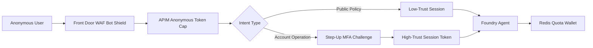
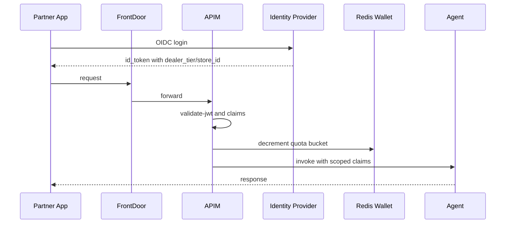

# Entra External ID CIAM vs B2B Guest vs OIDC Exchange Gateway: B2C and Partner Agent Identity Selection FAQ

> 🌐 **Language / 语言切换**: **[🇬🇧 English (entra-external-id-ciam-vs-b2b-guest-vs-apim-subscription-b2c-partner-agent-identity-selection-faq.en.md)](entra-external-id-ciam-vs-b2b-guest-vs-apim-subscription-b2c-partner-agent-identity-selection-faq.en.md)** | **[🇨🇳 中文版 (entra-external-id-ciam-vs-b2b-guest-vs-apim-subscription-b2c-partner-agent-identity-selection-faq.md)](entra-external-id-ciam-vs-b2b-guest-vs-apim-subscription-b2c-partner-agent-identity-selection-faq.md)** | **[📚 Architecture Selection FAQ Index](README.en.md)**

## 1) Objective and boundary
- Goal: architecture selection for B2C consumer and B2B2C partner agent identity, anti-abuse controls, and session step-up flows.
- Scope: cloud architecture, governance, risk controls, and TCO; no low-level implementation internals.
- Conclusion: isolate customer identity from employee identity and apply progressive trust elevation by intent.
## 2) Verifiable sources with timestamps
- Entra External ID docs: `https://learn.microsoft.com/entra/external-id/` (04:04 BJT).
- Entra B2B docs: `https://learn.microsoft.com/entra/external-id/b2b-collaboration-overview` (04:04 BJT).
- APIM JWT policy docs: `https://learn.microsoft.com/azure/api-management/` (04:05 BJT).
- Front Door WAF and bot docs: `https://learn.microsoft.com/azure/frontdoor/` (04:05 BJT).
- Azure Cache for Redis docs: `https://learn.microsoft.com/azure/azure-cache-for-redis/` (04:05 BJT).
- Metrics are tagged as measured, synthetic, or anonymized_reported.
## 3) 12-dimension matrix for customer and partner identity patterns
- D1 scale: External ID is strongest for million-level consumer registration.
- D2 directory isolation: CIAM and employee directories must remain physically separated.
- D3 partner trust: B2B is ideal for enterprise cross-tenant federation.
- D4 reuse speed: OIDC token exchange quickly reuses existing super-app sign-in state.
- D5 anti-abuse: anonymous entry needs WAF, device fingerprint, and token caps.
- D6 step-up: sensitive actions require in-session MFA elevation.
- D7 claim-driven authz: dealer_tier and store_id support gateway-level entitlement.
- D8 zero lookup: APIM can enforce quotas and pricing tiers without DB reads.
- D9 risk economics: progressive trust balances acquisition funnel and abuse cost.
- D10 ops complexity: dual-track anon and verified governance is more complex but safer.
- D11 best fit: External ID for consumers, B2B for partner enterprises, token exchange for legacy ecosystems.
- D12 anti-pattern: never inject millions of external members into employee guest directory.
## 4) Score snapshot and thresholds
- External ID: scale5 isolation5 experience5 governance4.
- Entra B2B: federation5 scale3 experience3 governance4.
- OIDC exchange gateway: reuse5 isolation3 governance4 speed5.
- Progressive two-stage auth: risk5 conversion4 complexity3 governance5.
- Threshold A: anonymous public sessions default to 1500-token caps.
- Threshold B: account-changing operations must trigger step-up MFA.
- Threshold C: partner tiering should be claim-driven to minimize backend lookups.
## 5) Five calculable Q&As
### Q1 Denial-of-wallet four-layer defense economics
- Layer stack is Front Door bot protection, device fingerprinting, anonymous token cap, and login trigger.
- Synthetic baseline shows 90%+ interception of budget-draining abusive traffic under peak probes.
### Q2 Why not place millions of members as employee guests
- Capacity, lifecycle governance, and audit boundaries become polluted by external account churn.
- A dedicated CIAM tenant cleanly separates credential, policy, and growth operations.
### Q3 Seamless in-session trust elevation design
- Public policy Q&A runs on low-trust session credentials.
- Sensitive operations trigger step-up and mint higher-assurance claims without dropping the chat.
### Q4 Claim-based quota and pricing isolation
- APIM reads dealer_tier and store_id for direct policy routing and throttling.
- This removes synchronous database lookups for most entitlement decisions.
### Q5 Identity-plus-gateway TCO at 2M MAU
- Main cost drivers are auth calls, gateway policy execution, and anti-abuse counters.
- Claim-first design with Redis wallets reduces backend lookup pressure materially.
## 6) Layered reference architecture
- Entry layer: Front Door, WAF, and bot management.
- Identity layer: External ID, B2B federation, or OIDC token exchange.
- Session layer: anonymous, elevated, and MFA challenge chains.
- Gateway layer: APIM JWT validation, throttling, and claim routing.
- State layer: Redis quota wallets and abuse counters.
- Inference layer: Foundry model and tool policy boundaries.
- Observability layer: interception rate, funnel conversion, and token economics.
## 7) Scenario A: high-net-worth advisory portal for asset management
- Dedicated External ID tenant with passkey login for premium clients.
- APIM extracts investor_id and C1 to C5 risk tier for bounded retrieval scope.
- Portfolio adjustment intents require mandatory step-up MFA.
- Recommendation responses are constrained by risk-profile claims.
- Synthetic gain: high-risk misoperation probability decreases significantly.
## 8) Scenario B: 1.2M franchise operators and technicians
- Existing mobile workbench sessions are exchanged via OIDC into gateway-scoped agent tokens.
- Front Door plus APIM plus Redis enforces per-store daily token wallets.
- Dealer-tier claims isolate rebate policy and wholesale-price visibility.
- Zero-ticket self-onboarding scales to hundreds of thousands of stores.
- Synthetic gain: onboarding efficiency improves by 4x.
## 9) Mermaid diagram 1 anonymous-to-verified progressive trust flow

- Public support and sensitive operations must run on separate trust levels.
## 10) Mermaid diagram 2 partner claim-driven isolation sequence

- Quota and pricing policies are enforced at the gateway without backend lookups.
## 11) Bicep template (Front Door WAF + APIM + Redis + Foundry)
```bicep
targetScope = 'resourceGroup'
param location string = resourceGroup().location
resource fd 'Microsoft.Cdn/profiles@2024-02-01' = {
  name: 'fd'
  location: location
}
resource apim 'Microsoft.ApiManagement/service@2023-09-01-preview' = {
  name: 'apim-prod'
  location: location
  sku: { name: 'PremiumV2', capacity: 1 }
}
resource redis 'Microsoft.Cache/Redis@2024-03-01' = {
  name: 'redis'
  location: location
}
```
- Production rollout still needs private networking, key rotation, managed identity, and tiered RBAC.
## 12) APIM dual-track throttling and step-up challenge snippet
```xml
<inbound>
  <validate-jwt header-name="Authorization" ... />
  <choose>
    <when condition="@(context.Variables["isAnonymous"] == true)">
      <set-header name="x-token-cap" exists-action="override"><value>1500</value></set-header>
    </when>
    <otherwise>
      <set-header name="x-step-up" exists-action="override"><value>required-for-sensitive</value></set-header>
    </otherwise>
  </choose>
</inbound>
```
- Auth policy must preserve public exploration while enforcing trusted elevation for sensitive actions.
## 13) KQL for abuse interception, funnel conversion, and token economics
```kql
let t = IdentityGatewayLogs | where TimeGenerated > ago(24h);
t
| summarize blocked=countif(IsBlocked==true), anon=countif(SessionType=="anon"), stepup=countif(StepUpTriggered==true), avgToken=avg(TokenUsed) by Channel,PartnerTier
| extend blockRate=todouble(blocked)/todouble(anon)
| order by blockRate desc, avgToken desc
```
- Funnel anomalies trigger adaptive risk tuning and escalation workflows.
## 14) Day-0/1/2 landing checklist
- Day-0 finalize identity boundaries and tenant separation policy.
- Day-0 define anonymous caps, elevation thresholds, and risk lexicon.
- Day-1 connect Front Door WAF and APIM claim policies.
- Day-1 enable Redis quota wallets and pressure-test abuse controls.
- Day-2 validate seamless step-up handshakes and rollback runbooks.
- Day-2 review channel-level funnel and spend-interception performance weekly.
- Day-2 publish quarterly identity and anti-abuse roadmap updates.
