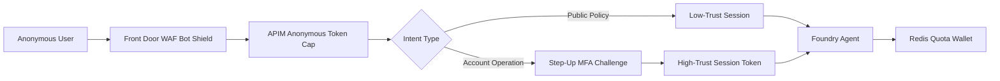
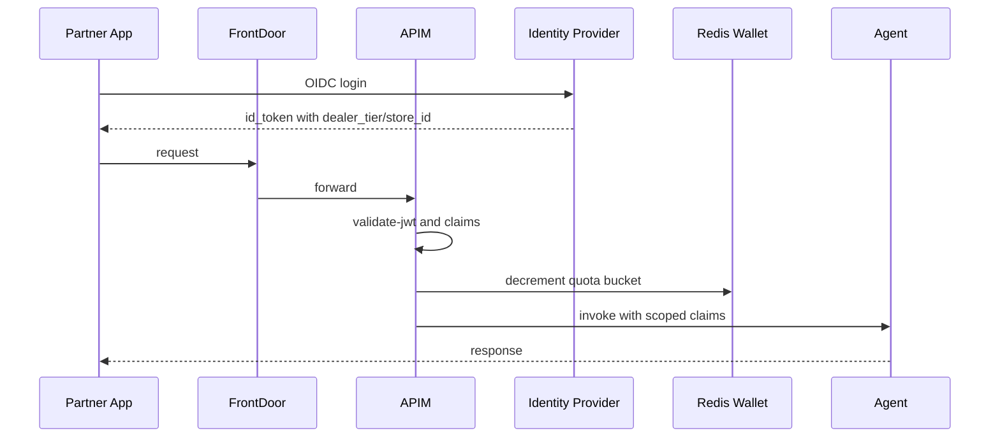

# Entra External ID CIAM vs B2B Guest vs OIDC换票网关：对客与伙伴智能体身份选型 FAQ

> 🌐 **Language / 语言切换**: **[🇨🇳 中文版 (entra-external-id-ciam-vs-b2b-guest-vs-apim-subscription-b2c-partner-agent-identity-selection-faq.md)](entra-external-id-ciam-vs-b2b-guest-vs-apim-subscription-b2c-partner-agent-identity-selection-faq.md)** | **[🇬🇧 English (entra-external-id-ciam-vs-b2b-guest-vs-apim-subscription-b2c-partner-agent-identity-selection-faq.en.md)](entra-external-id-ciam-vs-b2b-guest-vs-apim-subscription-b2c-partner-agent-identity-selection-faq.en.md)** | **[📚 返回架构选型指南目录](README.md)**

## 1) 研究目标与边界
- 目标：面向 B2C 与 B2B2C 智能体身份、反刷与会话升维认证选型。
- 范围：聚焦云架构、治理、成本、风控与合规，不讨论底层研发细节。
- 结论：消费级用户与员工目录必须隔离，匿名体验与实名操作应分段治理。
## 2) 可验证来源与时间戳
- Entra External ID：`https://learn.microsoft.com/entra/external-id/`（抓取 04:04 BJT）。
- Entra B2B：`https://learn.microsoft.com/entra/external-id/b2b-collaboration-overview`（抓取 04:04 BJT）。
- APIM JWT 验签策略：`https://learn.microsoft.com/azure/api-management/`（抓取 04:05 BJT）。
- Azure Front Door WAF/Bot：`https://learn.microsoft.com/azure/frontdoor/`（抓取 04:05 BJT）。
- Azure Cache for Redis：`https://learn.microsoft.com/azure/azure-cache-for-redis/`（抓取 04:05 BJT）。
- 数据标签统一 measured/synthetic/anonymized_reported。
## 3) 四类身份架构 12 维矩阵
- 维度1用户规模：External ID 更适配千万级消费者。
- 维度2目录隔离：CIAM 与员工目录物理隔离更安全。
- 维度3伙伴互信：B2B 适合大型企业跨租户协作。
- 维度4存量复用：OIDC换票可快速复用会员中心登录态。
- 维度5防刷能力：匿名体验需配合WAF、设备指纹和Token封顶。
- 维度6会话升维：涉及退改/账户操作时必须 Step-Up MFA。
- 维度7声明驱动授权：`dealer_tier`/`store_id` 可在网关侧即决策。
- 维度8零数据库回查：APIM按声明执行配额与价格隔离。
- 维度9风控成本：两段式鉴权兼顾获客转化与防薅羊毛。
- 维度10运维复杂度：双轨匿名+实名治理复杂但收益高。
- 维度11最佳场景：External ID 对客，B2B 对伙伴，OIDC换票对存量生态。
- 维度12反模式：严禁把百万外部会员塞进员工主租户Guest目录。
## 4) 评分与决策阈值
- External ID：规模5、隔离5、体验5、治理4。
- Entra B2B：互信5、规模3、体验3、治理4。
- OIDC换票网关：复用5、隔离3、治理4、上线速度5。
- 两段式渐进鉴权：风控5、转化4、复杂度3、治理5。
- 阈值A：公网匿名会话默认封顶 1,500 Token。
- 阈值B：涉及资产变更动作必须触发Step-Up MFA。
- 阈值C：伙伴分级策略应尽量声明化，减少数据库回查。
## 5) 五组可复算 Q&A
### Q1 Denial-of-Wallet 四层防线测算
- Front Door Bot 防护 + 设备指纹 + 匿名Token封顶 + 登录触发。
- synthetic示例：高峰恶意请求可拦截 90%+ 预算外消耗。
### Q2 为什么不能把百万会员塞进员工租户Guest
- 容量、治理、生命周期与审计边界都会被外部账号污染。
- 独立CIAM租户可清晰隔离凭据、策略与运营流程。
### Q3 会话中途升维如何不断流
- 公共问答阶段使用匿名/低权限token。
- 进入敏感操作时触发Step-Up并换发高保证会话声明。
### Q4 声明驱动配额与价格隔离
- APIM读取`dealer_tier`与`store_id`执行限流与政策隔离。
- 无需回库即可实现多层伙伴差异化策略。
### Q5 200万月活身份+网关TCO
- 关键成本来自鉴权调用、网关策略执行与反刷缓存。
- 通过声明化策略与Redis额度桶可显著降低后端回查成本。
## 6) 分层参考架构
- 接入层：Front Door + WAF + Bot 管理。
- 身份层：External ID/B2B/OIDC换票。
- 会话层：匿名会话、升维会话、MFA挑战链。
- 网关层：APIM JWT验签、限流、声明路由。
- 状态层：Redis额度桶与风控计数器。
- 推理层：Foundry 模型与工具调用策略。
- 观测层：拦截率、漏斗转化、Token成本。
## 7) 场景A：公募基金高净值客户投顾门户
- 独立 External ID CIAM 租户 + Passkey 登录。
- APIM 提取 `investor_id` 与风险等级 C1–C5。
- 检索范围按风险等级与账户权限强约束。
- 调仓前强制 Step-Up MFA 二次验证。
- synthetic收益：高风险误操作率显著下降。
## 8) 场景B：120万加盟店移动助手
- 既有移动工作台登录态经 OIDC 换票接入网关。
- Front Door + APIM + Redis 实现单店日Token钱包。
- 按经销商层级隔离返利策略与批发底价。
- 30万终端门店实现零IT工单自助开通。
- synthetic收益：运营开通效率提升 4x。
## 9) Mermaid 图1：匿名到实名升维双轨流

- 公开咨询与敏感操作必须走不同信任层。
## 10) Mermaid 图2：伙伴声明驱动限流与价格隔离时序

- 配额与价格策略在网关即决策，后端零回查。
## 11) Bicep 模板（Front Door WAF + APIM + Redis + Foundry）
```bicep
targetScope = 'resourceGroup'
param location string = resourceGroup().location
resource fd 'Microsoft.Cdn/profiles@2024-02-01' = {
  name: 'fd'
  location: location
}
resource apim 'Microsoft.ApiManagement/service@2023-09-01-preview' = {
  name: 'apim-prod'
  location: location
  sku: { name: 'PremiumV2', capacity: 1 }
}
resource redis 'Microsoft.Cache/Redis@2024-03-01' = {
  name: 'redis'
  location: location
  properties: { sku: { name: 'Standard', family: 'C', capacity: 1 } }
}
```
- 生产需补齐私网、密钥轮换、托管身份与分级RBAC。
## 12) APIM双轨限流与Step-Up挑战策略片段
```xml
<inbound>
  <validate-jwt header-name="Authorization" ... />
  <choose>
    <when condition="@(context.Variables["isAnonymous"] == true)">
      <set-header name="x-token-cap" exists-action="override"><value>1500</value></set-header>
    </when>
    <otherwise>
      <set-header name="x-step-up" exists-action="override"><value>required-for-sensitive</value></set-header>
    </otherwise>
  </choose>
</inbound>
```
- 认证层要保证“匿名可体验、敏感必升维”。
## 13) KQL：拦截率/漏斗/单客Token消耗
```kql
let t = IdentityGatewayLogs | where TimeGenerated > ago(24h);
t
| summarize blocked=countif(IsBlocked==true), anon=countif(SessionType=="anon"), stepup=countif(StepUpTriggered==true), avgToken=avg(TokenUsed) by Channel,PartnerTier
| extend blockRate=todouble(blocked)/todouble(anon)
| order by blockRate desc, avgToken desc
```
- 漏斗异常需联动风控策略自动调参与告警。
## 14) Day-0/1/2 落地清单
- Day-0：完成身份分层与租户边界设计。
- Day-0：定义匿名封顶、升维阈值与风险词典。
- Day-1：接通Front Door WAF与APIM声明策略。
- Day-1：上线Redis额度桶并做压测。
- Day-2：联调Step-Up无缝握手与回滚剧本。
- Day-2：按渠道复盘漏斗与预算拦截表现。
- Day-2：形成季度风控与身份运营迭代计划。
