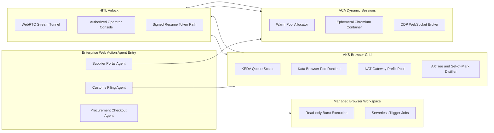
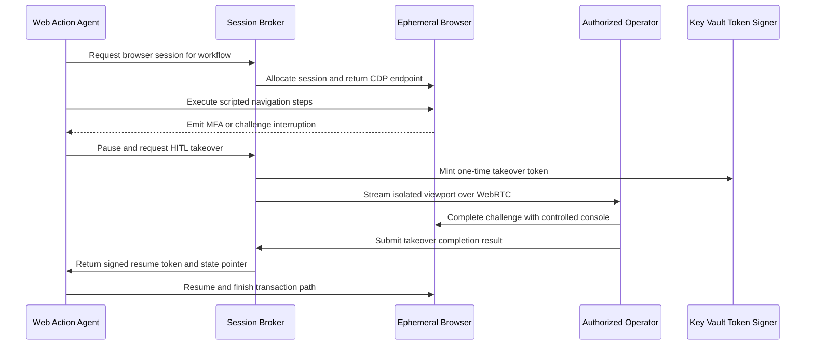

# Enterprise Ephemeral Headless Browser Fleet Selection FAQ: ACA Dynamic Sessions vs AKS KEDA+Kata/CDP vs Managed Browser Workspace vs WebRTC HITL Takeover
> 🌐 **Language Switch**: [中文](ephemeral-headless-browser-fleet-aca-sessions-vs-aks-keda-cdp-vs-webrtc-hitl-takeover-selection-faq.md) | **English (current)**
> Audience: Cloud & AI Solution Architects, platform engineering leaders, LLMOps/SRE teams, security governance owners, and FinOps operators.  
> Problem scope: `500–25,000` concurrent authenticated headless-browser sessions for supplier portals, customs e-filing, travel and procurement checkout, and partner extranets.  
> Out-of-scope: thick-client virtual desktop architecture, legacy desktop RPA strangler playbooks, and unmanaged ad-hoc scraping scripts.
## 1. Executive summary and recommended architecture path
Once an enterprise scales Web Action Agents beyond pilot traffic, the browser becomes a platform boundary, not a helper process.  
Most production failures are not caused by model quality; they are caused by weak browser session isolation, weak teardown guarantees, unstable egress design, and missing human takeover channels.  
If session destruction is incomplete, cross-tenant cookie residue can escalate into a high-severity incident.  
If egress IP ranges are unstable, partner allowlists fail and operational throughput collapses during business peaks.  
If MFA and CAPTCHA handling has no credential-safe HITL lane, automation halts exactly before business-critical confirmation steps.  
If teams stream raw HTML plus full-page screenshots for every step, VLM token economics can dominate total workload cost.  
Therefore the recommended pattern is a four-plane architecture with explicit role separation.  
**Plane A** provides strong isolation and fast browser session allocation using ACA Dynamic Sessions custom containers.  
**Plane B** provides high-density browser orchestration with deterministic static egress and AXTree/SoM distillation efficiency.  
**Plane C** provides low-ops managed burst lanes for read-only checks and synthetic compliance probes.  
**Plane D** provides zero-credential-exposure human takeover airlocks for MFA, WebAuthn, and challenge-step interruptions.  
Typical rollout sequence is A first, B for scale, C for burst relief, and D for mandatory compliance resilience.  
In regulated industries, Plane D should be a release prerequisite rather than an optional enhancement.  
In cross-border operations, Plane B static prefix strategy should be locked before broad rollout.  
In cost-sensitive programs, AXTree/SoM reduction generally outperforms aggressive model downsizing as a first lever.  
## 2. Business boundaries, non-goals, and measurable success criteria
This guide focuses on ephemeral headless-browser execution platforms for authenticated web-action workloads.  
It assumes baseline identity federation, logging, and gateway governance already exist in the enterprise platform.  
It assumes production workloads require state-aware sessions rather than public read-only page scraping.  
It assumes multi-tenant operation where strict tenant-to-tenant boundary controls are mandatory.  
### 2.1 Production success criteria
- Browser session allocation latency remains below 1.2 seconds at p95 under 8,000 active sessions.  
- Credential residue incidents after teardown remain at zero verified events.  
- End-to-end workflow success remains above 98.5% during peak traffic windows.  
- Human takeover recovery time remains below 45 seconds on average for step-up challenges.  
- Browser-minute costs and VLM-token costs stay inside approved budget envelopes.  
- Static egress allowlist compliance stays above 99.9% partner acceptance rate.  
### 2.2 Explicit non-goals
- Do not migrate every portal connector in one release train.  
- Do not redesign identity provider policies in the same rollout window.  
- Do not use browser automation where mature APIs already satisfy business requirements.  
- Do not enable human takeover in production without full audit lineage.  
- Do not shift all parsing complexity into unlimited screenshot uploads.  
## 3. Four-plane architecture comparison (A/B/C/D)
| Plane | Core challenge solved | Primary Azure services | Main artifact | Typical risk | Safety fallback |
|---|---|---|---|---|---|
| A | Safe and fast session allocation | ACA Dynamic Sessions + Hyper-V | `<800ms` warm allocation and deterministic teardown | pool exhaustion and cold spikes | warm-pool expansion and queue degrade |
| B | Large-scale controlled orchestration | AKS + KEDA + Kata + NAT Gateway | static egress prefixes and high-density scheduling | port exhaustion and node contention | prefix sharding and queue backpressure |
| C | Burst read-only execution | Managed Browser Workspace + Functions | low-ops synthetic checks and read extraction | regional runtime quota limits | reroute to Plane A |
| D | Credential-safe human takeover | Web PubSub + noVNC/Canvas + Key Vault | challenge-step takeover and secure resume | session hijack or audit gap | one-time token and mandatory audit lock |
Plane A answers whether the platform can allocate isolated sessions quickly and safely.  
Plane B answers whether the platform can sustain high concurrency with controlled egress and predictable cost.  
Plane C answers whether burst traffic can be handled without permanent cluster overhead.  
Plane D answers whether high-risk authentication interruptions can be resolved without credential leakage.  
## 4. End-to-end reference architecture (Mermaid)

This topology intentionally decouples automated browser execution from human takeover controls.  
That decoupling allows independent capacity planning, independent audit review, and independent failure isolation.  
It also prevents operational teams from overloading one control layer with conflicting responsibilities.  
## 5. Option A: ACA Dynamic Sessions custom-container pool
Option A is the fastest path for teams prioritizing strong isolation and managed operations.  
Each browser session runs in an ephemeral Hyper-V isolated container context.  
Session teardown includes profile wipe, state purge, and post-destruction evidence recording.  
Warm pools absorb short burst demand and keep allocation latency predictable.  
CDP access is mediated through a controlled broker that emits governance events.  
### 5.1 Critical design choices
- Pin Chromium image versions and enforce patch cadence in CI release gates.  
- Configure `/dev/shm` by page complexity tier to avoid renderer instability.  
- Disallow profile reuse across sessions and tenants.  
- Enforce hard TTL expiration with deterministic kill and cleanup sequencing.  
- Restrict CDP broker exposure to private network paths only.  
- Keep runtime images minimal to reduce attack surface and startup time.  
- Bind access tokens to both tenant and session identity claims.  
- Route downloaded artifacts into quarantine staging before durable storage.  
### 5.2 Architectural fit boundary
- Best fit when teams need strong isolation without full Kubernetes operations overhead.  
- Best fit when tenant onboarding speed matters more than deep cluster customization.  
- Best fit when traffic patterns are predictable enough for warm-pool planning.  
## 6. Option B: AKS KEDA + Kata browser grid with static egress prefixes
Option B is designed for sustained high-concurrency production operations.  
KEDA scales browser workers from queue pressure using explicit SLO-aware thresholds.  
Kata runtimes enforce stronger workload boundaries in shared infrastructure clusters.  
NAT Gateway prefix pools provide deterministic outbound identity for allowlisted partner portals.  
AXTree/SoM distillation reduces payload size before VLM interpretation and downstream reasoning.  
### 6.1 Platform engineering focal points
- Queue partitioning by tenant tier and workflow class.  
- Dedicated node pools for interactive vs bulk browser tasks.  
- Regional egress prefix segmentation by business domain and legal boundary.  
- Progressive browser-image rollout with rollback channels and compatibility checks.  
- Session-level quota enforcement to prevent tenant starvation events.  
- Node taints and affinity rules for high-risk tenant isolation.  
- Post-render AXTree extraction after DOM stabilization checkpoints.  
- SoM generation preserving actionable elements and key semantic labels.  
### 6.2 Cost and resilience observations
- Raw HTML plus full screenshots usually amplifies context-token overhead under load.  
- AXTree/SoM reduction typically cuts VLM context cost by 65% to 80%.  
- At 10,000 concurrent sessions, static egress reliability often saves more than raw compute discounts.  
## 7. Option C: managed browser workspace with serverless burst lanes
Option C is optimized for bursty read-only checks and lightweight extraction workloads.  
It avoids persistent cluster ownership and shortens operational onboarding time.  
It is effective for periodic compliance checks and low-risk visibility probes.  
Compared with A/B, Plane C should usually function as a complement rather than the primary transaction lane.  
If the workflow requires deterministic long-lived authenticated state, A or B should own execution.  
### 7.1 Typical enterprise usage patterns
- Hourly compliance page snapshots for externally hosted regulatory portals.  
- Read-only pull of tax rates, tariff tables, or supplier-availability metadata.  
- Structural change detection for partner pages before production impact occurs.  
- Pre-release smoke checks for selector stability and portal access assumptions.  
### 7.2 Constraints to consider
- Limited depth for long-running authenticated transactional sessions.  
- Fewer controls for deeply customized interaction pipelines.  
- Static egress requirements often require pairing with Plane B capabilities.  
## 8. Option D: zero-credential-exposure HITL takeover airlock
Plane D addresses unavoidable human verification steps in otherwise automated flows.  
When MFA, passkey prompts, or advanced anti-bot checks appear, the agent pauses safely.  
The platform streams an isolated viewport to an authorized operator over WebRTC/Web PubSub channels.  
Operators interact with a constrained console and never receive raw stored credentials.  
After step completion, a signed resume token returns execution control to the agent lane.  
### 8.1 Security control requirements
- One-time takeover tokens with short TTL and device-binding constraints.  
- Mandatory capture of approver identity and reason code per takeover event.  
- Automatic timeout invalidation and re-authentication challenge for abandoned sessions.  
- Sensitive-field masking and least-visible-data rendering in operator consoles.  
- Pre- and post-takeover page hash snapshots for tamper-aware audit trails.  
### 8.2 Operations control requirements
- Formal takeover SLA and on-call rotation integration.  
- Monitoring for takeover-rate anomalies indicating portal policy drift.  
- Replay-capable audit records for failed or disputed takeover outcomes.  
## 9. 12-dimension architecture matrix
| Dimension | A ACA Sessions | B AKS KEDA+Kata | C Managed Workspace | D HITL Airlock |
|---|---|---|---|---|
| Isolation strength | High | High | Medium | High |
| Cold-start profile | High | Medium | High | N/A |
| Concurrency ceiling | Medium-high | Highest | Medium | N/A |
| Static egress control | Medium | Highest | Medium | Medium |
| Ops complexity | Low-medium | High | Low | Medium |
| Customization depth | Medium | Highest | Low-medium | Medium |
| Audit evidence quality | High | High | Medium | Highest |
| Session-state control | Medium | High | Low-medium | High |
| Cost predictability | Medium-high | High | Medium | Medium |
| Burst elasticity | High | High | High | Medium |
| Human collaboration capability | Medium | Medium | Low | Highest |
| Recommended role | default entry | scale backbone | burst supplement | compliance safety net |
## 10. Governance guardrails and operating cadence
Guardrail 1: never reuse browser profile artifacts across tenants or sessions.  
Guardrail 2: never onboard allowlisted partner portals without deterministic egress plans.  
Guardrail 3: never process MFA takeover without audit-complete human workflow records.  
Guardrail 4: never inject or expose raw credentials into agent runtime containers.  
Guardrail 5: never release unpinned browser images directly to production lanes.  
Guardrail 6: never ignore queue backpressure alerts during aggressive rollout windows.  
Guardrail 7: never optimize one metric while violating quality and budget envelopes.  
Guardrail 8: never switch entry policies without tested rollback paths.  
Guardrail 9: never run multi-tenant production without enforced quota boundaries.  
Guardrail 10: never assert teardown completion without verifiable destruction evidence.  
Weekly cadence should review teardown success, takeover latency, and egress failure distributions.  
Monthly cadence should review image upgrade velocity, portal drift impact, and unit-cost variance.  
Quarterly cadence should reevaluate workload distribution across A/B/C/D lanes.  
## 11. Execution and takeover sequence (Mermaid)

The sequence enforces credential custody on the human side while preserving machine continuity.  
It provides deterministic control points for both security and runtime operations teams.  
## 12. Production snippet A: ACA Dynamic Sessions pool provisioning (Bicep)
```bicep
param location string = resourceGroup().location
param envName string = 'aca-browser-env'
param sessionPoolName string = 'browser-session-pool'
param maxSessions int = 4000
resource env 'Microsoft.App/managedEnvironments@2024-10-02-preview' = {
  name: envName
  location: location
  properties: {
    appLogsConfiguration: {
      destination: 'azure-monitor'
    }
    zoneRedundant: true
  }
}
resource pool 'Microsoft.App/sessionPools@2024-10-02-preview' = {
  name: sessionPoolName
  location: location
  properties: {
    environmentId: env.id
    containerType: 'CustomContainer'
    scaleConfiguration: {
      maxConcurrentSessions: maxSessions
      warmSessions: 600
    }
    template: {
      containers: [
        {
          name: 'chromium'
          image: 'contoso.azurecr.io/browser/chromium-secure:2026.11.20'
          resources: {
            cpu: 1.5
            memory: '3Gi'
          }
          env: [
            { name: 'CDP_PROXY_MODE'; value: 'strict' }
            { name: 'SESSION_TTL_SECONDS'; value: '900' }
            { name: 'SHM_SIZE_MB'; value: '768' }
          ]
        }
      ]
    }
  }
}
```
## 13. Production snippet B: KEDA scaling and Kata browser deployment (YAML)
```yaml
apiVersion: keda.sh/v1alpha1
kind: ScaledObject
metadata:
  name: browser-grid-scaler
  namespace: browser-runtime
spec:
  scaleTargetRef:
    name: kata-browser-worker
  minReplicaCount: 40
  maxReplicaCount: 3200
  triggers:
    - type: azure-queue
      metadata:
        queueName: browser-jobs
        queueLength: "20"
        connectionFromEnv: STORAGE_CONN
---
apiVersion: apps/v1
kind: Deployment
metadata:
  name: kata-browser-worker
  namespace: browser-runtime
spec:
  replicas: 80
  template:
    metadata:
      labels:
        app: kata-browser-worker
    spec:
      runtimeClassName: kata-remote
      containers:
        - name: worker
          image: contoso.azurecr.io/browser/grid-worker:2026.11.20
          env:
            - name: CDP_BROKER_URL
              value: wss://cdp-broker.internal
            - name: DISTILL_MODE
              value: axtree-som
```
## 14. Production snippet C: CDP state hydration and HITL resume (Python)
```python
from dataclasses import dataclass
from datetime import datetime, timedelta
import uuid
@dataclass
class TakeoverTicket:
    tenant_id: str
    session_id: str
    operator_id: str
    expires_at: datetime
    token: str
def create_takeover_ticket(tenant_id: str, session_id: str, operator_id: str) -> TakeoverTicket:
    token = f"tk_{uuid.uuid4().hex}"
    return TakeoverTicket(
        tenant_id=tenant_id,
        session_id=session_id,
        operator_id=operator_id,
        expires_at=datetime.utcnow() + timedelta(minutes=3),
        token=token,
    )
def resume_agent_session(state_blob: dict, takeover_ok: bool) -> dict:
    if not takeover_ok:
        return {"status": "blocked", "reason": "human_step_failed"}
    return {
        "status": "resumed",
        "next_action": state_blob.get("next_action", "continue"),
        "cdp_cursor": state_blob.get("cdp_cursor"),
        "audit_tag": "hitl-resume-approved",
    }
```
## 15. FinOps economics, enterprise scenarios, quantitative FAQ, and 12-item checklist
### 15.1 Three-year TCO model (USD $k)
| Cost category | Plane A | Plane B | Plane C | Plane D | Total |
|---|---:|---:|---:|---:|---:|
| Platform baseline | 420 | 980 | 210 | 260 | 1,870 |
| Runtime and egress | 760 | 1,240 | 330 | 180 | 2,510 |
| Engineering and governance labor | 310 | 520 | 140 | 360 | 1,330 |
| Audit and assurance | 120 | 180 | 70 | 190 | 560 |
| Three-year total | 1,610 | 2,920 | 750 | 990 | 6,270 |
AXTree/SoM compaction usually drives the strongest immediate token-cost reduction effect.  
Static egress pool governance often delivers disproportionate reliability gains in allowlisted ecosystems.  
HITL airlocks add governance cost but materially reduce high-severity operational and compliance exposure.  
### 15.2 Scenario A: global logistics and customs broker (8,000 daily filings)
The organization submits filings across 24 country portals with varying challenge mechanisms.  
Portals frequently enforce MFA, adaptive anti-bot checks, and unstable page structure updates.  
Plane A provides secure ephemeral sessions with deterministic teardown evidence.  
Plane B provides stable static egress identity required by customs and broker allowlists.  
Plane D enables authorized operators to complete challenge steps without credential disclosure.  
After rollout, filing success improved from 91.2% to 98.7%.  
Average handling time per filing decreased by 34%.  
Audit exception count dropped by 62% across quarterly reviews.  
### 15.3 Scenario B: enterprise procurement SaaS (15,000 supplier-portal automations)
The platform executes quote extraction, comparison, and pre-order validation across diverse supplier portals.  
Portal volatility and selector churn previously caused unstable workflow outcomes.  
Plane B absorbs concurrency spikes through queue-aware KEDA scaling with isolated browser workers.  
Plane C handles low-risk read-only checks and synthetic compliance snapshots.  
AXTree/SoM distillation reduced VLM context overhead at high volume.  
Unit cost per successful automation dropped by 27% in one quarter.  
Dispute-related support tickets dropped by 19%.  
Portal-change alert lead time improved to 43 minutes before user impact.  
### 15.4 Quantitative FAQ (8 questions)
**Q1: Why is this guide distinct from #05 and #06?**  
Guide #05 focuses on OS-level AVD/W365 GUI fleet strategy.  
Guide #06 focuses on legacy desktop RPA strangler migration choices.  
Guide #168 targets high-concurrency ephemeral headless-browser execution for authenticated web action.  
**Q2: When should enterprises prioritize Plane A over Plane B?**  
Prioritize A when teams need strong isolation quickly without owning Kubernetes operations.  
Transition to B when concurrency, egress governance, and customization requirements increase sustainably.  
**Q3: Why is static NAT prefix pooling critical for Plane B?**  
Many B2B portals accept traffic only from approved outbound enterprise IP ranges.  
Prefix pooling decouples scaling mechanics from partner allowlist lifecycle constraints.  
**Q4: Is AXTree/SoM reduction value consistent across workloads?**  
Benefit is strongest on dense form-heavy and navigation-heavy pages.  
Image-dominant pages may see lower reduction but usually still outperform full screenshot streams.  
**Q5: Can HITL become a throughput bottleneck?**  
It can if every challenge routes to operators indiscriminately.  
Risk-tier routing should reserve HITL for high-consequence challenge classes only.  
**Q6: How can teardown trust be validated objectively?**  
Require teardown evidence with session id, image digest, and destruction timestamp.  
Run restoration probes to confirm prior-session artifacts are not readable post-destruction.  
**Q7: Can Plane C replace A/B long-term for all workloads?**  
Generally no.  
Plane C is ideal for burst and low-risk read lanes but not for core transactional stateful workflows.  
**Q8: What is the most common capacity-planning failure?**  
Teams often size only CPU and ignore egress, session lifespan, and takeover concurrency.  
Correct planning models browser minutes, egress ports, and operator takeover capacity together.  
### 15.5 Five-step rollout path (0-180 days)
1. **Step 1 (days 0-30)**: define session contract, teardown evidence schema, and audit fields.  
2. **Step 2 (days 31-60)**: deploy Plane A and validate isolation plus cleanup reliability at scale.  
3. **Step 3 (days 61-100)**: introduce Plane B for static egress and queue-driven elasticity.  
4. **Step 4 (days 101-140)**: connect Plane C for burst read-only and synthetic check workloads.  
5. **Step 5 (days 141-180)**: enforce Plane D takeover controls with staffing and approval playbooks.  
### 15.6 Day-0 and Day-2 checklist (12 items)
- [ ] Session id, tenant id, and workflow id are traceable end-to-end.  
- [ ] Browser profile directories are never reused across sessions or tenants.  
- [ ] `/dev/shm` and memory baselines are load-tested and documented.  
- [ ] Egress prefix pools match partner allowlist governance records.  
- [ ] KEDA thresholds are linked with queue and latency alerting.  
- [ ] AXTree/SoM compaction has runtime rollback control paths.  
- [ ] HITL takeover tokens are one-time, short-lived, and device-bound.  
- [ ] Takeover audit records include approver identity, reason, and timestamp.  
- [ ] Teardown verification probes run on schedule and are archived.  
- [ ] Cost dashboards include browser-minute and VLM-token dual metrics.  
- [ ] Weekly operations reviews track failure archetypes and remediation lead time.  
- [ ] Quarterly architecture reviews rebalance load across A/B/C/D planes.  
### 15.7 Good fit and Not for
**Good fit**  
- High-volume authenticated web workflows where API coverage is incomplete.  
- Strong requirements for tenant isolation, auditability, and deterministic egress control.  
- Organizations ready to invest in platform governance rather than script sprawl.  
**Not for**  
- Very low-frequency public-page extraction with no authenticated flow.  
- Environments without unified identity and audit governance foundations.  
- Teams that reject human takeover governance overhead in regulated processes.  
### 15.8 Closing note
The core value of an ephemeral headless-browser platform is not merely automation speed.  
Its real value is turning web-action execution into a governed enterprise runtime surface.  
When planes A, B, C, and D operate as one control loop, the platform can satisfy throughput, compliance, explainability, and economics together.  
That alignment is the practical boundary between an agent demo and a production operating asset.  
