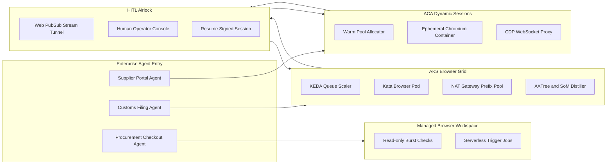
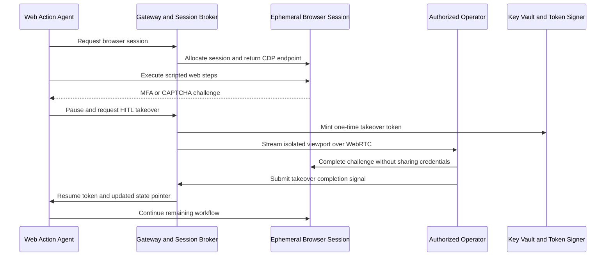

# 企业级临时无头浏览器智能体集群选型 FAQ：ACA Dynamic Sessions vs AKS KEDA+Kata/CDP vs 托管 Browser Workspace vs WebRTC HITL 接管
> 🌐 **Language Switch**: **中文（当前）** | [English](ephemeral-headless-browser-fleet-aca-sessions-vs-aks-keda-cdp-vs-webrtc-hitl-takeover-selection-faq.en.md)
> 目标读者：Cloud & AI Solution Architect、平台工程负责人、LLMOps/SRE、安全治理与 FinOps 团队。  
> 业务边界：聚焦 `500–25,000` 并发临时无头浏览器会话，覆盖 B2B 供应商门户、海关申报、差旅采购、合作伙伴外网自动化。  
> 非目标：不讨论厚客户端虚拟桌面替代，不讨论旧式桌面 RPA 绞杀策略，不讨论端侧浏览器自动化。
## 1. 执行摘要与推荐路线
当企业把 Web Action Agent 扩展到千级并发以后，浏览器不再只是一个工具进程，而是合规与成本的核心平台。  
多数失败项目并非“模型不够聪明”，而是浏览器会话隔离、回收、网络出口与人机接管链路设计不完整。  
如果会话销毁不彻底，跨租户 cookie 残留会直接触发重大安全事件。  
如果出口 IP 不稳定，供应商白名单策略会导致大规模任务失败。  
如果 MFA/CAPTCHA 没有无凭据 HITL 接管，自动化会停在关键交易前一跳。  
如果只传原始 HTML 与整页截图，VLM 令牌成本会在高峰期失控。  
因此我们推荐四平面并行架构，而非单点“换一个框架”。  
**Plane A** 负责超隔离会话池与快速分配。  
**Plane B** 负责高密度浏览器编排、静态出口与页面语义压缩。  
**Plane C** 负责零集群运维的突发只读任务。  
**Plane D** 负责 MFA/WebAuthn 触发时的零凭据暴露人工接管。  
上线顺序通常是 A 起步、B 规模化、C 峰值补位、D 合规兜底。  
对于受监管行业，D 不应是可选增强，而应是生产门禁能力。  
对于跨国场景，B 的 NAT 前缀池策略应在项目早期冻结。  
对于成本敏感场景，先做 AXTree/SoM 精炼比盲目压模型更有效。  
## 2. 业务边界、非目标与成功标准
本指南关注的是“临时无头浏览器会话平台”，不是桌面虚拟化替代方案。  
本指南假设企业已有统一身份、统一日志与统一网关能力。  
本指南默认需要处理认证态会话，而非公开页面爬取。  
本指南默认多租户共享平台，且租户之间存在强隔离要求。  
### 2.1 成功标准（生产口径）
- 并发 8,000 会话下分配延迟 P95 小于 1.2 秒。  
- 会话回收后跨租户残留凭据事件为零。  
- 高峰期间任务成功率不低于 98.5%。  
- MFA 接管链路平均恢复时间小于 45 秒。  
- 浏览器分钟成本与 VLM 成本同时进入预算带。  
- 静态出口白名单命中率维持在 99.9%。  
### 2.2 非目标（范围收敛）
- 不在本轮替换企业全部门户连接器。  
- 不在同一窗口同时改造身份提供方策略。  
- 不以无头浏览器替代所有 API 优先集成。  
- 不允许在无审计链路下启用人工接管。  
- 不把页面解析问题转化为无限制截图上传。  
## 3. 四路径架构总览（A/B/C/D）
| 平面 | 主问题 | 核心组件 | 关键产物 | 典型风险 | 兜底动作 |
|---|---|---|---|---|---|
| A | 快速且强隔离会话分配 | ACA Dynamic Sessions + Hyper-V | `<800ms` warm allocation、会话销毁证明 | 池耗尽与冷启动抖动 | 预热池扩容与降级队列 |
| B | 高并发可控编排与出口治理 | AKS + KEDA + Kata + NAT Gateway | 静态前缀出口、高密度任务调度 | 端口耗尽与节点拥塞 | 前缀分片与队列背压 |
| C | 突发只读检测与低运维 | 托管 Browser Workspace + Functions | 区域化弹性读任务执行 | 运行时限额触顶 | 回退到 A 平面补位 |
| D | 无凭据暴露人机接管 | Web PubSub + noVNC/Canvas + Key Vault | MFA step-up 接管与安全恢复 | 会话劫持与审计缺口 | 一次性令牌 + 审计锁定 |
Plane A 解决“能不能安全地快速起会话”。  
Plane B 解决“能不能经济地跑大规模生产负载”。  
Plane C 解决“能不能在业务波峰保持交付弹性”。  
Plane D 解决“能不能在高风险节点可控地让人介入”。  
## 4. 端到端参考架构（Mermaid）

该架构把“自动化执行平面”和“人工接管平面”明确分离。  
该分离让审计团队可以单独评估接管链路风险。  
该分离也让容量团队可以独立扩缩浏览器执行层。  
## 5. Option A：ACA Dynamic Sessions Custom Container Pool
Option A 适合快速交付与强隔离优先场景。  
每个会话运行在 Hyper-V 隔离的临时容器中。  
会话销毁时执行文件系统、浏览器状态与内存残留清理。  
通过预热池保持 warm allocation 延迟稳定。  
CDP 访问统一经受控代理转发并记录审计事件。  
### 5.1 关键设计点
- 自定义 Chromium 镜像固定版本并启用安全补丁流水线。  
- `/dev/shm` 根据页面复杂度分层配置，避免渲染崩溃。  
- 禁止跨会话复用 profile 目录。  
- 会话 TTL 到期后强制 kill 并执行销毁证据写入。  
- CDP proxy 不暴露调试端口到公网。  
- 容器内仅保留最小系统工具集。  
- 入口令牌绑定租户与会话双维度。  
- 所有下载文件先进入隔离暂存区再转存。  
### 5.2 适用边界
- 需要硬隔离但不希望维护 Kubernetes 控制面。  
- 需要快速启动新租户而非长期驻留浏览器。  
- 业务波峰相对可预测，便于池容量规划。  
## 6. Option B：AKS KEDA + Kata Browser Grid + Static Egress
Option B 面向高密度、高并发与网络可控要求。  
KEDA 根据队列长度触发 Pod 弹性。  
Kata 提供更强边界与租户隔离。  
NAT Gateway 前缀池保障对外出口地址稳定。  
AXTree/SoM 语义压缩大幅降低视觉模型成本。  
### 6.1 平台工程重点
- 队列分层：按租户等级与任务类型拆分队列。  
- 节点池分层：交互型任务与批处理任务隔离。  
- NAT 前缀池按区域与业务域拆分。  
- 浏览器镜像与驱动版本做灰度升级。  
- 会话级资源配额阻断单租户突发抢占。  
- 节点亲和与污点保证高风险租户隔离。  
- AXTree 采集在页面稳定后触发，避免噪声。  
- SoM 生成保留可点击集合与关键字段。  
### 6.2 成本收益观察
- 原始 HTML + 全图上传通常触发高额 token 开销。  
- AXTree/SoM 压缩后可降 65%–80% 视觉上下文成本。  
- 在 10,000 并发下，网络出口稳定性收益显著高于裸算力差价。  
## 7. Option C：Managed Cloud Browser Workspace + Serverless Burst
Option C 适合突发读任务与轻量巡检。  
无需维护集群与节点生命周期。  
可用于供应商站点健康探测与只读字段抽取。  
与 A/B 平面相比，C 平面更像“弹性副驾”。  
当核心交易流程需要会话持久控制时，C 不应主承载。  
### 7.1 典型使用方式
- 每小时合规页面快照核验。  
- 只读税率、运价、库存可见性拉取。  
- 低风险站点结构变化告警。  
- 灰度前的脚本烟测。  
### 7.2 限制条件
- 长会话状态管理能力有限。  
- 深度交互链路不如 A/B 可控。  
- 对静态出口白名单要求较强时需组合 B。  
## 8. Option D：WebRTC HITL 接管 Airlock（零凭据暴露）
Option D 解决自动化必须经过人类认证步骤的问题。  
当页面触发 MFA、Passkey 或 CAPTCHA，Agent 暂停自动输入。  
系统通过 Web PubSub 推送隔离视窗流给授权操作员。  
操作员只看到受控画布，不接触原始凭据材料。  
完成验证后返回签名恢复令牌，Agent 无缝继续流程。  
### 8.1 安全控制点
- 接管令牌一次性、短时效、绑定设备指纹。  
- 接管会话必须记录审批人与理由代码。  
- 操作窗口超时自动失效并触发重鉴权。  
- 敏感字段在传输层做掩码与最小显示。  
- 接管前后都要做页面哈希与风险快照。  
### 8.2 运维控制点
- 定义接管 SLA 与值班轮转策略。  
- 监控“接管频率突增”以识别站点策略变化。  
- 对失败接管建立可重放审计记录。  
## 9. 12 维选型矩阵
| 维度 | A ACA Sessions | B AKS KEDA+Kata | C Managed Workspace | D HITL Airlock |
|---|---|---|---|---|
| 隔离强度 | 高 | 高 | 中 | 高 |
| 冷启动表现 | 高 | 中 | 高 | 不适用 |
| 并发上限 | 中高 | 最高 | 中 | 不适用 |
| 静态出口治理 | 中 | 最高 | 中 | 中 |
| 运维复杂度 | 低中 | 高 | 低 | 中 |
| 自定义能力 | 中 | 最高 | 中低 | 中 |
| 合规审计能力 | 高 | 高 | 中 | 最高 |
| 会话持久控制 | 中 | 高 | 低中 | 高 |
| 成本可预测性 | 中高 | 高 | 中 | 中 |
| 峰值弹性 | 高 | 高 | 高 | 中 |
| 人机协同能力 | 中 | 中 | 低 | 最高 |
| 推荐定位 | 默认起步 | 规模主力 | 突发补位 | 风险兜底 |
## 10. 治理红线与运营节奏
红线一：禁止跨租户复用浏览器状态目录。  
红线二：禁止无静态出口策略直接对接白名单门户。  
红线三：禁止在未审计接管链路下处理 MFA。  
红线四：禁止把原始凭据下发到 Agent 容器。  
红线五：禁止在生产中启用无版本锁的浏览器镜像。  
红线六：禁止忽略队列背压告警持续放量。  
红线七：禁止单指标优化导致质量与成本失衡。  
红线八：禁止无回滚预案进行入口策略切换。  
红线九：禁止跳过租户级资源配额。  
红线十：禁止无证据声称会话已清除。  
周节奏：检查会话回收成功率、接管耗时、出口失败分布。  
月节奏：审查镜像升级节奏、门户变化影响与成本模型偏差。  
季节奏：重估架构定位，决定 A/B/C 负载比例调整。  
## 11. 执行与接管时序（Mermaid）

该时序强调“凭据留在人类侧，自动化恢复在系统侧”。  
该时序同时满足合规审计和连续执行两类要求。  
## 12. 生产片段 A：ACA Dynamic Sessions 池化（Bicep）
```bicep
param location string = resourceGroup().location
param envName string = 'aca-browser-env'
param sessionPoolName string = 'browser-session-pool'
param maxSessions int = 4000
resource env 'Microsoft.App/managedEnvironments@2024-10-02-preview' = {
  name: envName
  location: location
  properties: {
    appLogsConfiguration: {
      destination: 'azure-monitor'
    }
    zoneRedundant: true
  }
}
resource pool 'Microsoft.App/sessionPools@2024-10-02-preview' = {
  name: sessionPoolName
  location: location
  properties: {
    environmentId: env.id
    containerType: 'CustomContainer'
    scaleConfiguration: {
      maxConcurrentSessions: maxSessions
      warmSessions: 600
    }
    template: {
      containers: [
        {
          name: 'chromium'
          image: 'contoso.azurecr.io/browser/chromium-secure:2026.11.20'
          resources: {
            cpu: 1.5
            memory: '3Gi'
          }
          env: [
            { name: 'CDP_PROXY_MODE'; value: 'strict' }
            { name: 'SESSION_TTL_SECONDS'; value: '900' }
            { name: 'SHM_SIZE_MB'; value: '768' }
          ]
        }
      ]
    }
  }
}
```
## 13. 生产片段 B：KEDA + Kata + NAT 前缀池（YAML）
```yaml
apiVersion: keda.sh/v1alpha1
kind: ScaledObject
metadata:
  name: browser-grid-scaler
  namespace: browser-runtime
spec:
  scaleTargetRef:
    name: kata-browser-worker
  minReplicaCount: 40
  maxReplicaCount: 3200
  triggers:
    - type: azure-queue
      metadata:
        queueName: browser-jobs
        queueLength: "20"
        connectionFromEnv: STORAGE_CONN
---
apiVersion: apps/v1
kind: Deployment
metadata:
  name: kata-browser-worker
  namespace: browser-runtime
spec:
  replicas: 80
  template:
    metadata:
      labels:
        app: kata-browser-worker
    spec:
      runtimeClassName: kata-remote
      containers:
        - name: worker
          image: contoso.azurecr.io/browser/grid-worker:2026.11.20
          env:
            - name: CDP_BROKER_URL
              value: wss://cdp-broker.internal
            - name: DISTILL_MODE
              value: axtree-som
```
## 14. 生产片段 C：CDP 状态恢复与 HITL 交接（Python）
```python
from dataclasses import dataclass
from datetime import datetime, timedelta
import uuid
@dataclass
class TakeoverTicket:
    tenant_id: str
    session_id: str
    operator_id: str
    expires_at: datetime
    token: str
def create_takeover_ticket(tenant_id: str, session_id: str, operator_id: str) -> TakeoverTicket:
    token = f"tk_{uuid.uuid4().hex}"
    return TakeoverTicket(
        tenant_id=tenant_id,
        session_id=session_id,
        operator_id=operator_id,
        expires_at=datetime.utcnow() + timedelta(minutes=3),
        token=token,
    )
def resume_agent_session(state_blob: dict, takeover_ok: bool) -> dict:
    if not takeover_ok:
        return {"status": "blocked", "reason": "human_step_failed"}
    return {
        "status": "resumed",
        "next_action": state_blob.get("next_action", "continue"),
        "cdp_cursor": state_blob.get("cdp_cursor"),
        "audit_tag": "hitl-resume-approved",
    }
```
## 15. FinOps TCO、企业场景与 12 项检查清单
### 15.1 三年 TCO（USD $k）
| 成本项 | A 平面 | B 平面 | C 平面 | D 平面 | 合计 |
|---|---:|---:|---:|---:|---:|
| 平台基础成本 | 420 | 980 | 210 | 260 | 1,870 |
| 运行与出口成本 | 760 | 1,240 | 330 | 180 | 2,510 |
| 人员与治理成本 | 310 | 520 | 140 | 360 | 1,330 |
| 审计与安全保证 | 120 | 180 | 70 | 190 | 560 |
| 三年总成本 | 1,610 | 2,920 | 750 | 990 | 6,270 |
AXTree/SoM 精炼可减少视觉上下文成本 65%–80%。  
静态出口前缀池可显著降低白名单失败引发的重试浪费。  
HITL Airlock 会增加治理成本，但能避免高后果事件。  
### 15.2 场景 A：全球物流与关务代理（8,000 日申报）
客户需要跨 24 个国家门户提交贸易与合规表单。  
门户普遍启用 MFA 与动态风控挑战。  
A 平面提供快速起会话与销毁证明。  
B 平面保证静态出口地址满足海关门户白名单。  
D 平面在 step-up 节点由授权坐席完成二次验证。  
上线后申报自动化成功率从 91.2% 提升到 98.7%。  
平均单票处理时长下降 34%。  
审计缺陷项数量下降 62%。  
### 15.3 场景 B：全球采购 SaaS（15,000 供应商门户任务）
客户每天执行报价抓取、比价和下单前校验。  
门户结构差异大且页面变更频繁。  
B 平面通过 KEDA 弹性处理高峰任务。  
C 平面承担低风险巡检与只读抽取。  
AXTree/SoM 压缩后 VLM 成本显著下降。  
平台在季度内将单位任务成本降低 27%。  
对账争议工单下降 19%。  
供应商可用性告警提前量提高到 43 分钟。  
### 15.4 定量 FAQ（8 题）
**Q1：为什么本专题要与 #05/#06 区分？**  
#05 聚焦厚客户端与桌面环境。  
#06 聚焦传统 RPA 绞杀迁移。  
#168 聚焦高并发临时无头浏览器与认证态 Web Action。  
**Q2：什么时候优先 A 而不是 B？**  
当团队需要快速上线且 Kubernetes 运维能力不足时优先 A。  
当并发与出口治理要求持续抬升时再引入 B。  
**Q3：B 平面为什么要 NAT 前缀池？**  
因为大量 B2B 门户只认可固定企业出口 IP。  
前缀池能把扩容与白名单治理解耦。  
**Q4：AXTree/SoM 的价值是否稳定？**  
在信息密集型页面通常收益最高。  
在纯图像页面收益较低但仍优于全量截图。  
**Q5：HITL 会不会成为瓶颈？**  
如果没有分级路由会成为瓶颈。  
通过风险分级只把高风险步骤送入接管，可保持可控吞吐。  
**Q6：如何衡量会话销毁是否可信？**  
看销毁证据链是否包含会话 ID、镜像版本与时间戳。  
看抽检恢复测试是否无法读取前会话状态。  
**Q7：C 平面可以长期替代 A/B 吗？**  
不建议。  
C 更适合突发补位和低风险只读任务，不适合核心交易链。  
**Q8：容量规划最常见误区是什么？**  
只看 CPU 不看出口、会话寿命与接管峰值。  
正确做法是把浏览器分钟、出口并发和人机接管一起建模。  
### 15.5 五步落地路径（0–180 天）
1. **第 1 步（0–30 天）**：建立会话契约、销毁证明与审计字段标准。  
2. **第 2 步（31–60 天）**：上线 A 平面并完成回收与隔离压测。  
3. **第 3 步（61–100 天）**：引入 B 平面静态出口与队列弹性。  
4. **第 4 步（101–140 天）**：接入 C 平面处理波峰只读任务。  
5. **第 5 步（141–180 天）**：启用 D 平面并完善值班与审批机制。  
### 15.6 Day-0 / Day-2 检查清单（12 项）
- [ ] 会话 ID、租户 ID、任务 ID 全链路可追踪。  
- [ ] 浏览器 profile 不跨会话复用。  
- [ ] `/dev/shm` 与内存配额完成基线压测。  
- [ ] 出口前缀池配置与门户白名单一致。  
- [ ] KEDA 阈值与队列告警已联动。  
- [ ] AXTree/SoM 压缩链路有回退开关。  
- [ ] HITL 接管令牌采用一次性短时效策略。  
- [ ] 接管审计含审批人、时间与原因。  
- [ ] 会话销毁抽检计划已运行并归档。  
- [ ] 成本看板包含浏览器分钟与 VLM token 双指标。  
- [ ] 周度例会追踪失败类型分布与修复时效。  
- [ ] 季度评审决定 A/B/C/D 负载比例调整。  
### 15.7 Good fit / Not for
**Good fit**  
- 需要大量认证态网页操作且 API 覆盖不足。  
- 对租户隔离、审计与出口治理有明确要求。  
- 愿意投入平台化治理而非单脚本堆叠。  
**Not for**  
- 仅做低频内部页面抓取且无需认证。  
- 无统一身份和审计体系。  
- 不接受人机接管流程导致的治理开销。  
### 15.8 结语
临时无头浏览器平台的核心价值是把“网页自动化”升级为“企业级可治理执行平面”。  
当 A/B/C/D 四平面形成闭环时，系统能够同时满足吞吐、合规、可解释和成本约束。  
这也是 Web Action Agent 从 PoC 跨越到生产资产的关键工程分界线。  
