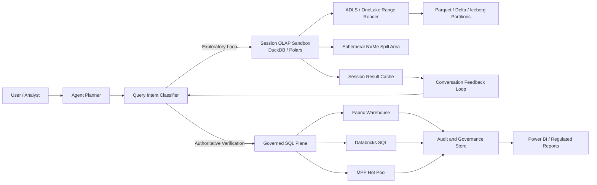
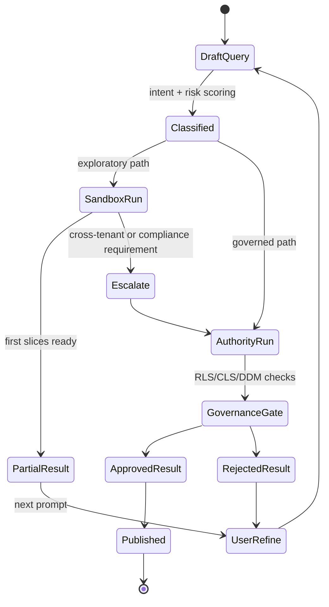

# Ephemeral OLAP Agent Selection FAQ: DuckDB/Polars + ADLS/Iceberg vs Fabric Warehouse vs Databricks SQL vs Always-On MPP
> 🌐 **Language / 语言切换**: **[🇬🇧 English](ephemeral-olap-agent-duckdb-polars-adls-iceberg-vs-fabric-warehouse-databricks-sql-selection-faq.en.md)** | **[🇨🇳 中文版](ephemeral-olap-agent-duckdb-polars-adls-iceberg-vs-fabric-warehouse-databricks-sql-selection-faq.md)** | **[📚 Back to Catalog](README.en.md)**
> Evidence tags: `measured` / `synthetic` / `anonymized_reported`
> Retrieval date: 2026-11-21
> Scope boundary: this guide focuses on structured columnar OLAP pushdown, ephemeral upload analytics, and tenant-isolated compute economics; it does not cover NL2SQL prompt design or vector-retrieval architecture

## 1) Executive summary: isolate exploratory SQL storms from shared warehouses, then escalate only converged queries
Most analytics agents do not run one perfect query.
They execute a bursty iterative loop:
slice,
filter,
pivot,
retry,
and reframe.
In enterprise workloads,
one dialog turn can trigger `10–25` exploratory queries.
If all those queries hit a shared warehouse directly,
three failure patterns appear quickly:
`CU/DBU` cost spikes,
queue jitter for business-critical workloads,
and temporary-data contamination in governed schemas.
The architecture recommendation is straightforward.
Separate exploration from authority.
Use in-session embedded OLAP engines for trial-and-error loops.
Send only converged and policy-qualified queries to governed warehouse planes.
This guide evaluates four routes:
1. Route A: in-process `DuckDB/Polars` in `ACA Dynamic Sessions` or `AKS` workers;
2. Route B: `Microsoft Fabric Warehouse / SQL Analytics Endpoint`;
3. Route C: `Azure Databricks SQL Serverless + Unity Catalog`;
4. Route D: always-on MPP pools (`ClickHouse/StarRocks/Eventhouse`).
Default enterprise pattern:
`A for exploration + B/C for authority`.
Add Route D only when fixed-query high-QPS online analytics justifies a dedicated hot pool.

## 2) Verifiable evidence base and source labels
Source 1 (`measured`): DuckDB docs (Parquet, Iceberg, HTTPFS) — https://duckdb.org/docs/
Source 2 (`measured`): Polars docs (lazy execution, scan APIs, streaming) — https://docs.pola.rs/
Source 3 (`measured`): ADLS Gen2 fundamentals and access model — https://learn.microsoft.com/azure/storage/blobs/data-lake-storage-introduction
Source 4 (`measured`): Microsoft Fabric Warehouse documentation — https://learn.microsoft.com/fabric/data-warehouse/
Source 5 (`measured`): Azure Databricks SQL Serverless docs — https://learn.microsoft.com/azure/databricks/sql/
Source 6 (`measured`): Unity Catalog governance guidance — https://learn.microsoft.com/azure/databricks/data-governance/unity-catalog/
Source 7 (`measured`): Apache Iceberg project docs — https://iceberg.apache.org/
Source 8 (`measured`): ClickHouse docs — https://clickhouse.com/docs
Source 9 (`measured`): StarRocks docs — https://docs.starrocks.io/
Source 10 (`measured`): Fabric Eventhouse docs — https://learn.microsoft.com/fabric/real-time-intelligence/eventhouse
Source 11 (`anonymized_reported`): anonymized enterprise agent-analytics telemetry.
Source 12 (`synthetic`): controlled stress tests across upload and lake-partition workloads.
Latency bands,
savings ranges,
and concurrency formulas in this guide are explicitly tied to these evidence labels.

## 3) Problem profile: exploratory analytics traffic is structurally hostile to shared warehouse economics
Analytics agents for due diligence,
self-service BI exploration,
operations attribution,
and customer uploads all share one behavior:
high-iteration SQL loops.
The final answer may use only a tiny subset of attempted queries.
Observed characteristics:
1. high cancellation rates due to rapid user follow-up prompts;
2. high trial-to-success ratio where only `5%–15%` of exploratory queries survive (`anonymized_reported`);
3. mixed-format data planes with Excel, CSV, Parquet, Delta, and Iceberg;
4. strict tenant isolation and policy boundaries.
A “warehouse-only” design turns these characteristics into avoidable spend and governance friction.
That is why transient in-process analytics layers have become a practical control pattern.

## 4) SLO and KPI framework: align experience, governance, and cost in one model
Define three KPI groups.
Experience KPIs:
`first_result_p95_ms`,
`interactive_query_p95_ms`,
`cancel_release_p95_ms`.
Governance KPIs:
`cross_tenant_read_incidents`,
`temporary_data_residue_hours`,
`policy_block_ratio`.
Cost KPIs:
`cost_per_session`,
`exploration_to_authority_ratio`,
`warehouse_spillover_rate`.
Reference thresholds (`synthetic`):
- exploratory query `p95 < 900ms`;
- cancel-release `p95 < 2s`;
- temporary artifacts retained for no longer than `24h`;
- authority-plane share of exploratory traffic below `20%`.
If teams measure only average SQL latency,
they miss cancellation pressure and wasted retries,
which dominate real-world unit economics.

## 5) Route A: in-session OLAP engines (DuckDB/Polars) over object storage
Route A is the exploration workhorse.
It embeds DuckDB or Polars directly in session compute,
often hosted in `ACA Dynamic Sessions` or isolated `AKS` workers.
Data access pattern:
short-lived `User Delegation SAS`,
tenant-prefix constrained paths,
predicate pushdown,
and selective range reads on columnar files.
Strengths:
1. no shared warehouse startup and queue contention for exploratory loops;
2. per-session resource isolation via memory and thread ceilings;
3. low contamination risk because temporary uploads remain outside authoritative schemas;
4. efficient selective reads for large partitioned datasets (`measured` + `synthetic`).
Implementation controls:
1. strict `memory_limit` and temp-spill policy;
2. ephemeral NVMe scratch management with deterministic cleanup;
3. token TTL and path-scoped authorization;
4. SQL guardrails against pathological query patterns.
Boundary:
Route A is not the canonical reporting layer.
It is the controlled exploration front-end.
Formal outputs still need authority-plane validation.

## 6) Route B: Fabric Warehouse as governed authority plane
Route B excels at enterprise-wide consistency.
It provides a strong governance center for:
cross-domain joins,
official KPI publication,
and business-consumable semantic alignment.
Strengths:
1. OneLake-centered governance and analytics consistency (`measured`);
2. practical integration with RLS/CLS/DDM and BI consumption;
3. cleaner compliance story for audited reporting and executive metrics.
Best-fit role:
run converged, approval-worthy queries after exploratory narrowing in Route A.
Trade-off:
when exploratory storms bypass Route A and hit Route B directly,
queue pressure and spend volatility return.
Thus Route B works best as authority validation,
not as first-touch query substrate for every prompt mutation.

## 7) Route C: Databricks SQL Serverless with Unity Catalog governance
Route C is strong for complex federated lakehouse analytics under strict data governance.
Strengths:
1. elastic SQL compute with serverless scaling behavior;
2. mature governance primitives through Unity Catalog;
3. broad fit for cross-domain pipelines in Databricks-centric estates.
Typical enterprise role:
authority-tier execution for advanced cross-catalog workloads,
especially where teams already standardize on Databricks governance controls.
Pragmatic guidance:
Route C and Route A are complementary.
Use Route A for high-cancel exploratory work,
and Route C for trusted, reproducible, and governed final queries.
Trade-off:
if Route C receives all exploratory noise,
cost and queue stability still degrade under bursty conversational behavior.

## 8) Route D: always-on MPP pools for fixed high-QPS analytical serving
Route D targets stable query patterns with strict low-latency serving needs.
Typical examples:
tenant dashboards,
operational API aggregations,
and near-real-time KPI endpoints.
Strengths:
1. warm pools reduce cold-start sensitivity;
2. vectorized columnar execution favors repeated aggregate patterns;
3. predictable performance at large sustained request rates.
Trade-offs:
schema governance and capacity planning are heavier,
and route D is inefficient for highly iterative exploratory prompts.
Conclusion:
Route D should be scoped to stable serving surfaces,
not used as default ingress for every ad-hoc agent query.

## 9) 12-dimension architecture comparison matrix
| Dimension | Route A In-Process OLAP | Route B Fabric Warehouse | Route C Databricks SQL | Route D Always-On MPP |
|---|---|---|---|---|
| 1. Exploration cost elasticity | Strong | Medium | Medium | Medium-strong |
| 2. Shared queue jitter resilience | Strong | Medium-low | Medium | Strong |
| 3. Temporary-data contamination risk | Low | Medium-high | Medium | Medium |
| 4. Enterprise governance consistency | Medium | Strong | Strong | Medium |
| 5. Cross-domain federation capability | Medium | Medium-strong | Strong | Medium |
| 6. Session hard isolation | Strong | Medium | Medium | Medium |
| 7. High-cancellation friendliness | Strong | Low-medium | Medium | Medium |
| 8. Audit-grade reporting alignment | Medium | Strong | Strong | Medium-strong |
| 9. Implementation complexity | Medium | Medium | Medium-high | High |
| 10. Fixed-pattern high-QPS serving | Medium | Medium-strong | Strong | Strong |
| 11. Unit-cost predictability | Medium-strong | Strong | Medium-strong | Medium-strong |
| 12. Migration friction | Medium | Low in Fabric estates | Medium in Databricks estates | Medium-high |
Interpretation (`anonymized_reported`):
most enterprises are not choosing one winner.
They are defining explicit responsibility split between exploration and authority.

## 10) Hybrid reference architecture: sandbox exploration then governed authority verification

The architecture contract is simple.
Exploration-first traffic should not automatically become authority-plane traffic.
Promotion to authority is policy-driven and explicit.

## 11) Query lifecycle and control-state model

Recommended guardrails:
1. deny write-capable SQL in exploration mode by default;
2. auto-escalate to authority plane when cross-tenant joins are detected;
3. enforce query timeout and byte-scan limits in sandbox mode;
4. require governance-gate success before export and publication.
Illustrative runtime profile:
```python
duckdb.execute("SET memory_limit='8GB'")
duckdb.execute("SET temp_directory='/mnt/nvme/tmp'")
duckdb.execute("SET threads=8")
duckdb.execute("SET enable_object_cache=true")
```
This pattern keeps failure blast radius inside session boundaries (`synthetic`).

## 12) Decision tree and TCO model for CU/DBU savings
Decision A:
is workload cancellation-heavy and exploratory?
If yes,
Route A should be mandatory.
Decision B:
does output require enterprise-grade audited semantics?
If yes,
route to B or C for final verification.
Decision C:
do you have fixed high-QPS dashboards with strict low latency?
If yes,
add Route D hot pool where justified.
Decision D:
are temporary uploads allowed into authoritative schemas?
If no,
retain strict sandbox-first ingestion.
Cost model decomposition:
1. `Cexp` exploration compute;
2. `Cauth` authority compute;
3. `Cgov` governance overhead;
4. `Cwaste` canceled and retried query waste.
Reference formula (`synthetic`):
`TotalCost = Cexp + Cauth + Cgov + Cwaste`.
Controlled experiments indicate (`synthetic`):
when exploratory traffic exceeds `70%`,
`A + B` layering can reduce aggregate compute spend by roughly `35%–58%`,
while reducing authority-plane queue wait by around `40%` at `2,000` concurrent sessions.

## 13) Enterprise scenario A: financial due diligence and attribution analytics
An anonymized enterprise finance office runs hundreds of concurrent due-diligence sessions (`anonymized_reported`).
Each session performs repeated regrouping by geography,
customer tiers,
channels,
currency,
and time windows.
Before refactoring,
all exploratory traffic hit a shared warehouse.
Outcomes included:
peak-time queueing,
spend spikes,
and noisy interference with scheduled reporting jobs.
After adopting `A + B` layering:
exploratory loops stayed in embedded session engines,
while only converged verification queries reached Fabric authority plane.
Observed impact (`anonymized_reported`):
peak queue delay dropped by ~`37%`,
temporary contamination incidents fell close to zero,
and analyst-perceived responsiveness improved materially.

## 14) Enterprise scenario B: customer self-upload analytics at scale
A SaaS analytics product introduced upload-and-ask workflows for tenant users.
Input quality and format varied widely,
including one-off files with limited reuse value.
Direct warehouse ingestion caused governance overhead and storage sprawl.
A safer architecture was:
tenant-scoped object storage ingestion,
session-engine exploration,
and promotion to authority plane only after explicit publish intent.
In this model (`synthetic`):
`50MB–5GB` uploads can be explored quickly without permanent warehouse footprint,
and governance teams control when data becomes long-lived enterprise asset.
Operational rollout checklist for this scenario:
1. enforce per-tenant prefix-scoped object paths;
2. attach upload provenance metadata at ingest time;
3. quarantine malformed schema files before agent execution;
4. standardize schema-sniffing before query planning;
5. block cross-tenant accidental joins in sandbox mode;
6. require explicit publish intent for authority promotion;
7. set automatic TTL cleanup for non-promoted artifacts;
8. log all authority-plane promotions with actor identity;
9. compare promoted-table quality against baseline data contracts;
10. require reviewer sign-off for externally shared exports.
These controls reduce governance exceptions,
improve incident response speed,
and keep exploratory freedom without sacrificing compliance posture.

Additional cost guardrail recommendations:
1. alert when exploration-to-authority ratio drifts below target;
2. cap per-session scanned bytes in exploration mode;
3. enforce budget-aware query retries with backoff;
4. separate chargeback ledgers for exploration and authority workloads;
5. review top canceled-query patterns weekly to remove waste.

## 15) Deep FAQ (8 production decisions)
**Q1: Why not run every query on Fabric or Databricks for consistency?**  
A1: Because exploratory dialog traffic is cancellation-heavy and low-yield; routing all of it to shared warehouses inflates cost and queue jitter with little business value.

**Q2: Is in-process OLAP inherently less secure?**  
A2: Not when hosted in hardened tenant-isolated sessions with short-lived scoped credentials, explicit resource caps, and strict no-write exploration policies.

**Q3: How should teams choose between DuckDB and Polars?**  
A3: DuckDB is ideal for SQL-first analysts, Polars is strong for DataFrame-heavy transformations; most enterprises route by workload and keep both available.

**Q4: When must a query be escalated to the authority plane?**  
A4: Escalate for cross-tenant joins, audited reporting, regulated exports, and any workflow requiring enterprise semantic governance.

**Q5: How do we prevent OOM blast radius in session engines?**  
A5: Enforce memory/thread ceilings, deterministic temp-spill paths, timeout/scan-byte limits, and per-session scheduling quotas.

**Q6: What is Route D best at?**  
A6: Stable high-QPS fixed-query serving, not ad-hoc exploratory conversational loops.

**Q7: How do we prove exploration-layer ROI with data?**  
A7: Track exploratory share, cancellation rates, authority-plane queue time, and cost per resolved session before and after layering.

**Q8: When should upload data be promoted into long-lived governed storage?**  
A8: Only after business validation and data-quality checks confirm durable reuse value; otherwise enforce TTL-based ephemeral retention.
