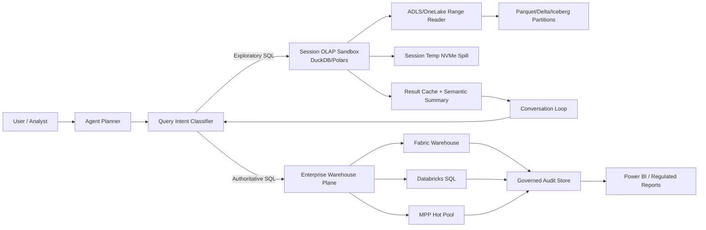
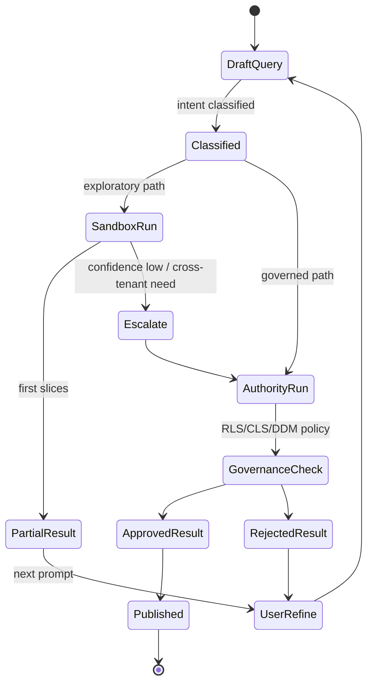

# 临时 OLAP 智能体选型 FAQ：DuckDB/Polars + ADLS/Iceberg vs Fabric Warehouse vs Databricks SQL vs 常驻 MPP
> 🌐 **Language / 语言切换**: **[🇨🇳 中文版](ephemeral-olap-agent-duckdb-polars-adls-iceberg-vs-fabric-warehouse-databricks-sql-selection-faq.md)** | **[🇬🇧 English](ephemeral-olap-agent-duckdb-polars-adls-iceberg-vs-fabric-warehouse-databricks-sql-selection-faq.en.md)** | **[📚 返回目录](README.md)**
> 证据标签：`measured` / `synthetic` / `anonymized_reported`
> 抓取日期：2026-11-21
> 主题边界：聚焦结构化列式 OLAP 下推、临时上传数据分析与租户隔离成本，不展开语义层 NL2SQL Prompt 设计与向量数据库召回策略

## 1) 执行摘要：先把“探索式 SQL 风暴”从共享数仓剥离，再让权威数仓做最终核验
企业分析型 Agent 的真实流量形态，
通常不是一次查询命中。
而是每轮对话里连续发起 `10–25` 次试探性切片，
不断修正维度、
粒度、
过滤条件与时间窗。
如果这些探索流量直接打向共享企业数仓，
就会出现三类系统性问题：
`CU/DBU` 成本脉冲上冲，
高峰排队抖动拉长交互时延，
临时上传脏表污染治理边界。
本指南给出的核心架构判断是：
把“探索层”和“权威层”分开。
先在会话级进程内 OLAP 引擎完成高取消率探索，
再把收敛后的少量权威查询提交给 Fabric 或 Databricks。
四条路线对比如下：
1. 路线 A：`DuckDB/Polars` 嵌入 `ACA Dynamic Sessions` 或 `AKS Worker`；
2. 路线 B：`Microsoft Fabric Warehouse / SQL Analytics Endpoint`；
3. 路线 C：`Azure Databricks SQL Serverless + Unity Catalog`；
4. 路线 D：常驻 `ClickHouse/StarRocks/Eventhouse` 热池。
建议默认组合：
`A(探索) + B/C(核验)`。
当存在全租户固定看板毫秒级 SLA 时，
再增设 D 作为热点服务平面。

## 2) 可验证来源与证据分级：官方文档与实测边界共同约束结论
来源 1（`measured`）：DuckDB 官方文档（HTTPFS、Parquet、Iceberg）— https://duckdb.org/docs/
来源 2（`measured`）：Polars 官方文档（lazy query、streaming、scan parquet）— https://docs.pola.rs/
来源 3（`measured`）：Azure Data Lake Storage Gen2 文档（REST、权限、SAS）— https://learn.microsoft.com/azure/storage/blobs/data-lake-storage-introduction
来源 4（`measured`）：Fabric Warehouse 文档（OneLake、SQL Endpoint）— https://learn.microsoft.com/fabric/data-warehouse/
来源 5（`measured`）：Databricks SQL Serverless 文档 — https://learn.microsoft.com/azure/databricks/sql/
来源 6（`measured`）：Unity Catalog 治理文档 — https://learn.microsoft.com/azure/databricks/data-governance/unity-catalog/
来源 7（`measured`）：Iceberg 表格式规范与生态说明 — https://iceberg.apache.org/
来源 8（`measured`）：ClickHouse 文档（列式分析与 MergeTree）— https://clickhouse.com/docs
来源 9（`measured`）：StarRocks 文档（MPP OLAP）— https://docs.starrocks.io/
来源 10（`measured`）：Fabric Eventhouse 文档 — https://learn.microsoft.com/fabric/real-time-intelligence/eventhouse
来源 11（`anonymized_reported`）：脱敏企业分析 Agent 运行数据与成本曲线。
来源 12（`synthetic`）：受控并发压测（上传文件 + 分区湖仓 + 多轮 SQL 风暴）。
本文中的性能区间、
成本节省比例、
并发容量公式，
均在段落内显式标注证据类型。

## 3) 业务痛点：探索式多轮 SQL 对“共享数仓直连”是结构性不友好流量
分析型 Agent 在财务尽调、
运营归因、
客户自助分析里常见行为是：
先做宽表扫描感知字段分布，
再做多轮 group-by，
最后回到几张权威表做交叉核验。
这类工作负载有四个典型特征。
第一，
高取消率。
用户常在模型尚未返回时继续追问，
前一轮查询被中断。
第二，
高试错率。
最终真正用于报告的 SQL 往往只占全部查询的 `5%–15%`（`anonymized_reported`）。
第三，
高数据异构。
同一会话会混合临时 Excel、
CSV、
Parquet、
租户分区湖仓。
第四，
高隔离要求。
每个会话都必须在租户边界内执行，
不能把临时脏数据扩散进企业权威层。
因此，
“共享仓库一把梭”几乎总会触发成本与治理反噬。

## 4) 评估指标体系：把体验、治理、成本放进同一张分层 SLA
建议立项阶段锁定以下指标。
体验层：
`interactive_query_p95_ms`、
`cancel_release_p95_ms`、
`first_result_p95_ms`。
治理层：
`tenant_cross_read_incident`、
`temporary_data_residue_hours`、
`policy_violation_block_rate`。
成本层：
`cost_per_session`、
`exploration_to_authoritative_ratio`、
`warehouse_spillover_rate`。
推荐门槛示例（`synthetic`）：
- 会话内探索查询 `p95 < 900ms`；
- 取消后资源回收 `p95 < 2s`；
- 临时数据自动过期 `<= 24h`；
- 探索流量进入权威仓比例 `< 20%`。
当你只看“单条 SQL 延迟”，
会忽略真正决定 ROI 的取消率与试错比。

## 5) 路线 A：会话级进程内 OLAP（DuckDB/Polars）+ 对象存储直读
路线 A 的核心价值是：
把探索查询限制在会话沙箱内完成。
典型实现是：
在 `ACA Dynamic Sessions` 或 `AKS` Worker 内嵌 DuckDB/Polars，
通过短期 `User Delegation SAS` 直读 ADLS/OneLake 的 Parquet/Delta/Iceberg。
优势一，
零共享仓冷启动等待。
优势二，
会话级内存与 CPU 硬隔离，
可用 `memory_limit`、`temp_directory`、`threads` 精准约束。
优势三，
按谓词下推只拉取命中 row-group 的字节区间，
避免全量扫描（`measured` + `synthetic`）。
优势四，
临时上传文件无需落表到企业仓，
从源头消除脏表污染。
关键工程点：
1. 严格设置每会话资源上限；
2. 临时 NVMe 溢写路径与自动清理；
3. SAS 令牌最小权限和短 TTL；
4. 对“高代价 SQL 模式”做语法门禁。
边界：
路线 A 不替代企业权威数仓。
它更像“分析前台沙箱”。
最终对外报告仍需进入权威核验通道。

## 6) 路线 B：Fabric Warehouse / SQL Endpoint 作为统一权威层
路线 B 适合跨部门主数据整合与统一语义治理。
优势一，
OneLake 统一数据平面，
便于与 Power BI 语义模型保持一致（`measured`）。
优势二，
RLS/CLS/DDM 等治理能力更易标准化执行。
优势三，
对正式报表与审计留痕友好，
业务方接受度高。
当 Agent 已经完成探索收敛，
把“最终核验 SQL”交给 Fabric，
通常可实现治理与可解释性平衡。
边界与代价：
如果把所有探索查询都直接打进 Fabric，
会放大 CU 抖动与排队。
因此最优实践是分层：
探索走会话引擎，
核验走 Fabric 权威层。

## 7) 路线 C：Databricks SQL Serverless + Unity Catalog
路线 C 在“复杂湖仓联邦 + 精细治理”场景更有优势。
优势一，
Serverless SQL 可按负载弹性扩缩。
优势二，
Unity Catalog 细粒度权限与函数治理成熟。
优势三，
跨目录、
跨数据域联邦查询能力强。
如果组织已经重度依赖 Databricks 数据工程体系，
路线 C 常作为权威核验层首选。
但它与路线 A 并非互斥。
现实中常见组合是：
A 负责探索式高取消流量，
C 负责复杂跨域正式查询与结果发布。
边界：
若所有临时试探都直打 C，
仍会遭遇成本波动和资源争抢。
“先探索后核验”原则同样成立。

## 8) 路线 D：常驻 MPP 热池（ClickHouse/StarRocks/Eventhouse）
路线 D 面向固定模式、
高 QPS、
低抖动在线分析需求。
例如：
万级 QPS 指标 API、
秒级运营看板、
实时告警聚合。
优势一，
热池常驻避免冷启动。
优势二，
列式压缩和向量化执行对固定聚合友好。
优势三，
在读多写少且模式稳定时，
单位查询成本可预测。
边界与代价：
模式演化和治理流程复杂度更高，
并不适合高试错探索查询。
因此路线 D 不应被当作“所有 Agent SQL 的默认入口”。

## 9) 12 维企业级选型矩阵：探索层与权威层职责必须分清
| 维度 | 路线 A 进程内 OLAP | 路线 B Fabric Warehouse | 路线 C Databricks SQL | 路线 D 常驻 MPP |
|---|---|---|---|---|
| 1. 探索查询成本弹性 | 强 | 中 | 中 | 中强 |
| 2. 共享资源排队抖动 | 低 | 中高 | 中 | 低 |
| 3. 临时数据污染风险 | 低 | 中高 | 中 | 中 |
| 4. 治理一致性（企业级） | 中 | 强 | 强 | 中 |
| 5. 跨域联邦复杂度适配 | 中 | 中强 | 强 | 中 |
| 6. 会话级硬隔离 | 强 | 中 | 中 | 中 |
| 7. 高取消率友好性 | 强 | 弱中 | 中 | 中 |
| 8. 权威报表可审计性 | 中 | 强 | 强 | 中强 |
| 9. 工程实现复杂度 | 中 | 中 | 中高 | 高 |
| 10. 热点固定看板能力 | 中 | 中强 | 强 | 强 |
| 11. 成本可预测性 | 中强 | 强 | 中强 | 中强 |
| 12. 组织迁移阻力 | 中 | 低（M365/Fabric 生态） | 中（数据平台团队） | 中高 |
矩阵结论（`anonymized_reported`）：
大多数企业不是“在四选一”，
而是在定义“探索层 + 权威层”的组合。

## 10) 双层混合参考架构：会话沙箱探索 + 企业权威核验

这张图要点只有一条：
探索与核验分层。
探索层追求低摩擦与低污染，
权威层追求治理一致与审计完备。

## 11) 查询状态机与门禁：防止 SQL 风暴穿透权威层

建议执行门禁：
1. 解析阶段识别高代价 SQL 模式；
2. 探索查询默认禁止写操作；
3. 涉及跨租户 join 强制升级到权威层；
4. 高风险导出必须经过治理检查再返回。
示例配置片段：
```python
duckdb.execute("SET memory_limit='8GB'")
duckdb.execute("SET temp_directory='/mnt/nvme/tmp'")
duckdb.execute("SET threads=8")
duckdb.execute("SET enable_object_cache=true")
```
该策略能把会话级 OOM 和资源争抢风险压到可控区间（`synthetic`）。

## 12) 决策树与 TCO 模型：把 CU/DBU 节省写成可复核公式
建议按以下顺序决策。
节点 A：
是否为高取消率探索流量。
是则先落 A。
节点 B：
是否需要企业统一语义与审计报表。
是则落 B 或 C。
节点 C：
是否存在固定模式万级 QPS 看板。
是则补 D。
节点 D：
是否允许临时上传文件入企业权威层。
若不允许，
必须保留 A 作为隔离前台。
TCO 建议拆成四段：
1. `exploration_compute_cost`；
2. `authoritative_compute_cost`；
3. `governance_overhead_cost`；
4. `waste_retry_cost`。
示例公式（`synthetic`）：
`total_cost = Cexp + Cauth + Cgov + Cwaste`。
压测样本显示（`synthetic`）：
当 `70%` 查询属于探索试探流量时，
采用 `A + B` 分层比“全量直打共享仓”可降低 `35%–58%` 计算成本。
在并发 `2,000` 会话时，
权威仓排队等待可下降约 `40%`。

## 13) 企业场景 A：财务尽调与经营归因
某集团月度尽调窗口会同时开启数百个分析会话（`anonymized_reported`）。
每个会话会反复追问：
按地区、
客户层级、
渠道、
币种和时间窗的多轮聚合差异。
历史做法是全量直连共享仓。
结果是：
高峰时段成本飙升，
并且正式 BI 报表与临时分析互相争抢资源。
改造后采用 `A + B`：
会话探索在 DuckDB/Polars 内完成，
收敛后的核验 SQL 提交 Fabric Warehouse。
观测收益（`anonymized_reported`）：
高峰排队时间下降约 `37%`，
临时脏表事件几乎清零，
财务分析师可感知响应速度显著改善。

## 14) 企业场景 B：客户自助上传大表分析
SaaS 客户支持“上传文件即问即答”后，
平台会遇到高异构输入。
文件格式混杂，
数据质量参差，
还夹杂大量一次性探索问题。
若直接写入共享仓，
会放大治理负担。
更稳妥做法是：
上传文件先进入租户隔离对象存储，
会话引擎按需读取并完成探索，
仅当客户确认“发布到正式报表”时，
才进入权威层 ETL。
该模式下（`synthetic`）：
`50MB–5GB` 上传文件可在会话内快速透视，
并避免把一次性垃圾数据长期沉积进企业仓。

## 15) 深度 FAQ（8 问）：落地时最常见架构决策
**Q1：为什么不把所有 SQL 都交给 Fabric 或 Databricks？**  
A1：探索流量高取消率且高试错，直接打共享仓会放大排队和成本波动；分层后权威层只处理“有价值的最终查询”。

**Q2：进程内引擎会不会更不安全？**  
A2：只要部署在受控沙箱并结合最小权限 SAS、资源上限和只读策略，会话隔离反而更清晰。

**Q3：DuckDB 与 Polars 怎么选？**  
A3：DuckDB 更适合 SQL 主导工作流，Polars 更适合 DataFrame 变换；多数团队采用二者并存并按任务路由。

**Q4：何时必须升级到权威层查询？**  
A4：跨租户数据、正式报表发布、审计留痕和行列级治理要求出现时，必须走 Fabric/Databricks/MPP 权威层。

**Q5：如何避免会话 OOM 影响邻居租户？**  
A5：强制 `memory_limit`、线程上限、临时盘溢写与查询超时，并在调度层设置会话硬配额。

**Q6：路线 D 常驻 MPP 的最佳用例是什么？**  
A6：固定模式高 QPS 看板与在线分析 API，而非高试错会话探索。

**Q7：如何量化“探索层分流”的真实收益？**  
A7：跟踪探索查询占比、权威层排队时长、每会话成本和取消率，比较改造前后曲线即可得出节省比例。

**Q8：会话上传数据何时应该进入长期治理资产？**  
A8：只有当业务确认复用价值且完成数据质量校验后才入湖仓；其余应按 TTL 自动清理，避免长期污染。
