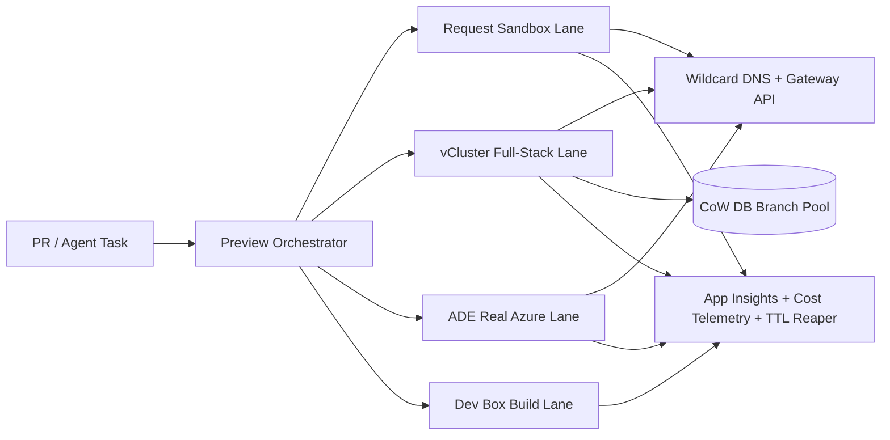
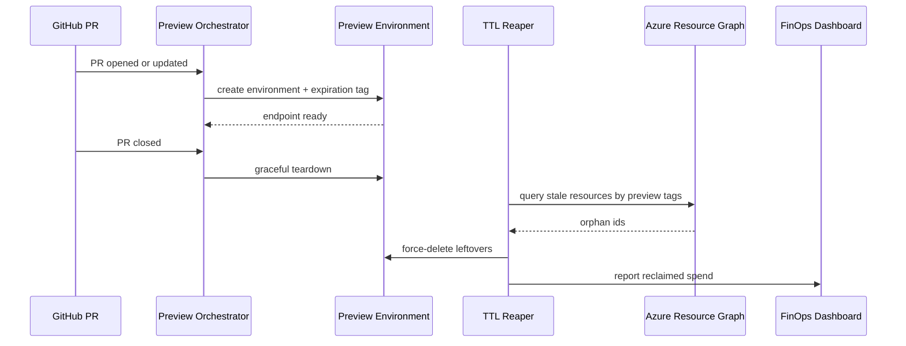

# Enterprise Ephemeral PR Preview Sandbox Selection FAQ: `ADE + Bicep` vs `vCluster on AKS` vs `Signadot/Telepresence` vs `Microsoft Dev Box`

## 1. Executive Summary: Autonomous Engineering Agents Usually Fail on Environment Supply, Not Model Calls
As organizations move from assistant-style coding to autonomous fix-and-verify agents,
the first hard bottleneck is preview environment supply chain performance.
If each PR requires a full `20-25 minute` ARM deployment before tests can run,
the agent inner loop collapses.
If preview stacks have no strict TTL and no deterministic cleanup pipeline,
zombie environments accumulate and cloud spend leaks quickly.
In Azure-heavy enterprises,
durable success rarely comes from one product alone.
Most mature programs combine four lanes:
`vCluster` for seconds-level full-stack preview,
`ADE` for real Azure PaaS validation,
request-routed sandboxes for high-density low-cost PR concurrency,
and `Dev Box` pools for heavy build and packaging stages.
The architecture objective is not a single fastest path.
It is a balanced operating model that optimizes speed,
verification fidelity,
security boundary strength,
and lifecycle teardown certainty at the same time.

## 2. Problem Boundary: What Breaks When Daily Preview Volume Grows from `500` to `5,000`
At low volume,
manual preview provisioning appears workable.
At autonomous-agent scale,
that approach fails rapidly.
Control-plane queues back up.
Ingress/DNS collisions increase.
Database seeding races introduce flaky tests.
Secret boundaries blur when temporary environments are rushed.
The common anti-pattern is to force every PR through one environment strategy.
That creates either a latency bottleneck or a cost explosion.
Architecture review should explicitly answer four constraints:
Can preview provisioning stay within seconds to low minutes?
Can autonomous agents run high-fidelity full-stack checks,
not only synthetic unit-level smoke tests?
Can teardown be guaranteed and auditable under failure?
Can agents provision safely without subscription-level Owner privileges?

## 3. Four-Lane Role Model: Assign Each Preview Mechanism to a Specific Change Type
Lane A is `vCluster on AKS` with CoW database branching.
Use it for fast full-stack preview where Kubernetes behavior must be realistic.
Lane B is `Azure Deployment Environments`.
Use it when PRs modify true Azure resources:
Service Bus,
Cosmos DB,
Functions,
Key Vault,
managed identity,
or policy-bearing IaC.
Lane C is request-routed sandboxing via `Signadot/Telepresence`.
Use it when only `1-2` services changed and baseline services can be shared.
Lane D is `Microsoft Dev Box` pools.
Use it for heavy compile/package workflows before deployment verification.
The strongest delivery systems chain these lanes.
Agent workflow can run C first for rapid smoke,
A for full integration,
B for infrastructure correctness,
and D before all of them when build latency dominates.

## 4. 12-Dimension Comparison Matrix: Provisioning Speed, Fidelity, Isolation, Teardown, and Cost
| Dimension | `vCluster on AKS` | `ADE + Bicep/Terraform` | `Signadot/Telepresence` | `Dev Box Pools` | Selection Signal |
|---|---|---|---|---|---|
| Provisioning latency | `<12s` control plane (`measured`) | `12-25min` resource deployment (`anonymized_reported`) | `<20s` per-service route overlay (`anonymized_reported`) | `40-180s` prebuilt workstation boot (`measured`) | A/C for inner loop speed |
| Verification fidelity | High (cluster-realistic) | Highest (real Azure resources) | Medium (shared baseline) | Medium (build-centric) | B mandatory for infra changes |
| Concurrency density | High | Medium-low | Very high | Medium | PR storms favor C |
| Cost per preview | Low-medium | High | Lowest | Medium-high | C minimizes marginal cost |
| Isolation boundary | Namespace + policy + gateway | RG/subscription/policy boundary | Request routing boundary | Workstation boundary | Compliance-heavy prefers B/D |
| Data isolation | Strong with CoW branches | Strong by resource isolation | Needs explicit data split | Local clone isolation | Sensitive tests favor A/B |
| Cleanup determinism | High with TTL controller | High with expiration metadata | Medium-high | Medium | Central reaper still required |
| Operational complexity | Medium | Medium | Medium-high | Medium | Team maturity determines fit |
| Elastic scaling | High | Medium | High | Medium | A/C best for burst |
| Debuggability | Strong Kubernetes introspection | Good cloud-native traces | Harder request semantics | Best local IDE introspection | D improves dev UX |
| Security posture | Strong | Strongest | Moderate | Strong | B is strongest for guardrails |
| Best-fit workload | full-stack PR preview | IaC/PaaS validation | single-service deltas | heavy compile/test prep | Combine lanes intentionally |

## 5. Reference Architecture A: Layered Preview Factory for Autonomous Coding and QA Agents


This architecture intentionally separates cost curves and fidelity curves.
A single universal path is usually either too slow or too expensive.
Layered routing keeps autonomous throughput stable under mixed PR types.

## 6. Lane A Deep Dive: How `vCluster + CoW DB` Enables Seconds-Level Full-Stack Preview
`vCluster` provides virtual control-plane isolation per PR while reusing host AKS workers.
With image prefetch and Helm chart cache,
control plane readiness can stay around `10-12 seconds`.
When paired with PostgreSQL copy-on-write branching or ephemeral stateful containers,
writable test data can be available in `3-8 seconds`.
Preview endpoint routing can use `pr-<id>.preview.internal` hostnames with Gateway API.
Teardown can be near-instant if finalizers and TTL controllers are wired correctly.
This lane is ideal for schema migrations,
ingress behavior,
API integration chains,
and Playwright E2E that need realistic service mesh behavior.
Main risks are noisy-neighbor pressure,
cluster policy drift,
and image registry bottlenecks.
These require quotas,
PDB defaults,
pod-priority controls,
and pull-through cache strategy.

## 7. Lane B Deep Dive: `ADE` Is a Fidelity and Governance Primitive, Not a Speed Primitive
When PRs touch cloud resources,
Kubernetes-only emulation is insufficient.
`ADE` lets platform teams publish controlled environment definitions in Bicep/Terraform.
Agents can provision real Azure resources within bounded permissions.
This preserves policy enforcement and realistic RBAC semantics.
It is slower than vCluster lanes,
typically `12-25 minutes` depending on template complexity.
But it prevents false confidence from synthetic-only checks.
For regulated organizations,
the key advantage is delegated control:
agents receive environment-scoped rights,
not broad subscription ownership.
That materially reduces blast radius for autonomous pipelines.

## 8. Lane C Deep Dive: Request-Routed Sandboxes for Massive Concurrent PR Validation
In most microservice estates,
many PRs affect only one service.
Replicating all services per PR is wasteful.
Request-level routing injects PR-specific traffic only into changed services,
while unchanged services stay on stable baseline.
In a `45-service` platform,
full-copy preview at `200` concurrent PRs can exceed `18 TB` memory footprint (`synthetic` model).
Request-routing with shared baseline can reduce total active memory to roughly `1.4 TB`,
often more than `92%` reduction.
The tradeoff is semantic complexity:
headers must be propagated consistently,
tracing must preserve route identity,
and canary-path debugging must be first-class.
This lane is excellent for high-throughput regression at low cost.
It is not enough for broad infra mutation validation.

## 9. Lane D Deep Dive: `Dev Box` Pools as Build and Toolchain Warmup Plane
Autonomous agents spend substantial time in compile/package phases,
especially in C++/Rust/Android monorepos.
`Dev Box` custom image pools make heavyweight toolchains warm and repeatable.
Teams commonly reduce first-build readiness from `18-35 minutes` to `4-8 minutes`.
That does not replace preview deployment lanes.
It accelerates artifact generation before A/B/C validation runs.
Dev Box also improves incident triage experience when humans must inspect failed agent output.
By decoupling build-prep from runtime preview,
the overall pipeline gets less jitter and clearer bottleneck attribution.

## 10. Quantitative Q&A: Eight Hard Numbers Architecture Boards Ask First
**Q1. Why does `22-minute` environment spin-up break autonomous loops?**  
At `4` iterations per PR, waiting alone becomes `88 minutes`, exceeding most practical auto-fix windows.

**Q2. What is the provisioning delta between full ARM and `vCluster + CoW`?**  
From `20-25 minutes` down to `<12s` control-plane boot plus `3-8s` data branch activation; roughly two orders of magnitude.

**Q3. How much memory can request-routed sandboxes save?**  
For `45` services and `200` concurrent PRs, modelled total memory drops from `18 TB` to about `1.4 TB` (`synthetic`), saving `92%+`.

**Q4. How large is zombie environment leakage without strict cleanup?**  
At `3,000` previews/day with `8%` cleanup misses, orphaned assets can compound into hundreds of active leftovers within days.

**Q5. Can TTL + Resource Graph sweeping materially reduce waste?**  
Yes; anonymized enterprise results show `65%+` reduction in wasted preview spend after hard TTL and orphan sweeper rollout.

**Q6. Why is ADE mandatory for IaC-heavy PRs?**  
Only real Azure resources exercise policy assignments, RBAC paths, and managed-service runtime semantics.

**Q7. What should cleanup SLO look like?**  
A practical target is teardown completion `P95 <= 10 minutes` and forced-deletion escalation at `30 minutes`.

**Q8. When should autonomous deployment require human approval?**  
When templates modify egress policy, identity privilege scope, or cross-subscription network boundaries.

## 11. Production IaC Example: `vCluster` Values + Gateway Route for Per-PR Preview Domains
```yaml
apiVersion: v1
kind: Namespace
metadata:
  name: pr-24871
  labels:
    preview.env/type: ephemeral
    preview.env/ttl-hours: "6"
---
apiVersion: helm.toolkit.fluxcd.io/v2
kind: HelmRelease
metadata:
  name: vcluster-pr-24871
  namespace: pr-24871
spec:
  chart:
    spec:
      chart: vcluster
      version: 0.22.4
      sourceRef:
        kind: HelmRepository
        name: loft
  values:
    controlPlane:
      statefulSet:
        highAvailability:
          replicas: 1
    sync:
      toHost:
        ingresses:
          enabled: true
    policies:
      networkPolicy:
        enabled: true
---
apiVersion: gateway.networking.k8s.io/v1
kind: HTTPRoute
metadata:
  name: pr-24871-route
  namespace: pr-24871
spec:
  parentRefs:
  - name: preview-gateway
    namespace: ingress-system
  hostnames:
  - pr-24871.preview.internal
  rules:
  - backendRefs:
    - name: app-web
      port: 8080
```

## 12. Production IaC Example: `ADE` Definition with Expiration Guardrails and Teardown Hook
```yaml
name: pr-preview-environment
version: 1.0.0
description: Secure preview for autonomous coding and QA agents
runner: Bicep
parameters:
  prNumber:
    type: string
  ownerAlias:
    type: string
  expirationHours:
    type: int
    default: 4
templatePath: infra/main.bicep
resourceTags:
  preview.env/type: ade
  preview.env/pr: "${prNumber}"
  preview.env/owner: "${ownerAlias}"
  preview.env/expiration: "${expirationHours}"
policies:
  allowedLocations:
    - eastus2
    - swedencentral
  allowedSkuTiers:
    - Standard
  denyPublicIp: true
```

```yaml
name: preview-teardown
on:
  pull_request:
    types: [closed]
jobs:
  cleanup:
    runs-on: ubuntu-latest
    steps:
      - name: Delete ADE environment
        run: |
          azd env delete pr-${{ github.event.pull_request.number }} --force --no-prompt
      - name: Sweep orphan resources by tag
        run: |
          az graph query -q "Resources | where tags['preview.env/pr']=='${{ github.event.pull_request.number }}'" \
          | jq -r '.data[].id' \
          | xargs -r -n 1 az resource delete --ids
```

## 13. Reference Architecture B: Teardown Governance with TTL Reaper and Orphan Sweep


## 14. Enterprise Scenarios: FinTech Super-App and Platform-Engineering Guardrail Program
Scenario A:
a FinTech super-app engineering organization with `1,400` engineers and autonomous QA/fix agents.
The platform executes around `3,200` preview verifications per day across `60` microservices.
Architecture uses request-routed sandboxes for cheap broad concurrency,
and `vCluster` for full-stack fidelity checks.
After introducing hard TTL and deterministic reapers,
preview residue rate dropped from `11%` to below `2%`.
Average verification wait time dropped by roughly `63%`.
Scenario B:
an enterprise cloud-platform team validating Bicep/Terraform changes with autonomous agents.
All infra-modifying PRs are forced through ADE sandbox subscriptions with strict SKU allowlists.
Each environment has a `4-hour` hard expiration policy.
Platform identity is delegated minimally,
avoiding subscription-level Owner grants.
Quarterly audit showed fewer privilege boundary incidents and better teardown traceability.

## 15. FinOps TCO, Day-0/Day-2 Checklist, and Final Recommendation
### FinOps/TCO Monthly Estimate
| Cost Component | `vCluster` Lane | `ADE` Lane | Request-Routed Lane | `Dev Box` Lane | Notes |
|---|---:|---:|---:|---:|---|
| Control-plane and compute | `$22,000` | `$31,500` | `$8,800` | `$17,400` | A/B increase fidelity spend |
| Storage and data branching | `$6,400` | `$9,100` | `$2,700` | `$3,600` | CoW materially reduces storage cost |
| Network and gateway | `$4,200` | `$6,300` | `$3,900` | `$2,100` | Request routing adds gateway overhead |
| Platform operations | `$13,500` | `$10,800` | `$12,200` | `$7,400` | C lane needs stronger routing ops |
| Zombie waste after governance | `$2,100` | `$2,800` | `$1,200` | `$1,500` | hard TTL lowers residual waste |
| Estimated monthly total | `$48,200` | `$60,500` | `$28,800` | `$32,000` | blended deployment is common |

### Day-0/Day-2 Checklist (12 Items)
- Enforce `pr/owner/expiration` tags on every preview asset.  
- Block untagged traffic at preview ingress boundary.  
- Use synthetic/anonymized seed data only for preview databases.  
- Isolate preview Key Vault instances from production secrets.  
- Require ADE validation for any IaC/PaaS mutation PR.  
- Set default quotas and NetworkPolicies for each vCluster namespace.  
- Propagate request-route headers into traces and logs end-to-end.  
- Implement two-phase cleanup: graceful teardown then force sweep.  
- Track cleanup SLO and escalation on timeout breaches.  
- Allocate preview spend by team/repo/agent dimension.  
- Run weekly zombie-resource compliance sweep drills.  
- Run quarterly chaos drills on create-test-teardown pipeline integrity.  

### Milestone Operating Notes for the `200-Guide / 400-Doc` Scale Stage
At this maturity level, preview environments should be managed as a formal internal product,
not as an ad hoc CI side-effect.
Each lane should publish explicit SLOs:
provisioning latency targets,
verification success rates,
teardown completion bounds,
and maximum tolerated orphan-resource ratio.
The platform should maintain a unified event ledger linking:
PR identity,
agent execution identity,
provisioning request metadata,
test verdicts,
cleanup outcomes,
and cost-attribution records.
Without this ledger, organizations repeatedly face the same blind spot:
code fix quality appears high,
but release confidence degrades because environment failures remain under-observed.
For multi-region enterprises,
template drift and quota asymmetry should be tracked as first-class release risks.
A PR that passes in one region but fails in another due to hidden SKU or policy divergence
is still an operational failure for autonomous delivery.
Therefore, platform owners should continuously run regional parity verification jobs
and version-lock environment templates with policy snapshots.
The strategic objective is not simply “give the agent an environment quickly.”
The objective is “give the agent a deterministic,
policy-conformant,
cost-bounded,
and forensically auditable environment every single run.”
It also means preserving reproducibility evidence so that any failed autonomous run can be replayed with the same template version, policy pack, seed-data snapshot, and route configuration across regions.

### Final Recommendation
For high-throughput autonomous engineering programs,
use **request-routed sandboxes + vCluster** as the fast validation plane.
For any PR that mutates real Azure resources,
enforce **ADE** as the governed fidelity lane.
For heavy compilation and packaging pipelines,
place **Dev Box pools** ahead of preview deployment.
Only this layered design can simultaneously deliver speed,
fidelity,
governance,
and predictable cloud economics at enterprise scale.
