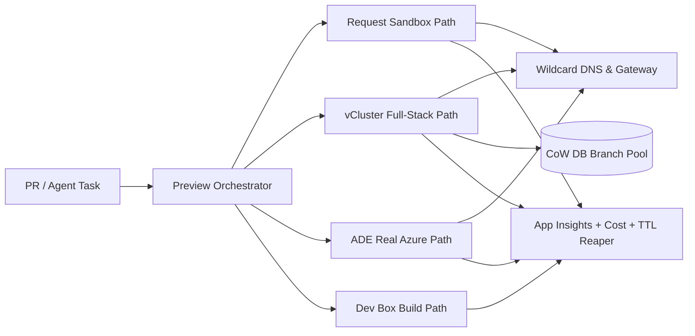
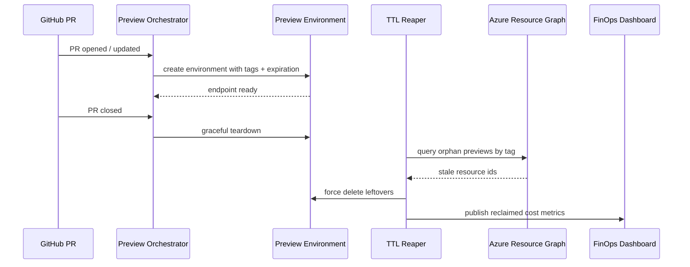

# 企业 PR 临时预览沙箱环境选型 FAQ：`ADE + Bicep` vs `vCluster on AKS` vs `Signadot/Telepresence` vs `Microsoft Dev Box`

## 1. 执行摘要：自治 Coding/QA Agent 的关键瓶颈是“环境供给速度与回收纪律”
当企业把 AI 工程助手升级为自治修复与自治验证 Agent 后，
最先崩掉的通常不是模型调用额度，
而是预览环境供给链路。
如果每个 PR 都要等待 `20-25` 分钟的完整 ARM 资源部署，
Agent 内循环会被直接拖死。
如果临时环境没有硬 TTL 与统一回收策略，
一周后就会出现大量僵尸资源与账单失控。
在 Azure 实践里，
稳定方案几乎都不是单一路线。
而是把 `vCluster`、`ADE`、请求级沙箱和 `Dev Box` 组合成分层平面。
`vCluster` 负责秒级 K8s 全栈预览。
`ADE` 负责真实 PaaS 资源变更验证。
`Signadot/Telepresence` 负责仅改一服务时的低成本并发验证。
`Dev Box` 负责重编译型 monorepo 与本地工具链预热。
决策原则是把“验证保真度”与“每次验证成本”同步优化，
而不是只追求某一个指标的极值。

## 2. 问题边界：从 `500` 到 `5,000` 每日预览栈后会发生什么
在小规模阶段，
团队往往可以容忍手工创建临时环境。
但当自治 Agent 开始批量提交修复 PR，
环境系统会进入指数压力区间。
首先是控制面队列堆积，
其次是 DNS、证书与网关路由冲突，
最后是账单与权限边界失控。
典型故障包括：
环境创建完成但初始化脚本未完成；
测试跑完但资源未释放；
共享数据库被脏数据污染；
预览环境意外访问生产 Secrets。
所以设计必须回答四个硬问题：
能否在秒级到分钟级完成可用预览；
能否保证自治 Agent 拿到足够高的验证保真度；
能否把回收失败率压到可审计阈值；
能否在不授予订阅级高权的前提下让 Agent 自助创建环境。

## 3. 四路线职责分层：不是“谁替代谁”，而是“谁覆盖哪类变更”
路线 A：`vCluster on AKS` + CoW 数据分支。
用于微服务栈级别快速预览与 E2E。
路线 B：`Azure Deployment Environments`。
用于真实 Azure PaaS 资源变化验证。
路线 C：`Signadot/Telepresence` 请求级沙箱。
用于仅改一个或少量服务的高并发低成本验证。
路线 D：`Microsoft Dev Box` 预热池。
用于重构建任务、编译与本地依赖打包阶段。
四路线的正确关系是前后串联与并联混搭。
多数企业会让 Agent 先跑 C 的快速冒烟，
再在 A 跑完整集成，
涉及 IaC 时进入 B，
编译瓶颈任务前置到 D。
这样才能同时满足吞吐、保真与成本。

## 4. 12 维对比矩阵：供给速度、保真度、回收确定性与总成本
| 维度 | `vCluster on AKS` | `ADE + Bicep/Terraform` | `Signadot/Telepresence` | `Dev Box Pools` | 选型结论 |
|---|---|---|---|---|---|
| 创建时延 | `<12s` 控制面级（`measured`） | 常见 `12-25min` 全资源（`anonymized_reported`） | `<20s` 服务级注入（`anonymized_reported`） | `40-180s` 预热镜像（`measured`） | 快速内循环优先 A/C |
| 验证保真度 | 高（接近独立集群） | 最高（真实云资源） | 中（共享基线） | 中（偏构建） | IaC 变更必须 B |
| 并发密度 | 高 | 中低 | 极高 | 中 | 大规模 PR 风暴优先 C |
| 资源成本 | 低到中 | 高 | 最低 | 中到高 | C 成本最优 |
| 网络隔离 | Namespace+Policy+Gateway | 资源组与订阅边界 | 请求路由隔离 | 工作站隔离 | 合规场景 B+D |
| 数据隔离 | CoW 分支可强隔离 | 独立资源天然隔离 | 需额外数据分流 | 本地副本 | 关键数据推荐 A/B |
| 回收确定性 | 高（TTL+控制器） | 高（`ExpirationDate`） | 中高 | 中 | 必须统一回收总线 |
| 运维复杂度 | 中 | 中 | 中高 | 中 | 组织能力决定组合 |
| 扩展弹性 | 高 | 中 | 高 | 中 | 波峰流量 A/C 更稳 |
| 调试体验 | 好（K8s 原生） | 中（云资源排障） | 中（路由语义复杂） | 最好（IDE 原生） | 开发者偏好 D |
| 安全边界 | 好 | 最强（RBAC 明确） | 中 | 好 | 强监管优先 B |
| 典型工作负载 | 全栈预览 | Infra/PaaS 改动 | 单服务改动 | 重编译任务 | 必须分层编排 |

## 5. 参考架构一：自治 Agent 的“预览工厂”分层流水线


该架构重点不是把所有路径统一成一个平台，
而是让不同改动类型走不同验证成本曲线。
这样可以把自治 Agent 的单位 PR 成本稳定在可预测区间。

## 6. 路线 A：`vCluster + CoW DB` 如何做到秒级全栈预览
`vCluster` 的核心价值是为每个 PR 提供虚拟控制面隔离，
同时复用宿主 AKS 节点池与网关能力。
配合预置 Helm 缓存与镜像分发优化，
控制面创建可压到 `10-12s`。
数据库层使用 CoW 分支或临时 Stateful 容器时，
可在 `3-8s` 内提供可写测试数据面。
完成后统一通过 TTL 控制器与 Finalizer 清理，
环境销毁常见 `<3s` 到 `<10s`。
此路线特别适合需要真实 Ingress、服务发现、
Schema migration 与 Playwright 端到端链路验证的任务。
风险在于多租户资源竞争与 CRD 漂移。
必须配套配额、PDB、优先级类与镜像策略。

## 7. 路线 B：`ADE` 的价值在“真实 PaaS 变更验证”而非速度
当 PR 触及 Service Bus、Cosmos、Key Vault、Functions、
或 Managed Identity RBAC 时，
只在 K8s 里做仿真会产生高误判。
`ADE` 允许通过受控模板目录让 Agent 自助部署真实 Azure 资源，
同时保留平台团队的 SKU、区域、配额和策略边界。
它不是最快的路径，
却是最接近生产权限与资源语义的路径。
典型创建时延在 `12-25` 分钟，
但可通过分层模板、预部署基线与并行任务减少关键路径。
对高合规企业，
`ADE` 的优势是“授权最小化”：
Agent 拿到环境级权限而非订阅级 Owner。
这直接降低了自动化系统的横向爆炸风险。

## 8. 路线 C：请求级沙箱如何把 `200` 并发 PR 成本压低 `90%+`
在微服务体系里，
多数 PR 只改 `1-2` 个服务。
若每个 PR 都复制整套 `40+` 服务，
资源浪费会非常夸张。
请求级沙箱通过 header 或子域路由，
把变更服务流量重定向到临时版本，
其余服务复用稳定基线。
以 `45` 服务体系为例，
全复制可能需要 `90GB`/PR；
`200` 并发即 `18TB`。
请求级复用后常见可降到约 `1.4TB` 总量（`synthetic` 估算）。
代价是系统语义更复杂，
需要严格的请求标记传递与可观测性。
这一路线适合高并发回归验证，
不适合涉及全局基础设施变更的场景。

## 9. 路线 D：`Dev Box` 在“构建预热”阶段的独特价值
自治 Agent 并不只跑在线服务验证，
还要处理大型 monorepo 的编译与打包。
`Dev Box` 预热镜像池可提供 `32vCPU/128GB` 级别工作站，
把环境准备前置并标准化。
对于 C++/Rust/Android 混合仓，
预热镜像可把首轮可编译时间从 `18-35min` 降到 `4-8min`。
它不直接替代预览环境，
而是让“生成可部署产物”这一步更稳定。
与 `vCluster` 或 `ADE` 组合时，
Agent 可以先在 Dev Box 产出制品，
再把部署验证委派到 A/B/C 路径。
这种拆分显著降低了预览系统抖动来源。

## 10. 定量 Q&A：评审会最常问的 8 个硬问题
**Q1. 为什么 `22` 分钟 ARM 部署会让 Agent 内循环失效？**  
若单 PR 需 `4` 次迭代，环境等待就占 `88` 分钟，远高于多数团队 `30-45` 分钟修复窗口。

**Q2. `vCluster + CoW` 与完整 ARM 的速度差距多大？**  
从 `20-25min` 到 `<12s` 控制面创建，数量级差距约 `100x`，能显著提升自治修复吞吐。

**Q3. 请求级沙箱真的能省内存吗？**  
在 `45` 服务、`200` PR 并发场景，估算可从 `18TB` 降到 `~1.4TB`，降幅超过 `92%`（`synthetic`）。

**Q4. 僵尸环境如何造成账单泄漏？**  
若每日遗漏 `8%` 回收，`3,000` 环境规模下 7 天内可累积数百个活资源组；加入 TTL+Resource Graph 清扫常可节约 `65%+` 浪费。

**Q5. 如何避免预览环境访问生产 PII？**  
必须使用匿名化/合成种子数据、禁用生产 egress、并在 Key Vault 层阻断生产密钥挂载。

**Q6. 为什么 IaC 变更不能只跑 `vCluster`？**  
因为 RBAC、策略、配额和托管服务语义只在真实 Azure 资源平面里可验证，K8s 仿真会漏报。

**Q7. 回收 SLA 如何定义？**  
建议 `P95` 回收在 `10min` 内完成，超过 `30min` 自动触发二级回收与告警升级。

**Q8. 什么时候必须强制人工审批？**  
当模板触及网络出口、密钥策略、跨订阅身份授权时，应把自治部署切换为人工双签。

## 11. 生产级 IaC 示例：`vCluster` + Gateway 路由 + 临时域名
```yaml
apiVersion: v1
kind: Namespace
metadata:
  name: pr-24871
  labels:
    preview.env/type: ephemeral
    preview.env/ttl-hours: "6"
---
apiVersion: helm.toolkit.fluxcd.io/v2
kind: HelmRelease
metadata:
  name: vcluster-pr-24871
  namespace: pr-24871
spec:
  chart:
    spec:
      chart: vcluster
      version: 0.22.4
      sourceRef:
        kind: HelmRepository
        name: loft
  values:
    controlPlane:
      statefulSet:
        highAvailability:
          replicas: 1
    sync:
      toHost:
        ingresses:
          enabled: true
    policies:
      networkPolicy:
        enabled: true
---
apiVersion: gateway.networking.k8s.io/v1
kind: HTTPRoute
metadata:
  name: pr-24871-route
  namespace: pr-24871
spec:
  parentRefs:
  - name: preview-gateway
    namespace: ingress-system
  hostnames:
  - pr-24871.preview.internal
  rules:
  - backendRefs:
    - name: app-web
      port: 8080
```

## 12. 生产级 IaC 示例：`ADE` 环境定义与自动过期回收
```yaml
name: pr-preview-environment
version: 1.0.0
description: Secure preview for autonomous coding and QA agents
runner: Bicep
parameters:
  prNumber:
    type: string
  ownerAlias:
    type: string
  expirationHours:
    type: int
    default: 4
templatePath: infra/main.bicep
resourceTags:
  preview.env/type: ade
  preview.env/pr: "${prNumber}"
  preview.env/owner: "${ownerAlias}"
  preview.env/expiration: "${expirationHours}"
policies:
  allowedLocations:
    - eastus2
    - swedencentral
  allowedSkuTiers:
    - Standard
  denyPublicIp: true
```

```yaml
name: preview-teardown
on:
  pull_request:
    types: [closed]
jobs:
  cleanup:
    runs-on: ubuntu-latest
    steps:
      - name: Delete ADE environment
        run: |
          azd env delete pr-${{ github.event.pull_request.number }} --force --no-prompt
      - name: Sweep orphan resources by tag
        run: |
          az graph query -q "Resources | where tags['preview.env/pr']=='${{ github.event.pull_request.number }}'" \
          | jq -r '.data[].id' \
          | xargs -r -n 1 az resource delete --ids
```

## 13. 参考架构二：TTL 回收器与僵尸环境治理闭环


## 14. 企业场景：FinTech 超级 App 与平台团队双栈实践
场景 A：某 FinTech 超级 App，
`1,400` 工程师与自治修复 Agent 协作。
每天运行约 `3,200` 次预览验证。
架构采用 `vCluster + 请求级沙箱` 双轨，
全栈回归与增量验证分层执行。
通过统一 TTL 与回收控制器，
预览资源残留率从 `11%` 降到 `<2%`。
端到端平均验证等待时间下降约 `63%`。
场景 B：企业平台团队负责 IaC 变更治理。
对 Bicep/Terraform PR 强制使用 `ADE` 沙箱订阅。
每个环境设置 `4` 小时硬过期。
结合 SKU allowlist 与托管身份最小权限，
在不授予订阅 Owner 的前提下完成自治验证。
季度审计显示，
越权部署事件显著下降且回收可追溯性提升。

## 15. FinOps TCO、Day-0/Day-2 清单与最终建议
### FinOps / TCO（月度估算）
| 成本项 | `vCluster` 路线 | `ADE` 路线 | 请求级沙箱路线 | `Dev Box` 路线 | 说明 |
|---|---:|---:|---:|---:|---|
| 控制面与计算 | `$22,000` | `$31,500` | `$8,800` | `$17,400` | A/B 保真高成本高 |
| 存储与数据分支 | `$6,400` | `$9,100` | `$2,700` | `$3,600` | CoW 可显著降本 |
| 网络与网关 | `$4,200` | `$6,300` | `$3,900` | `$2,100` | 请求路由有额外网关成本 |
| 平台运维人力 | `$13,500` | `$10,800` | `$12,200` | `$7,400` | C 路线运维复杂度偏高 |
| 僵尸资源浪费（治理后） | `$2,100` | `$2,800` | `$1,200` | `$1,500` | 启用 TTL 后显著下降 |
| 月总估算 | `$48,200` | `$60,500` | `$28,800` | `$32,000` | 实践通常是多路线组合 |

### Day-0 / Day-2 检查清单（12 项）
- 为每个预览环境强制打上 `pr/owner/expiration` 标签。  
- 统一入口网关策略，禁止未标记流量访问预览域。  
- 建立合成种子数据流水线，禁止生产 PII 注入。  
- 预览 Key Vault 与生产 Key Vault 彻底隔离。  
- 对 IaC 变更定义强制 `ADE` 验证门。  
- 为 `vCluster` 设置资源配额与默认 NetworkPolicy。  
- 为请求级沙箱增加 trace header 贯穿与回放能力。  
- 对回收器设置双阶段删除与失败重试策略。  
- 定义回收 SLO 与超时升级路径。  
- 将预览成本按团队/仓库/Agent 维度分账。  
- 每周执行一次僵尸资源审计演练。  
- 每季度回归验证“创建-测试-回收”全链路故障注入。  

### 里程碑收口建议（面向 `200-Guide / 400-Doc` 规模后的平台化）
当预览体系进入大规模常态化后，
建议把“环境即产品”纳入平台 OKR，
并为每条环境路径定义固定的 SLO、单次验证预算上限、失败重试策略与责任人。
建议将 `PR -> 预览环境 -> 测试结果 -> 回收审计 -> 成本归集` 形成统一事件流，
避免自治 Agent 成功修复代码但失败在环境侧却无人感知。
对跨区域组织，应提前建立区域级模板差异白名单，
否则同一份 PR 在不同区域会因配额、SKU、网络策略差异出现不可复现失败。
最终目标不是“让 Agent 拿到环境”，
而是“让 Agent 在受控预算、可证明合规、可复现实验条件下稳定拿到正确环境”。  

### 最终建议
对高吞吐自治 Agent 平台，
优先采用 **请求级沙箱 + `vCluster`** 构建快速验证平面。
对任何真实 Azure 资源变更，
强制引入 **`ADE`** 进行受控验证。
对重编译与工具链复杂仓库，
引入 **`Dev Box`** 预热池作为前置层。
四路线合并后，
才能同时实现速度、保真度、合规性与成本可控。
