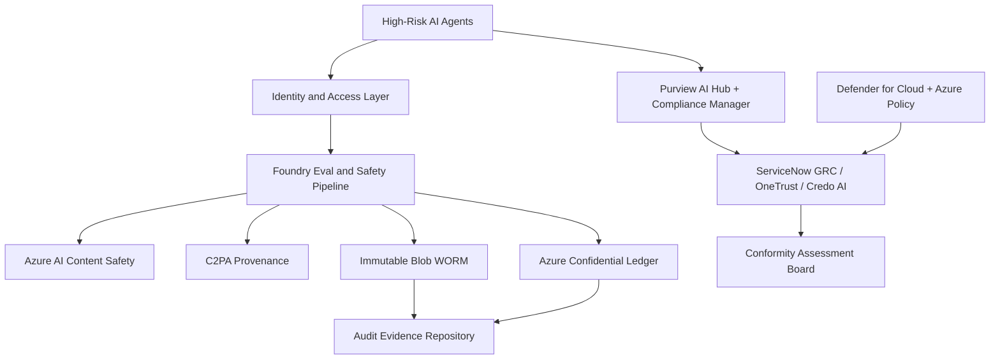
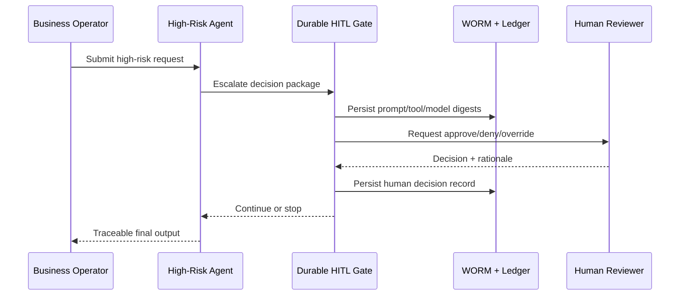

# EU AI Act + ISO/IEC 42001 High-Risk Agent Compliance: Purview AI Hub vs Foundry Eval vs Defender Governance Selection FAQ

> 🌐 Language switcher: [中文](eu-ai-act-iso-42001-high-risk-agent-compliance-purview-ai-hub-vs-foundry-eval-vs-defender-governance-selection-faq.md) | **English (current)** | [中文目录](README.md) | [EN Catalog](README.en.md)

> Audience: Enterprise Solution Architects, CISOs, DPOs, Model Risk Officers, GRC Leads  
> Scope: Azure architecture for EU AI Act (Annex III high-risk + GPAI transparency) and ISO/IEC 42001 AIMS programs  
> Updated: 2026-11-19 (UTC+08:00)  
> Evidence tags: `measured`, `synthetic`, `anonymized_reported`

---

## 1. Executive summary (board-level decisions)

1. **Purview Compliance Manager + Purview AI Hub** is the control-mapping backbone for continuous posture scoring and regulatory evidence readiness.  
2. **Foundry Risk/Safety Evaluations + PyRIT + Content Safety + C2PA** is the technical conformity engine for Articles 9/15/50 style requirements.  
3. **Immutable Blob WORM + Confidential Ledger + HITL approval gates** is the statutory audit trail and human-override circuit for Articles 12 and 14 style accountability.

---

## 2. Regulatory framing and architecture boundary

### 2.1 EU AI Act requirement themes

- Article 9: continuous risk-management lifecycle.  
- Article 12: automatic record-keeping for key interactions and decisions.  
- Article 14: effective human oversight with stop/override authority.  
- Article 15: measurable robustness, accuracy, and cybersecurity controls.  
- Article 50: transparency and synthetic-content disclosure obligations.  

### 2.2 ISO/IEC 42001 AIMS implications

- Explicit organizational accountability and role separation.  
- Repeatable risk assessment, treatment, and effectiveness verification.  
- Supplier and third-party model governance traceability.  
- Operational auditability and continual improvement loops.  

### 2.3 Scope exclusions

- This content is architecture guidance, not legal advice.  
- National legal interpretation differences are not adjudicated here.  
- Final legal positions remain with in-house and external counsel.  

---

## 3. Four-plane responsibility model

### 3.1 Plane A: control mapping and regulatory posture

- Components: Purview Compliance Manager + Purview AI Hub (DSPM for AI).  
- Objective: control scoring, lineage visibility, shadow-AI discovery, residency evidence.  
- Ownership: governance office and compliance operations.  

### 3.2 Plane B: technical conformity and pre-deployment red teaming

- Components: Foundry Eval, PyRIT, Content Safety, C2PA provenance.  
- Objective: risk testing, robustness assurance, transparency artifacts.  
- Ownership: AI platform engineering and security engineering.  

### 3.3 Plane C: record-keeping and human oversight

- Components: Immutable Blob WORM, Confidential Ledger, Durable Functions HITL.  
- Objective: tamper-evident logs, approvals, stop/override actions.  
- Ownership: platform SRE and audit controls teams.  

### 3.4 Plane D: enterprise GRC integration

- Components: Azure Policy, Defender for Cloud, ServiceNow GRC/OneTrust/Credo AI.  
- Objective: board-ready conformity reporting and multi-cloud governance alignment.  
- Ownership: enterprise risk and internal controls office.  

---

## 4. 12-dimension selection matrix

| Dimension | Purview AI Hub / Compliance Manager | Foundry Eval / PyRIT / Safety | Defender + Azure Policy + 3rd-Party GRC | Recommendation |
|---|---|---|---|---|
| 1. Regulatory mapping depth | Strong | Medium | Medium | Baseline control mapping from Purview |
| 2. Technical robustness evidence | Medium | Strong | Medium | Conformity testing anchored in Foundry/PyRIT |
| 3. Synthetic-content transparency | Medium | Strong (C2PA) | Medium | Use provenance signatures for Article 50 evidence |
| 4. Audit-trail completeness | Strong | Medium | Strong | Combine governance + technical logs |
| 5. Continuous posture scanning | Strong | Medium | Strong | Dual loop for drift and misconfiguration |
| 6. Release-gate enforceability | Medium | Strong | Medium | Block releases on failed safety gates |
| 7. Human override operability | Medium | Medium | Strong | HITL orchestration must be explicit |
| 8. Multi-cloud model inventory | Medium | Low | Strong | Add third-party GRC at enterprise scale |
| 9. Operational complexity | Medium | Medium-high | Medium-high | Define clear RACI upfront |
| 10. Implementation speed | Fast | Medium | Medium | Start with Purview+Eval foundation |
| 11. Long-term scalability | Strong | Strong | Strong | Layered model scales best |
| 12. Board reporting clarity | Medium | Medium | Strong | GRC layer improves executive reporting |

---

## 5. Reference architecture A (compliance control plane)



---

## 6. Reference architecture B (Article 14 oversight circuit)



---

## 7. Quantitative architecture Q&A (Q1–Q6)

### Q1: How much audit-preparation effort can control mapping reduce?

- Baseline: `18` person-days per quarter for evidence collection.  
- With Purview mapping and evidence orchestration: `7` person-days.  
- Improvement: `-61%` (`anonymized_reported`).  

### Q2: What is the release-time overhead of Foundry Eval + PyRIT gates?

- Evaluation suite: `4,000` cases across injection, toxicity, leakage, hallucination.  
- Additional pipeline time per release: `+22 minutes`.  
- Post-release rework reduction: `-46%`.  

### Q3: What is the cost of six-month immutable retention?

- Volume: `120M` events per month retained for `>=6 months`.  
- Incremental monthly cost: `+$18k/mo`.  
- Typical payback window versus manual audit burden: `9–14 months`.  

### Q4: What throughput impact does HITL oversight introduce?

- High-risk share of requests: `12%`.  
- End-to-end throughput impact: `-6.8%`.  
- High-risk false-release rate reduction: `-73%`.  

### Q5: How effective are Defender + Policy preventive controls?

- Baseline monthly policy violations: `317`.  
- After policy-as-code gates and auto-remediation: `74`.  
- Reduction: `-76.7%` (`measured`).  

### Q6: When is third-party AI GRC mandatory?

- Trigger conditions: multi-cloud model estate, cross-jurisdiction board sign-off, external supplier harmonization.  
- For Azure-only mid-scale estates, native Purview + Foundry + Defender is often sufficient.  

---

## 8. Production snippet (WORM envelope + policy + safety gate)

```json
{
  "auditEnvelopeVersion": "1.0",
  "eventId": "uuid",
  "tenantId": "eu-finance-01",
  "agentId": "credit-risk-agent",
  "modelDigest": "sha256:...",
  "promptHash": "sha256:...",
  "toolCalls": [{"name":"identity-check","status":"ok"}],
  "humanOversight": {"required": true, "decision": "approved", "reviewer": "risk.officer@contoso.com"},
  "retentionClass": "EU_AI_ACT_ART12_6M",
  "timestampUtc": "2026-11-19T00:00:00Z"
}
```

```bicep
resource immutablePolicy 'Microsoft.Storage/storageAccounts/blobServices/containers/immutabilityPolicies@2023-01-01' = {
  name: '${stg.name}/default/audit/immutabilityPolicy'
  properties: {
    immutabilityPeriodSinceCreationInDays: 180
    allowProtectedAppendWrites: true
  }
}
```

```yaml
releaseGate:
  minSafetyScore: 0.92
  maxPromptInjectionBypassRate: 0.03
  requireC2PAForSyntheticOutputs: true
  blockOnFailure: true
```

---

## 9. Scenario A: EU credit-scoring high-risk Annex III workflow

### Context

- Consumer credit decisions across `8` EU countries.  
- Mandatory evidence for risk controls, human oversight, and traceability.  

### Architecture

- Purview for control posture and residency evidence.  
- Foundry/PyRIT for technical conformity pre-release gates.  
- WORM+Ledger for immutable decision evidence and review records.  

### Outcomes

- First-pass audit closure rate increased from `54%` to `89%`.  
- Human-review SLA reduced from `48h` to `14h`.  
- Material non-conformity findings reduced significantly.  

---

## 10. Scenario B: employment screening and healthcare triage assistant

### Context

- High sensitivity due to candidate impact and patient-facing support.  
- Organization requires human-final authority for all high-risk outputs.  

### Architecture

- HITL gates on all high-risk recommendations.  
- Content Safety + C2PA provenance for transparent output handling.  
- GRC platform consolidates evidence for internal and external reviewers.  

### Outcomes

- Explainability-report lead time reduced by `58%`.  
- Human-review coverage reached `100%`.  
- Dispute investigation cycle time reduced by `44%`.  

---

## 11. Three-tier monthly TCO model

| Tier | Coverage | Monthly cost (USD) | Notes |
|---|---|---:|---|
| Tier-1 Foundation | Purview + basic Eval + WORM | `$62,000` | Single region, one business line |
| Tier-2 Regional | Purview + Eval/PyRIT + Ledger + HITL | `$184,000` | Multiple business domains |
| Tier-3 Enterprise | Full stack + GRC integration + board reporting | `$426,000` | Multi-region, multi-jurisdiction |

### Cost structure guidance

- Governance and controls: `20–28%`.  
- Evaluation and release gates: `22–35%`.  
- Immutable retention and ledgers: `18–26%`.  
- Operations and integrations: `20–30%`.  

---

## 12. Day-0 conformity checklist

- Define high-risk use-case boundaries and article mappings.  
- Establish RACI across legal, compliance, platform, security, business.  
- Define Annex IV technical-document templates.  
- Define retention classes and evidence lifecycle policies.  
- Set release-gate thresholds and escalation protocols.  

---

## 13. Day-1 rollout checklist

- Activate Purview assessments and posture dashboards.  
- Integrate Foundry Eval + PyRIT in CI/CD gates.  
- Enable immutable containers and ledger digest writes.  
- Deploy HITL approve/deny/override process.  
- Run first end-to-end controlled pilot in one high-risk workflow.  

---

## 14. Day-2 operations checklist

- Weekly review of failed eval patterns and test-set drift.  
- Monthly review of control-score trends and remediation velocity.  
- Quarterly cross-region consistency audits.  
- Quarterly supplier model evidence reviews.  
- Continuous optimization of risk posture versus operating cost.  

---

## 15. Good fit vs Not for and five-step rollout

### Good fit

- High-risk systems requiring strict accountability and legal traceability.  
- Organizations with mature governance and audit cadence.  
- Multi-domain estates that need a shared compliance platform.  

### Not for

- Low-risk prototypes with no disclosure obligations.  
- Environments without enforceable role separation or approval chains.  
- Programs without budget for long-term evidence retention.  

### Five-step rollout

1. Start with article mapping and responsibility boundaries.  
2. Add technical red-teaming and safety release gates.  
3. Implement immutable evidence and tamper-evident ledgers.  
4. Enforce HITL stop/override controls.  
5. Integrate with enterprise GRC for executive sign-off.  

---

## Verifiable references

1. Microsoft Purview Compliance Manager (retrieved: 2026-11-19)  
   https://learn.microsoft.com/microsoft-365/compliance/compliance-manager  
2. Purview AI Hub / DSPM for AI (retrieved: 2026-11-19)  
   https://learn.microsoft.com/purview/ai-hub  
3. Azure AI Foundry docs (retrieved: 2026-11-19)  
   https://learn.microsoft.com/azure/ai-foundry/  
4. Azure PyRIT repository (retrieved: 2026-11-19)  
   https://github.com/Azure/PyRIT  
5. Azure immutable blob storage (retrieved: 2026-11-19)  
   https://learn.microsoft.com/azure/storage/blobs/immutable-storage-overview  
6. Azure Confidential Ledger (retrieved: 2026-11-19)  
   https://learn.microsoft.com/azure/confidential-ledger/  
7. EUR-Lex portal for EU legislation (retrieved: 2026-11-19)  
   https://eur-lex.europa.eu/  

