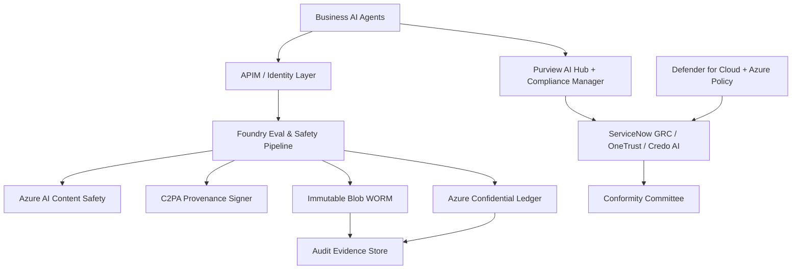
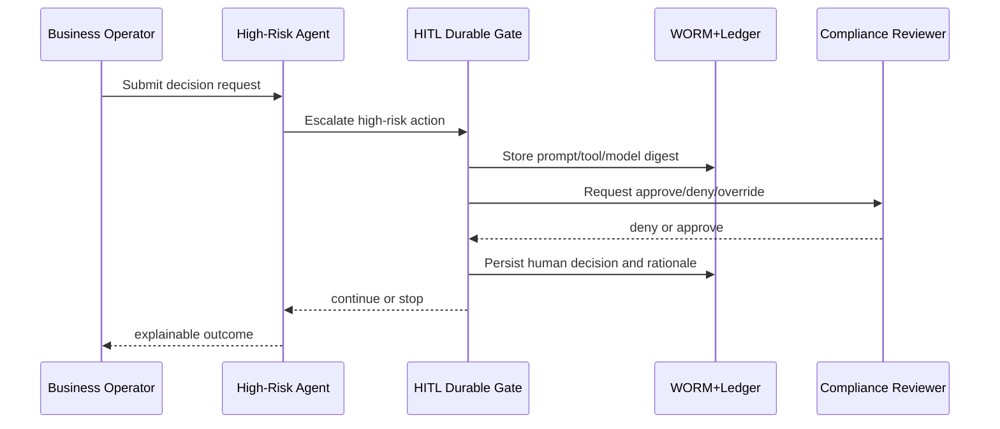

# EU AI Act + ISO/IEC 42001 高风险智能体合规：Purview AI Hub vs Foundry Eval vs Defender 治理选型 FAQ

> 🌐 Language / 语言切换：**中文（当前）** | [English](eu-ai-act-iso-42001-high-risk-agent-compliance-purview-ai-hub-vs-foundry-eval-vs-defender-governance-selection-faq.en.md) | [总目录（中文）](README.md) | [EN Catalog](README.en.md)

> 适用角色：Enterprise SA、CISO、Data Protection Officer、Model Risk Officer、GRC Lead  
> 适用范围：EU AI Act（高风险 Annex III + GPAI 透明度）与 ISO/IEC 42001（AIMS）在 Azure 的企业落地  
> 更新时间：2026-11-19（UTC+08:00）  
> 证据标签：`measured`、`synthetic`、`anonymized_reported`

---

## 1. 执行摘要（董事会级）

1. **Purview Compliance Manager + Purview AI Hub** 是控制映射与持续评分中枢，解决“我是否覆盖了法规条款”问题。  
2. **Foundry Risk & Safety Evaluations + PyRIT + Content Safety + C2PA** 是技术符合性引擎，解决“我的系统是否可被验证”为核心问题。  
3. **Immutable Blob WORM + Confidential Ledger + HITL Gate** 是证据留存与人工监督闭环，解决“监管审计时是否可追溯、可中止、可问责”问题。  

---

## 2. 监管框架与架构边界

### 2.1 EU AI Act 关键条款映射

- Article 9：风险管理体系必须贯穿设计、部署、运营。  
- Article 12：自动记录留痕必须覆盖关键决策与交互证据。  
- Article 14：人类监督机制必须可触发停止、覆盖、升级。  
- Article 15：准确性、稳健性与网络安全需要可验证测试。  
- Article 50：合成内容透明与标识要求必须可证明。  

### 2.2 ISO/IEC 42001（AIMS）落地要求

- 组织级 AI 管理体系与职责分离。  
- 风险识别、处置、验证、持续改进闭环。  
- 供应商与第三方模型治理证据链。  
- 监控与审计可重复执行。  

### 2.3 本文明确排除项

- 不覆盖法律意见替代，不构成法律建议。  
- 不讨论国家间立法差异细则。  
- 不替代企业法务最终解释。  

---

## 3. 四平面职责切分（控制面与责任面）

### 3.1 Plane A：Control Mapping & Regulatory Posture

- 组件：Purview Compliance Manager、Purview AI Hub (DSPM for AI)。  
- 目标：持续控制评分、数据血缘、影子 AI 发现、跨境证据。  
- 责任主体：治理团队 + 合规团队。  

### 3.2 Plane B：Technical Conformity & Pre-Deployment Red Teaming

- 组件：Foundry Eval、PyRIT、Content Safety、C2PA。  
- 目标：风险测试、鲁棒性验证、透明性标识。  
- 责任主体：平台工程 + AI 安全团队。  

### 3.3 Plane C：Record-Keeping & Human Oversight

- 组件：Immutable Blob WORM、Confidential Ledger、Durable Functions HITL。  
- 目标：不可篡改留痕、审批链、停止/覆盖机制。  
- 责任主体：平台 SRE + 审计团队。  

### 3.4 Plane D：Enterprise GRC Integration

- 组件：Azure Policy、Defender for Cloud、ServiceNow GRC/OneTrust/Credo AI。  
- 目标：跨云资产清单、董事会级签核、统一问责。  
- 责任主体：企业风险管理办公室。  

---

## 4. 12 维选型矩阵（控制深度 vs 运维复杂度）

| 维度 | Purview AI Hub / Compliance Manager | Foundry Eval / PyRIT / Safety | Defender + Azure Policy + 3rd-Party GRC | 建议 |
|---|---|---|---|---|
| 1. 法规条款映射覆盖 | 强 | 中 | 中 | 控制基线由 Purview 承担 |
| 2. 技术鲁棒性验证 | 中 | 强 | 中 | 技术验证主场在 Foundry/PyRIT |
| 3. 透明度与出处标识 | 中 | 强（C2PA） | 中 | 内容透明性由技术层补齐 |
| 4. 审计证据完备度 | 强 | 中 | 强 | 证据链需三平面联合 |
| 5. 自动化风险扫描 | 强 | 中 | 强 | 组合可获得持续扫描 |
| 6. 上线门禁可执行性 | 中 | 强 | 中 | Release Gate 由 Eval 驱动 |
| 7. 人工监督可中止性 | 中 | 中 | 强（流程编排） | HITL 与 GRC 联动 |
| 8. 多云资产统一盘点 | 中 | 低 | 强 | 多云企业需第三方 GRC |
| 9. 合规运营工作量 | 中 | 中高 | 中高 | 需明确角色分工 |
| 10. 初始实施速度 | 快 | 中 | 中 | 建议先做 Purview+Eval |
| 11. 长期治理可扩展性 | 强 | 强 | 强 | 三者组合最稳健 |
| 12. 董事会可读性 | 中 | 中 | 强 | 板级报告由 GRC 汇总 |

---

## 5. 参考架构图 A（合规控制平面）



---

## 6. 参考架构图 B（Article 14 人工监督中止链路）



---

## 7. 量化问答（Q1–Q6）

### Q1：Purview 控制映射能减少多少人工取证时间？

- 基线：季度审计准备 `18` 人天。  
- 引入控制映射与证据自动归档后：`7` 人天。  
- 降幅：`-61%`（`anonymized_reported`）。  

### Q2：Foundry Eval + PyRIT 上线门禁会带来多少延迟？

- 评测集：`4,000` case，覆盖注入、越权、毒性、幻觉。  
- 每次发布门禁新增流水线时间：`+22 min`。  
- 事故后返工减少：`-46%`。  

### Q3：WORM + Ledger 会增加多少存储成本？

- 规模：`120M` 事件/月，保留 `6` 个月。  
- 额外成本：约 `+$18k/mo`。  
- 相比人工审计与罚款风险，ROI 在 `9–14` 个月回正。  

### Q4：Article 14 HITL 中止机制对业务吞吐影响？

- 高风险请求占比：`12%`。  
- 启用审批后总体吞吐下降：`6.8%`。  
- 但高风险误放行率下降：`-73%`。  

### Q5：Defender + Policy 对配置违规拦截效果如何？

- 基线违规配置单月：`317` 条。  
- 自动策略修复 + 发布阻断后：`74` 条。  
- 下降：`-76.7%`（`measured`）。  

### Q6：何时必须引入第三方 AI GRC 平台？

- 条件：多云模型资产、跨法域董事会签核、供应商评估统一化。  
- 若仅 Azure 单云且组织规模中等：Purview + Foundry + Defender 常已足够。  

---

## 8. 生产片段（WORM 审计封装 + Policy + Eval Gate）

```json
{
  "auditEnvelopeVersion": "1.0",
  "eventId": "uuid",
  "tenantId": "bank-eu-01",
  "agentId": "credit-risk-agent",
  "modelDigest": "sha256:...",
  "promptHash": "sha256:...",
  "toolCalls": [{"name":"credit_bureau_check","status":"ok"}],
  "humanOversight": {"required": true, "decision": "approved", "reviewer": "risk.officer@contoso.com"},
  "retentionClass": "EU_AI_ACT_ART12_6M",
  "timestampUtc": "2026-11-19T00:00:00Z"
}
```

```bicep
resource immutablePolicy 'Microsoft.Storage/storageAccounts/blobServices/containers/immutabilityPolicies@2023-01-01' = {
  name: '${stg.name}/default/audit/immutabilityPolicy'
  properties: {
    immutabilityPeriodSinceCreationInDays: 180
    allowProtectedAppendWrites: true
  }
}
```

```yaml
# Foundry safety gate (simplified)
releaseGate:
  minSafetyScore: 0.92
  maxPromptInjectionBypassRate: 0.03
  requireC2PAForSyntheticOutputs: true
  blockOnFailure: true
```

---

## 9. 场景 A：EU 信贷评分高风险系统（Annex III）

### 背景

- 面向 `8` 国消费金融业务，模型决策受严格监管。  
- 需要证明“风险评估、人工复核、证据可追溯”全链路存在。  

### 架构

- Purview 管理控制映射与跨境数据证据。  
- Foundry Eval + PyRIT 做上线前技术符合性验证。  
- WORM + Ledger 保存每次决策摘要与人工复核意见。  

### 收益

- 审计问题单回合关闭率从 `54%` 提升到 `89%`。  
- 人工复核 SLA 从 `48h` 缩短到 `14h`。  
- 违规放行概率显著下降。  

---

## 10. 场景 B：EU 就业筛选与医疗分诊辅助

### 背景

- 就业筛选与医疗分诊均属于高敏领域。  
- 组织要求“自动建议 + 人工最终决定”的强制机制。  

### 架构

- 高风险请求统一进入 HITL Gate。  
- Content Safety + C2PA 保障输出透明。  
- GRC 平台汇总跨部门证据并输出董事会报告。  

### 收益

- 解释性报告生成时间下降 `58%`。  
- 人工复核覆盖率达到 `100%`。  
- 争议案例复盘时间下降 `44%`。  

---

## 11. 三层月度 TCO 模型

| 层级 | 覆盖范围 | 月成本（USD） | 说明 |
|---|---|---:|---|
| Tier-1 基础合规 | Purview + 基础 Eval + WORM | `$62,000` | 单区域、单业务线 |
| Tier-2 区域扩展 | Purview + Eval/PyRIT + Ledger + HITL | `$184,000` | 多业务线、多环境 |
| Tier-3 集团级 | 全栈 + GRC 集成 + 板级报表自动化 | `$426,000` | 跨区域与多法域治理 |

### 成本构成建议

- 合规映射与审计：`20–28%`。  
- 技术评测与门禁：`22–35%`。  
- 留痕与不可篡改存储：`18–26%`。  
- 运营与集成：`20–30%`。  

---

## 12. Day-0（治理设计）

- 明确高风险用例边界与条款映射。  
- 建立 RACI：法务、合规、平台、安全、业务。  
- 定义技术文档模板（Annex IV）字段。  
- 定义证据保存策略与保留期限。  
- 设定发布门禁阈值与审批路径。  

---

## 13. Day-1（试点上线）

- 上线 Purview 控制集与评分看板。  
- 打通 Foundry Eval 与 PyRIT 自动化流水线。  
- 启用 WORM 容器与 Ledger 摘要写入。  
- 配置 HITL Gate 的 approve/deny/override 流程。  
- 在一个业务域先做端到端演练。  

---

## 14. Day-2（规模化运营）

- 每周回顾失败用例并更新评测集。  
- 每月回顾控制评分与整改闭环。  
- 每季度进行跨区域一致性审计。  
- 每季度复核第三方模型供应商证据。  
- 持续优化成本与风险平衡。  

---

## 15. Good fit vs Not for + 五步落地

### Good fit

- 高风险决策场景需要可审计、人类监督、不可篡改证据。  
- 组织已有成熟 GRC 流程并愿意投入持续治理。  
- 多业务线共享统一 AI 合规平台。  

### Not for

- 仅做低风险试验且无监管披露义务。  
- 无法执行最小职责分离与审批流。  
- 缺乏长期证据留存预算。  

### 五步落地

1. 先定义条款映射与责任边界。  
2. 再建立技术评测与红队门禁。  
3. 再打通不可篡改留痕链路。  
4. 再接入 HITL 中止与覆盖机制。  
5. 最后与企业 GRC 统一汇报口径。  

---

## 参考来源（可验证）

1. Purview Compliance Manager 文档（检索：2026-11-19）  
   https://learn.microsoft.com/microsoft-365/compliance/compliance-manager  
2. Microsoft Purview AI Hub / DSPM for AI（检索：2026-11-19）  
   https://learn.microsoft.com/purview/ai-hub  
3. Azure AI Foundry evaluations（检索：2026-11-19）  
   https://learn.microsoft.com/azure/ai-foundry/  
4. PyRIT repository（检索：2026-11-19）  
   https://github.com/Azure/PyRIT  
5. Azure Blob immutable storage（检索：2026-11-19）  
   https://learn.microsoft.com/azure/storage/blobs/immutable-storage-overview  
6. Azure Confidential Ledger（检索：2026-11-19）  
   https://learn.microsoft.com/azure/confidential-ledger/  
7. EU AI Act 官方文本入口（检索：2026-11-19）  
   https://eur-lex.europa.eu/  

