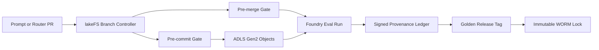
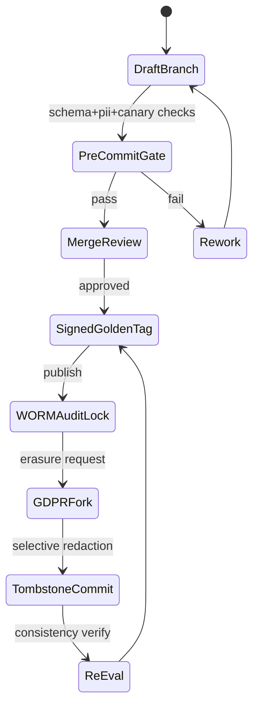

# Enterprise Multimodal Agent Evaluation Corpus Versioning, Zero-Copy Branching, and Audit Lineage Selection FAQ (lakeFS / Foundry Assets / Delta-Iceberg)
> Topic ID: #456
> Target workload: `500K–50M` trajectories, multimodal fixtures, and `5 TB–200 TB` corpus footprints
> Mission: enforce reproducibility, compliance, and cost discipline in one governance control plane
## 1) Decision baseline: this is not folder hygiene, it is provable version governance
Evaluation corpora include tool-call JSONL traces, screenshots, PDFs, WAV clips, and rubric metadata.
Once many teams run parallel prompt and router iterations, mutable folder naming becomes untrustworthy.
Regulatory review does not accept approximate statements about which dataset version was used.
Model risk governance requires deterministic ties between input snapshot, policy bundle, and score output.
Without zero-copy branching, each parallel experiment triggers expensive TB-scale object duplication.
Without merge gates, contaminated examples can silently enter golden sets and poison release quality.
Without cryptographic lineage, replay claims remain narrative instead of machine-verifiable evidence.
The core design question is therefore evidentiary reproducibility, not only storage location.
## 2) Constraint stack: scale, concurrency, audits, and erasure requests co-exist
Scale pressure comes from `5 TB–200 TB` pools and frequent `10K` small-file directory operations.
Concurrency pressure comes from `50+` simultaneous PR evaluations across prompt and router tracks.
Audit pressure comes from EU AI Act and SR 11-7 style model-risk reproducibility requirements.
Sovereignty pressure requires explicit cross-region controls and traceable data movement boundaries.
Erasure pressure requires GDPR-selective deletion without destroying historical release lineage.
Contamination pressure requires canary-GUID checks across training and evaluation partitions.
Gate pressure requires both pre-commit and pre-merge policy enforcement with hard reject semantics.
Performance pressure requires near-instant branch creation to avoid developer waiting cascades.
Cost pressure requires branch growth with metadata delta rather than object-level cloning.
## 3) Four architecture choices and practical boundary conditions
Pattern A uses `ADLS Gen2 + lakeFS` for metadata-driven zero-copy branches and commit lineage.
Pattern A relies on Graveler metadata graphs to create branches in `<80 ms` with zero blob duplication.
Pattern A usually runs with AKS control-plane high availability and PostgreSQL Flexible Server metadata.
Pattern A fits mixed binary and tabular corpora that need strict merge policies and replay certainty.
Pattern B uses `Foundry/AML Data Assets v2` as immutable asset registry with managed experience.
Pattern B pairs naturally with Purview and OpenLineage for broad lineage visibility.
Pattern B fits teams prioritizing managed operations and moderate customization depth.
Pattern C uses `Delta/Iceberg` for heavy structured trajectories with time travel and CDF semantics.
Pattern C is strong for table-heavy evaluation histories and vectorized change inspection.
Pattern C still needs complementary object governance for large binary fixture collections.
Pattern D (`Git + DVC` or mutable ADLS folders) collapses under millions of small files and weak gates.
Pattern D also lacks robust server-side atomic merge controls at enterprise scale.
## 4) Twelve-dimension quantified matrix for architecture review boards
| Dimension | Pattern A (ADLS + lakeFS) | Pattern B (Foundry Assets) | Pattern C (Delta/Iceberg) | Pattern D (Git+DVC or mutable folders) |
|:-|:-:|:-:|:-:|:-:|
| Branch creation latency on `20 TB` | 45–80 ms | 2–6 s | 4–12 s | 40 min–3 h |
| Extra storage per branch | `<0.4%` | 2–8% | 5–15% | 18–45% |
| PDF/PNG/WAV handling maturity | high | medium | low-to-medium | low |
| Pre-commit hook programmability | high | medium | medium | low |
| Pre-merge atomic policy gate | high | medium | medium | very-low |
| Commit-to-eval binding strength | high | medium-high | medium | low |
| GDPR selective erasure support | medium-high | medium | high (tabular) | low |
| WORM-compatible signed release tags | high | medium | medium | low |
| `10K` small-file listing efficiency | high | medium | medium | low |
| RBAC/ABAC granularity | high | medium-high | medium-high | low |
| Day-2 operations burden | medium | low | medium-high | high |
| Board recommendation | primary backbone | managed complement | tabular accelerator | anti-pattern |
## 5) Control-plane and data-plane interaction topology

The control plane enforces policy, signatures, approval workflow, rollback, and alerting.
The data plane manages object blobs, metadata maps, references, and branch deltas.
The release plane binds commit IDs, dataset digests, and evaluation outcomes into one evidence unit.
## 6) Corpus lifecycle with GDPR fork semantics

This machine treats erasure requests as controlled forks instead of in-place history rewrites.
Historical tags remain auditable while current views can evolve through signed lineage updates.
## 7) Q1: how to quantify zero-copy storage amplification savings
A practical model is `Saving_TB = N_branch * Corpus_TB - Metadata_Overhead_TB`.
For `N_branch=60`, `Corpus=25 TB`, and metadata overhead `0.35%`, savings exceed `1,490 TB`.
This benefit compounds with every parallel experiment cycle rather than one-time provisioning.
Full-copy branching quickly saturates network egress and storage quotas at enterprise scale.
## 8) Q2: Graveler lookup latency versus raw ADLS listing economics
Directory recursion over millions of objects creates unstable tail latency and high listing cost.
Metadata graph lookups convert version resolution into commit graph traversal.
A practical policy is to ban recursive object diff when object count exceeds `5M`.
Capacity dashboards should track both commit-lookup P95 and object-list P95 for drift detection.
## 9) Q3: contamination gates and canary-GUID mathematics
Inject controlled canary GUIDs into protected subsets and run dual presence checks before merge.
If training data contains evaluation canaries, merge must be rejected with contamination severity labels.
A simple metric is `LeakRate = leaked_canary / total_canary`, target value permanently near zero.
This mechanism produces deterministic evidence and outperforms manual spot-check routines.
## 10) Q4: reconciling ten-year audit retention with thirty-day GDPR erasure
Use a two-layer design: immutable snapshot lineage plus erasable PII sidecar indirection.
Erasure requests trigger sidecar localization and crypto-shredding instead of rewriting signed history.
Audit records keep hashes and signatures while avoiding long-term retention of direct identifiers.
This pattern supports both traceability mandates and privacy-right execution deadlines.
## 11) Q5: Delta deletion vectors versus shallow-branch compaction
Structured trajectories fit Delta/Iceberg deletion vectors and time-travel replay very well.
Binary fixtures are better governed through object-version control with branch references.
A balanced strategy is table workloads on Pattern C, multimodal binaries on Pattern A.
Single-layer designs handling all modalities often fail either performance or compliance goals.
## 12) Q6: deterministic tie-in between lakeFS commit and Foundry release gates
Evaluation submission should carry `commit_id`, `dataset_digest`, and `policy_bundle_sha` tags.
Release gates must reject results missing any of the three immutable provenance coordinates.
Reviewers should replay by tags and verify identical snapshot plus policy package before approval.
This triad acts as the final evidence integrity lock before model promotion.
## 13) Production-grade code snippets specific to #456
### 13.1 Bicep provisioning for ADLS Gen2 WORM and PostgreSQL metadata backend
```bicep
param location string = resourceGroup().location
param prefix string = 'evalcorpus'
resource stg 'Microsoft.Storage/storageAccounts@2023-05-01' = {
  name: '${prefix}stg01'
  location: location
  sku: { name: 'Standard_RAGRS' }
  kind: 'StorageV2'
  properties: {
    isHnsEnabled: true
    immutableStorageWithVersioning: { enabled: true }
    allowBlobPublicAccess: false
    minimumTlsVersion: 'TLS1_2'
  }
}
resource pg 'Microsoft.DBforPostgreSQL/flexibleServers@2023-12-01-preview' = {
  name: '${prefix}-pg'
  location: location
  sku: { name: 'Standard_D4ds_v5', tier: 'GeneralPurpose' }
  properties: {
    highAvailability: { mode: 'ZoneRedundant' }
    network: { publicNetworkAccess: 'Disabled' }
    storage: { storageSizeGB: 512 }
  }
}
```
### 13.2 lakeFS pre-merge action gate for PII, schema, and canary controls
```yaml
name: pre-merge-eval-gate
on:
  pre-merge:
    branches: [main]
actions:
  - id: presidio-scan
    type: run
    command: "python tools/pii_scan.py --branch $SOURCE_BRANCH --max-hit 0"
  - id: schema-check
    type: run
    command: "python tools/schema_validate.py --branch $SOURCE_BRANCH --spec eval_trace.schema.json"
  - id: canary-check
    type: run
    command: "python tools/canary_guard.py --branch $SOURCE_BRANCH --must-contain eval_canary_guid.txt --must-not-contain train_canary_guid.txt"
  - id: decision
    type: gate
    require: [presidio-scan, schema-check, canary-check]
```
### 13.3 Python snippet for zero-copy branch, immutable tags, and replay verification
```python
from hashlib import sha256
from lakefs_client import Client
from azure.ai.evaluation import EvaluationClient

repo = "eval-gold"
base_ref = "main"
pr_ref = "pr-router-184"
commit_id = "9f1c0d8a4c..."
dataset_digest = sha256(b"lakefs://eval-gold@9f1c0d8a4c...").hexdigest()

lf = Client(endpoint="https://lakefs.contoso.com", access_key="***", secret_key="***")
lf.branches.create_branch(repository=repo, branch=pr_ref, source=base_ref)

ev = EvaluationClient(endpoint="https://foundry.contoso.com", credential="***")
run = ev.create_run(
    name="router-pr-184-eval",
    tags={
        "lakefs_commit": commit_id,
        "dataset_digest": dataset_digest,
        "policy_bundle_sha": "f7e2aa21..."
    },
)

assert run.tags["lakefs_commit"] == commit_id
assert run.tags["dataset_digest"] == dataset_digest
```
## 14) Enterprise scenarios and three-year TCO
### 14.1 Scenario A: global investment-bank SR 11-7 validation hub
Data profile: `18 TB` earnings-call PDFs, multimodal traces, and adjudication artifacts.
Team profile: `40` quantitative and model-risk squads iterating prompts and routing logic in parallel.
Primary challenge: maintain audit-grade replay while sustaining high branch concurrency.
Execution pattern: Pattern A as backbone, Pattern B for managed registry, Pattern C for heavy table analytics.
Operational KPI: every scorecard must trace to one immutable commit and policy package.
### 14.2 Scenario B: multi-market ecommerce visual-shopping and care-agent platform
Data profile: `12M` image-plus-chat trajectories with daily GDPR erasure requests.
Team profile: regional operations, trust and safety, recommendation, and service quality groups.
Primary challenge: frequent deletions with preserved signed release lineage.
Execution pattern: sidecar-based erasure, signed re-tag, and mandatory post-erasure re-evaluation.
Operational KPI: no unverified lineage transitions in deletion-driven release cycles.
### 14.3 Three-tier 3-year TCO (`2 TB / 25 TB / 150 TB`)
| Tier | Corpus size | Pattern A | Pattern B | Pattern C |
|:-|:-:|:-:|:-:|:-:|
| Business-unit scale | 2 TB | $0.58M | $0.63M | $0.71M |
| Group scale | 25 TB | $4.90M | $5.44M | $6.20M |
| Ultra scale | 150 TB | $27.6M | $31.2M | $35.5M |
Cost driver one: object storage and metadata-index lifecycle maintenance.
Cost driver two: concurrent branch count and evaluation job parallelism.
Cost driver three: compliance audit effort plus selective-erasure operations.
Cost driver four: cross-region governance divergence and remediation workload.
## 15) Day-0 / Day-1 / Day-2 actions and source list
Day-0 action: establish modality taxonomy and classify identifiable versus attestable fields.
Day-0 action: define branch naming, commit signing, and release-tag conventions.
Day-0 action: implement canary-GUID injection and leakage guard baseline scripts.
Day-0 action: codify pre-commit and pre-merge reject reason dictionaries.
Day-0 action: complete legal workflow review for GDPR erasure evidence packaging.
Day-1 action: deploy Pattern A baseline and pressure-test `<80 ms` branch targets.
Day-1 action: connect Pattern B registry flows and expose Purview lineage dashboards.
Day-1 action: enable Pattern C time-travel and CDF replay for table trajectories.
Day-1 action: enforce commit-run tag consistency checks in CI and release gates.
Day-1 action: issue first signed WORM-protected golden tags and run replay validation.
Day-2 action: review contamination gate false alarms and misses weekly.
Day-2 action: optimize small-file IOPS hotspots through directory layout adjustments monthly.
Day-2 action: conduct quarterly region-failover and evidence-recovery drills.
Day-2 action: benchmark marginal cost and latency of A/B/C combinations continuously.
Day-2 action: publish reusable governance bundles for cross-team onboarding.
Adoption note: organizations requiring strict replay and high-concurrency experimentation should anchor on Pattern A.
Risk note: retaining Pattern D beyond prototyping almost always leads to metadata storms and audit breakdown.
lakeFS documentation (retrieved 2026-11-26): https://docs.lakefs.io/
Azure Data Assets documentation (retrieved 2026-11-26): https://learn.microsoft.com/azure/machine-learning/how-to-create-data-assets
Purview documentation (retrieved 2026-11-26): https://learn.microsoft.com/purview/
Delta Lake documentation (retrieved 2026-11-26): https://docs.delta.io/latest/
Apache Iceberg documentation (retrieved 2026-11-26): https://iceberg.apache.org/docs/latest/
## 16) Extended operating notes for sustained corpus governance
A platform committee should own branch lifecycle policy instead of leaving conventions to each squad.
Snapshot expiration windows must be driven by legal and risk controls rather than ad-hoc storage cleanup.
Merge gate failures should map to explicit remediation playbooks with accountable owners and deadlines.
Every production release should archive a machine-readable provenance bundle for external examiners.
Teams should classify fixtures by sensitivity tier to minimize unnecessary high-trust handling paths.
Binary fixture compression choices should be benchmarked against replay latency and forensic readability.
Large-object ingestion pipelines benefit from deterministic chunking to reduce redundant object churn.
Small-file storms should trigger automatic layout refactoring recommendations in governance reports.
Cross-region replication policies need explicit justification fields tied to data sovereignty controls.
Policy bundle rollouts should include staged canary checks before global enforcement.
Evaluation run dashboards should expose lineage completeness as a first-class health signal.
Incident postmortems should include provenance breakage analysis, not only model quality deltas.
Delete-request workflows should emit tamper-evident audit artifacts for every execution step.
Dataset digest mismatches must hard-fail release promotion regardless of score improvements.
Schema drift should be tracked with compatibility levels and controlled exception windows.
Long-running branches should receive staleness warnings to prevent hidden divergence buildup.
Quarterly governance drills should rehearse replay from historical commits under access constraints.
Capacity models should forecast metadata growth, not only raw blob growth, under branch multiplication.
Finance reporting should separate storage baseline from branch-concurrency amplification effects.
Security reviews should include webhook integrity, signing key rotation, and gate bypass resistance.
Operating handbooks should publish escalation contacts for legal, platform, and data stewardship teams.
