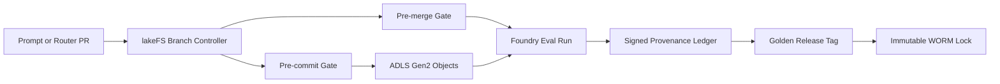
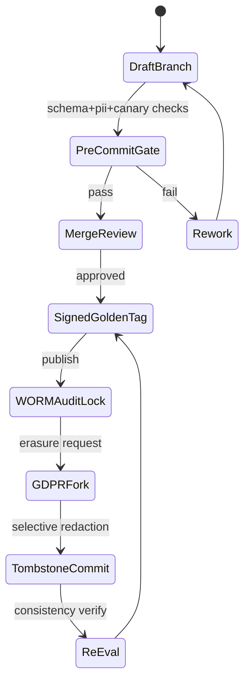

# 企业多模态智能体评测语料版本化、零拷贝分支与审计血缘架构选型 FAQ（lakeFS / Foundry Assets / Delta-Iceberg）
> 主题编号：#456
> 目标对象：管理 `500K–50M` 评测轨迹、`5 TB–200 TB` 语料资产、`50+` 并行评测分支的企业平台团队
> 核心目的：把复现性、合规性与成本效率一起纳入同一套数据治理控制平面
## 1) 决策起点：评测语料不是“文件夹命名问题”，而是“可证明版本控制问题”
多模态评测语料包含工具调用 JSONL、截图、PDF、WAV、表格切片、路由打分轨迹。
当团队数超过十个以后，“golden-final-v3-fixed” 命名会导致事实源失控。
监管审计不接受“我们大概用了那一版数据”，需要精确到 commit 和 digest。
模型风险管理场景要求给出评测输入、评测代码、评测结果三者的一致绑定。
若没有零拷贝分支能力，任何并行实验都会复制 TB 级数据并拖垮预算。
若没有预合并门禁，污染样本会直接进入金标集并扩大偏差传播半径。
若没有加密签名链路，结果复现会沦为人工解释而不是机器可验证事实。
因此本题关键不是“存在哪”，而是“如何保证每次评测都能重放与验真”。
## 2) 约束画像：规模、并发、审计和删除请求同时存在
规模约束来自 `5 TB–200 TB` 资产池和 `10K` 级小文件目录高频扫描。
并发约束来自 `50+` prompt/router PR 同时拉起临时评测分支。
审计约束来自 EU AI Act、SR 11-7 等规则对复现与追责链路的要求。
数据主权约束要求跨区域访问具备显式授权与边界可追踪记录。
删除请求约束要求支持 GDPR 选择性擦除，同时不能破坏历史发布证明链。
污染防护约束要求检测 canary-GUID 是否意外进入训练或评测交叉集合。
门禁约束要求 pre-commit 与 pre-merge 都有自动策略校验并可拒绝提交。
性能约束要求 branch 创建近实时，不允许小时级等待阻塞开发节奏。
成本约束要求分支扩增几乎零复制，避免每个实验都复制全量 Blob。
## 3) 四种路径与边界条件
Pattern A：`ADLS Gen2 + lakeFS`，以元数据图谱做零拷贝分支与提交编排。
Pattern A：通过 Graveler 元数据结构实现 `<80 ms` 分支创建与 `0` 字节对象复制。
Pattern A：搭配 AKS 高可用控制面与 PostgreSQL Flexible Server 承载元数据索引。
Pattern A：适合二进制与结构化混合语料并行治理，强调强可复现与强门禁。
Pattern B：`Foundry/AML Data Assets v2` 提供托管版本实体，降低平台维护门槛。
Pattern B：与 Purview/OpenLineage 配合可快速建立资产血缘与消费关系视图。
Pattern B：适合以托管服务为主、偏标准流程、深度自定义诉求中等的团队。
Pattern C：`Delta/Iceberg` 在大规模结构化轨迹场景具备时间旅行与 CDF 优势。
Pattern C：可用于高频表格轨迹差分、回放、删除向量治理与批量统计回归。
Pattern C：对 PDF/PNG/WAV 这类二进制夹杂语料仍需外层对象治理补位。
Pattern D：`Git + DVC` 在百万级小文件下会出现 metadata thrash 与长尾阻塞。
Pattern D：缺乏服务端原子 pre-merge 钩子会放大脏数据并入主线的概率。
Pattern D：可变文件夹命名方案更不可取，几乎无法支撑审计级复现要求。
## 4) 十二维量化矩阵（面向平台评审）
| 评估维度 | Pattern A（ADLS+lakeFS） | Pattern B（Foundry Assets） | Pattern C（Delta/Iceberg） | Pattern D（Git+DVC/可变目录） |
|:-|:-:|:-:|:-:|:-:|
| `20 TB` 分支创建时延 | 45–80 ms | 2–6 s | 4–12 s | 40 min–3 h |
| 分支额外存储开销 | `<0.4%` | 2–8% | 5–15% | 18–45% |
| PDF/PNG/WAV 原生治理 | 强 | 中 | 弱到中 | 弱 |
| pre-commit 钩子可编排性 | 强 | 中 | 中 | 弱 |
| pre-merge 原子策略门禁 | 强 | 中 | 中 | 弱 |
| commit 与评测运行绑定 | 强 | 中强 | 中 | 弱 |
| GDPR 选择性删除能力 | 中强 | 中 | 强（表格） | 弱 |
| WORM 发布签名兼容性 | 强 | 中 | 中 | 弱 |
| `10K` 小文件 listing IOPS | 高 | 中 | 中 | 低 |
| RBAC/ABAC 颗粒度 | 高 | 中高 | 中高 | 低 |
| Day-2 运维负担 | 中 | 低 | 中高 | 高 |
| 企业综合推荐 | 主推 | 托管补位 | 表格加速层 | 反模式 |
## 5) 控制平面与数据平面联动图

控制平面负责策略、签名、审批、回滚、审计告警。
数据平面负责对象存储、元数据映射、快照引用、分支差异。
发布平面负责把 commit、dataset digest、评测结果绑定为单一证据单元。
## 6) 语料生命周期状态机（含 GDPR 分叉）

该状态机强调“删除请求”是受控分叉而不是对历史标签的原地覆盖。
历史版本可审计，当前版本可修订，二者通过签名链路关联而非互相覆盖。
## 7) Q1：零拷贝分支节省量如何计算
可用公式 `Saving_TB = N_branch * Corpus_TB - Metadata_Overhead_TB`。
当 `N_branch=60`、`Corpus=25 TB`、metadata 开销 `0.35%` 时，理论节省超 `1,490 TB`。
该节省不是一次性收益，而是每次并行实验都会持续复用。
若改用全量复制分支，网络出口、存储配额、作业等待会同步爆炸。
## 8) Q2：Graveler 查询与 ListBlobs 开销如何对比
对象直扫常受目录深度和小文件数量影响，尾时延在百万对象场景显著抬升。
元数据索引查询把“找版本”转成“查提交图”，避免全量目录递归。
可设门槛：当对象数超过 `5M` 时禁止目录枚举式差异比对。
建议把提交查询 P95 与对象列举 P95 同时纳入容量看板。
## 9) Q3：污染门禁如何做成可量化机制
把 canary-GUID 写入受控样本集合并在 pre-merge 执行 presence/absence 双检测。
若训练集发现评测 canary，则拒绝合并并打上 contamination 事件标签。
可定义 `LeakRate = leaked_canary / total_canary`，目标应长期保持为零。
该机制比人工 spot-check 更稳定，也更容易形成自动化审计证据。
## 10) Q4：十年审计保全与 GDPR 30 天擦除如何共存
建议采用“PII sidecar 索引 + 主数据不可变快照”的双层结构。
删除请求触发 sidecar 定位与 crypto-shredding，而非重写历史不可变标签。
审计层保留哈希和签名，不保留可识别明文，从而兼顾证明与隐私。
该模式可同时满足“可追溯”与“可删除”两类互相冲突的制度目标。
## 11) Q5：Delta Deletion Vectors 与 shallow-branch 压缩如何协同
表格轨迹可在 Delta/Iceberg 层做向量化删除与时间旅行回放。
二进制对象仍应由对象版本控制层接管，不建议强行塞入表格式治理。
建议策略是“结构化走 C 层，二进制走 A 层”，并在评测入口统一绑定版本。
若单层方案承载全部类型，往往在性能或合规上出现明显短板。
## 12) Q6：如何把 `lakefs://...@sha` 与 Foundry 评测关卡严格绑定
评测提交时写入 `commit_id`、`dataset_digest`、`policy_bundle_sha` 三元标签。
发布门禁仅接受三元标签匹配的结果，拒绝无来源或来源漂移的评测分数。
复核时按标签反查到同一数据快照与同一策略包，实现机器级重放。
该绑定链路是模型上线前“证据完整性”最后一道强约束。
## 13) 生产代码片段（#456 专用）
### 13.1 Bicep：ADLS Gen2 + WORM + PostgreSQL Flexible Server
```bicep
param location string = resourceGroup().location
param prefix string = 'evalcorpus'
resource stg 'Microsoft.Storage/storageAccounts@2023-05-01' = {
  name: '${prefix}stg01'
  location: location
  sku: { name: 'Standard_RAGRS' }
  kind: 'StorageV2'
  properties: {
    isHnsEnabled: true
    immutableStorageWithVersioning: { enabled: true }
    allowBlobPublicAccess: false
    minimumTlsVersion: 'TLS1_2'
  }
}
resource pg 'Microsoft.DBforPostgreSQL/flexibleServers@2023-12-01-preview' = {
  name: '${prefix}-pg'
  location: location
  sku: { name: 'Standard_D4ds_v5', tier: 'GeneralPurpose' }
  properties: {
    highAvailability: { mode: 'ZoneRedundant' }
    network: { publicNetworkAccess: 'Disabled' }
    storage: { storageSizeGB: 512 }
  }
}
```
### 13.2 lakeFS pre-merge 门禁：PII/Schema/Canary 三重校验
```yaml
name: pre-merge-eval-gate
on:
  pre-merge:
    branches: [main]
actions:
  - id: presidio-scan
    type: run
    command: "python tools/pii_scan.py --branch $SOURCE_BRANCH --max-hit 0"
  - id: schema-check
    type: run
    command: "python tools/schema_validate.py --branch $SOURCE_BRANCH --spec eval_trace.schema.json"
  - id: canary-check
    type: run
    command: "python tools/canary_guard.py --branch $SOURCE_BRANCH --must-contain eval_canary_guid.txt --must-not-contain train_canary_guid.txt"
  - id: decision
    type: gate
    require: [presidio-scan, schema-check, canary-check]
```
### 13.3 Python：零拷贝分支 + Foundry 评测标签绑定 + 复现核验
```python
from hashlib import sha256
from lakefs_client import Client
from azure.ai.evaluation import EvaluationClient

repo = "eval-gold"
base_ref = "main"
pr_ref = "pr-router-184"
commit_id = "9f1c0d8a4c..."
dataset_digest = sha256(b"lakefs://eval-gold@9f1c0d8a4c...").hexdigest()

lf = Client(endpoint="https://lakefs.contoso.com", access_key="***", secret_key="***")
lf.branches.create_branch(repository=repo, branch=pr_ref, source=base_ref)

ev = EvaluationClient(endpoint="https://foundry.contoso.com", credential="***")
run = ev.create_run(
    name="router-pr-184-eval",
    tags={
        "lakefs_commit": commit_id,
        "dataset_digest": dataset_digest,
        "policy_bundle_sha": "f7e2aa21..."
    },
)

assert run.tags["lakefs_commit"] == commit_id
assert run.tags["dataset_digest"] == dataset_digest
```
## 14) 企业场景与三年 TCO
### 14.1 场景 A：全球投行 SR 11-7 模型风险验证中枢
语料构成：`18 TB` 财报电话 PDF、音频摘要、工具调用轨迹与人工裁决记录。
团队构成：`40` 个量化与风控小组并行推进路由策略与提示词修订。
核心挑战：高并发分支实验与审计复现必须同时满足，且不可互相牺牲。
落地策略：主数据采用 Pattern A，托管登记采用 Pattern B，表格差分叠加 Pattern C。
运营重点：每次评测结果必须可反查到同一 commit 与同一策略包。
### 14.2 场景 B：跨市场电商视觉导购与客服智能体平台
语料构成：`12M` 图像+对话轨迹，日常存在大量 GDPR 删除请求。
团队构成：多市场运营、风控、推荐算法与客服质检并行改版。
核心挑战：删除请求高频发生，但历史评测发布链路不能被破坏。
落地策略：用 sidecar 定位可识别信息并执行可证明擦除，再触发重评测。
运营重点：删除后版本必须生成新标签并保留与旧标签的签名关联。
### 14.3 三档三年 TCO（`2 TB / 25 TB / 150 TB`）
| 档位 | 语料规模 | Pattern A | Pattern B | Pattern C |
|:-|:-:|:-:|:-:|:-:|
| 业务线级 | 2 TB | $0.58M | $0.63M | $0.71M |
| 集团级 | 25 TB | $4.90M | $5.44M | $6.20M |
| 超大规模级 | 150 TB | $27.6M | $31.2M | $35.5M |
成本驱动一：对象存储与快照元数据索引维护成本。
成本驱动二：并行分支数量带来的评测作业并发压力。
成本驱动三：合规审计、删除请求与证据回放的人力与平台投入。
成本驱动四：跨区域数据策略差异导致的额外治理开销。
## 15) Day-0 / Day-1 / Day-2（15 项执行动作）与参考
Day-0：建立语料分类字典并标注可识别字段与保全字段边界。
Day-0：确定分支命名、提交签名和发布标签规范。
Day-0：实现 canary-GUID 注入与检测基线脚本。
Day-0：定义 pre-commit 与 pre-merge 拒绝码字典。
Day-0：完成 GDPR 删除请求流程与证据模板评审。
Day-1：上线 Pattern A 主链路并压测 `<80 ms` 分支创建目标。
Day-1：接入 Pattern B 资产登记并串联 Purview 血缘可视化。
Day-1：在结构化轨迹层引入 Pattern C 时间旅行与 CDF 回放。
Day-1：建立 commit 与评测 run 标签一致性巡检任务。
Day-1：发布首批 WORM 受保护金标标签并执行回放验真。
Day-2：每周审计污染门禁误报与漏报并做策略校准。
Day-2：每月复盘小文件 IOPS 热点并重排目录布局。
Day-2：每季度演练区域故障与证据恢复链路。
Day-2：持续比较 A/B/C 组合在成本与时延上的边际收益。
Day-2：把高质量策略包沉淀为跨团队复用模板。
适配建议：要求强复现、强审计、强并发实验的组织优先采用 A 作为骨架。
风险提示：若把 D 当作长期方案，元数据风暴和审计失败几乎必然发生。
lakeFS 文档（抓取 2026-11-26）：https://docs.lakefs.io/
Azure Data Assets 文档（抓取 2026-11-26）：https://learn.microsoft.com/azure/machine-learning/how-to-create-data-assets
Purview 文档（抓取 2026-11-26）：https://learn.microsoft.com/purview/
Delta Lake 文档（抓取 2026-11-26）：https://docs.delta.io/latest/
Apache Iceberg 文档（抓取 2026-11-26）：https://iceberg.apache.org/docs/latest/
## 16) 持续治理补充实践（面向平台长期运营）
平台委员会需要统一分支生命周期规则，不能让各团队各自维护私有口径。
快照保留窗口必须由法务与风险共同驱动，而不是仅由存储清理脚本决定。
门禁失败要绑定标准化整改剧本、责任人和截止时间，避免“口头修复”。
每次生产发布都应沉淀机器可读的 provenance 打包件，便于外部审查复核。
语料资产应按敏感等级分层，减少高信任路径被滥用的概率。
二进制压缩策略要同时评估重放时延、可读性与取证保真度，不能只看压缩比。
大对象入湖建议使用确定性分块，降低重复写入与碎片化扩散。
当小文件风暴出现时，平台应自动给出目录重排建议并量化收益。
跨区域复制必须附带主权理由字段和审批记录，杜绝隐式扩散。
策略包发布推荐先做灰度 canary，再做全局启用，防止一次性误杀。
评测看板应把 lineage 完整度作为核心健康指标，而不是附属指标。
事故复盘除模型分数波动外，还要分析证据链断裂点和责任转移路径。
删除请求流程每一步都应产出防篡改审计件，并支持独立抽检复放。
只要 dataset digest 不一致，就必须阻断发布，不得以“分数提升”替代证据一致性。
Schema 漂移建议定义兼容级别和例外时窗，避免长期积累隐形债务。
长寿命分支应具备陈旧告警，防止评测基线与主线持续偏离。
季度演练应覆盖“历史提交在受限权限下重放”的完整链路。
容量模型需同时预测 metadata 增长曲线与 blob 增长曲线，避免只看一侧。
财务报表应拆分基础存储成本与并行分支放大成本，便于治理问责。
安全评审要检查 webhook 完整性、签名密钥轮换与门禁绕过防护能力。
运行手册应明确法务、平台、数据管家三方升级联络机制与响应时限。
