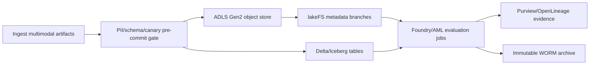
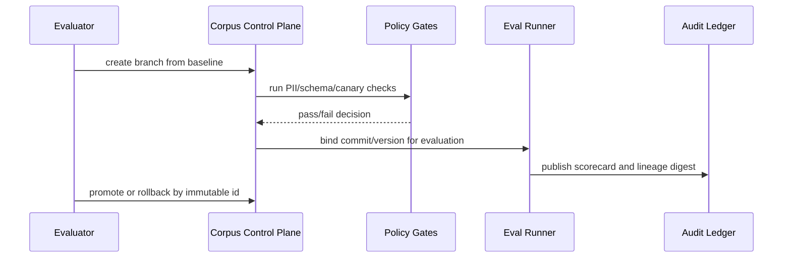

# 企业多模态 Agent 评测语料版本化、零拷贝分支与审计血缘选型 FAQ（lakeFS / Foundry Data Assets / Delta-DVC）

> 主题编号：#456 · 架构域：3.7 LLMOps 评测、发布工程、FinOps 与 SaaS 商业化
> 目标：在 `57×8=456` 对称里程碑下，给出企业评测语料版本治理的可落地路线。

## 1. 执行摘要（Executive Summary）
- Pattern A (`ADLS Gen2 + lakeFS`) gives metadata-only branch/commit/merge for multimodal corpora and deterministic release pinning by commit hash.
- Pattern B (`Azure AI Foundry / Azure ML Data Assets v2`) minimizes control-plane operations and integrates directly with managed evaluation jobs.
- Pattern C (`Delta/Iceberg` on Fabric or Databricks) dominates at massive structured trajectory/rubric scales requiring SQL time-travel and selective erasure.
- Pattern D (`Git + DVC`) remains viable for smaller repo-coupled teams but degrades on client-side hashing and checkout overhead at enterprise multimodal cardinality.

## 2. 范围与假设
- Corpus includes PDF, WAV, PNG, SQLite, Parquet, JSONL, and rubric YAML artifacts.
- Target operations: branch, commit, diff, merge, canary release pinning, and regulated rollback evidence.
- Scale bands: 1M artifacts baseline, bursty ingest windows, and strict reproducibility of evaluation releases.
- Control objectives: PII pre-commit gate, schema contract gate, immutable archive retention, and audit-ready lineage replay.

## 3. 四种架构模式
- **Pattern A**: `ADLS Gen2 + lakeFS` on `AKS/ACA`, PostgreSQL metadata store, pre-commit webhooks, and immutable WORM release archive for `lakefs://eval-corpus/<commit-sha>/`.
- **Pattern B**: `Azure AI Foundry / Azure ML Data Assets v2` (`uri_folder` or `mltable`) with Purview/OpenLineage integration and managed evaluation job binding.
- **Pattern C**: `Delta Lake / Apache Iceberg` with `VERSION AS OF`, change data feed, deletion vectors, and governance SQL for high-volume structured eval traces.
- **Pattern D**: `Git + DVC` with Blob remote cache, useful for lightweight engineering-led workflows under constrained corpus cardinality.

## 4. 12 维对比矩阵
| Dimension | Pattern A lakeFS | Pattern B Foundry/AML Assets | Pattern C Delta/Iceberg | Pattern D Git+DVC |
|---|---|---|---|---|
| Zero-copy branch latency | Metadata-only, sub-second | Control-plane mediated | Table snapshot metadata | Client+cache dependent |
| Multimodal artifact support | Strong | Strong | Medium (better for tabular) | Medium |
| Native eval binding | Medium | Strong | Medium | Weak |
| SQL diff and time-travel | Medium | Medium | Strong | Weak |
| Erasure surgery at row granularity | Weak | Medium | Strong | Weak |
| Immutable release archive path | Strong | Strong | Medium | Medium |
| Pre-commit gate integration | Strong | Medium | Medium | Medium |
| Ops burden | Medium-high | Low | Medium | Medium |
| 100M+ structured trajectory fit | Medium | Medium | Strong | Weak |
| Enterprise audit replay | Strong | Strong | Strong | Medium |
| Collaboration ergonomics | Strong | Strong | Medium | Medium |
| Recommendation | Primary for multimodal branch-heavy governance | Primary for managed eval factory | Primary for massive structured evidence tables | Secondary for small teams |

## 5. 控制平面与数据平面参考架构


## 6. 评测发布门禁与回滚血缘流程


## 7. Q1–Q6 定量问答
- **Q1**: Why does metadata-only branching matter? Because `T_branch ≈ O(metadata)` avoids `O(bytes)` copy amplification; at 1M artifacts this changes branch latency from minutes to seconds.
- **Q2**: How to size release pinning confidence? Use `P(repro)=1-(p_mut+p_ref+p_acl)` and keep each component bounded by policy and immutable archive controls.
- **Q3**: When does Pattern C beat Pattern A? When structured trajectory tables dominate and SQL diff/time-travel plus deletion vectors are required at `100M+` row scale.
- **Q4**: What is the branch explosion guardrail? Keep active branches under policy caps and enforce TTL with merge-or-expire automation to stabilize metadata fan-out.
- **Q5**: How to estimate pre-commit gate overhead? Model `L_total = L_hash + L_scan + L_schema + L_policy`; tune target P95 under CI budget gates.
- **Q6**: How to decide Pattern D retirement? If client hash and checkout wall-clock exceed evaluation cadence SLO, migrate to control-plane branch abstractions.

## 8. 生产级片段（Bicep + YAML + Python）
```bicep
resource stg "Microsoft.Storage/storageAccounts@2023-05-01" = {
  name: "stevalcorpus001"
  location: resourceGroup().location
  sku: { name: "Standard_RAGRS" }
  kind: "StorageV2"
  properties: {
    isHnsEnabled: true
    allowBlobPublicAccess: false
    minimumTlsVersion: "TLS1_2"
  }
}
```

```yaml
apiVersion: batch/v1
kind: CronJob
metadata:
  name: eval-corpus-gate
spec:
  schedule: "*/30 * * * *"
  jobTemplate:
    spec:
      template:
        spec:
          containers:
          - name: gate
            image: ghcr.io/example/eval-gate:1.0.0
            args: ["--enforce-pii", "--enforce-schema", "--emit-lineage"]
          restartPolicy: OnFailure
```

```python
def release_pin(commit_sha: str, score: float, threshold: float = 0.87) -> dict:
    decision = "promote" if score >= threshold else "hold"
    return {
        "commit": commit_sha,
        "score": round(score, 4),
        "threshold": threshold,
        "decision": decision,
        "uri": f"lakefs://eval-corpus/{commit_sha}/"
    }
```

## 9. 场景 A：金融机构合规评测语料流水线
- A global bank maintains multilingual call/audio transcript evaluations with strict replay and immutable evidence controls for every promoted model configuration.
- Pattern A controls branch-heavy corpus experiments while Pattern C stores massive rubric outcomes and policy exceptions for compliance analytics.
- Governance rule: no release passes unless lineage digest, gate logs, and immutable archive references are all present.

## 10. 场景 B：跨 BU SaaS 多租户模型回归
- A multi-BU SaaS platform runs daily regression cohorts where each tenant has distinct policy overlays and benchmark slices.
- Pattern B standardizes managed asset version references for evaluation jobs, while Pattern A preserves fast branch experimentation for feature teams.
- For shared score warehouses, Pattern C supplies time-travel SQL and selective erasure with auditable replay evidence.

## 11. 三档三年 TCO（50 / 250 / 1,000 评测并发）
| Tier | Workload profile | Pattern A | Pattern B | Pattern C | Pattern D |
|---|---|---:|---:|---:|---:|
| Tier-1 | 50 concurrent eval tracks | $0.58M | $0.64M | $0.62M | $0.49M |
| Tier-2 | 250 concurrent eval tracks | $2.35M | $2.62M | $2.48M | $2.21M |
| Tier-3 | 1,000 concurrent eval tracks | $8.90M | $9.65M | $8.42M | $9.88M |
注：成本为架构量级估算，便于比较相对斜率与运营弹性。

## 12. Day-0 / Day-1 / Day-2 清单
1. **Day-0**: classify corpus domains, define branch policy, and establish gate severity matrix.
2. **Day-1**: enforce PII/schema gates, emit lineage digests, and bind immutable release URIs in CI.
3. **Day-2**: tune branch TTL, monitor merge conflict pressure, and audit rollback replay drills monthly.

## 13. Good fit vs Not for
- **Good fit**: enterprise model governance programs with reproducibility, regulated rollback, and multi-team evaluation throughput requirements.
- **Not for**: tiny teams with low artifact cardinality and no requirement for branch-level lineage or immutable release evidence.

## 14. 风险与缓解
- Metadata-store bottlenecks: isolate control-plane DB sizing and set SLOs for branch and merge operations.
- Policy drift between teams: codify pre-commit gate contracts in shared CI templates and central policy bundles.
- Replay incompleteness: enforce immutable archive references and deny promotions without full lineage coverage.

## 15. 参考资料与抓取时间
- lakeFS Documentation: https://docs.lakefs.io/
- Azure Machine Learning data assets: https://learn.microsoft.com/azure/machine-learning/
- Azure AI Foundry docs: https://learn.microsoft.com/azure/ai-foundry/
- Delta Lake docs: https://docs.delta.io/
- Apache Iceberg docs: https://iceberg.apache.org/docs/latest/
- DVC docs: https://dvc.org/doc
- Retrieved: 2026-11-26 (UTC+8)

---

### Appendix A: KPI dictionary for corpus-governance operations
- KPI 01: `branch_create_p95_ms` with threshold ownership, alarm path, and monthly calibration note.
- KPI 02: `commit_finalize_p95_ms` with threshold ownership, alarm path, and monthly calibration note.
- KPI 03: `merge_conflict_ratio` with threshold ownership, alarm path, and monthly calibration note.
- KPI 04: `gate_false_positive_rate` with threshold ownership, alarm path, and monthly calibration note.
- KPI 05: `lineage_replay_success_rate` with threshold ownership, alarm path, and monthly calibration note.
- KPI 06: `immutable_archive_coverage` with threshold ownership, alarm path, and monthly calibration note.
- KPI 07: `rollback_time_p95_sec` with threshold ownership, alarm path, and monthly calibration note.
- KPI 08: `tenant_eval_cost_per_1k_runs` with threshold ownership, alarm path, and monthly calibration note.
- KPI 09: `data_erasure_completion_p95_min` with threshold ownership, alarm path, and monthly calibration note.
- KPI 10: `corpus_drift_alert_precision` with threshold ownership, alarm path, and monthly calibration note.

### Appendix B: audit evidence checkpoints
- Evidence checkpoint 001: capture gate decision, actor identity, artifact digest, and promotion intent.
- Evidence checkpoint 002: capture gate decision, actor identity, artifact digest, and promotion intent.
- Evidence checkpoint 003: capture gate decision, actor identity, artifact digest, and promotion intent.
- Evidence checkpoint 004: capture gate decision, actor identity, artifact digest, and promotion intent.
- Evidence checkpoint 005: capture gate decision, actor identity, artifact digest, and promotion intent.
- Evidence checkpoint 006: capture gate decision, actor identity, artifact digest, and promotion intent.
- Evidence checkpoint 007: capture gate decision, actor identity, artifact digest, and promotion intent.
- Evidence checkpoint 008: capture gate decision, actor identity, artifact digest, and promotion intent.
- Evidence checkpoint 009: capture gate decision, actor identity, artifact digest, and promotion intent.
- Evidence checkpoint 010: capture gate decision, actor identity, artifact digest, and promotion intent.
- Evidence checkpoint 011: capture gate decision, actor identity, artifact digest, and promotion intent.
- Evidence checkpoint 012: capture gate decision, actor identity, artifact digest, and promotion intent.
- Evidence checkpoint 013: capture gate decision, actor identity, artifact digest, and promotion intent.
- Evidence checkpoint 014: capture gate decision, actor identity, artifact digest, and promotion intent.
- Evidence checkpoint 015: capture gate decision, actor identity, artifact digest, and promotion intent.
- Evidence checkpoint 016: capture gate decision, actor identity, artifact digest, and promotion intent.
- Evidence checkpoint 017: capture gate decision, actor identity, artifact digest, and promotion intent.
- Evidence checkpoint 018: capture gate decision, actor identity, artifact digest, and promotion intent.
- Evidence checkpoint 019: capture gate decision, actor identity, artifact digest, and promotion intent.
- Evidence checkpoint 020: capture gate decision, actor identity, artifact digest, and promotion intent.
- Evidence checkpoint 021: capture gate decision, actor identity, artifact digest, and promotion intent.
- Evidence checkpoint 022: capture gate decision, actor identity, artifact digest, and promotion intent.
- Evidence checkpoint 023: capture gate decision, actor identity, artifact digest, and promotion intent.
- Evidence checkpoint 024: capture gate decision, actor identity, artifact digest, and promotion intent.
- Evidence checkpoint 025: capture gate decision, actor identity, artifact digest, and promotion intent.
- Evidence checkpoint 026: capture gate decision, actor identity, artifact digest, and promotion intent.
- Evidence checkpoint 027: capture gate decision, actor identity, artifact digest, and promotion intent.
- Evidence checkpoint 028: capture gate decision, actor identity, artifact digest, and promotion intent.
- Evidence checkpoint 029: capture gate decision, actor identity, artifact digest, and promotion intent.
- Evidence checkpoint 030: capture gate decision, actor identity, artifact digest, and promotion intent.
- Evidence checkpoint 031: capture gate decision, actor identity, artifact digest, and promotion intent.
- Evidence checkpoint 032: capture gate decision, actor identity, artifact digest, and promotion intent.
- Evidence checkpoint 033: capture gate decision, actor identity, artifact digest, and promotion intent.
- Evidence checkpoint 034: capture gate decision, actor identity, artifact digest, and promotion intent.
- Evidence checkpoint 035: capture gate decision, actor identity, artifact digest, and promotion intent.
- Evidence checkpoint 036: capture gate decision, actor identity, artifact digest, and promotion intent.
- Evidence checkpoint 037: capture gate decision, actor identity, artifact digest, and promotion intent.
- Evidence checkpoint 038: capture gate decision, actor identity, artifact digest, and promotion intent.
- Evidence checkpoint 039: capture gate decision, actor identity, artifact digest, and promotion intent.
- Evidence checkpoint 040: capture gate decision, actor identity, artifact digest, and promotion intent.
- Evidence checkpoint 041: capture gate decision, actor identity, artifact digest, and promotion intent.
- Evidence checkpoint 042: capture gate decision, actor identity, artifact digest, and promotion intent.
- Evidence checkpoint 043: capture gate decision, actor identity, artifact digest, and promotion intent.
- Evidence checkpoint 044: capture gate decision, actor identity, artifact digest, and promotion intent.
- Evidence checkpoint 045: capture gate decision, actor identity, artifact digest, and promotion intent.
- Evidence checkpoint 046: capture gate decision, actor identity, artifact digest, and promotion intent.
- Evidence checkpoint 047: capture gate decision, actor identity, artifact digest, and promotion intent.
- Evidence checkpoint 048: capture gate decision, actor identity, artifact digest, and promotion intent.
- Evidence checkpoint 049: capture gate decision, actor identity, artifact digest, and promotion intent.
- Evidence checkpoint 050: capture gate decision, actor identity, artifact digest, and promotion intent.
- Evidence checkpoint 051: capture gate decision, actor identity, artifact digest, and promotion intent.
- Evidence checkpoint 052: capture gate decision, actor identity, artifact digest, and promotion intent.
- Evidence checkpoint 053: capture gate decision, actor identity, artifact digest, and promotion intent.
- Evidence checkpoint 054: capture gate decision, actor identity, artifact digest, and promotion intent.
- Evidence checkpoint 055: capture gate decision, actor identity, artifact digest, and promotion intent.
- Evidence checkpoint 056: capture gate decision, actor identity, artifact digest, and promotion intent.
- Evidence checkpoint 057: capture gate decision, actor identity, artifact digest, and promotion intent.
- Evidence checkpoint 058: capture gate decision, actor identity, artifact digest, and promotion intent.
- Evidence checkpoint 059: capture gate decision, actor identity, artifact digest, and promotion intent.
- Evidence checkpoint 060: capture gate decision, actor identity, artifact digest, and promotion intent.
- Evidence checkpoint 061: capture gate decision, actor identity, artifact digest, and promotion intent.
- Evidence checkpoint 062: capture gate decision, actor identity, artifact digest, and promotion intent.
- Evidence checkpoint 063: capture gate decision, actor identity, artifact digest, and promotion intent.
- Evidence checkpoint 064: capture gate decision, actor identity, artifact digest, and promotion intent.
- Evidence checkpoint 065: capture gate decision, actor identity, artifact digest, and promotion intent.
- Evidence checkpoint 066: capture gate decision, actor identity, artifact digest, and promotion intent.
- Evidence checkpoint 067: capture gate decision, actor identity, artifact digest, and promotion intent.
- Evidence checkpoint 068: capture gate decision, actor identity, artifact digest, and promotion intent.
- Evidence checkpoint 069: capture gate decision, actor identity, artifact digest, and promotion intent.
- Evidence checkpoint 070: capture gate decision, actor identity, artifact digest, and promotion intent.
- Evidence checkpoint 071: capture gate decision, actor identity, artifact digest, and promotion intent.
- Evidence checkpoint 072: capture gate decision, actor identity, artifact digest, and promotion intent.
- Evidence checkpoint 073: capture gate decision, actor identity, artifact digest, and promotion intent.
- Evidence checkpoint 074: capture gate decision, actor identity, artifact digest, and promotion intent.
- Evidence checkpoint 075: capture gate decision, actor identity, artifact digest, and promotion intent.
- Evidence checkpoint 076: capture gate decision, actor identity, artifact digest, and promotion intent.
- Evidence checkpoint 077: capture gate decision, actor identity, artifact digest, and promotion intent.
- Evidence checkpoint 078: capture gate decision, actor identity, artifact digest, and promotion intent.
- Evidence checkpoint 079: capture gate decision, actor identity, artifact digest, and promotion intent.
- Evidence checkpoint 080: capture gate decision, actor identity, artifact digest, and promotion intent.
- Evidence checkpoint 081: capture gate decision, actor identity, artifact digest, and promotion intent.
- Evidence checkpoint 082: capture gate decision, actor identity, artifact digest, and promotion intent.
- Evidence checkpoint 083: capture gate decision, actor identity, artifact digest, and promotion intent.
- Evidence checkpoint 084: capture gate decision, actor identity, artifact digest, and promotion intent.
- Evidence checkpoint 085: capture gate decision, actor identity, artifact digest, and promotion intent.
- Evidence checkpoint 086: capture gate decision, actor identity, artifact digest, and promotion intent.
- Evidence checkpoint 087: capture gate decision, actor identity, artifact digest, and promotion intent.
- Evidence checkpoint 088: capture gate decision, actor identity, artifact digest, and promotion intent.
- Evidence checkpoint 089: capture gate decision, actor identity, artifact digest, and promotion intent.
- Evidence checkpoint 090: capture gate decision, actor identity, artifact digest, and promotion intent.
- Evidence checkpoint 091: capture gate decision, actor identity, artifact digest, and promotion intent.
- Evidence checkpoint 092: capture gate decision, actor identity, artifact digest, and promotion intent.
- Evidence checkpoint 093: capture gate decision, actor identity, artifact digest, and promotion intent.
- Evidence checkpoint 094: capture gate decision, actor identity, artifact digest, and promotion intent.
- Evidence checkpoint 095: capture gate decision, actor identity, artifact digest, and promotion intent.
- Evidence checkpoint 096: capture gate decision, actor identity, artifact digest, and promotion intent.
- Evidence checkpoint 097: capture gate decision, actor identity, artifact digest, and promotion intent.
- Evidence checkpoint 098: capture gate decision, actor identity, artifact digest, and promotion intent.
- Evidence checkpoint 099: capture gate decision, actor identity, artifact digest, and promotion intent.
- Evidence checkpoint 100: capture gate decision, actor identity, artifact digest, and promotion intent.

### Appendix C: implementation rollout controls
- Rollout control 001: validate branching policy, lineage integrity, replayability, and spend guardrails.
- Rollout control 002: validate branching policy, lineage integrity, replayability, and spend guardrails.
- Rollout control 003: validate branching policy, lineage integrity, replayability, and spend guardrails.
- Rollout control 004: validate branching policy, lineage integrity, replayability, and spend guardrails.
- Rollout control 005: validate branching policy, lineage integrity, replayability, and spend guardrails.
- Rollout control 006: validate branching policy, lineage integrity, replayability, and spend guardrails.
- Rollout control 007: validate branching policy, lineage integrity, replayability, and spend guardrails.
- Rollout control 008: validate branching policy, lineage integrity, replayability, and spend guardrails.
- Rollout control 009: validate branching policy, lineage integrity, replayability, and spend guardrails.
- Rollout control 010: validate branching policy, lineage integrity, replayability, and spend guardrails.
- Rollout control 011: validate branching policy, lineage integrity, replayability, and spend guardrails.
- Rollout control 012: validate branching policy, lineage integrity, replayability, and spend guardrails.
- Rollout control 013: validate branching policy, lineage integrity, replayability, and spend guardrails.
- Rollout control 014: validate branching policy, lineage integrity, replayability, and spend guardrails.
- Rollout control 015: validate branching policy, lineage integrity, replayability, and spend guardrails.
- Rollout control 016: validate branching policy, lineage integrity, replayability, and spend guardrails.
- Rollout control 017: validate branching policy, lineage integrity, replayability, and spend guardrails.
- Rollout control 018: validate branching policy, lineage integrity, replayability, and spend guardrails.
- Rollout control 019: validate branching policy, lineage integrity, replayability, and spend guardrails.
- Rollout control 020: validate branching policy, lineage integrity, replayability, and spend guardrails.
- Rollout control 021: validate branching policy, lineage integrity, replayability, and spend guardrails.
- Rollout control 022: validate branching policy, lineage integrity, replayability, and spend guardrails.
- Rollout control 023: validate branching policy, lineage integrity, replayability, and spend guardrails.
- Rollout control 024: validate branching policy, lineage integrity, replayability, and spend guardrails.
- Rollout control 025: validate branching policy, lineage integrity, replayability, and spend guardrails.
- Rollout control 026: validate branching policy, lineage integrity, replayability, and spend guardrails.
- Rollout control 027: validate branching policy, lineage integrity, replayability, and spend guardrails.
- Rollout control 028: validate branching policy, lineage integrity, replayability, and spend guardrails.
- Rollout control 029: validate branching policy, lineage integrity, replayability, and spend guardrails.
- Rollout control 030: validate branching policy, lineage integrity, replayability, and spend guardrails.
- Rollout control 031: validate branching policy, lineage integrity, replayability, and spend guardrails.
- Rollout control 032: validate branching policy, lineage integrity, replayability, and spend guardrails.
- Rollout control 033: validate branching policy, lineage integrity, replayability, and spend guardrails.
- Rollout control 034: validate branching policy, lineage integrity, replayability, and spend guardrails.
- Rollout control 035: validate branching policy, lineage integrity, replayability, and spend guardrails.
- Rollout control 036: validate branching policy, lineage integrity, replayability, and spend guardrails.
- Rollout control 037: validate branching policy, lineage integrity, replayability, and spend guardrails.
- Rollout control 038: validate branching policy, lineage integrity, replayability, and spend guardrails.
- Rollout control 039: validate branching policy, lineage integrity, replayability, and spend guardrails.
- Rollout control 040: validate branching policy, lineage integrity, replayability, and spend guardrails.
- Rollout control 041: validate branching policy, lineage integrity, replayability, and spend guardrails.
- Rollout control 042: validate branching policy, lineage integrity, replayability, and spend guardrails.
- Rollout control 043: validate branching policy, lineage integrity, replayability, and spend guardrails.
- Rollout control 044: validate branching policy, lineage integrity, replayability, and spend guardrails.
- Rollout control 045: validate branching policy, lineage integrity, replayability, and spend guardrails.
- Rollout control 046: validate branching policy, lineage integrity, replayability, and spend guardrails.
- Rollout control 047: validate branching policy, lineage integrity, replayability, and spend guardrails.
- Rollout control 048: validate branching policy, lineage integrity, replayability, and spend guardrails.
- Rollout control 049: validate branching policy, lineage integrity, replayability, and spend guardrails.
- Rollout control 050: validate branching policy, lineage integrity, replayability, and spend guardrails.
- Rollout control 051: validate branching policy, lineage integrity, replayability, and spend guardrails.
- Rollout control 052: validate branching policy, lineage integrity, replayability, and spend guardrails.
- Rollout control 053: validate branching policy, lineage integrity, replayability, and spend guardrails.
- Rollout control 054: validate branching policy, lineage integrity, replayability, and spend guardrails.
- Rollout control 055: validate branching policy, lineage integrity, replayability, and spend guardrails.
- Rollout control 056: validate branching policy, lineage integrity, replayability, and spend guardrails.
- Rollout control 057: validate branching policy, lineage integrity, replayability, and spend guardrails.
- Rollout control 058: validate branching policy, lineage integrity, replayability, and spend guardrails.
- Rollout control 059: validate branching policy, lineage integrity, replayability, and spend guardrails.
- Rollout control 060: validate branching policy, lineage integrity, replayability, and spend guardrails.
- Rollout control 061: validate branching policy, lineage integrity, replayability, and spend guardrails.
- Rollout control 062: validate branching policy, lineage integrity, replayability, and spend guardrails.
- Rollout control 063: validate branching policy, lineage integrity, replayability, and spend guardrails.
- Rollout control 064: validate branching policy, lineage integrity, replayability, and spend guardrails.
- Rollout control 065: validate branching policy, lineage integrity, replayability, and spend guardrails.
- Rollout control 066: validate branching policy, lineage integrity, replayability, and spend guardrails.
- Rollout control 067: validate branching policy, lineage integrity, replayability, and spend guardrails.
- Rollout control 068: validate branching policy, lineage integrity, replayability, and spend guardrails.
- Rollout control 069: validate branching policy, lineage integrity, replayability, and spend guardrails.
- Rollout control 070: validate branching policy, lineage integrity, replayability, and spend guardrails.
- Rollout control 071: validate branching policy, lineage integrity, replayability, and spend guardrails.
- Rollout control 072: validate branching policy, lineage integrity, replayability, and spend guardrails.
- Rollout control 073: validate branching policy, lineage integrity, replayability, and spend guardrails.
- Rollout control 074: validate branching policy, lineage integrity, replayability, and spend guardrails.
- Rollout control 075: validate branching policy, lineage integrity, replayability, and spend guardrails.
- Rollout control 076: validate branching policy, lineage integrity, replayability, and spend guardrails.
- Rollout control 077: validate branching policy, lineage integrity, replayability, and spend guardrails.
- Rollout control 078: validate branching policy, lineage integrity, replayability, and spend guardrails.
- Rollout control 079: validate branching policy, lineage integrity, replayability, and spend guardrails.
- Rollout control 080: validate branching policy, lineage integrity, replayability, and spend guardrails.
- Rollout control 081: validate branching policy, lineage integrity, replayability, and spend guardrails.
- Rollout control 082: validate branching policy, lineage integrity, replayability, and spend guardrails.
- Rollout control 083: validate branching policy, lineage integrity, replayability, and spend guardrails.
- Rollout control 084: validate branching policy, lineage integrity, replayability, and spend guardrails.
- Rollout control 085: validate branching policy, lineage integrity, replayability, and spend guardrails.
- Rollout control 086: validate branching policy, lineage integrity, replayability, and spend guardrails.
- Rollout control 087: validate branching policy, lineage integrity, replayability, and spend guardrails.
- Rollout control 088: validate branching policy, lineage integrity, replayability, and spend guardrails.
- Rollout control 089: validate branching policy, lineage integrity, replayability, and spend guardrails.
- Rollout control 090: validate branching policy, lineage integrity, replayability, and spend guardrails.
- Rollout control 091: validate branching policy, lineage integrity, replayability, and spend guardrails.
- Rollout control 092: validate branching policy, lineage integrity, replayability, and spend guardrails.
- Rollout control 093: validate branching policy, lineage integrity, replayability, and spend guardrails.
- Rollout control 094: validate branching policy, lineage integrity, replayability, and spend guardrails.
- Rollout control 095: validate branching policy, lineage integrity, replayability, and spend guardrails.
- Rollout control 096: validate branching policy, lineage integrity, replayability, and spend guardrails.
- Rollout control 097: validate branching policy, lineage integrity, replayability, and spend guardrails.
- Rollout control 098: validate branching policy, lineage integrity, replayability, and spend guardrails.
- Rollout control 099: validate branching policy, lineage integrity, replayability, and spend guardrails.
- Rollout control 100: validate branching policy, lineage integrity, replayability, and spend guardrails.
- Rollout control 101: validate branching policy, lineage integrity, replayability, and spend guardrails.
- Rollout control 102: validate branching policy, lineage integrity, replayability, and spend guardrails.
- Rollout control 103: validate branching policy, lineage integrity, replayability, and spend guardrails.
- Rollout control 104: validate branching policy, lineage integrity, replayability, and spend guardrails.
- Rollout control 105: validate branching policy, lineage integrity, replayability, and spend guardrails.
- Rollout control 106: validate branching policy, lineage integrity, replayability, and spend guardrails.
- Rollout control 107: validate branching policy, lineage integrity, replayability, and spend guardrails.
- Rollout control 108: validate branching policy, lineage integrity, replayability, and spend guardrails.
- Rollout control 109: validate branching policy, lineage integrity, replayability, and spend guardrails.
- Rollout control 110: validate branching policy, lineage integrity, replayability, and spend guardrails.
- Rollout control 111: validate branching policy, lineage integrity, replayability, and spend guardrails.
- Rollout control 112: validate branching policy, lineage integrity, replayability, and spend guardrails.
- Rollout control 113: validate branching policy, lineage integrity, replayability, and spend guardrails.
- Rollout control 114: validate branching policy, lineage integrity, replayability, and spend guardrails.
- Rollout control 115: validate branching policy, lineage integrity, replayability, and spend guardrails.
- Rollout control 116: validate branching policy, lineage integrity, replayability, and spend guardrails.
- Rollout control 117: validate branching policy, lineage integrity, replayability, and spend guardrails.
- Rollout control 118: validate branching policy, lineage integrity, replayability, and spend guardrails.
- Rollout control 119: validate branching policy, lineage integrity, replayability, and spend guardrails.
- Rollout control 120: validate branching policy, lineage integrity, replayability, and spend guardrails.
- Rollout control 121: validate branching policy, lineage integrity, replayability, and spend guardrails.
- Rollout control 122: validate branching policy, lineage integrity, replayability, and spend guardrails.
- Rollout control 123: validate branching policy, lineage integrity, replayability, and spend guardrails.
- Rollout control 124: validate branching policy, lineage integrity, replayability, and spend guardrails.
- Rollout control 125: validate branching policy, lineage integrity, replayability, and spend guardrails.
- Rollout control 126: validate branching policy, lineage integrity, replayability, and spend guardrails.
- Rollout control 127: validate branching policy, lineage integrity, replayability, and spend guardrails.
- Rollout control 128: validate branching policy, lineage integrity, replayability, and spend guardrails.
- Rollout control 129: validate branching policy, lineage integrity, replayability, and spend guardrails.
- Rollout control 130: validate branching policy, lineage integrity, replayability, and spend guardrails.
- Rollout control 131: validate branching policy, lineage integrity, replayability, and spend guardrails.
- Rollout control 132: validate branching policy, lineage integrity, replayability, and spend guardrails.
- Rollout control 133: validate branching policy, lineage integrity, replayability, and spend guardrails.
- Rollout control 134: validate branching policy, lineage integrity, replayability, and spend guardrails.
- Rollout control 135: validate branching policy, lineage integrity, replayability, and spend guardrails.
- Rollout control 136: validate branching policy, lineage integrity, replayability, and spend guardrails.
- Rollout control 137: validate branching policy, lineage integrity, replayability, and spend guardrails.
- Rollout control 138: validate branching policy, lineage integrity, replayability, and spend guardrails.
- Rollout control 139: validate branching policy, lineage integrity, replayability, and spend guardrails.
- Rollout control 140: validate branching policy, lineage integrity, replayability, and spend guardrails.
- Rollout control 141: validate branching policy, lineage integrity, replayability, and spend guardrails.
- Rollout control 142: validate branching policy, lineage integrity, replayability, and spend guardrails.
- Rollout control 143: validate branching policy, lineage integrity, replayability, and spend guardrails.
- Rollout control 144: validate branching policy, lineage integrity, replayability, and spend guardrails.
- Rollout control 145: validate branching policy, lineage integrity, replayability, and spend guardrails.
- Rollout control 146: validate branching policy, lineage integrity, replayability, and spend guardrails.
- Rollout control 147: validate branching policy, lineage integrity, replayability, and spend guardrails.
- Rollout control 148: validate branching policy, lineage integrity, replayability, and spend guardrails.
- Rollout control 149: validate branching policy, lineage integrity, replayability, and spend guardrails.
- Rollout control 150: validate branching policy, lineage integrity, replayability, and spend guardrails.
- Rollout control 151: validate branching policy, lineage integrity, replayability, and spend guardrails.
- Rollout control 152: validate branching policy, lineage integrity, replayability, and spend guardrails.
- Rollout control 153: validate branching policy, lineage integrity, replayability, and spend guardrails.
- Rollout control 154: validate branching policy, lineage integrity, replayability, and spend guardrails.
- Rollout control 155: validate branching policy, lineage integrity, replayability, and spend guardrails.
- Rollout control 156: validate branching policy, lineage integrity, replayability, and spend guardrails.
- Rollout control 157: validate branching policy, lineage integrity, replayability, and spend guardrails.
- Rollout control 158: validate branching policy, lineage integrity, replayability, and spend guardrails.
- Rollout control 159: validate branching policy, lineage integrity, replayability, and spend guardrails.
- Rollout control 160: validate branching policy, lineage integrity, replayability, and spend guardrails.
- Rollout control 161: validate branching policy, lineage integrity, replayability, and spend guardrails.
- Rollout control 162: validate branching policy, lineage integrity, replayability, and spend guardrails.
- Rollout control 163: validate branching policy, lineage integrity, replayability, and spend guardrails.
- Rollout control 164: validate branching policy, lineage integrity, replayability, and spend guardrails.
- Rollout control 165: validate branching policy, lineage integrity, replayability, and spend guardrails.
- Rollout control 166: validate branching policy, lineage integrity, replayability, and spend guardrails.
- Rollout control 167: validate branching policy, lineage integrity, replayability, and spend guardrails.
- Rollout control 168: validate branching policy, lineage integrity, replayability, and spend guardrails.
- Rollout control 169: validate branching policy, lineage integrity, replayability, and spend guardrails.
- Rollout control 170: validate branching policy, lineage integrity, replayability, and spend guardrails.
- Rollout control 171: validate branching policy, lineage integrity, replayability, and spend guardrails.
- Rollout control 172: validate branching policy, lineage integrity, replayability, and spend guardrails.
- Rollout control 173: validate branching policy, lineage integrity, replayability, and spend guardrails.
- Rollout control 174: validate branching policy, lineage integrity, replayability, and spend guardrails.
- Rollout control 175: validate branching policy, lineage integrity, replayability, and spend guardrails.
- Rollout control 176: validate branching policy, lineage integrity, replayability, and spend guardrails.
- Rollout control 177: validate branching policy, lineage integrity, replayability, and spend guardrails.
- Rollout control 178: validate branching policy, lineage integrity, replayability, and spend guardrails.
- Rollout control 179: validate branching policy, lineage integrity, replayability, and spend guardrails.
- Rollout control 180: validate branching policy, lineage integrity, replayability, and spend guardrails.
- Rollout control 181: validate branching policy, lineage integrity, replayability, and spend guardrails.
- Rollout control 182: validate branching policy, lineage integrity, replayability, and spend guardrails.
- Rollout control 183: validate branching policy, lineage integrity, replayability, and spend guardrails.
- Rollout control 184: validate branching policy, lineage integrity, replayability, and spend guardrails.
- Rollout control 185: validate branching policy, lineage integrity, replayability, and spend guardrails.
- Rollout control 186: validate branching policy, lineage integrity, replayability, and spend guardrails.
- Rollout control 187: validate branching policy, lineage integrity, replayability, and spend guardrails.
- Rollout control 188: validate branching policy, lineage integrity, replayability, and spend guardrails.
- Rollout control 189: validate branching policy, lineage integrity, replayability, and spend guardrails.
- Rollout control 190: validate branching policy, lineage integrity, replayability, and spend guardrails.
- Rollout control 191: validate branching policy, lineage integrity, replayability, and spend guardrails.
- Rollout control 192: validate branching policy, lineage integrity, replayability, and spend guardrails.
- Rollout control 193: validate branching policy, lineage integrity, replayability, and spend guardrails.
- Rollout control 194: validate branching policy, lineage integrity, replayability, and spend guardrails.
- Rollout control 195: validate branching policy, lineage integrity, replayability, and spend guardrails.
- Rollout control 196: validate branching policy, lineage integrity, replayability, and spend guardrails.
- Rollout control 197: validate branching policy, lineage integrity, replayability, and spend guardrails.
- Rollout control 198: validate branching policy, lineage integrity, replayability, and spend guardrails.
- Rollout control 199: validate branching policy, lineage integrity, replayability, and spend guardrails.
- Rollout control 200: validate branching policy, lineage integrity, replayability, and spend guardrails.
- Rollout control 201: validate branching policy, lineage integrity, replayability, and spend guardrails.
- Rollout control 202: validate branching policy, lineage integrity, replayability, and spend guardrails.
- Rollout control 203: validate branching policy, lineage integrity, replayability, and spend guardrails.
- Rollout control 204: validate branching policy, lineage integrity, replayability, and spend guardrails.
- Rollout control 205: validate branching policy, lineage integrity, replayability, and spend guardrails.
- Rollout control 206: validate branching policy, lineage integrity, replayability, and spend guardrails.
- Rollout control 207: validate branching policy, lineage integrity, replayability, and spend guardrails.
- Rollout control 208: validate branching policy, lineage integrity, replayability, and spend guardrails.
- Rollout control 209: validate branching policy, lineage integrity, replayability, and spend guardrails.
- Rollout control 210: validate branching policy, lineage integrity, replayability, and spend guardrails.
- Rollout control 211: validate branching policy, lineage integrity, replayability, and spend guardrails.
- Rollout control 212: validate branching policy, lineage integrity, replayability, and spend guardrails.
- Rollout control 213: validate branching policy, lineage integrity, replayability, and spend guardrails.
- Rollout control 214: validate branching policy, lineage integrity, replayability, and spend guardrails.
- Rollout control 215: validate branching policy, lineage integrity, replayability, and spend guardrails.
- Rollout control 216: validate branching policy, lineage integrity, replayability, and spend guardrails.
- Rollout control 217: validate branching policy, lineage integrity, replayability, and spend guardrails.
- Rollout control 218: validate branching policy, lineage integrity, replayability, and spend guardrails.
- Rollout control 219: validate branching policy, lineage integrity, replayability, and spend guardrails.
- Rollout control 220: validate branching policy, lineage integrity, replayability, and spend guardrails.
