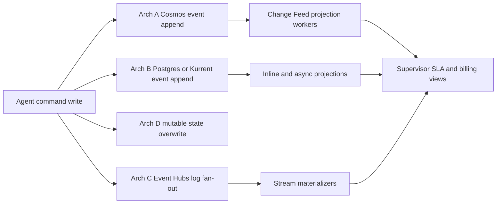
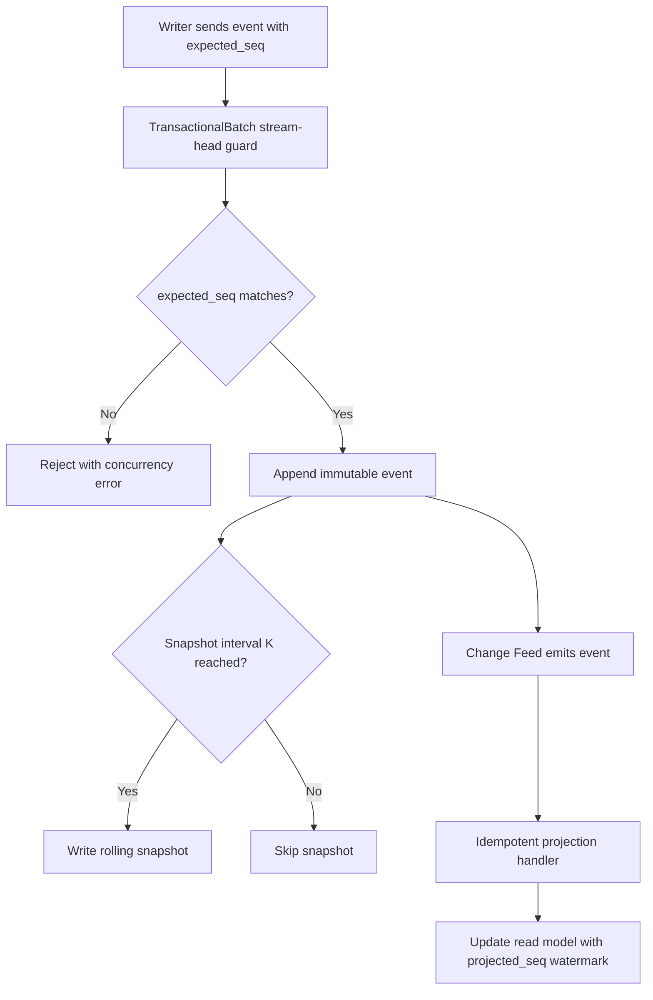
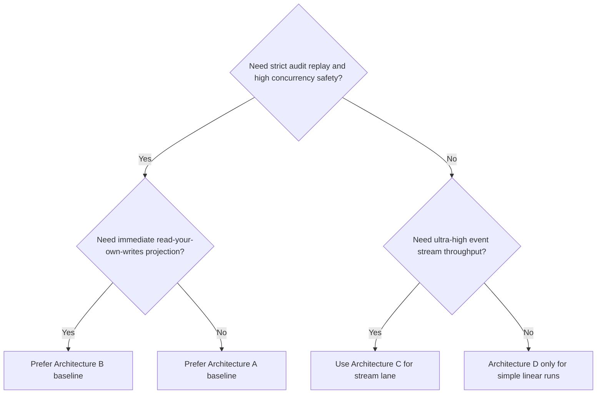

# Event-Sourced CQRS Agent Ledger Selection FAQ: Cosmos Change Feed Projections vs PostgreSQL Marten/Kurrent vs Mutable State Overwrite
> **Applies to**: regulated underwriting, trade settlement, procurement orchestration, and clinical care-coordination workflows.
> **Decision pressure**: eliminate mutable-state overwrite bottlenecks in long-lived multi-agent runs while preserving auditability and low-latency supervisor views.
> **Core objective**: select an event-sourced command ledger and CQRS read-model strategy that scales concurrency, traceability, and cost efficiency.

## 1. Executive summary
- Mutable JSON overwrite state stores fail rapidly as agent-run histories become deep and parallel.
- Large state blobs drive quadratic RU/WAL amplification and unpredictable write latency.
- Parallel tool commits and human approvals collide on single-row optimistic locks.
- Supervisory and billing views become expensive when reconstructed from full-state scans.
- Event-sourced append streams decouple command writes from specialized read-model fan-out.
- CQRS projections enable low-latency views without mutating source-of-truth history.
- Architecture A is strongest for cloud-native multi-region event append and projection fan-out.
- Architecture B is strongest for ACID inline read-your-own-writes consistency.
- Architecture C is strongest for ultra-high event-rate telemetry/event streaming pipelines.
- Architecture D is strongest only for simple low-step single-writer agent runs.
- Most enterprise platforms combine A or B for command truth with selective C for telemetry.
- Final selection should be driven by concurrency profile, audit burden, and run volume.

## 2. Applicability and explicit non-goals
- Scope includes long-lived agent workflows with `100+` steps and multi-writer coordination.
- Scope includes append-only event ledgers, rolling snapshots, and asynchronous projections.
- Scope includes command-side optimistic concurrency and projection-lag management patterns.
- Scope includes schema evolution without rewriting immutable event history.
- Scope is distinct from LangGraph checkpoint backend comparisons inside 3.5.
- Scope is distinct from Temporal/Durable Task workflow code-versioning upcaster concerns in 3.5.
- Scope is distinct from WORM tamper-evident hashing via Azure Confidential Ledger in 3.3.
- Scope excludes transactional ERP source-system data modeling itself.
- Scope excludes legal retention policy authoring beyond architecture controls.

## 3. Scenario and constraint physics
- Multi-agent workflows accumulate progressively larger state context over time.
- Overwriting full-state blobs (`128KB–1.5MB`) amplifies storage-engine and RU/WAL costs.
- Parallel sub-agent writes create race windows on shared mutable documents.
- Supervisors require near-real-time queue, SLA, and audit timeline views.
- Compliance requires exact historical reconstruction of decision states and tool outputs.
- New read dimensions should not force expensive full backfill scans.
- Cost must remain stable from `50K` to `25M` multi-step runs per month.

## 4. Four architecture candidates
- **Architecture A**: Cosmos append-only event streams with Change Feed CQRS projections.
- **Architecture B**: PostgreSQL/Kurrent ACID event store with inline plus async projections.
- **Architecture C**: Event Hubs log backbone with stream-materialized read models.
- **Architecture D**: mutable current-state overwrite plus append-only audit side table.
- Arch-A optimizes cloud-native partition scaling and asynchronous projection flexibility.
- Arch-B optimizes strict transactional semantics and immediate projection visibility.
- Arch-C optimizes very high throughput event ingestion and replay fan-out economics.
- Arch-D minimizes initial complexity but degrades quickly under depth and concurrency.

## 5. Architecture A details (Cosmos event ledger + Change Feed CQRS)
- Event appends are immutable `CreateItem` writes with per-stream ordering semantics.
- Hierarchical partition keys (`/tenantId`, `/runId`) localize write and read boundaries.
- Stream-head guards with `TransactionalBatch` enforce monotonic `expected_seq`.
- Rolling snapshots reduce replay cost for long histories.
- Change Feed fan-out materializes read models asynchronously by consumer type.
- Separate projections can target Cosmos views, AI Search, and Fabric mirrors.
- Point-in-time reconstruction is deterministic: `Snapshot_n + ΔEvents[n+1..m]`.
- Arch-A is ideal for multi-region cloud-native command/event workloads.

## 6. Architecture B details (PostgreSQL/Marten/Kurrent)
- Event append plus inline projection can complete in one ACID transaction.
- Callers can read own writes at zero projection lag for primary UI paths.
- Async projection lanes support heavyweight analytics or cross-domain denormalization.
- `expected_version` stream locks prevent concurrent append split-brain.
- SQL tooling simplifies ad hoc audits and relational joins.
- Single-primary write ceilings require sharding planning at high event rates.
- Failover behavior depends on HA topology and replication mode choices.
- Arch-B is strong when strict immediate consistency dominates requirements.

## 7. Architecture C details (Event Hubs streaming backbone)
- Partitioned logs support high event ingress and multi-consumer replay.
- Stream processors can maintain rolling read models with low incremental cost.
- Best suited for telemetry, token traces, and derived operational analytics.
- Broker publish path lacks native per-aggregate `expected_version` command lock.
- Command authority requires upstream coordinator or secondary command store.
- Exactly-once semantics require idempotency keys and checkpoint discipline.
- Great for throughput-intensive observability and enrichment lanes.
- Arch-C is not sufficient alone as authoritative command ledger.

## 8. Architecture D details (Mutable overwrite + audit side table)
- Simple to start for linear single-writer low-step workflows.
- Current-state reads are straightforward with one-document lookup.
- Audit side table preserves chronology but not natural command reconstruction ergonomics.
- Full-state overwrite cost rises sharply as runs accumulate long traces.
- ETag/version conflicts increase under parallel approval and tool execution.
- New read dimensions often require expensive historical backfills.
- Projection agility is limited compared with event-native systems.
- Arch-D is acceptable only for low-complexity low-concurrency workloads.

## 9. Twelve-dimension architecture comparison matrix
| Dimension | Architecture A | Architecture B | Architecture C | Architecture D |
|---|---|---|---|---|
| Primary objective | Cloud-native event truth + async CQRS | ACID event truth + inline CQRS | High-throughput event fan-out | Minimal initial complexity |
| Write amplification resilience | Highest | High | High | Lowest |
| Concurrency control strength | High | Highest | Medium | Low |
| Read-your-own-writes | Medium with watermark | Highest | Medium | High for current state |
| Projection flexibility | Highest | High | High | Low |
| Point-in-time replay | Highest | Highest | Medium-high | Medium |
| Multi-region posture | High | Medium-high | High | Medium |
| Operational complexity | Medium-high | High | High | Low-medium |
| Cost at low scale | Medium | Medium-high | Medium | Lowest initially |
| Cost at high scale | Lowest blended | Medium-high | Low for stream | Highest under depth |
| Auditability | Highest | Highest | High | Medium |
| Schema evolution ergonomics | High | High | Medium | Low |

## 10. Four-architecture topology overview


## 11. Command append, snapshot, and projection watermark sequence


## 12. SA decision tree


### Q1. How overwrite RU math compares to append plus optimal rolling snapshot interval
- Full-document overwrite cost rises with state size and write frequency.
- Appending compact deltas keeps per-event write cost approximately stable.
- Snapshotting reduces replay cost but adds periodic write overhead.
- Replay cost per query decreases as snapshot cadence increases.
- Snapshot cost per event increases as snapshot cadence increases.
- Optimal balance can be approximated as `K* = sqrt(2 * C_snap / C_event_read)`.
- Teams should calibrate `C_snap` and `C_event_read` from real workload telemetry.
- Delta event sizing policy directly affects total RU and replay economics.
- This model prevents blind over-snapshotting or under-snapshotting.

### Q2. How per-run optimistic concurrency with `expected_seq` guard prevents split-brain commits
- Parallel tool writes must never commit against stale stream versions.
- Stream-head document stores latest committed sequence per aggregate run.
- `TransactionalBatch` updates head and appends event atomically.
- Append is accepted only when `expected_seq == current_seq`.
- Rejected writers reload head and re-evaluate command intent.
- This avoids hidden divergent histories under concurrent tool/human updates.
- Retry loops should include idempotency keys to prevent duplicate business effects.
- Conflict metrics should feed orchestration backpressure and routing logic.
- Concurrency guards are foundational for regulated replay integrity.

### Q3. How to handle CQRS read-your-own-writes lag with session tokens and projected watermarks
- Change Feed projection lag commonly ranges `150–800ms` under load.
- Client response can include `committed_seq` and optional session token.
- Read model responses should expose `projected_seq` watermark.
- UI can block final rendering until `projected_seq >= committed_seq`.
- Fallback path can read command-side stream directly for critical confirmations.
- Watermark-aware APIs avoid false stale-state confusion in supervisor consoles.
- SLOs should track projection lag percentiles by projection type.
- Projection workers must be idempotent and checkpoint safely.
- This pattern preserves responsiveness while honoring consistency expectations.

### Q4. How to execute zero-downtime blue-green projection rebuild and schema evolution
- Immutable event history allows rebuilding new projections without write downtime.
- Deploy projection-v2 in parallel while projection-v1 remains active.
- Backfill v2 from stream origin with deterministic upcasters.
- Validate parity metrics before traffic cutover.
- Upcasters should be weak-schema tolerant to old event payload variants.
- Do not rewrite immutable history for schema migration.
- Keep dual-write/dual-read observability during switchover window.
- Retire v1 only after lag and parity stability criteria are met.
- This approach supports continuous evolution with audit continuity.

### Q5. What production Cosmos TransactionalBatch append and Change Feed projection can look like
- Command append should atomically validate and persist expected sequence.
- Event documents should include deterministic IDs and idempotency keys.
- Projection handlers should gate on monotonic `projected_seq`.
- Duplicate Change Feed deliveries must not produce double-applies.
- Projection outputs should store last-applied sequence and timestamp.

```python
from azure.cosmos import CosmosClient, PartitionKey

def append_event(container, tenant_id, run_id, expected_seq, evt):
    pk = [tenant_id, run_id]
    head_id = f"head::{run_id}"
    event_id = f"evt::{run_id}::{expected_seq+1}"
    batch = container.create_transactional_batch(partition_key=pk)
    batch.read_item(item=head_id)
    batch.create_item({
        "id": event_id,
        "tenantId": tenant_id,
        "runId": run_id,
        "seq": expected_seq + 1,
        "type": evt["type"],
        "payload": evt["payload"],
        "idempotencyKey": evt["idempotencyKey"]
    })
    batch.patch_item(
        item=head_id,
        patch_operations=[{"op": "replace", "path": "/seq", "value": expected_seq + 1}],
        filter_predicate=f"from c where c.seq = {expected_seq}"
    )
    resp = batch.execute()
    return resp
```

```csharp
public async Task ApplyProjectionAsync(EventEnvelope evt, ProjectionState state, Container projectionContainer)
{
    if (evt.Seq <= state.ProjectedSeq) return;
    var item = new { id = state.ViewId, tenantId = evt.TenantId, runId = evt.RunId, projectedSeq = evt.Seq, view = state.Reduce(evt) };
    await projectionContainer.UpsertItemAsync(item, new PartitionKey(new[] { evt.TenantId, evt.RunId }));
}
```

```json
{
  "projection_watermark_contract": {
    "committed_seq": 482,
    "projected_seq": 479,
    "consistency_state": "stale_read_model",
    "recommended_action": "poll_until_projected_seq_gte_committed_seq"
  }
}
```

### Q6. What three-year TCO looks like at 50K, 1M, and 25M multi-step runs per month
- TCO divergence widens rapidly as run depth and concurrency increase.
- Overwrite-heavy designs incur disproportionate write and backfill cost.
- Event-ledger plus CQRS designs shift cost toward predictable append and projection lanes.
- Cost planning must include storage, compute, replay, and operations labor.

| Monthly multi-step runs | Architecture A | Architecture B | Architecture C | Architecture D |
|---|---:|---:|---:|---:|
| 50K | \$0.90M–\$1.50M | \$1.10M–\$1.80M | \$1.00M–\$1.70M | \$0.80M–\$1.40M |
| 1M | \$6.20M–\$9.80M | \$8.00M–\$12.40M | \$7.10M–\$11.00M | \$9.50M–\$15.80M |
| 25M | \$38.00M–\$59.00M | \$52.00M–\$79.00M | \$44.00M–\$68.00M | \$81.00M–\$124.00M |

| Monthly multi-step runs | Typical audit/replay risk reduction with append-only event ledgers | Typical productivity uplift with specialized CQRS read models |
|---|---:|---:|
| 50K | 42%–58% | 28%–45% |
| 1M | 50%–67% | 40%–58% |
| 25M | 57%–74% | 48%–66% |

- Architecture choices should prioritize compliance replay guarantees before nominal write simplicity.
- Projection-lag SLOs must be reviewed alongside command throughput metrics.
- Finance and engineering should jointly review cost per completed run and incident avoidance.

## 13. Day-0 rollout checklist
- Define event schema taxonomy and immutable naming/versioning conventions.
- Implement stream-head concurrency guards with idempotency keys.
- Establish snapshot cadence baseline and replay performance tests.
- Build initial CQRS read models for supervisor, billing, and audit views.
- Configure projection checkpoints and dead-letter handling.
- Instrument projection-lag metrics and watermark contracts.
- Document conflict retry and operator intervention runbooks.
- Enable retention and legal hold policy alignment for immutable event history.

## 14. Day-2 operations checklist
- Tune snapshot interval `K` using observed replay and write-cost telemetry.
- Monitor concurrency reject rate and retry success distribution.
- Track projection lag p50/p95/p99 by read-model class.
- Run blue-green projection rebuild drills quarterly.
- Audit upcaster coverage across legacy event versions.
- Verify idempotency behavior under replay and failover tests.
- Review command/read model parity alarms and stale-view incidents.
- Recompute TCO against observed run depth and monthly volume trends.

## 15. Good fit versus not for
| Category | Guidance |
|---|---|
| ✅ Good fit | Regulated long-lived multi-agent workflows with strict replay/audit obligations. |
| ✅ Good fit | Platforms requiring multiple low-latency supervisor and SLA read views. |
| ✅ Good fit | Systems facing high parallel write contention from tools and human approvals. |
| ⛔ Not for | Small linear single-writer workflows with minimal history and no replay requirements. |
| ⛔ Not for | Teams unwilling to operate projection pipelines and schema evolution processes. |
| ⛔ Not for | Use cases needing only a mutable latest-state cache with no temporal traceability. |

## 16. Five-step implementation guide
1. Partition command aggregates by tenant and run with explicit stream identities.
2. Implement append-only ledger with optimistic concurrency and idempotency controls.
3. Add rolling snapshots and calibrate `K` from replay/write economics.
4. Build CQRS read models with watermark-aware consistency contracts.
5. Operate blue-green projection evolution and continuous TCO/lag tuning.

## 17. Operational metric pack for quarterly steering
- Track append RU or WAL cost per event by event type.
- Track overwrite-equivalent avoided cost by run depth tier.
- Track concurrency reject rate (`expected_seq` mismatch).
- Track idempotency duplicate-suppression hit rate.
- Track snapshot write overhead and replay acceleration gain.
- Track projection lag p50/p95/p99 for each read model.
- Track stale-read incidents where `projected_seq < committed_seq`.
- Track projection dead-letter volume and recovery latency.
- Track read-model rebuild duration during blue-green migration.
- Track upcaster coverage ratio across historic event versions.
- Track command throughput per partition/stream group.
- Track cross-partition query dependence in read models.
- Track supervisor inbox latency and SLA breach detection delay.
- Track audit reconstruction time for historical incident windows.
- Track event schema drift detection and remediation lead time.
- Track failover replay correctness and duplicate side-effect rate.
- Track cost per completed run versus baseline targets.
- Track model/tool decision trace completeness in event payloads.
- Track legal hold and retention policy compliance for event streams.
- Track run-abort and compensating action event patterns.
- Track hot-partition skew and rebalance interventions.
- Track projection parity mismatches between v1 and v2.
- Track incident MTTR improvement attributable to event timeline visibility.
- Track operator override frequency for projection consistency waits.
- Track quarterly TCO deltas by architecture lane.
- Maintain architecture decision logs for stream and projection changes.

## 18. Provenance
- `anonymized_reported`: metrics, formulas, and control patterns are synthesized from anonymized enterprise event-ledger and CQRS programs with reproducible sizing assumptions.
