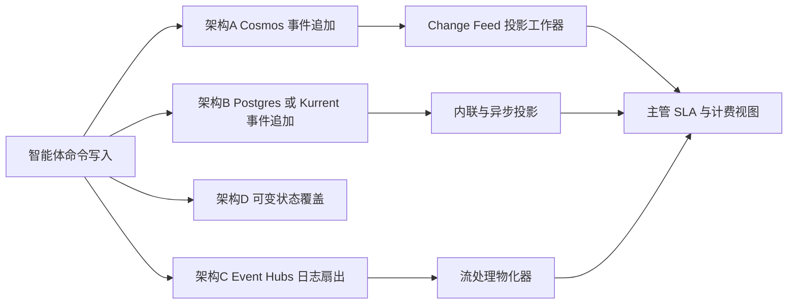
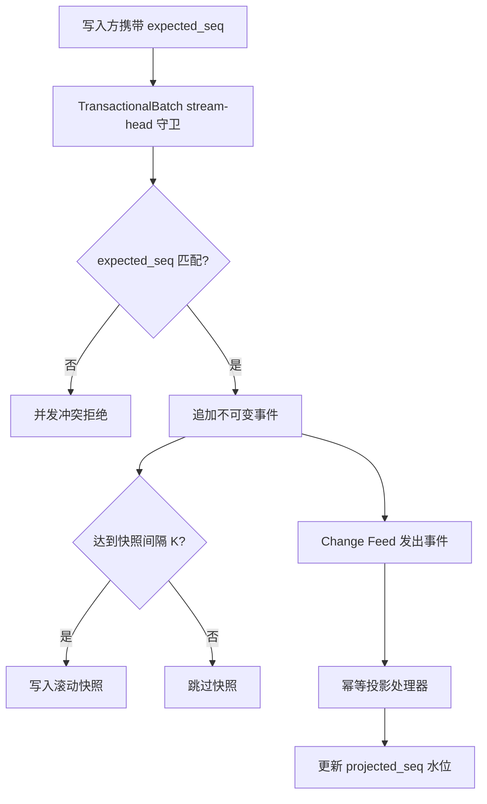
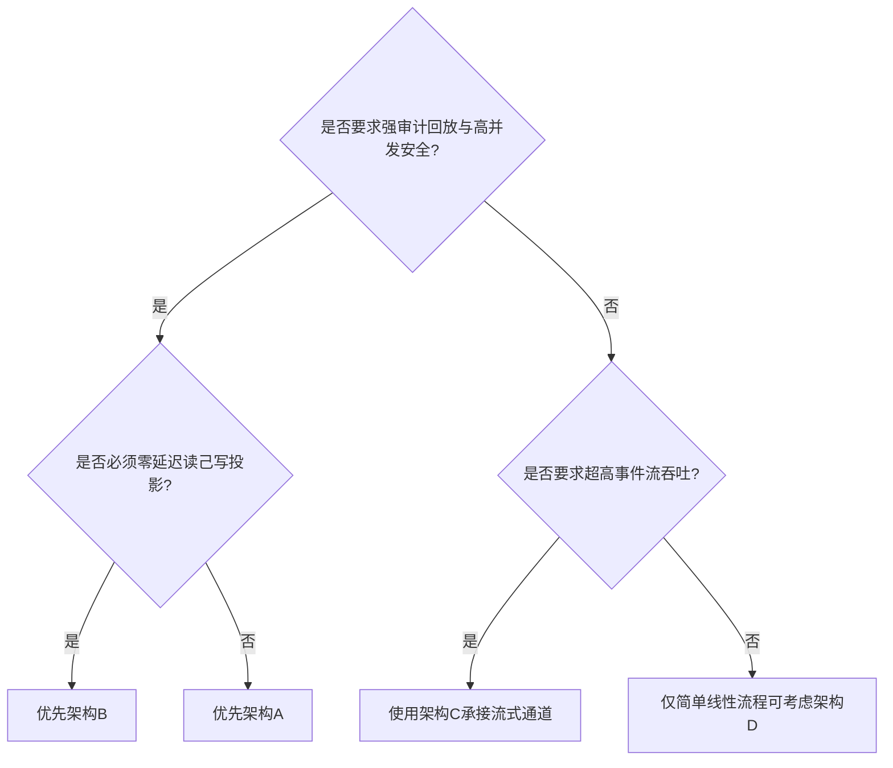

# 事件溯源 CQRS 智能体账本选型 FAQ：Cosmos Change Feed 投影 vs PostgreSQL Marten/Kurrent vs 可变状态覆盖
> **适用场景**：受监管核保、交易清结算、采购编排、临床协同等长流程多智能体业务。
> **决策压力**：在长生命周期并行运行中，消除可变状态覆盖瓶颈并保持可审计低延迟视图。
> **核心目标**：选择可扩展并发、安全回放、可控成本的命令账本与 CQRS 读模型体系。

## 1. 执行摘要
- 随着智能体运行轨迹加深，并行写入增多，可变 JSON 覆盖模型会快速失效。
- 大状态文档覆盖会引发二次方级 RU/WAL 放大和写入延迟抖动。
- 并行工具提交与人工审批会在单行乐观锁上持续碰撞。
- 主管队列、SLA、计费视图从全量状态回扫构建成本高昂。
- 事件溯源 append 流可把命令写与读视图扇出解耦。
- CQRS 投影可在不篡改真值历史前提下提供低延迟读视图。
- 架构 A 在云原生多区域 append 与投影扩散上综合最优。
- 架构 B 在 ACID 强一致与零延迟读己写上最强。
- 架构 C 在超高频事件吞吐与多消费者回放上最强。
- 架构 D 仅在低步数单写者简单流程中可接受。
- 多数企业会以 A 或 B 做命令真值，叠加 C 承接遥测流。
- 最终选型应由并发形态、审计压力、运行规模共同驱动。

## 2. 适用边界与明确非目标
- 适用于 `100+` 步、长生命周期、多写者协调的智能体流程。
- 适用于 append-only 事件账本、滚动快照与异步投影读模型。
- 适用于命令侧乐观并发控制与投影延迟水位治理。
- 适用于不重写历史的事件 schema 演进策略。
- 本文不等同于 3.5 中 LangGraph checkpoint 后端存储比较。
- 本文不等同于 3.5 中 Temporal/Durable Task 代码版本升级器议题。
- 本文不等同于 3.3 中 Azure Confidential Ledger 的 WORM 防篡改哈希链。
- 不覆盖 ERP 核心源系统的业务主数据建模。
- 不覆盖法规条文编写本身，仅覆盖架构控制手段。

## 3. 场景约束与工程物理
- 多智能体流程会持续累积上下文与中间状态，状态体积不断增长。
- 全量覆盖状态（`128KB–1.5MB`）会放大存储引擎与 RU/WAL 成本。
- 并行子智能体写入会对共享可变文档形成竞态窗口。
- 主管需要近实时队列、SLA 与审计时间线视图。
- 合规要求可重建任意时间点的决策状态与工具输出。
- 新读维度不应触发昂贵全表回填扫描。
- 成本曲线需在 `50K` 到 `25M` 月运行量下保持可控。

## 4. 四类候选架构
- **架构 A**：Cosmos append-only 事件流 + Change Feed CQRS 投影。
- **架构 B**：PostgreSQL/Kurrent ACID 事件存储 + 内联/异步投影。
- **架构 C**：Event Hubs 日志骨干 + 流处理物化读模型。
- **架构 D**：可变当前态覆盖 + 审计旁路追加表。
- A 强在云原生分区扩展与异步多读模型演进能力。
- B 强在事务语义与读己写零延迟体验。
- C 强在超高吞吐事件采集与多消费者回放经济性。
- D 上手简单但在深轨迹并发场景退化明显。

## 5. 架构 A 细节（Cosmos 事件账本 + Change Feed CQRS）
- 事件以不可变 `CreateItem` 方式追加，保持天然历史链。
- 分层分区键（`/tenantId`、`/runId`）限定写热点与读边界。
- 通过 `TransactionalBatch` + stream-head 守卫实现 `expected_seq` 栅栏。
- 滚动快照降低长轨迹回放成本。
- Change Feed 扇出按消费者类型构建专用读模型。
- 读模型可落在 Cosmos 视图、AI Search、Fabric 镜像等目的地。
- 时间点重建公式确定：`Snapshot_n + ΔEvents[n+1..m]`。
- A 适合多区域、云原生、高审计要求命令事件工作负载。

## 6. 架构 B 细节（PostgreSQL/Marten/Kurrent）
- 事件追加与内联投影可在单个 ACID 事务中完成。
- 主调用链可获得零投影延迟的读己写一致性。
- 异步投影通道可承接重型分析和跨域反范式聚合。
- `expected_version` 流锁可阻断并发分叉提交。
- SQL 生态便于临时审计查询与关系联查。
- 单主写入上限在高吞吐阶段需要分片设计。
- 故障切换表现依赖 HA 拓扑与复制模式配置。
- B 在强一致优先场景中通常是首选。

## 7. 架构 C 细节（Event Hubs 流式骨干）
- 分区日志可承载极高事件入口与多消费者回放。
- 流处理可低增量成本维护滚动物化读模型。
- 适合 token、工具调用、遥测等高频事件管线。
- 发布路径不提供每聚合 `expected_version` 级原生命令并发锁。
- 命令权威仍需上游协调器或二级命令存储兜底。
- 精确一次语义依赖幂等键与 checkpoint 纪律。
- C 在可观测与衍生分析通道价值突出。
- C 不宜单独承担命令真值账本角色。

## 8. 架构 D 细节（可变覆盖 + 审计旁路）
- 对线性、单写者、低步数流程上手最简单。
- 当前态读取可通过单文档/单行快速完成。
- 审计旁路可保留时间线，但重建命令语义不自然。
- 随运行深度增长，全量覆盖成本显著恶化。
- 并行审批与工具执行会持续放大 ETag/版本冲突。
- 新增读维度常需昂贵历史回填作业。
- 相比事件原生方案，读模型演进弹性较弱。
- D 仅建议用于低复杂、低并发的短流程。

## 9. 十二维架构对比矩阵
| 维度 | 架构 A | 架构 B | 架构 C | 架构 D |
|---|---|---|---|---|
| 主目标 | 云原生命令真值 + 异步 CQRS | ACID 命令真值 + 内联 CQRS | 超高吞吐事件分发 | 最小初始复杂度 |
| 抗写放大能力 | 最高 | 高 | 高 | 最低 |
| 并发控制强度 | 高 | 最高 | 中 | 低 |
| 读己写能力 | 中（需水位） | 最高 | 中 | 高（仅当前态） |
| 投影扩展性 | 最高 | 高 | 高 | 低 |
| 时间点回放能力 | 最高 | 最高 | 中高 | 中 |
| 多区域姿态 | 高 | 中高 | 高 | 中 |
| 运维复杂度 | 中高 | 高 | 高 | 低中 |
| 小规模成本 | 中 | 中高 | 中 | 最低 |
| 大规模成本 | 综合最低 | 中高 | 流式低成本 | 最高 |
| 审计可追溯性 | 最高 | 最高 | 高 | 中 |
| Schema 演进体验 | 高 | 高 | 中 | 低 |

## 10. 四架构拓扑总览


## 11. 命令追加、快照与投影水位时序


## 12. SA 选型决策树


### Q1. 覆盖写 RU 数学与 append + 快照最优间隔如何比较
- 全量覆盖成本会随状态体积与写频次同步增长。
- 追加小增量事件可保持近似稳定的单次写成本。
- 快照可降回放成本，但会引入周期性额外写入。
- 快照越密，回放越快；但快照成本越高。
- 快照越疏，写成本越低；但回放延迟越大。
- 近似最优点可写为 `K* = sqrt(2 * C_snap / C_event_read)`。
- 应基于真实遥测标定 `C_snap` 与 `C_event_read`。
- 事件增量粒度策略会直接决定总 RU 与回放经济性。
- 该模型可避免盲目过密或过疏快照策略。

### Q2. `expected_seq` 并发守卫如何阻断分叉提交
- 并行工具写入不应在旧版本头指针上成功提交。
- stream-head 文档记录每个运行流最新序号。
- `TransactionalBatch` 原子完成 head 更新与事件追加。
- 仅当 `expected_seq == current_seq` 才允许提交。
- 拒绝方需重读 head 后重新评估命令意图。
- 可避免并行工具/人工审批下的隐性历史分叉。
- 重试流程应绑定幂等键，避免重复业务副作用。
- 冲突率指标应反向驱动编排限流与路由策略。
- 并发栅栏是受监管回放可信性的底层前提。

### Q3. `150–800ms` 投影滞后下如何保证读己写体验
- Change Feed 投影在负载下常见 `150–800ms` 延迟。
- 命令响应可返回 `committed_seq` 与可选 session token。
- 读 API 应返回当前 `projected_seq` 水位。
- 前端可等待 `projected_seq >= committed_seq` 再展示最终态。
- 关键确认路径可回退读取命令侧事件流。
- 水位感知接口可避免主管台“写了但看不到”的误判。
- 应按投影类型持续监控延迟分位数 SLO。
- 投影 worker 必须幂等并保持可靠 checkpoint。
- 该模式在一致性与响应速度之间取得可运营平衡。

### Q4. 如何做零停机蓝绿投影重建与 schema 演进
- 不可变历史允许在不停写前提下重建新投影。
- 先并行部署 projection-v2，保持 projection-v1 对外服务。
- v2 从事件起点回放并执行确定性 upcaster。
- 达到校验阈值后再切流到 v2。
- upcaster 应对历史弱 schema 事件保持容错。
- 不应通过重写历史事件实现 schema 迁移。
- 切换窗口应维持双读/双写可观测性。
- 仅在延迟与一致性稳定后退役 v1。
- 该方法支持持续演进且不破坏审计连续性。

### Q5. 生产级 Cosmos TransactionalBatch + Change Feed 投影实现样例
- 命令追加需原子校验并持久化期望序号。
- 事件文档需包含确定性 ID 与幂等键。
- 投影处理器需基于 `projected_seq` 单调推进。
- Change Feed 重投递不得导致重复应用。
- 投影输出应持久化最后序号与处理时间戳。

```python
from azure.cosmos import CosmosClient, PartitionKey

def append_event(container, tenant_id, run_id, expected_seq, evt):
    pk = [tenant_id, run_id]
    head_id = f"head::{run_id}"
    event_id = f"evt::{run_id}::{expected_seq+1}"
    batch = container.create_transactional_batch(partition_key=pk)
    batch.read_item(item=head_id)
    batch.create_item({
        "id": event_id,
        "tenantId": tenant_id,
        "runId": run_id,
        "seq": expected_seq + 1,
        "type": evt["type"],
        "payload": evt["payload"],
        "idempotencyKey": evt["idempotencyKey"]
    })
    batch.patch_item(
        item=head_id,
        patch_operations=[{"op": "replace", "path": "/seq", "value": expected_seq + 1}],
        filter_predicate=f"from c where c.seq = {expected_seq}"
    )
    resp = batch.execute()
    return resp
```

```csharp
public async Task ApplyProjectionAsync(EventEnvelope evt, ProjectionState state, Container projectionContainer)
{
    if (evt.Seq <= state.ProjectedSeq) return;
    var item = new { id = state.ViewId, tenantId = evt.TenantId, runId = evt.RunId, projectedSeq = evt.Seq, view = state.Reduce(evt) };
    await projectionContainer.UpsertItemAsync(item, new PartitionKey(new[] { evt.TenantId, evt.RunId }));
}
```

```json
{
  "projection_watermark_contract": {
    "committed_seq": 482,
    "projected_seq": 479,
    "consistency_state": "stale_read_model",
    "recommended_action": "poll_until_projected_seq_gte_committed_seq"
  }
}
```

### Q6. `50K/1M/25M` 月运行量下三年 TCO 如何分化
- 随运行深度与并发提升，架构 TCO 差距会快速拉开。
- 覆盖写模型在高规模下会承担显著写入与回填惩罚。
- 事件账本 + CQRS 会把成本转为可预测 append 与投影通道成本。
- 评估应同时包含存储、计算、回放、运维人力与故障代价。

| 月度多步运行量 | 架构 A | 架构 B | 架构 C | 架构 D |
|---|---:|---:|---:|---:|
| 50K | \$0.90M–\$1.50M | \$1.10M–\$1.80M | \$1.00M–\$1.70M | \$0.80M–\$1.40M |
| 1M | \$6.20M–\$9.80M | \$8.00M–\$12.40M | \$7.10M–\$11.00M | \$9.50M–\$15.80M |
| 25M | \$38.00M–\$59.00M | \$52.00M–\$79.00M | \$44.00M–\$68.00M | \$81.00M–\$124.00M |

| 月度多步运行量 | append-only 事件账本对审计/回放风险的典型降低幅度 | 专用 CQRS 读模型对运维效率的典型提升幅度 |
|---|---:|---:|
| 50K | 42%–58% | 28%–45% |
| 1M | 50%–67% | 40%–58% |
| 25M | 57%–74% | 48%–66% |

- 选型应优先保证合规回放能力，再讨论写路径简化收益。
- 投影延迟 SLO 必须与命令吞吐指标联合评估。
- 财务与工程应按“每成功运行成本 + 避免事故价值”联合复盘。

## 13. Day-0 上线清单
- 定义事件分类、不可变命名规范与版本策略。
- 实现 stream-head 并发守卫与幂等键机制。
- 建立快照间隔基线与回放性能压测脚本。
- 首批构建主管队列、计费、审计时间线读模型。
- 配置投影 checkpoint 与死信恢复流程。
- 建立投影延迟指标与水位契约输出。
- 编写并发冲突重试与人工介入 runbook。
- 对齐不可变历史的保留、法律保全与审计策略。

## 14. Day-2 运维清单
- 基于真实回放/写入遥测持续调整快照间隔 `K`。
- 监控并发拒绝率与重试成功分布。
- 按读模型类别追踪投影延迟 p50/p95/p99。
- 季度演练蓝绿投影重建与切换流程。
- 审计 upcaster 对历史事件版本覆盖率。
- 在故障切换与回放中验证幂等行为正确性。
- 监控命令侧与读模型视图偏差告警。
- 按运行深度与月规模重算 TCO 与预算门限。

## 15. 适配场景与不适配场景
| 类别 | 建议 |
|---|---|
| ✅ Good fit | 受监管、长流程、多智能体并发且要求强审计回放的业务。 |
| ✅ Good fit | 需要多类低延迟主管/SLA/计费读视图的平台。 |
| ✅ Good fit | 工具与人工审批并行写冲突频繁的系统。 |
| ⛔ Not for | 低步数、单写者、无回放诉求的简单线性流程。 |
| ⛔ Not for | 无法承担投影管线运维与 schema 演进治理的团队。 |
| ⛔ Not for | 只需“最新状态缓存”且不关心时间可追溯性的场景。 |

## 16. 五步落地指南
1. 以租户和运行实例定义命令聚合流与稳定流 ID。
2. 落地 append-only 账本、乐观并发栅栏与幂等机制。
3. 引入滚动快照并用回放/写入经济学校准 `K`。
4. 构建带水位契约的 CQRS 读模型 API。
5. 建立蓝绿投影演进与持续 TCO/延迟调优闭环。

## 17. 季度治理指标包
- 追踪按事件类型拆分的单事件 RU/WAL 成本。
- 追踪按运行深度分层的覆盖写“避免成本”。
- 追踪 `expected_seq` 不匹配导致的并发拒绝率。
- 追踪幂等去重命中率与重复提交抑制效果。
- 追踪快照写入开销与回放加速收益。
- 追踪各读模型投影延迟 p50/p95/p99。
- 追踪 `projected_seq < committed_seq` 陈旧读事件。
- 追踪投影死信量与恢复时延。
- 追踪蓝绿重建期间读模型构建时长。
- 追踪 upcaster 对历史版本事件的覆盖比例。
- 追踪分区/流组命令吞吐与热点分布。
- 追踪读模型对跨分区查询依赖比例。
- 追踪主管 inbox 时延与 SLA 违规发现滞后。
- 追踪历史窗口审计回放耗时。
- 追踪事件 schema 漂移发现与修复前置期。
- 追踪故障切换回放正确率与重复副作用率。
- 追踪每成功运行成本与目标基线偏差。
- 追踪事件负载中决策链与工具证据完整率。
- 追踪事件保留与法律保全策略合规率。
- 追踪运行中止与补偿事件模式演化。
- 追踪热分区倾斜与重平衡动作频率。
- 追踪 v1/v2 投影并行期一致性偏差率。
- 追踪事件时间线可见性对 MTTR 改善贡献。
- 追踪因一致性等待触发的人工作业介入频率。
- 追踪按架构通道拆分的季度 TCO 演化曲线。
- 维护流与投影关键决策的架构决议记录。

## 18. 数据来源声明
- `anonymized_reported`：文中指标、公式与控制模式来自匿名化企业事件账本与 CQRS 项目经验，采用可复现测算假设进行归纳。
