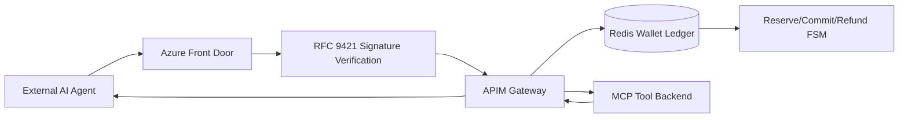
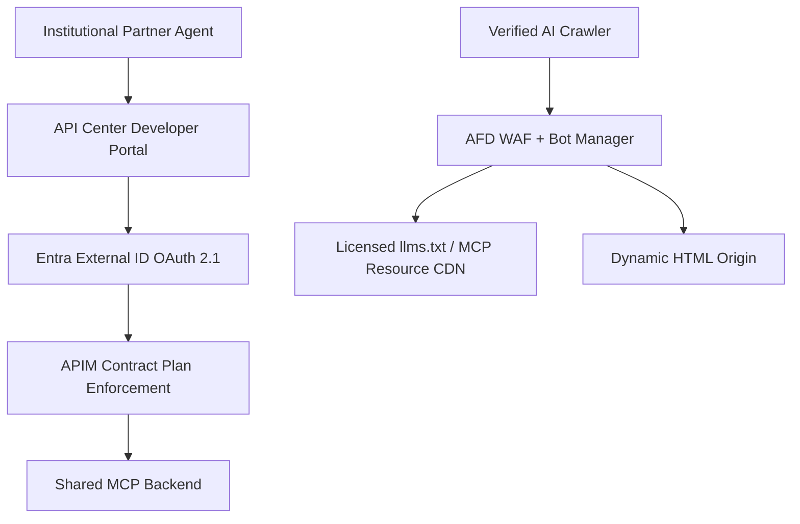

# External Paid MCP & Agentic-Web Monetization FAQ: Web Bot Auth + HTTP 402 Wallet Settlement vs API Center B2B Subscription

> **Audience**: Cloud & AI Solution Architects, external AI gateway platform owners, data-product monetization teams, security and legal governance leads.
> **Decision scope**: Stop unmonetized autonomous scraping while enabling low-latency, cryptographically verifiable, machine-payable Remote MCP access for third-party AI agents.
> **Primary objective**: Combine strong agent identity, programmable payment semantics, and edge-origin offload into a unified architecture that supports both enterprise-contract customers and long-tail autonomous callers.

---

## 1. Executive summary

External AI-agent access creates a structural tension:

- open too much and your content/services are harvested without revenue control,
- lock down too hard and you lose ecosystem adoption and partner integration velocity.

A viable architecture needs to support **both**:

1. cryptographically verified machine identity,
2. economic controls compatible with sub-dollar tool calls,
3. differentiated commercial tracks for institutional vs long-tail callers,
4. origin cost protection for high-volume crawler traffic.

This guide compares four routes:

- **Route A**: Azure Front Door signature verification (`RFC 9421 Web Bot Auth`) + APIM `HTTP 402` challenge + prepaid wallet/macaroon debit flow.
- **Route B**: Azure API Center partner portal + APIM OAuth 2.1 enterprise subscription plans and postpaid tiering.
- **Route C**: Edge traffic bifurcation for verified AI crawlers to licensed `llms.txt`/MCP resources with attribution watermarking.
- **Route D**: Synchronous per-call fiat card charging plus spoofable `robots.txt`/`User-Agent` allowlist anti-pattern.

**Recommended strategy**:

1. Route A for long-tail autonomous agents and micropayment economics.
2. Route B for enterprise institutions with contractual SLAs and legal redistribution boundaries.
3. Route C as mandatory origin-shield and licensed-content offload layer at scale.
4. Route D should be prohibited for sub-dollar call economics and reliability reasons.

---

## 2. Problem boundary and architecture constraints

### 2.1 Typical market pattern

Data providers, bureaus, catalog platforms, and publishers increasingly receive headless AI traffic.
Without machine-authenticated pricing rails, they typically face:

- high origin cost with low conversion to paid channels,
- attribution loss and redistribution ambiguity,
- legal and policy friction around unauthorized extraction.

### 2.2 Required non-functional guarantees

- predictable latency under identity + billing checks,
- no double-charge under retries/timeouts,
- no free-data leakage when client disconnects after partial execution,
- machine-readable pricing for autonomous budget-aware routing,
- auditable reconciliation between access logs and monetization events.

### 2.3 Out-of-scope

- card-acquirer implementation details,
- offline legal contracting workflow internals,
- internal-only tenant metering topics already covered by separate architectures.

---

## 3. Route definitions

### Route A — AFD signature verification + APIM 402 + prepaid wallet

Route A is optimized for high-frequency, low-ticket machine calls.
Core behavior:

1. verify bot/agent identity cryptographically at the edge,
2. expose machine-readable per-tool price and budget semantics,
3. enforce prepaid reserve/commit/refund debit flow atomically,
4. avoid synchronous payment-rail latency in request path.

Best fit:

- `$0.001-$1.00` per call tools,
- large long-tail ecosystem adoption,
- autonomous callers requiring deterministic programmatic payment behavior.

### Route B — API Center partner subscription with APIM and Entra External ID

Route B is optimized for enterprise institutions under master agreements.
Core behavior:

- onboarding through partner developer portal,
- OAuth-based federated identity and policy enforcement,
- plan/contract alignment (volume tiers, burst, SLA, legal scope),
- postpaid invoice and procurement-aligned governance.

Best fit:

- banks, insurers, regulated enterprises,
- predictable recurring traffic profiles,
- legal redistribution and audit obligations.

### Route C — Edge traffic bifurcation for licensed resources

Route C separates expensive dynamic HTML origin from licensed machine-friendly endpoints:

- verified AI crawlers are redirected to cached markdown/json/mcp-resource feeds,
- spoofed or suspicious traffic remains challenged/throttled,
- source attribution markers and canary tokens support enforcement and investigation.

Best fit:

- content-heavy sites under crawler pressure,
- organizations needing both SEO/public web and licensed AI consumption channels,
- teams targeting major origin compute reduction without total access denial.

### Route D — Synchronous card-per-call + User-Agent allowlist anti-pattern

Route D appears straightforward but fails in practice:

- fixed rail fees destroy micropayment unit economics,
- user-agent identity is trivially forgeable,
- latency tail worsens due to payment network variance,
- retry behavior often causes billing ambiguity and customer disputes.

Route D should be removed from serious production monetization designs.

---

## 4. Twelve-dimension comparison matrix

| Dimension | Route A | Route B | Route C | Route D |
|---|---|---|---|---|
| 1) Commercial model | Prepaid micropayment | Contracted postpaid | Licensed resource distribution | Per-call fiat charge |
| 2) Identity assurance | High (signature-based) | High (enterprise auth) | Medium-high | Low |
| 3) Micropayment viability | **High** | Medium | Medium | **Very low** |
| 4) Latency stability | High | High | High | Low |
| 5) Implementation complexity | Medium-high | Medium | Medium | Low |
| 6) Anti-spoof resilience | High | High | Medium-high | Low |
| 7) Long-tail ecosystem support | **High** | Medium | High | Medium |
| 8) Contract governance strength | Medium | **High** | Medium | Low |
| 9) Origin cost reduction potential | Medium | Medium | **High** | Low |
| 10) Failure compensation safety | High | Medium-high | Medium | Low |
| 11) Audit and attribution quality | High | High | High | Low |
| 12) Recommendation | **A** | A | A- (as additive layer) | Prohibited |

---

## 5. Quantitative Q1 — Why synchronous card settlement fails for sub-dollar tools

Let:

- `F_fixed` = fixed payment-rail fee per transaction,
- `r` = proportional fee rate,
- `V_topup` = wallet top-up amount,
- `P_call` = price per MCP call.

Effective fee per call:

`Fee_eff = (F_fixed + r * V_topup) / (V_topup / P_call)`

Implication:

- with `P_call = $0.005` and meaningful fixed fees, per-call direct settlement is economically non-viable.
- prepaid batching (for example `V_topup >= $25-$100`) amortizes fixed costs and restores margin.

This is the core reason Route A is preferred for autonomous low-ticket usage.

---

## 6. Quantitative Q2 — Cryptographic identity vs spoofable User-Agent controls

`User-Agent` allowlists fail because:

- headers are forgeable,
- residential proxy pools blur source identity,
- no cryptographic accountability exists between request and caller principal.

`RFC 9421`-style signature verification provides:

- key-bound request authenticity,
- replay-window validation,
- deterministic reject behavior at edge/gateway before backend spend.

Result:

- stronger abuse control,
- cleaner attribution,
- reduced false trust in superficial headers.

---

## 7. Quantitative Q3 — Two-phase wallet settlement and idempotency safety

Recommended state machine:

1. `RESERVE` funds before tool execution,
2. `EXECUTE` backend call,
3. `COMMIT` on success,
4. `RELEASE/REFUND` on failure or timeout.

With `Idempotency-Key`:

- retries do not double-debit,
- backend timeout does not silently leak unpaid data,
- disconnect scenarios become recoverable by deterministic reconciliation.

This pattern is essential for reliable machine-to-machine monetization.

---

## 8. Quantitative Q4 — Machine-readable pricing and budget controls

Expose pricing in both protocol and HTTP surfaces:

- `tools/list` metadata (for example `_meta.pricing.amount_micros`, billing unit, policy hints),
- `HTTP 402` structured problem payload with top-up/budget semantics.

Agent-side benefit:

- autonomous budget checks,
- route fallback selection,
- user approval triggers only when required.

Provider-side benefit:

- fewer ambiguous failures,
- clearer client behavior under insufficient balance,
- improved conversion from free probe traffic to paid use.

---

## 9. Quantitative Q5 — Origin cost offload via Route C

Definitions:

- `T_bot` = headless/agent crawler share of incoming traffic,
- `C_origin` = dynamic SSR+DB monthly cost baseline,
- `C_edge` = licensed feed CDN/edge cost.

Approximate blended cost:

`C_new = C_origin * (1 - T_offload) + C_edge`

Example (illustrative):

- dynamic origin baseline: `$18k/mo`,
- licensed feed edge path: `$0.9k/mo`,
- if `65%` crawler-equivalent load offloads to cached feeds, origin spend drops substantially.

Route C should be treated as a core economic control layer, not only a security filter.

---

## 10. Quantitative Q6 — Coexistence model for Route A and Route B

A practical coexistence pattern:

- same MCP backend service,
- differentiated ingress policy by principal class,
- institutional identities routed to Route B contract plans,
- long-tail autonomous identities routed to Route A prepaid flow.

Benefits:

- one backend operational plane,
- dual commercial tracks without duplicate business logic,
- consolidated observability and reconciliation.

---

## 11. Reference architecture diagram A — Route A prepaid micropayment flow



---

## 12. Reference architecture diagram B — Route B contracts + Route C edge bifurcation



---

## 13. Production snippet A — APIM 402 challenge with machine-readable price signal

```xml
<policies>
  <inbound>
    <base />
    <set-variable name="priceMicros" value="5000" />
    <set-variable name="walletBalance" value="@(context.Variables.GetValueOrDefault<int>(\"wallet\", 0))" />

    <choose>
      <when condition="@(context.Variables.GetValueOrDefault<int>(\"walletBalance\",0) < context.Variables.GetValueOrDefault<int>(\"priceMicros\",0))">
        <return-response>
          <set-status code="402" reason="Payment Required" />
          <set-header name="X-MCP-Price-Micros" exists-action="override">
            <value>@(context.Variables["priceMicros"].ToString())</value>
          </set-header>
          <set-body>{\"type\":\"https://mcp.example/errors/insufficient-credit\",\"title\":\"Top-up required\"}</set-body>
        </return-response>
      </when>
    </choose>
  </inbound>
  <backend><base /></backend>
  <outbound><base /></outbound>
  <on-error><base /></on-error>
</policies>
```

Operational note:

- emit deterministic challenge format so autonomous clients can react without brittle parsing.

---

## 14. Production snippet B — Redis Lua reserve/commit/refund settlement primitive

```lua
-- reserve_commit_refund.lua
-- KEYS[1]=wallet_key, KEYS[2]=idem_key
-- ARGV[1]=op(reserve|commit|refund), ARGV[2]=amount, ARGV[3]=ttl

local op = ARGV[1]
local amount = tonumber(ARGV[2])
local ttl = tonumber(ARGV[3])

if op == "reserve" then
  if redis.call("EXISTS", KEYS[2]) == 1 then
    return "IDEMPOTENT"
  end
  local bal = tonumber(redis.call("GET", KEYS[1]) or "0")
  if bal < amount then
    return "INSUFFICIENT"
  end
  redis.call("DECRBY", KEYS[1], amount)
  redis.call("SETEX", KEYS[2], ttl, "RESERVED:" .. amount)
  return "RESERVED"
elseif op == "commit" then
  if redis.call("EXISTS", KEYS[2]) == 0 then
    return "MISSING_RESERVE"
  end
  redis.call("SETEX", KEYS[2], ttl, "COMMITTED:" .. amount)
  return "COMMITTED"
elseif op == "refund" then
  redis.call("INCRBY", KEYS[1], amount)
  redis.call("SETEX", KEYS[2], ttl, "REFUNDED:" .. amount)
  return "REFUNDED"
end

return "INVALID_OP"
```

Operational note:

- pair with idempotency keys and reconciliation jobs to guarantee financial correctness under retries and gateway failures.

---

## 15. Enterprise scenario A — Global credit-risk and corporate-registry bureau

Profile:

- Tier-1 banks consume high-volume contracted APIs with strict legal scope,
- long-tail AI procurement and due-diligence agents issue bursty micropayment calls,
- monetization must preserve anti-abuse controls and attribution integrity.

Recommended architecture:

- Route B for contracted institutions,
- Route A for long-tail autonomous demand,
- Route C to reduce crawler-origin spend and expose licensed machine feeds.

Expected outcome:

- stronger revenue capture,
- less unauthorized extraction,
- consistent backend operation with differentiated ingress contracts.

---

## 16. Enterprise scenario B — Technical standards and B2B research publisher

Profile:

- heavy headless-browser scraping pressure on dynamic content pages,
- need to enable licensed grounding for AI assistants,
- requirement for watermark-backed attribution and legal redistribution controls.

Recommended architecture:

- Route C edge bifurcation as default for crawler classes,
- Route A/B dual track for paid MCP access by caller type,
- periodic legal and telemetry review on attribution-watermark traces.

Expected outcome:

- reduced origin infrastructure burn,
- improved licensing compliance,
- clearer evidence in dispute resolution and policy enforcement.

---

## 17. Three-year TCO comparison (illustrative, synthetic, USD)

| Option | Year 1 | Year 2 | Year 3 | 3-Year Total | Notes |
|---|---:|---:|---:|---:|---|
| Route A | 1,680,000 | 1,730,000 | 1,790,000 | 5,200,000 | Strong micropayment economics and long-tail fit |
| Route B | 1,820,000 | 1,900,000 | 1,980,000 | 5,700,000 | High contract governance and institutional control |
| Route C | 1,420,000 | 1,500,000 | 1,580,000 | 4,500,000 | Major origin offload when crawler share is high |
| Route D | 2,250,000 | 2,400,000 | 2,560,000 | 7,210,000 | Worst blend of economics and operational risk |

Interpretation:

- Route A and Route B are monetization core tracks,
- Route C is an additive economic and security amplifier,
- Route D is not viable for scalable agentic-web ecosystems.

---

## 18. Day-0 / Day-1 / Day-2 rollout checklist

### Day-0 (design baseline)

- define tool-level pricing tiers and budget constraints,
- define signature-directory and key-rotation governance,
- define wallet consistency and compensation requirements,
- classify principal classes (institutional vs long-tail autonomous).

### Day-1 (go-live controls)

- deploy edge signature verification and APIM 402 challenge path,
- deploy atomic wallet settlement script with idempotency key handling,
- enable dual commercial ingress routes to shared MCP backend,
- validate failure drills for retry, timeout, and disconnect cases.

### Day-2 (operational excellence)

- weekly review of reserve/commit/refund anomaly ratios,
- monthly reconciliation audit between call logs and billing ledger,
- quarterly optimization of price tiers, quota thresholds, and abuse controls.

---

## 19. Data provenance and reproducibility labels

All quantitative values in this guide should be tagged as:

- **measured**: observed from production telemetry or controlled validation.
- **synthetic**: assumption-driven scenario modeling values.
- **anonymized_reported**: aggregated anonymized cross-team field reports.

Formal architecture-review packs should include:

1. sampling windows,
2. metric definitions and denominators,
3. outlier handling rules,
4. reproducible query IDs or scripts.

---

## 20. Final recommendation

Sustainable external AI-data monetization is not solved by naive openness or static blocking.
It requires a layered architecture:

- **Route A** for programmable long-tail micropayment access,
- **Route B** for institutional contractual governance,
- **Route C** for edge offload, licensed feed delivery, and attribution control,
- strict rejection of **Route D** anti-pattern economics.

In practice, use **A + B as monetization backbone**, with **C as mandatory edge and origin-efficiency layer**, all under unified audit and policy controls.
