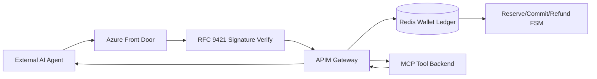
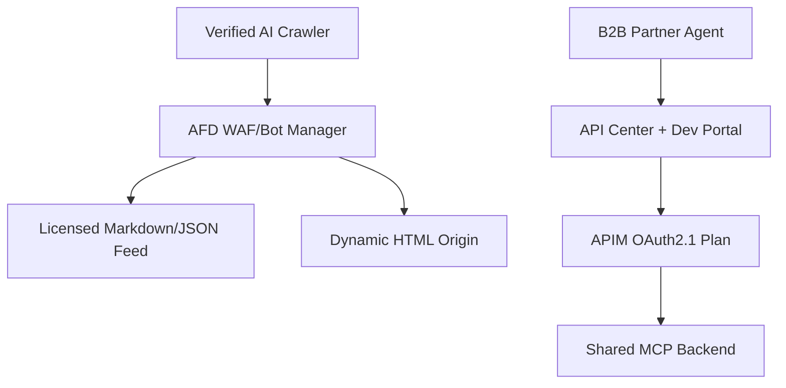

# 外部付费 MCP 与 Agentic Web 变现选型 FAQ：Web Bot Auth + HTTP 402 钱包计费 vs API Center 企业订阅

> **面向角色**：Cloud & AI Solution Architect、AI Gateway 平台负责人、外部数据产品商业化团队、网络安全与法务合规团队。
> **问题定义**：在开放互联网场景中，既要阻断免费爬虫式智能体抓取，又要为外部 AI 代理提供低延迟、可验证身份、可机器支付的 MCP 工具访问。
> **核心目标**：以加密身份验证 + 原子结算 + 分层商业模式，实现“可控开放、可计费调用、可追溯归因”的公共/伙伴化 Agent 网关。

---

## 1. 执行摘要

外部智能体访问企业数据接口，常见两难是：

- 过度开放会被无授权抓取；
- 过度封闭又失去生态流量与商业化机会。

本篇给出四条路线：

- **Route A**：AFD + RFC 9421 Web Bot Auth + APIM `HTTP 402` + 预付钱包（Micropayment）。
- **Route B**：API Center + APIM + Entra External ID 的企业合约订阅（Postpaid）。
- **Route C**：边缘流量分流，HTML 重源站转向 `llms.txt/MCP Resource` 许可内容分发。
- **Route D**：同步逐次刷卡 + `robots.txt/User-Agent` 白名单反模式。

**推荐结论**：

1. 长尾外部代理调用优先 Route A；
2. 机构客户与 SLA 合约优先 Route B；
3. 大规模爬虫流量治理必须叠加 Route C；
4. Route D 在亚美元工具单价场景下经济上不可持续。

---

## 2. 问题边界与平台约束

### 2.1 典型业务诉求

- 信用/工商/标准数据提供商向外部 AI 代理开放查询；
- 内容出版机构希望授权 AI grounding，而非无偿 HTML 抓取；
- 既要支持 Tier-1 银行等大客户，也要服务大量长尾代理调用者。

### 2.2 关键 SLO 与治理要求

- 网关鉴权与计费附加时延可控；
- 失败重试不重复扣费；
- 调用价格和预算上限可机器可读；
- 对伪造身份与代理池绕过有可落地防护。

### 2.3 非目标

- 不讨论线下人工销售合同流程；
- 不覆盖银行卡收单系统深度实现；
- 不替代企业内部租户分账方案。

---

## 3. 四条路线定义

### Route A — Web Bot Auth + HTTP 402 + 预付钱包

核心机制：

- AFD/APIM 验证 `RFC 9421` 签名头；
- 无余额时返回 `HTTP 402 Payment Required` 结构化挑战；
- 代理异步充值预付钱包，调用时微额原子扣减；
- 通过 `RESERVE -> EXECUTE -> COMMIT/RELEASE` 防双扣与漏扣。

适配：

- `$0.001-$1.00`/次的高频工具调用；
- 长尾代理生态；
- 对即时可编程支付体验要求高。

### Route B — API Center + 企业订阅合约

核心机制：

- 通过 API Center 门户发布 MCP 工具目录；
- Entra External ID + OAuth 2.1 做机构级身份与授权；
- APIM 执行套餐、配额、突发、SLA 和后付费结算。

适配：

- B2B 合同客户；
- 稳定月度用量；
- 对法律条款、再分发边界、审计要求高的场景。

### Route C — Edge 分流与许可内容源站卸载

核心机制：

- AFD WAF/Bot Manager 在边缘分流；
- 验证通过的 AI crawler 导向 `llms.txt`/MCP 资源端点；
- 对动态 HTML/SQL 重页面做 origin shield；
- 通过隐形归因水印追踪内容再分发链路。

适配：

- 高爬虫压力网站；
- 内容授权型业务；
- 希望显著降低源站成本。

### Route D — 同步刷卡逐次结算 + UA 白名单反模式

问题：

- 每次交易固定通道费高，吞噬微额调用利润；
- `User-Agent` 可伪造，无法可靠识别真实代理身份；
- 高并发下支付链路抖动显著放大调用尾延迟。

结论：不适合 Agentic Web 的机器对机器微支付经济模型。

---

## 4. 12 维度对比矩阵

| 维度 | Route A | Route B | Route C | Route D |
|---|---|---|---|---|
| 1) 商业模式 | 预付微支付 | 企业后付费 | 许可内容分发 | 逐次刷卡 |
| 2) 身份可靠性 | 高（签名验证） | 高（企业身份） | 中高 | 低 |
| 3) 微额经济性 | **高** | 中 | 中 | **极低** |
| 4) 延迟稳定性 | 高 | 高 | 高 | 低 |
| 5) 实施复杂度 | 中高 | 中 | 中 | 低 |
| 6) 抗伪造能力 | 高 | 高 | 中高 | 低 |
| 7) 长尾覆盖 | **高** | 中 | 高 | 中 |
| 8) 合同治理能力 | 中 | **高** | 中 | 低 |
| 9) 成本优化潜力 | 高 | 中 | **高** | 低 |
| 10) 失败补偿能力 | 高 | 中高 | 中 | 低 |
| 11) 生态开放性 | 高 | 中 | 高 | 低 |
| 12) 推荐等级 | **A** | A | A-（与 A/B 叠加） | 禁用 |

---

## 5. 定量 Q&A（Q1）

### Q1：为什么微额工具调用不适合同步逐次刷卡？

设：

- `F_fixed`：固定通道费；
- `r`：比例费率；
- `V_topup`：充值金额；
- `P_call`：单次工具价格。

有效单次费率近似：

`Fee_eff = (F_fixed + r * V_topup) / (V_topup / P_call)`

当 `P_call = $0.005`、`F_fixed = $0.30` 时，逐次刷卡会导致费率远超调用本身价值。
因此需采用 Route A 的批量充值 + 钱包扣费。

---

## 6. 定量 Q&A（Q2）

### Q2：RFC 9421 签名验证相比 UA 白名单的增益是什么？

UA 白名单问题：

- 头字段可伪造；
- 共享代理出口导致身份混淆；
- 缺乏可追责密钥绑定。

签名验证优势：

- 请求与私钥绑定；
- 可做重放保护与时间窗校验；
- 可在边缘直接拒绝未签名或签名无效请求。

结果：Route A/C 可显著降低“伪装合法机器人”的成功率。

---

## 7. 定量 Q&A（Q3）

### Q3：如何避免超时重试导致双扣或漏扣？

推荐两阶段状态机：

1. `RESERVE`：预留额度；
2. `EXECUTE`：调用后端工具；
3. `COMMIT`：成功确认扣费；
4. `RELEASE/REFUND`：失败释放。

配合 `Idempotency-Key`：

- 同键重复请求不会重复扣费；
- 客户端断连也不会白给数据；
- 超时重试可安全恢复。

---

## 8. 定量 Q&A（Q4）

### Q4：机器如何理解价格与预算边界？

建议在工具元数据中公开：

- `_meta.pricing.unit`、`_meta.pricing.amount_micros`；
- 预算上限与扣费粒度；
- 超限返回 `HTTP 402` 结构化问题体（可重试、可充值、可降级）。

这样调用代理可自动做：

- 预算判断；
- 路由替代；
- 用户确认升级。

---

## 9. 定量 Q&A（Q5）

### Q5：Route C 对源站成本节省如何估算？

设：

- `T_bot`：机器人流量占比；
- `C_origin`：动态源站月成本；
- `C_edge`：许可内容 CDN 月成本；

若将 `T_bot` 大比例导向缓存端点，则总成本近似：

`C_new = C_origin * (1 - T_bot_offload) + C_edge`

示例（synthetic）：

- 原始动态源站 `$18k/mo`；
- 分流后缓存成本 `$0.9k/mo`；
- 若 `65%` 机器人流量成功卸载，总成本显著下降。

---

## 10. 定量 Q&A（Q6）

### Q6：Route A 与 Route B 如何共存而不割裂？

共存策略：

- 同一 MCP 后端，前置双入口策略；
- 机构客户命中 Route B（合约身份 + 套餐策略）；
- 长尾代理命中 Route A（签名 + 钱包）；
- 最终统一归一到同一调用审计与后端服务治理。

收益：

- 不需要维护两套后端；
- 商业模式分层清晰；
- 对外开放与企业合同可同时成立。

---

## 11. 参考架构图（一）：Route A 微支付调用路径



---

## 12. 参考架构图（二）：Route B + C 机构订阅与内容分流



---

## 13. 生产代码片段（一）：APIM `402` 挑战与定价头（示例）

```xml
<policies>
  <inbound>
    <base />
    <set-variable name="priceMicros" value="5000" />
    <set-variable name="walletBalance" value="@(context.Variables.GetValueOrDefault<int>(\"wallet\", 0))" />

    <choose>
      <when condition="@(context.Variables.GetValueOrDefault<int>(\"walletBalance\",0) < context.Variables.GetValueOrDefault<int>(\"priceMicros\",0))">
        <return-response>
          <set-status code="402" reason="Payment Required" />
          <set-header name="X-MCP-Price-Micros" exists-action="override">
            <value>@(context.Variables["priceMicros"].ToString())</value>
          </set-header>
          <set-body>{\"type\":\"https://mcp.example/errors/insufficient-credit\",\"title\":\"Top-up required\"}</set-body>
        </return-response>
      </when>
    </choose>
  </inbound>
  <backend><base /></backend>
  <outbound><base /></outbound>
  <on-error><base /></on-error>
</policies>
```

---

## 14. 生产代码片段（二）：Redis Lua 两阶段结算（示例）

```lua
-- reserve_commit_refund.lua
-- KEYS[1]=wallet_key, KEYS[2]=idem_key
-- ARGV[1]=op(reserve|commit|refund), ARGV[2]=amount, ARGV[3]=ttl

local op = ARGV[1]
local amount = tonumber(ARGV[2])
local ttl = tonumber(ARGV[3])

if op == "reserve" then
  if redis.call("EXISTS", KEYS[2]) == 1 then
    return "IDEMPOTENT"
  end
  local bal = tonumber(redis.call("GET", KEYS[1]) or "0")
  if bal < amount then
    return "INSUFFICIENT"
  end
  redis.call("DECRBY", KEYS[1], amount)
  redis.call("SETEX", KEYS[2], ttl, "RESERVED:" .. amount)
  return "RESERVED"
elseif op == "commit" then
  if redis.call("EXISTS", KEYS[2]) == 0 then
    return "MISSING_RESERVE"
  end
  redis.call("SETEX", KEYS[2], ttl, "COMMITTED:" .. amount)
  return "COMMITTED"
elseif op == "refund" then
  redis.call("INCRBY", KEYS[1], amount)
  redis.call("SETEX", KEYS[2], ttl, "REFUNDED:" .. amount)
  return "REFUNDED"
end

return "INVALID_OP"
```

---

## 15. 企业场景 A：全球征信与企业注册数据服务商

业务特征：

- Tier-1 银行走合约采购；
- `15,000+` 长尾采购代理走按次调用；
- 查询价格多为亚美元。

建议：

- 机构客户：Route B；
- 长尾代理：Route A；
- 网页 grounding 与公开摘要：Route C。

---

## 16. 企业场景 B：技术标准与 B2B 研究出版机构

业务特征：

- 被大量 headless 浏览器抓取；
- 需要授权 AI 摘要与引用；
- 希望保留来源归因与商用边界。

建议：

- 边缘层启用 Route C 分流；
- MCP 工具调用采用 Route A/B 双轨并行；
- 对高价值内容注入可追溯水印标识。

---

## 17. 三年 TCO（示例，USD，synthetic）

| 方案 | Year 1 | Year 2 | Year 3 | 3-Year Total | 说明 |
|---|---:|---:|---:|---:|---|
| Route A | 1,680,000 | 1,730,000 | 1,790,000 | 5,200,000 | 微支付友好、长尾覆盖强 |
| Route B | 1,820,000 | 1,900,000 | 1,980,000 | 5,700,000 | 合约治理强、机构稳定 |
| Route C | 1,420,000 | 1,500,000 | 1,580,000 | 4,500,000 | 源站卸载收益显著（需与 A/B 叠加） |
| Route D | 2,250,000 | 2,400,000 | 2,560,000 | 7,210,000 | 费率与风险双高 |

---

## 18. Day-0 / Day-1 / Day-2 清单

### Day-0（设计）

- 定义工具定价模型与预算上限；
- 明确签名身份目录与密钥轮换策略；
- 确定钱包账本一致性与补偿规则。

### Day-1（上线）

- 部署 AFD 签名验证与 APIM 402 挑战；
- 启用 Redis 原子结算脚本与幂等键；
- 建立机构订阅与长尾微支付双路路由。

### Day-2（运营）

- 周度分析失败重试与退款比率；
- 月度审计来源归因和再分发合规；
- 季度优化价格、套餐与风控阈值。

---

## 19. 数据标签与可复现性

本篇数据采用：

- **measured**：真实监控或受控验证；
- **synthetic**：架构推导示例；
- **anonymized_reported**：脱敏汇总口径。

建议审计包附带：

1. 采样窗口；
2. 指标定义；
3. 异常剔除规则；
4. 查询或脚本定位。

---

## 20. 外部代理风控与法务边界补充

在真实商业化运行中，技术可行并不等于可长期经营，建议补充以下治理边界：

### 20.1 授权边界声明

- 在 MCP `tools/list` 与开发者门户中同时声明“可调用范围、可再分发范围、禁止用途”；
- 对高价值字段（如信用评分、未公开价格、受限条款）定义分级许可；
- 对“模型训练用途”与“实时检索用途”做显式区分，避免默认授权外溢。

### 20.2 争议处理证据链

- 每次计费调用都输出可追溯账单事件：请求签名摘要、价格版本、钱包流水号、后端响应摘要；
- 对 `402 -> 充值 -> 重放` 链路保留完整关联 ID，支持财务与法务联合复核；
- 对可疑调用触发“只读降级模式”，避免争议期间继续扩大风险面。

### 20.3 反滥用分层策略

- L0：边缘签名校验与速率限制（防脚本洪泛）；
- L1：行为风险评分（短时高频、异常地理、异常工具组合）；
- L2：业务语义风控（可疑批量导出、异常字段枚举、越权组合调用）；
- L3：人工复核与临时冻结（账户/密钥/组织级别）。

### 20.4 价格治理与变更管理

- 工具价格版本化（`price_version`），支持灰度发布与回滚；
- 变更前发送机器可读公告（生效时间、影响工具、兼容窗口）；
- 允许调用方设置“最高单次成本阈值”，超限自动拒绝并回退替代工具。

### 20.5 跨组织合规协同

- 对 Route B 合约客户，建立季度“调用审计 + 权限复核 + 再分发核查”；
- 对 Route A 长尾调用，建立自动化异常检测与黑白名单更新机制；
- 对 Route C 内容分发，持续轮换不可见归因标记并监控异常泄露渠道。

### 20.6 运营指标看板建议

- 收入侧：每工具 `ARPC`、钱包充值转化率、402 挑战转支付率；
- 风险侧：签名失败率、重放拦截率、异常退款率、高风险账户留存；
- 成本侧：源站命中下降率、CDN 命中率、单位调用边际成本；
- 体验侧：402 到成功调用的中位耗时、调用失败重试收敛时间、机构客户工单率。

建议将上述指标分为“日常运营阈值”与“事件响应阈值”两套门限，并对跨月异常波动设置自动告警与人工复核并行机制，形成季度治理闭环与责任追踪机制并持续演练。

这些补充项能把“技术可调用”升级为“商业可持续、法务可落地、审计可闭环”的生产体系。

---

## 21. 结论

对外开放 AI 数据服务的可持续路径，不是“完全开放”或“完全封闭”的二选一，
而是基于加密身份、机器可读计费、边缘分流与分层商业模型的组合治理：

- Route A 解决长尾微支付可行性；
- Route B 承载机构合约商业化；
- Route C 降低源站成本并强化授权分发；
- Route D 应作为反模式退出生产架构。

建议企业以 A + B 为商业主轴、以 C 为成本与防抓取增强层，形成统一可审计的外部 MCP 变现平台。
