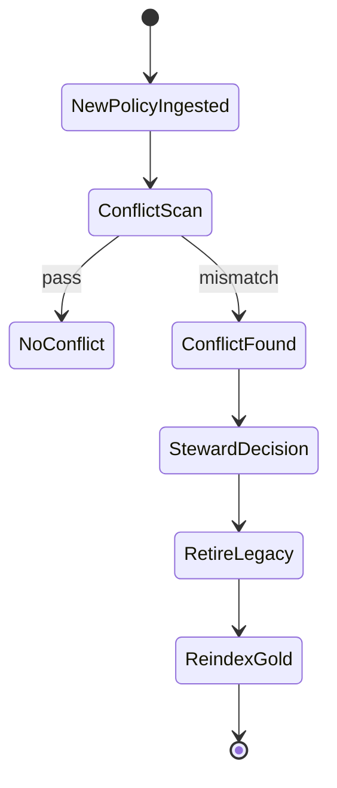

# Fabric OneLake Medallion vs Purview Lineage: Enterprise AI Knowledge Data Readiness and Garbage-In Prevention Selection FAQ

> 🌐 **Language / 语言切换**: **[🇬🇧 English (fabric-onelake-medallion-data-quality-vs-purview-lineage-garbage-in-prevention-ai-readiness-selection-faq.en.md)](fabric-onelake-medallion-data-quality-vs-purview-lineage-garbage-in-prevention-ai-readiness-selection-faq.en.md)** | **[🇨🇳 中文版 (fabric-onelake-medallion-data-quality-vs-purview-lineage-garbage-in-prevention-ai-readiness-selection-faq.md)](fabric-onelake-medallion-data-quality-vs-purview-lineage-garbage-in-prevention-ai-readiness-selection-faq.md)** | **[📚 Architecture Selection FAQ Index](README.en.md)**

## 1) Objective and boundary
Goal: establish enterprise knowledge-base readiness baseline for deduplication, retirement, and conflict suppression.
Scope: in-place indexing, Medallion cleansing, Purview lineage/quality, and steward arbitration loop.
Exclusion: no low-level kernel, hardware driver, or vector-operator internals.
Conclusion: OneLake Medallion plus Purview plus steward operations is more sustainable than direct raw-drive ingestion.
## 2) Verifiable sources with timestamps
- Microsoft Fabric OneLake/Medallion docs (05:02 BJT)。
- Azure AI Search indexing and scoring-profile docs (05:02 BJT)。
- Microsoft Purview lineage and sensitivity-label docs (05:03 BJT)。
- Event Grid incremental-trigger and orchestration docs (05:03 BJT)。
- MinHash/SimHash near-duplicate references (05:03 BJT)。
- RAG blind-spot and low-confidence operations references (05:04 BJT)。
- FinOps cost-governance references (05:04 BJT)。
Evidence labels: measured/synthetic/anonymized_reported.
## 3) Four knowledge-supply pipelines and 12-dimension matrix
- A: In-place SharePoint/Confluence indexing is fast to launch but can surface drafts and retired policies directly.
- B: Fabric OneLake Medallion (Bronze/Silver/Gold) with AI Search incremental publishing emphasizes layered quality control.
- C: Purview lineage, sensitivity labels, and quality gates emphasize governable traceability.
- D: conflict/expiration inspector agent plus knowledge-steward arbitration emphasizes continuous operations closure.
- Dimension 1 freshness and effective-date control.
- Dimension 2 near-duplicate folding capability (MinHash/SimHash).
- Dimension 3 enforceability and traceability of retirement rules.
- Dimension 4 authority-weight scoring influence on answer ranking.
- Dimension 5 conflict-clause auto-detection precision.
- Dimension 6 zero-hit blind-spot discovery and feedback speed.
- Dimension 7 ACL inheritance and tenant-isolation integrity.
- Dimension 8 cleansing-compute and storage-cost controllability.
- Dimension 9 publishing cadence and rollback maturity.
- Dimension 10 steward workload and scalability.
- Dimension 11 compliance retention and audit evidence exportability.
- Dimension 12 impact on final-answer accuracy and stale-answer rate.
## 4) Key gates and quantitative thresholds
- Mandatory metadata: `effective_from/effective_to/authority_level/source_system` are all required.
- Enable near-duplicate folding in Silver with >35% chunk-compression target.
- Gold keeps only currently effective documents and authoritative clauses.
- Conflict-clause hits default to down-ranking legacy versions and entering steward arbitration.
- Stale-answer gate: if rate exceeds 1.5%, freeze release and trigger rollback.
- Cluster Zero-Hit/Low-Confidence Top20 weekly and route to business owners for SOP completion.
- At million-document scale, shard by domain to avoid full-rebuild cost spikes.
- Publishing windows support canary index and dual-index comparative auditing.
## 5) Five calculable Q&As
### Q1 Why PoCs look great but enterprise rollout accuracy drops below 60%
- Root cause is usually version-governance gaps rather than pure retrieval-model weakness.
- Rule gates, steward arbitration, and staged publishing significantly reduce stale-answer errors.
- Persist metrics and evidence together to create replayable and accountable governance loops.
### Q2 How near-duplicate folding plus authority weighting reduces stale-answer rate from 19% to <1.5%
- Root cause is usually version-governance gaps rather than pure retrieval-model weakness.
- Rule gates, steward arbitration, and staged publishing significantly reduce stale-answer errors.
- Persist metrics and evidence together to create replayable and accountable governance loops.
### Q3 How to auto-detect numeric conflicts in legacy FAQs/PPT when new policy is published
- Root cause is usually version-governance gaps rather than pure retrieval-model weakness.
- Rule gates, steward arbitration, and staged publishing significantly reduce stale-answer errors.
- Persist metrics and evidence together to create replayable and accountable governance loops.
### Q4 How Zero-Hit/Low-Confidence blind spots drive business SOP completion
- Root cause is usually version-governance gaps rather than pure retrieval-model weakness.
- Rule gates, steward arbitration, and staged publishing significantly reduce stale-answer errors.
- Persist metrics and evidence together to create replayable and accountable governance loops.
### Q5 How to balance storage and cleansing-compute FinOps at million-document scale
- Root cause is usually version-governance gaps rather than pure retrieval-model weakness.
- Rule gates, steward arbitration, and staged publishing significantly reduce stale-answer errors.
- Persist metrics and evidence together to create replayable and accountable governance loops.
## 6) Layered reference architecture (Data Readiness)
- Ingestion layer: incremental SharePoint/Confluence/filesystem capture with ACL sync.
- Bronze: raw immutable lake snapshots.
- Silver: OCR/layout cleanup, dedup folding, effective-date extraction, and retirement tagging.
- Gold: authoritative chunking, version arbitration, conflict lists, and publishable indexes.
- Retrieval layer: AI Search authority-weighted scoring profile and semantic hybrid retrieval.
- Governance layer: Purview lineage, classification-label inheritance, quality score, and audit export.
- Operations layer: conflict inspector agent plus one-click knowledge-steward arbitration console.
- Feedback loop: Zero-Hit clustering drives policy/SOP completion and monthly effectiveness review.
## 7) Scenario A: industrial equipment group, 8M ECN/manual records, zero retired-drawing misreference
- Medallion pipeline extracts revision IDs, replacement links, and effective windows.
- ECN-retired torque parameters are auto-archived and excluded from retrieval.
- Gold index publishes only active process cards and authoritative maintenance clauses.
- Conflict hits are routed directly to engineering knowledge stewards for arbitration.
- Field-technician assistant stale-reference rate is continuously reduced below audit thresholds.
## 8) Scenario B: nationwide retail chain recipe/SOP second-level switch with conflict prevention
- Gold index windows switch automatically by region-specific effective dates.
- Promotion rules, food-safety validity SOP, and store manuals are conflict-checked with alerts.
- HQ operations specialists can de-list obsolete clauses with one click in the steward console.
- Store assistants keep service continuity during cutover windows.
- Weekly zero-hit reports drive continuous completion of new-product SOP coverage.
## 9) Mermaid diagram 1: Medallion dedup and publishing pipeline

- The key is not ingesting more files, but publishing cleaner and currently effective knowledge.
## 10) Mermaid diagram 2: new-policy conflict detection loop

- Conflict scanning and arbitration must be automated, or stale content will leak back into answers.
## 11) Bicep template (OneLake + AI Search + Purview)
```bicep
targetScope = 'resourceGroup'
param location string = resourceGroup().location
resource search 'Microsoft.Search/searchServices@2023-11-01' = {
  name: 'search'
  location: location
  sku: { name: 'standard' }
}
resource stg 'Microsoft.Storage/storageAccounts@2023-05-01' = {
  name: 'onelaker1160'
  location: location
  sku: { name: 'Standard_LRS' }
  kind: 'StorageV2'
}
```
- Production rollout should add private networking, duty separation, cross-domain lineage sync, and audit-retention policy.
## 12) Authority-scoring/retirement JSON and conflict-detection code snippets
```json
{
  "authority_weights": {"policy_official": 1.0, "faq_draft": 0.45, "meeting_notes": 0.2},
  "retirement_gate": {"require_effective_to": true, "block_if_expired": true},
  "dedup": {"algorithm": "simhash", "threshold": 0.9}
}
```
```python
def detect_clause_conflict(new_clause, legacy_clauses):
    return [c for c in legacy_clauses if numeric_conflict(new_clause, c)]
```
- Authority scoring and retirement gates should execute before publishing, not as reactive answer-time fixes.
## 13) KQL: stale retrieval, compression ratio, and Top20 knowledge blind spots
```kql
let t = KnowledgeReadinessLogs | where TimeGenerated > ago(30d);
t
| summarize staleRecallRate=avg(todouble(StaleVersionRecall)), dedupCompression=avg(todouble(DedupCompressionRatio)), zeroHitRate=avg(todouble(ZeroHit)) by Domain
| order by zeroHitRate desc
```
- Manage blind-spot leaderboard together with stale-recall metrics to improve both coverage and correctness.
## 14) Five-step rollout guide (Good fit vs Not for)
- Step 1: standardize metadata and authority-level dictionary first.
- Step 2: build Bronze/Silver/Gold layers and pilot on high-value domains.
- Step 3: integrate Purview lineage and quality-score gates.
- Step 4: deploy conflict inspector agent and steward arbitration console.
- Step 5: make Zero-Hit clustering a weekly governance routine to complete missing policies.
- Good fit: frequent policy changes, massive historical archives, and strict compliance environments.
- Not for: short-lived campaign knowledge bases with no version-governance requirements.
