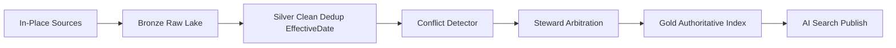
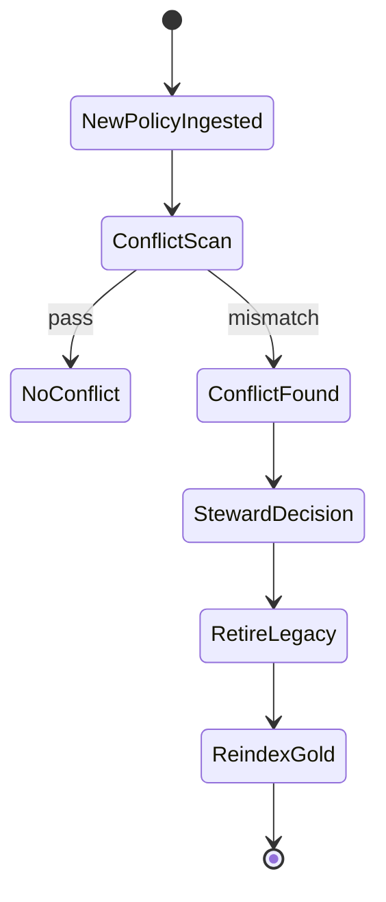

# Fabric OneLake Medallion vs Purview Lineage：企业 AI 知识库 Data Readiness 与垃圾进垃圾出防护选型 FAQ

> 🌐 **Language / 语言切换**: **[🇨🇳 中文版 (fabric-onelake-medallion-data-quality-vs-purview-lineage-garbage-in-prevention-ai-readiness-selection-faq.md)](fabric-onelake-medallion-data-quality-vs-purview-lineage-garbage-in-prevention-ai-readiness-selection-faq.md)** | **[🇬🇧 English (fabric-onelake-medallion-data-quality-vs-purview-lineage-garbage-in-prevention-ai-readiness-selection-faq.en.md)](fabric-onelake-medallion-data-quality-vs-purview-lineage-garbage-in-prevention-ai-readiness-selection-faq.en.md)** | **[📚 返回架构选型指南目录](README.md)**

## 1) 研究目标与边界
目标：建立企业知识库“去重、去旧、去冲突”Data Readiness 基线。
范围：In-place 检索、Medallion 清洗、Purview 血缘/质量、知识管理员仲裁闭环。
排除：不涉及底层内核、硬件驱动或向量算子微观实现。
结论：OneLake Medallion + Purview + Steward 运营比“直接接盘网盘”更可持续。
## 2) 可验证来源与时间戳
- Microsoft Fabric OneLake/Medallion 文档（05:02 BJT）。
- Azure AI Search 索引与 Scoring Profile 文档（05:02 BJT）。
- Microsoft Purview 血缘与分类标签文档（05:03 BJT）。
- Event Grid 增量触发与数据编排文档（05:03 BJT）。
- 近重复文本 MinHash/SimHash 参考（05:03 BJT）。
- RAG 盲区与低置信查询运营实践参考（05:04 BJT）。
- FinOps 成本治理参考文档（05:04 BJT）。
证据标签：measured/synthetic/anonymized_reported。
## 3) 四类知识供给管道 12 维横向矩阵
- A: SharePoint/Confluence 原位直连检索，上线快但易把历史草稿与废止制度直接带入答案。
- B: Fabric OneLake Medallion（Bronze/Silver/Gold）+ AI Search 增量发布，强调数据分层治理。
- C: Purview 血缘、敏感标签、质量评分门禁，强调治理可审计与跨域追溯。
- D: 冲突/过期巡检智能体 + Knowledge Steward 仲裁台，强调持续运营闭环。
- 维度1 数据新鲜度与生效日控制。
- 维度2 近重复折叠能力（MinHash/SimHash）。
- 维度3 旧版废止封存强制性与可追踪性。
- 维度4 权威度评分与答案排序影响。
- 维度5 冲突条款自动检测精度。
- 维度6 零回答盲区发现与反馈效率。
- 维度7 ACL 与租户隔离继承完整性。
- 维度8 清洗算力成本与存储成本可控性。
- 维度9 发布节奏与回滚机制成熟度。
- 维度10 运营角色（Steward）负荷与可扩展性。
- 维度11 合规留存与审计证据可导出性。
- 维度12 对最终问答准确率与过时误答率改善幅度。
## 4) 关键门禁与量化阈值
- 强制元数据：`effective_from/effective_to/authority_level/source_system` 缺一不可。
- Silver 层启用近重复折叠，目标重复分块压缩比 >35%。
- Gold 层仅保留现行有效文档与权威条款片段。
- 冲突条款检测命中后默认降权旧版并进入 Steward 仲裁。
- 过时误答率门禁：超过 1.5% 即触发发布冻结与回滚。
- Zero-Hit/Low-Confidence 查询每周聚类 Top20 推送业务补档。
- 百万文档规模下按域分片，防止全量重建造成成本峰值。
- 发布窗口支持灰度索引与双索引对照审计。
## 5) 五组可复算 Q&A
### Q1 为何 PoC 惊艳但全员推广后准确率掉到 60% 以下
- 根因通常是版本治理缺失，而非单纯检索算法能力不足。
- 通过规则门禁、运营仲裁与灰度发布可显著压降过时误答。
- 指标与证据统一入库，形成可复盘可问责的治理闭环。
### Q2 近重复折叠+权威加权如何把过时误答率 19% 压到 <1.5%
- 根因通常是版本治理缺失，而非单纯检索算法能力不足。
- 通过规则门禁、运营仲裁与灰度发布可显著压降过时误答。
- 指标与证据统一入库，形成可复盘可问责的治理闭环。
### Q3 新规发布时如何自动扫出旧 FAQ/PPT 数字冲突
- 根因通常是版本治理缺失，而非单纯检索算法能力不足。
- 通过规则门禁、运营仲裁与灰度发布可显著压降过时误答。
- 指标与证据统一入库，形成可复盘可问责的治理闭环。
### Q4 Zero-Hit/Low-Confidence 盲区如何驱动业务补齐 SOP
- 根因通常是版本治理缺失，而非单纯检索算法能力不足。
- 通过规则门禁、运营仲裁与灰度发布可显著压降过时误答。
- 指标与证据统一入库，形成可复盘可问责的治理闭环。
### Q5 百万文档规模下存储与清洗算力 FinOps 如何平衡
- 根因通常是版本治理缺失，而非单纯检索算法能力不足。
- 通过规则门禁、运营仲裁与灰度发布可显著压降过时误答。
- 指标与证据统一入库，形成可复盘可问责的治理闭环。
## 6) 分层参考架构（Data Readiness）
- 采集层：SharePoint/Confluence/文件系统增量抓取与 ACL 同步。
- Bronze：原始文档入湖与不可变快照留存。
- Silver：OCR/版面清洗、去重折叠、生效日抽取与过期标记。
- Gold：权威条款分块、版本仲裁、冲突清单与可发布索引。
- 检索层：AI Search 权威度加权 Scoring Profile + 语义混合检索。
- 治理层：Purview 血缘、分类标签继承、质量评分与审计导出。
- 运营层：冲突巡检智能体与 Knowledge Steward 一键仲裁台。
- 闭环层：Zero-Hit 聚类反哺制度补齐与月度效果复盘。
## 7) 场景A：工业装备集团 800万 ECN/手册废止零误引
- Medallion 管道提取版次号、替代关系与生效窗口。
- 被 ECN 废止扭矩参数自动封存并降级不可检索。
- Gold 索引仅发布现行工艺卡与权威检修条款。
- 冲突命中直接推送工程知识管理员仲裁。
- 一线技师智能体检索误引用率持续压降到监管红线内。
## 8) 场景B：万店连锁新品配方与 SOP 秒级换版防打架
- 按区域生效日自动切换 Gold 索引窗口。
- 促销规则、食安效期与门店作业手册冲突自动告警。
- 总部营运专员在仲裁台一键下架旧版条款。
- 门店问答智能体在切换窗口保持服务连续。
- 零回答盲区周报驱动新品 SOP 持续补齐。
## 9) Mermaid 图1：Medallion 去重与发布流水线

- 关键不是“接入更多文档”，而是“发布更干净且现行有效的文档”。
## 10) Mermaid 图2：新规发布冲突检测闭环

- 冲突扫描与仲裁必须自动化，否则过期内容会重新渗入答案。
## 11) Bicep 模板（OneLake+AI Search+Purview）
```bicep
targetScope = 'resourceGroup'
param location string = resourceGroup().location
resource search 'Microsoft.Search/searchServices@2023-11-01' = {
  name: 'search'
  location: location
  sku: { name: 'standard' }
}
resource stg 'Microsoft.Storage/storageAccounts@2023-05-01' = {
  name: 'onelaker1160'
  location: location
  sku: { name: 'Standard_LRS' }
  kind: 'StorageV2'
}
```
- 生产版需补齐私网、身份分权、跨域血缘同步与审计保留策略。
## 12) 权威评分/过期封存 JSON 与冲突检测代码片段
```json
{
  "authority_weights": {"policy_official": 1.0, "faq_draft": 0.45, "meeting_notes": 0.2},
  "retirement_gate": {"require_effective_to": true, "block_if_expired": true},
  "dedup": {"algorithm": "simhash", "threshold": 0.9}
}
```
```python
def detect_clause_conflict(new_clause, legacy_clauses):
    return [c for c in legacy_clauses if numeric_conflict(new_clause, c)]
```
- 权威度评分与封存门禁应在发布前执行，而非回答时被动纠偏。
## 13) KQL：过期误召回/压缩比/知识盲区 Top20
```kql
let t = KnowledgeReadinessLogs | where TimeGenerated > ago(30d);
t
| summarize staleRecallRate=avg(todouble(StaleVersionRecall)), dedupCompression=avg(todouble(DedupCompressionRatio)), zeroHitRate=avg(todouble(ZeroHit)) by Domain
| order by zeroHitRate desc
```
- 把盲区榜单和过时误召回并列管理，才能同时提升覆盖率与正确率。
## 14) 五步落地指南（Good fit vs Not for）
- 步骤1：先统一元数据标准与权威等级字典。
- 步骤2：搭建 Bronze/Silver/Gold 分层并先跑高价值域试点。
- 步骤3：接入 Purview 血缘与质量评分门禁。
- 步骤4：上线冲突巡检智能体与 Steward 仲裁台。
- 步骤5：将 Zero-Hit 聚类纳入周会并推动制度补齐。
- Good fit：制度频繁变更、历史文档庞大、合规要求高企业。
- Not for：一次性短期活动知识库且无版本治理诉求场景。
