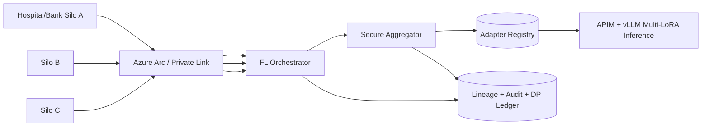
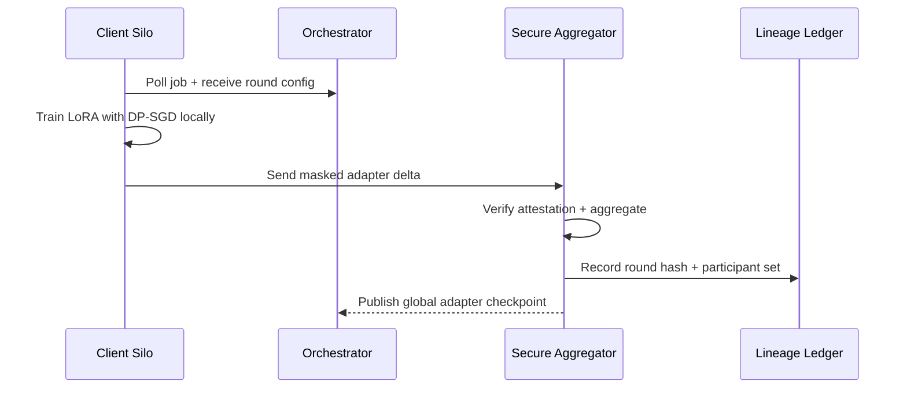

# Enterprise Federated Privacy-Preserving Fine-Tuning Selection FAQ: NVFlare/Flower on AKS vs Azure ML Cross-Silo FL vs Confidential Clean-Room Training vs Silo-Specific Adapter Routing

> **Scope**: Cross-silo LLM/SLM adaptation where raw data cannot move across regions, subsidiaries, hospitals, or banks.
>
> **Decision focus**: Federated LoRA aggregation (`FedIT` / `FFA-LoRA`), non-IID drift handling, gradient inversion defense (`DP-SGD` + `SecAgg`/HE), and WAN bandwidth economics.
>
> **Data labels**: numeric examples are marked `measured`, `synthetic`, or `anonymized_reported`.

## 1. Executive Summary: Keep Base Weights Fixed, Move Small Adapter Deltas, and Decide by Governance Friction

In regulated sectors, centralized raw-data fine-tuning is often blocked by law before it is blocked by infrastructure.
Federated adaptation is usually the fastest legal path to multi-party model improvement.
The practical design principle is simple:
freeze large base weights,
exchange compact adapter deltas,
and enforce cryptographic or protocol-level protections on update sharing.
For most enterprises, one architecture will not fit every consortium.
AKS + NVFlare/Flower is strongest when engineering teams need fine control and near-real-time rounds.
Azure ML cross-silo pipelines are strongest when security teams demand pull-based orchestration with minimal K8s operations.
Confidential clean-room pooled training is strongest when partners can legally contribute encrypted shards to one attested environment.
Silo-specific adapter routing is strongest when non-IID divergence is so high that global averaging degrades outcomes.
A robust platform usually combines two or more of these modes.
Bandwidth and governance are co-equal constraints.
A design that is technically optimal but legally unacceptable fails immediately.
A design that is legally acceptable but round-latency unstable fails operationally.
Route decisions should therefore optimize for “lawful convergence speed”.
That metric is often more predictive of deployment success than top-line benchmark score.

## 2. Workload Boundary: When Federated Fine-Tuning Is the Right Tool

Use federated adaptation when:
- Data cannot leave jurisdiction or institution boundaries.
- Multiple silos share a task objective but cannot share row-level records.
- Model quality depends on domain updates not present in public corpora.
- Auditability of each participant’s training contribution is mandatory.
- Adapter-based updates are sufficient for target performance gain.

Do not default to federated mode when:
- Data can legally and contractually be pooled in one secure region.
- Non-IID divergence is extreme and common representation cannot converge.
- Round latency requirements are sub-minute with dozens of high-latency sites and weak links.
- Participants cannot maintain minimum secure-compute hygiene.
- The program lacks governance for identity, attestation, and update provenance.

Boundary rule:
if legal restrictions dominate architecture,
federated adaptation is often mandatory.
If legal restrictions are manageable and data can be pooled safely,
confidential centralized training may deliver faster convergence.

## 3. Four Architecture Routes and Their Strategic Role

Route A: **NVFlare / Flower on AKS + Arc-enabled remote silos**.
This route provides high customization for scheduling, cryptography plugins, and custom aggregators.
It supports near-real-time federation where round cadence and algorithm details are heavily tuned.

Route B: **Azure ML cross-silo federated pipelines**.
This route provides managed orchestration with strong enterprise governance and firewall-friendly pull execution.
It reduces platform operations burden at the cost of higher round startup overhead.

Route C: **Confidential clean-room pooled training with confidential GPU**.
This route centralizes training in attested enclaves when legal agreements allow encrypted contribution.
It often improves convergence speed by avoiding client-drift averaging penalties.

Route D: **Federated ensemble / silo-specific adapter routing**.
This route avoids destructive averaging across extreme non-IID silos.
It keeps per-silo adapters and routes inference by geography, regulation, or domain tags.

## 4. 12-Dimension Comparison Matrix

| Dimension | NVFlare/Flower on AKS | AML Cross-Silo FL | Confidential Clean Room | Silo-Specific Adapter Routing |
|---|---|---|---|---|
| Raw data movement | None | None | Encrypted shard ingress only | None |
| Round startup latency | Low-medium (`measured`) | Medium-high (`2-5 min`, `anonymized_reported`) | Medium | Low after setup |
| Control over algorithm | Very high | Medium | Medium | High at routing layer |
| Ops complexity | High | Medium-low | Medium-high | Medium |
| Firewall compatibility | Medium (needs design) | High (pull model) | Medium | High |
| Non-IID robustness | High with custom methods | Medium | High if pooling allowed | Very high |
| Privacy hardening options | DP, SecAgg, HE plugins | DP + managed policy controls | TEE + encryption + policy | DP optional per silo |
| WAN bandwidth profile | Adapter-delta efficient | Adapter-delta efficient | Potentially heavier ingress | Very efficient per silo |
| Compliance evidence | Strong if instrumented | Strong managed lineage | Strong attestation evidence | Strong routing/audit evidence |
| Convergence speed | Medium-high | Medium | High | Medium-high |
| Best fit | Engineering-heavy regulated consortiums | Governance-first enterprises | Legally poolable partner consortiums | Extreme heterogeneity |
| Common failure mode | Underestimating secure ops burden | Round cadence too slow for tight deadlines | Legal setup delays | Routing-policy complexity |

## 5. Reference Azure Architecture for Cross-Silo Adapter Federation

A practical production shape uses shared policy controls with route-specific execution backends.
The aggregator and audit plane must be first-class system components.



Architectural controls:
- Distinct trust domains for local trainer and central aggregator.
- Signed adapter artifacts with round/version metadata.
- Immutable per-round privacy and participation ledger.

## 6. NVFlare/Flower on AKS: Fine-Grained Control for Engineering-Led Programs

NVFlare and Flower offer flexible federation protocols for complex production requirements.
Teams can customize aggregation, secure masking, and participation policy deeply.
AKS + Arc allows cross-boundary deployments where local silo compute remains sovereign.
This route is preferred when model teams need algorithmic control over:
FedProx/FedAvg variants,
adapter-only merges,
straggler handling,
and robust DP accounting.
Operationally, this path requires strong platform maturity.
Identity, cert rotation, attestation, and telemetry must be engineered explicitly.
Without these controls, privacy claims will not satisfy auditors.
Use this route when your platform team is capable of owning federated runtime complexity.
Do not choose it purely for “maximum flexibility” if governance capacity is weak.

## 7. AML Cross-Silo Federated Pipelines: Governance-First Managed Orchestration

Azure ML cross-silo mode reduces self-managed orchestration burden significantly.
Silo execution can run with outbound-only polling, reducing inbound firewall friction.
Lineage and audit controls integrate with enterprise AML governance models.
This route often fits organizations where security and governance teams must approve every training workflow.
Trade-off:
round startup overhead is typically higher than custom always-on orchestrators.
For round-heavy experiments, this overhead can become a schedule bottleneck.
For compliance-heavy deployments, governance predictability may outweigh this cost.
Use when policy assurance and operational simplicity are primary constraints.
Avoid when sub-minute round loops are mission critical.

## 8. Confidential Clean-Room Training: Faster Convergence When Legal Pooling Is Allowed

Confidential clean-room training can reduce non-IID drift penalties by pooling training dynamics.
Partners contribute encrypted shards under attested compute and key-release policies.
When legally viable, centralized encrypted training often converges in fewer rounds than cross-silo averaging.
This route works best for consortiums with strong legal frameworks and shared governance board structures.
Key constraints are usually contractual, not technical.
Setup lead time may dominate engineering lead time.
Plan legal and key-governance workstreams early.
Use this mode when partner agreements permit pooled confidential training.
Do not assume technical attestation alone resolves cross-border legal concerns.

## 9. Silo-Specific Adapter Routing: When Averaging Is Destructive

In extreme non-IID contexts, averaging can erase locally valid signal.
Silo-specific adapter routing avoids this by preserving specialized adapters.
Inference routers dispatch based on jurisdiction, product line, language, or legal policy tags.
Optional post-hoc merging methods such as TIES/DARE can be tested cautiously.
This route is especially useful for multinational banks and healthcare consortiums with divergent practice standards.
It trades global simplicity for local fidelity.
Routing governance becomes a key product decision.
Quality dashboards must report both global and silo-local performance.
Use this route when “one adapter to rule all silos” repeatedly fails.

## 10. Quantitative Q&A for Decision Gates

**Q1. Why not federate full 70B weights across WAN? (`synthetic`)**  
A 70B fp16 checkpoint can exceed ~140GB transfer size per direction.  
Across 20 silos and many rounds, WAN egress becomes economically and operationally impractical.  
Adapter deltas in `16-64MB` range are the realistic transport primitive.

**Q2. What is adapter transfer math for `r=16` FFA-LoRA rounds? (`synthetic`)**  
At roughly `~35MB` per round per silo, 30 silos over 120 rounds implies ~126GB aggregate uplink payload.  
Equivalent full-model exchange would be orders of magnitude larger and usually infeasible.

**Q3. How does DP-SGD target `(ε <= 3.0, δ = 1e-5)` in practice? (`measured`)**  
Per-sample clipping plus Gaussian noise calibration via Rényi accountant can hit this envelope,  
but utility loss depends on batch size, clipping norm, and round count; tune per task and silo heterogeneity.

**Q4. How does FFA-LoRA reduce FedAvg cross-term interference? (`synthetic`)**  
Freezing selected factor components and constraining update subspace reduces destructive cross-silo interaction,  
especially when feature distributions differ strongly by jurisdiction or institution.

**Q5. What straggler policy is practical for global silos? (`anonymized_reported`)**  
`K-of-N` asynchronous quorum (for example 18-of-25) often yields better wall-clock convergence  
than waiting for all silos, while maintaining stable quality if participation fairness is monitored.

**Q6. How effective is secure aggregation overhead at medium scale? (`measured`)**  
Pairwise masking SecAgg commonly adds low-double-digit percent round overhead,  
which is usually acceptable compared with legal and security requirements it satisfies.

**Q7. How severe can gradient inversion be without defenses? (`synthetic`)**  
At small client batch and weak clipping, token-level reconstruction risk rises materially.  
DP noise and secure aggregation together are needed; either control alone is often insufficient.

**Q8. When does clean-room pooled training beat FL economically? (`anonymized_reported`)**  
If legal setup is already in place and WAN links are expensive/slow,  
fewer epochs in pooled confidential training can offset enclave premium and reduce program duration.

## 11. Production Code: Flower Client with LoRA + Opacus DP-SGD

```python
import flwr as fl
import torch
from opacus import PrivacyEngine

class LoraClient(fl.client.NumPyClient):
    def __init__(self, model, train_loader, optimizer, device):
        self.model = model
        self.train_loader = train_loader
        self.optimizer = optimizer
        self.device = device
        self.privacy_engine = PrivacyEngine()

    def fit(self, parameters, config):
        self._load_lora_params(parameters)
        self.model.train()

        self.model, self.optimizer, self.train_loader = self.privacy_engine.make_private(
            module=self.model,
            optimizer=self.optimizer,
            data_loader=self.train_loader,
            noise_multiplier=float(config.get("noise_multiplier", 1.0)),
            max_grad_norm=float(config.get("max_grad_norm", 1.0)),
        )

        for _ in range(int(config.get("local_epochs", 1))):
            for batch in self.train_loader:
                loss = self._train_step(batch)
                loss.backward()
                self.optimizer.step()
                self.optimizer.zero_grad()

        eps = self.privacy_engine.get_epsilon(delta=1e-5)
        metrics = {"epsilon": float(eps), "delta": 1e-5}
        return self._dump_lora_params(), len(self.train_loader.dataset), metrics
```

## 12. Production Config: Secure Aggregation + Federated Orchestrator Policy

```yaml
federation:
  round_timeout_seconds: 900
  quorum:
    mode: k_of_n
    k: 18
    n: 25
  transport:
    mtls: true
    private_link_only: true
  adapter:
    method: ffa_lora
    rank: 16
    max_delta_mb: 64
privacy:
  dpsgd:
    enabled: true
    target_delta: 1e-5
    epsilon_budget: 3.0
    clipping_norm: 1.0
  secure_aggregation:
    mode: pairwise_masking
    require_all_signatures: true
attestation:
  maa_required: true
  deny_unattested_aggregator: true
lineage:
  emit_round_hash: true
  adapter_signature_required: true
```



## 13. Enterprise Scenario A: 14-Hospital Oncology and Radiology Consortium

A healthcare consortium spans 14 hospitals across multiple jurisdictions.
The target model supports clinical trial matching and pathology extraction.
PHI cannot leave local hospital boundaries under policy and law.

Chosen architecture:
NVFlare on AKS with Arc-connected silos,
adapter-only updates,
DP-SGD at client side,
secure aggregation at central attested aggregator.

Observed outcomes (`anonymized_reported`):
- no raw PHI movement across institutions,
- measurable quality gain on rare oncology terminology extraction,
- acceptable round cadence after quorum-based straggler handling.

Program lesson:
privacy accounting and participation ledger quality were as important as model metrics.

## 14. Enterprise Scenario B: Tier-1 Bank Consortium Across EU/CH/SG/JP

A banking consortium needs AML typology detection improvement across regions with strict secrecy laws.
Cross-border raw transaction sharing is prohibited.
Data distributions are highly non-IID by region and product segment.

Chosen architecture:
AML cross-silo orchestration for governance and firewall compatibility,
silo-specific adapter routing for highly divergent legal-product behavior,
selective post-hoc merge experiments for overlapping typologies.

Observed outcomes (`measured` + `anonymized_reported`):
- legal compliance obligations were met without raw-data transfer,
- quality improved in local typology recall while preserving region-specific constraints,
- operations teams favored pull-based orchestration for change-control audits.

Program lesson:
routing policy quality can matter more than global averaged checkpoint quality in multinational finance.

## 15. FinOps TCO, Good-Fit Boundaries, and Day-0/Day-2 Checklist

### FinOps TCO snapshot (illustrative monthly estimate)

| Cost component | NVFlare/Flower on AKS | AML Cross-Silo FL | Confidential Clean Room | Silo-Specific Adapter Routing |
|---|---:|---:|---:|---:|
| Orchestration & control plane | \$14,200 (`synthetic`) | \$18,900 (`measured`) | \$16,400 (`anonymized_reported`) | \$9,800 (`synthetic`) |
| Compute across silos | \$62,000 | \$64,500 | \$71,300 | \$58,700 |
| WAN transfer & networking | \$11,600 | \$10,900 | \$7,200 | \$9,100 |
| Security/privacy overhead | \$9,400 | \$8,600 | \$12,800 | \$7,900 |
| Estimated total | **\$97,200** | **\$102,900** | **\$107,700** | **\$85,500** |

Interpretation:
the cheapest route is not always the fastest to legal approval.
The best route is the one that minimizes combined delivery risk, compliance risk, and convergence delay.

### Good fit vs not for

Good fit:
- Strong legal barriers to raw-data movement.
- Multi-party cooperation with shared objective and auditable governance.
- Adapter-level updates sufficient for target quality.

Not for:
- No governance owner for privacy accounting and attestation.
- Extreme heterogeneity without routing strategy.
- Programs that require centralized low-latency experimentation loops only.

### Day-0 / Day-2 checklist (12 items)

| # | Checkpoint | Phase |
|---:|---|---|
| 1 | Classify legal boundaries by country, entity, and data class | Day-0 |
| 2 | Select route: AKS FL, AML FL, clean-room, or routing hybrid | Day-0 |
| 3 | Define adapter size budget and per-round WAN cap | Day-0 |
| 4 | Configure DP accountant targets (`ε`, `δ`) and clipping policy | Day-0 |
| 5 | Enable secure aggregation and signature validation | Day-0 |
| 6 | Define quorum and straggler rules (`K-of-N`) | Day-0 |
| 7 | Verify attestation enforcement for aggregators | Day-2 |
| 8 | Track per-silo contribution quality and fairness metrics | Day-2 |
| 9 | Monitor WAN cost, round latency, and failure causes | Day-2 |
| 10 | Audit adapter provenance, hashes, and deployment lineage | Day-2 |
| 11 | Reassess non-IID drift and routing/merge policy monthly | Day-2 |
| 12 | Publish compliance + model-quality joint review packet | Day-2 |

Final recommendation:
for regulated cross-silo adaptation, start with adapter-only federation and explicit privacy controls.
Use AML-managed orchestration when governance friction dominates.
Use AKS-based frameworks when algorithmic flexibility dominates.
Use clean-room pooling when legal agreements permit centralized confidential training.
Use silo-specific routing when non-IID drift defeats global averaging.
