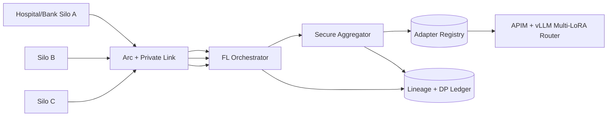
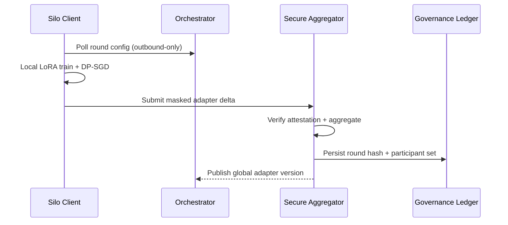

# 企业联邦隐私保真微调选型 FAQ：AKS 上 NVFlare/Flower vs AML Cross-Silo FL vs 机密 Clean Room vs 分域适配器路由

> **适用范围**：在 `GDPR`/`HIPAA`/`PIPL` 等约束下，跨医院、跨银行、跨国家分域训练 LLM/SLM 适配器，且原始数据零出域。
>
> **决策焦点**：`FedIT`/`FFA-LoRA` 适配器聚合、梯度反演防护（`DP-SGD` + `SecAgg`/HE）、Non-IID 漂移治理、以及 WAN 带宽与轮次经济性。
>
> **数据标签**：定量指标按 `measured`、`synthetic`、`anonymized_reported` 明示来源属性。

## 1. 执行摘要：冻结大模型底座，只交换小体积适配器增量

在强监管行业里，很多项目不是“技术不能做”，而是“数据不能动”。
联邦微调的核心价值是把模型改进和数据主权同时成立。
最实用原则是：
冻结基础权重，
跨域交换小体积 LoRA 增量，
并用密码学与策略治理封装更新路径。
单一路线难以覆盖所有联盟结构。
AKS + NVFlare/Flower 适合算法与调度可控性优先的团队。
AML Cross-Silo 适合治理优先、运维简化优先的组织。
Confidential Clean Room 适合可依法集中密文训练的联盟。
分域适配器路由适合极端 Non-IID 场景，避免平均化毁损局部能力。
优秀平台通常是混合模式而非单模式。
法律可行性与收敛速度同等关键。
技术最优但法务不可落地，项目会在立项阶段失败。
法务可落地但轮次效率失控，项目会在运营阶段失败。
因此应优化“合规条件下的收敛速度”。
这比单点 benchmark 分数更能预测上线成功率。

## 2. 业务边界：何时必须采用联邦微调

以下条件出现时，应优先评估联邦路线：
- 原始数据不能跨国或跨机构移动。
- 多个数据孤岛有共同任务目标，但无法共享明文样本。
- 模型需要持续吸收私域新知识。
- 每轮训练参与证据需要可审计可追溯。
- 适配器级更新可满足业务质量目标。

以下条件下不应机械套用联邦：
- 法律与合同允许在可信环境集中训练。
- Non-IID 差异极大且无路由策略时难以收敛。
- 业务强依赖超短轮次迭代而跨域链路延迟高。
- 参与方不具备最低安全与运维能力。
- 缺少身份、证明、审计统一治理主体。

经验判据：
当“数据不动”是硬约束时，联邦是优先项。
当“数据可合规汇聚”且效率优先时，机密集中训练可能更快。

## 3. 四条路线定位：治理、效率与漂移容忍度

路线 A：**AKS + NVFlare/Flower + Arc 跨域联邦**。
优势是可深度定制聚合策略、加密路径、轮次控制与参与规则。
适合工程能力强、希望算法可控的联盟。

路线 B：**AML Cross-Silo Federated Pipelines**。
优势是受管编排、审计与防火墙友好（出站轮询）。
适合治理优先、K8s 自运维意愿低的企业。

路线 C：**Confidential Clean Room（机密 GPU）集中密文训练**。
在法律允许前提下可减轻 Non-IID 漂移，提升收敛速度。
适合少量高信任伙伴形成数据合作联盟。

路线 D：**联邦集成 + 分域适配器路由（不做统一平均）**。
保留每个域的专属 LoRA，在推理侧按域路由。
适合跨法域语义差异大、统一平均会伤害性能的场景。

## 4. 12 维比较矩阵：从合规可行性到轮次经济性

| 维度 | AKS NVFlare/Flower | AML Cross-Silo | Confidential Clean Room | 分域适配器路由 |
|---|---|---|---|---|
| 原始数据跨域 | 否 | 否 | 仅密文入场 | 否 |
| 轮次启动延迟 | 低到中（`measured`） | 中到高（`2-5 min`，`anonymized_reported`） | 中 | 低 |
| 算法可控性 | 很高 | 中 | 中 | 高（路由侧） |
| 运维复杂度 | 高 | 中低 | 中高 | 中 |
| 防火墙适配 | 中 | 高（轮询） | 中 | 高 |
| Non-IID 鲁棒性 | 高（可定制） | 中 | 高（可集中） | 很高 |
| 隐私增强手段 | DP/SecAgg/HE 插件化 | DP + 受管治理 | TEE + 密钥释放 | 可叠加 DP |
| WAN 带宽压力 | 适配器级可控 | 适配器级可控 | 入口侧可更高 | 最低（按域） |
| 合规证据输出 | 强（自建） | 强（平台治理） | 强（远程证明） | 强（策略审计） |
| 收敛速度 | 中高 | 中 | 高 | 中高 |
| 最佳适配 | 工程主导联盟 | 治理主导企业 | 可合法汇聚联盟 | 极端异质联盟 |
| 常见失败点 | 低估安全运维投入 | 轮次启动开销过大 | 法务协同周期长 | 路由复杂度上升 |

## 5. Azure 参考架构：联邦编排、聚合与推理路由分层

联邦平台应把编排、聚合、注册、审计、推理解耦。
不要把训练逻辑和推理路由耦合在同一控制面。



控制要点：
- 本地训练节点与中心聚合节点分离信任域。
- 每轮适配器都做签名与摘要记录。
- 隐私预算、参与者集合、聚合版本入账审计台账。

## 6. AKS + NVFlare/Flower：算法可控性最强的工程路线

NVFlare 与 Flower 适合需要深度控制联邦训练细节的团队。
可自定义 FedProx/FedAvg 变体、异步聚合、加密插件、分层参与策略。
AKS + Arc 允许各分域保留本地数据主权和本地算力自治。
当项目要求“边训练边调策略”时，这条路线优势明显。
代价是平台运维能力要求高。
证书轮换、身份治理、远程证明、审计埋点都要自己做好。
若只看算法灵活性而忽略安全运维，审计阶段很容易被打回。
因此该路线适合“工程能力领先”的联盟。
不适合希望“最少自运营投入”但需求又复杂的组织。

## 7. AML Cross-Silo：治理与防火墙友好的受管路线

AML Cross-Silo 对企业安全治理团队更友好。
本地算力可通过出站轮询接收任务，减少入站开口需求。
训练过程、资产版本、血缘可融入既有 AML 治理体系。
对受监管企业，审计沟通成本通常更低。
主要代价是每轮启动开销较高。
若实验轮次极多，累计延迟会明显。
因此该路线适合“治理优先于极速迭代”的组织。
对于严苛变更流程和跨团队协作场景，受管编排往往更稳。

## 8. Confidential Clean Room：可合法汇聚时的收敛加速器

当联盟伙伴在法务上允许密文入场集中训练时，
机密清洁室可以显著降低 Non-IID 平均化损失。
相较纯联邦多轮平均，集中密文训练通常在轮次上更快收敛。
这类方案特别适合伙伴数量较少但数据互补强的联盟。
但关键瓶颈常在法律与密钥治理流程。
技术准备往往快于合同准备。
应尽早并行推进法务条款、密钥托管、审计责任划分。
不要把“可远程证明”误解为“自动跨法域合规”。

## 9. 分域适配器路由：极端 Non-IID 的务实解法

当不同国家、机构、业务线数据分布差异极大时，
统一平均可能损害各域原本有效的能力。
分域适配器路由通过“多适配器并存 + 推理时路由”规避该问题。
可按国家、法规、语言、产品标签做策略分流。
必要时再做 TIES/DARE 等后处理融合实验。
该路线把复杂度从训练端转移到路由治理端。
因此需要更强的在线路由评估和策略审计机制。
对跨国银行和多中心医疗网络，这通常更可落地。

## 10. 定量 Q&A：带宽、隐私预算与收敛门槛

**Q1. 为什么不在联邦中交换 70B 全量权重？（`synthetic`）**  
70B fp16 权重单次可达约 `140GB` 级别。  
若 `20` 个 silo、`100+` 轮，WAN egress 与时间成本通常不可接受。  
因此联邦应以适配器增量而非全量权重为交换单位。

**Q2. `r=16` FFA-LoRA 的带宽账怎么算？（`synthetic`）**  
若单轮每 silo 约 `35MB`，`30` 个 silo、`120` 轮总上行约 `126GB`。  
相比全量权重交换，量级差异可达数百到上千倍。  
这决定了项目是否具备 WAN 可运营性。

**Q3. `(epsilon <= 3.0, delta = 1e-5)` 如何落地？（`measured`）**  
通过 per-sample clipping + Gaussian 噪声，并用 Rényi accountant 校准可达该目标。  
但效能损失受 batch、clip norm、轮次数影响，必须按任务实测调参。  
隐私预算应与业务 KPI 联合评估，而不是单独看 epsilon。

**Q4. `FedAvg` 交叉项干扰为何会发生，`FFA-LoRA` 如何缓解？（`synthetic`）**  
在强 Non-IID 下，不同 silo 的更新方向可能互相抵消或污染。  
`FFA-LoRA` 通过冻结/约束部分因子子空间降低干扰。  
与 `FedProx` 等正则一起可提升收敛稳定性。

**Q5. 跨洲 straggler 如何设异步 quorum？（`anonymized_reported`）**  
实务上 `K-of-N`（如 `18-of-25`）常优于等待全量到齐。  
在监控参与公平性的前提下，可显著缩短 wall-clock 轮次时长。  
若长期固定同一批慢节点被排除，应触发治理告警。

**Q6. SecAgg/HE 额外开销是否可接受？（`measured`）**  
中等规模下，SecAgg 常见增加低双位数百分比轮次开销。  
与合规收益相比通常可接受。  
但要提前把该开销纳入项目 SLA 预算。

**Q7. 不做 DP 会有多大梯度反演风险？（`synthetic`）**  
在小 batch、弱裁剪场景，梯度泄露风险显著上升。  
仅做 SecAgg 不能完全覆盖反演风险。  
DP 与 SecAgg 联用才是稳妥基线。

**Q8. 何时机密集中训练会比联邦更经济？（`anonymized_reported`）**  
当法律框架已就绪、WAN 链路昂贵且 Non-IID 很强时，  
更少轮次的集中机密训练可能抵消 enclave 成本并缩短总周期。  
该判断应结合法务周期与算力配额综合决策。

## 11. 生产代码：Flower 客户端 + LoRA + Opacus DP-SGD

```python
import flwr as fl
from opacus import PrivacyEngine

class FederatedLoraClient(fl.client.NumPyClient):
    def __init__(self, model, loader, optimizer):
        self.model = model
        self.loader = loader
        self.optimizer = optimizer
        self.privacy_engine = PrivacyEngine()

    def fit(self, parameters, config):
        self._load_lora(parameters)
        self.model, self.optimizer, self.loader = self.privacy_engine.make_private(
            module=self.model,
            optimizer=self.optimizer,
            data_loader=self.loader,
            noise_multiplier=float(config.get("noise_multiplier", 1.0)),
            max_grad_norm=float(config.get("max_grad_norm", 1.0)),
        )
        self.model.train()
        for _ in range(int(config.get("local_epochs", 1))):
            for batch in self.loader:
                loss = self._step(batch)
                loss.backward()
                self.optimizer.step()
                self.optimizer.zero_grad()
        eps = self.privacy_engine.get_epsilon(delta=1e-5)
        return self._dump_lora(), len(self.loader.dataset), {"epsilon": float(eps), "delta": 1e-5}
```

## 12. 生产配置：SecAgg + Quorum + 隐私预算策略

```yaml
federation:
  topology: cross_silo
  quorum:
    mode: k_of_n
    k: 18
    n: 25
  round_timeout_seconds: 900
  transport:
    mtls: true
    private_link_only: true
adapter:
  method: ffa_lora
  rank: 16
  max_delta_mb: 64
privacy:
  dpsgd:
    enabled: true
    epsilon_budget: 3.0
    delta: 1e-5
    clipping_norm: 1.0
  secure_aggregation:
    mode: pairwise_masking
    require_participant_signatures: true
attestation:
  aggregator_maa_required: true
lineage:
  emit_round_hash: true
  signed_adapter_required: true
```



## 13. 企业场景 A：14 家医院肿瘤与放射联盟

某医疗联盟由 14 家医院组成，目标是临床试验匹配和病理抽取增强。
各院 PHI 不允许出院区或出法域。
项目需要在不移动明文数据前提下提升模型表现。

选型组合：
AKS 上 NVFlare 联邦编排，
Arc 连接本地训练节点，
适配器增量上报，
客户端 DP-SGD，
中心 SecAgg 聚合。

结果（`anonymized_reported`）：
- PHI 零出域；
- 稀有肿瘤术语召回提升可观；
- 通过 `K-of-N` 异步 quorum 缩短轮次等待。

关键经验：
隐私台账与参与证据质量，和模型指标同等重要。

## 14. 企业场景 B：跨欧盟/瑞士/新加坡/日本银行联盟

某 Tier-1 银行联盟联合微调跨境 AML typology 检测 SLM。
受银行保密法约束，交易明细不可跨境共享。
不同国家数据分布和法规要求明显异质。

选型组合：
AML Cross-Silo 负责编排与审计，
分域适配器路由负责推理时按法域分流，
仅在可比域做小范围后融合实验。

结果（`measured` + `anonymized_reported`）：
- 保持零原始数据跨境移动；
- 各法域本地 typology 召回保持提升；
- 变更审计与风控审阅流程更顺畅。

关键经验：
在跨法域金融场景，“路由策略正确”往往比“全局平均最优”更有价值。

## 15. FinOps TCO、适配边界与 Day-0/Day-2 清单

### FinOps TCO（示例月度估算）

| 成本项 | AKS NVFlare/Flower | AML Cross-Silo | Confidential Clean Room | 分域适配器路由 |
|---|---:|---:|---:|---:|
| 编排与控制面 | \$14,200（`synthetic`） | \$18,900（`measured`） | \$16,400（`anonymized_reported`） | \$9,800（`synthetic`） |
| 各 silo 训练算力 | \$62,000 | \$64,500 | \$71,300 | \$58,700 |
| WAN 传输与网络 | \$11,600 | \$10,900 | \$7,200 | \$9,100 |
| 隐私与安全治理 | \$9,400 | \$8,600 | \$12,800 | \$7,900 |
| 估算总计 | **\$97,200** | **\$102,900** | **\$107,700** | **\$85,500** |

解读：
最低账面成本不一定代表最低交付风险。
应联合评估合规风险、收敛效率、组织治理摩擦成本。

### Good fit vs Not for

Good fit：
- 原始数据严格受限不可移动；
- 多方协同且有统一治理机制；
- 适配器微调即可达到业务目标。

Not for：
- 缺失隐私预算治理与证明机制；
- 极端异质但没有路由策略；
- 只追求超快集中试验且不受数据跨域约束。

### Day-0 / Day-2 核查清单（12 项）

| # | 检查项 | 阶段 |
|---:|---|---|
| 1 | 按法域与数据类型完成法律边界分层 | Day-0 |
| 2 | 明确主路线（AKS/AML/Clean Room/路由混合） | Day-0 |
| 3 | 设定单轮适配器大小与 WAN 预算上限 | Day-0 |
| 4 | 设定 DP 预算目标（`epsilon`/`delta`）与裁剪策略 | Day-0 |
| 5 | 启用 SecAgg 与签名校验 | Day-0 |
| 6 | 定义 `K-of-N` quorum 与 straggler 策略 | Day-0 |
| 7 | 强制聚合节点远程证明与拒绝未证明实例 | Day-2 |
| 8 | 监控各 silo 贡献质量与公平性 | Day-2 |
| 9 | 监控 WAN 成本、轮次时长与失败类型 | Day-2 |
| 10 | 记录适配器摘要、来源与上线血缘 | Day-2 |
| 11 | 每月复核 Non-IID 漂移与路由策略效果 | Day-2 |
| 12 | 产出合规与模型质量联合审阅包 | Day-2 |

最终建议：
受监管跨域微调应默认采用“适配器联邦 + 显式隐私控制”。
治理压力高时优先 AML 受管编排。
算法可控性要求高时优先 AKS NVFlare/Flower。
可合法汇聚时引入机密集中训练加速收敛。
极端 Non-IID 时采用分域适配器路由替代强制平均。
