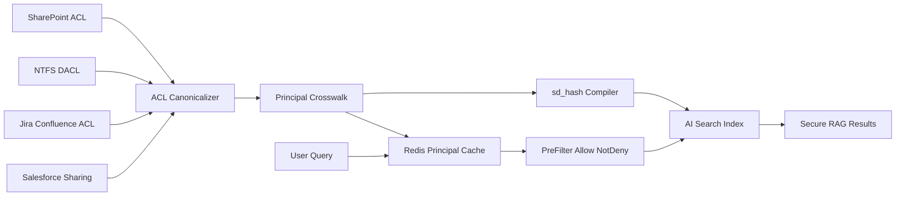
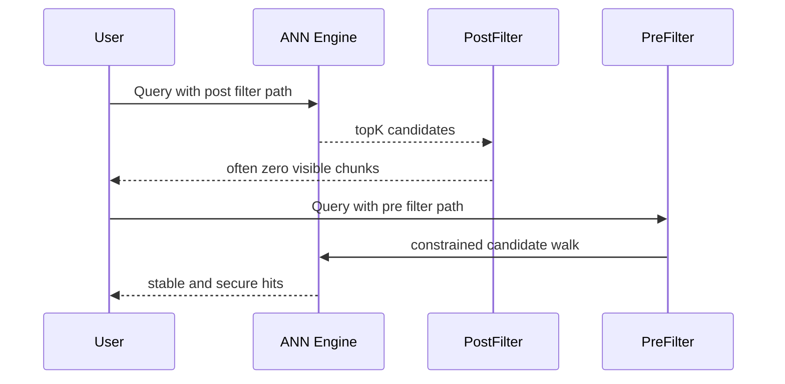

# Enterprise federated RAG heterogeneous ACL normalization and deny aware selection FAQ
> Topic ID: #470
> Section: 3.4 Agent state memory tiering and enterprise RAG data plane
> Audience: enterprise retrieval platform teams and security governance teams
> Goal: deliver high recall low leakage and low latency under multi source ACL complexity

## 1 Production failure modes and root causes
Enterprise knowledge platforms usually aggregate SharePoint documents, NTFS DACL file trees, Confluence spaces, Jira artifacts, and Salesforce records, yet these systems do not share one authorization grammar.
Many teams validate only with privileged accounts during pilot phases, so the first release appears healthy while hidden ACL divergence remains unresolved in the data plane.
`Entra ID` group overclaim can truncate group claims under high fan out identity graphs, and any pipeline that trusts raw token groups as complete truth starts drifting from real authorization on day one.
`NTFS DACL` and SharePoint explicit deny rules require deny precedence, so an allow only index model can leak restricted records whenever deny memberships are not evaluated.
Broken inheritance is another frequent trap, because child folders or lists can override parent permissions and naive crawlers often miss those overrides when metadata sampling is shallow.
Sparse access profiles amplify all these issues, since post filter paths remove most ANN candidates after retrieval and produce empty or unstable answers even when authorized evidence exists.
The net outcome is a triple regression across security, user trust, and performance, with leakage risk rising while legal recall drops and tail latency inflates under concurrency.
A production fix must unify ACL semantics, move filtering before vector traversal, and pair principal compression with deterministic invalidation so correctness and speed can hold together.

## 2 Why naive secure trimming collapses at scale
A naive design appends long GUID sets into OData filters and sends them per request, which works in tiny tests but fails once principal fan out reaches thousands.
Large filters increase transfer cost and parser cost in near linear proportion to payload size, so gateway and search latency drift away from millisecond targets.
The more critical weakness is semantic, because enterprise ACL is not a single allow list and must preserve explicit deny plus inheritance overrides in every decision path.
Live recursive principal expansion can patch completeness, yet it introduces dependency on external rate limits and converts identity turbulence into retrieval instability.
Therefore principal compaction, deny precedence, inheritance awareness, pre filter traversal, and delta invalidation must be engineered as one coherent control plane.
In that control plane, `vectorFilterMode: "preFilter"` governs timing, `search.in(token_set, '|')` governs expression power, and `sd_hash` governs compression efficiency.

## 3 Four architecture patterns
Pattern A is the primary enterprise path and combines dual ACL fields, compact principal mapping, Redis transitive cache, and pre filter vector traversal.
Pattern B is the complex relationship path and uses SpiceDB or OpenFGA semantics with `sd_hash` equivalence reverse indexing for scalable authorization joins.
Pattern C is the high sensitivity complement and uses live OBO federation with source native authorization at query time and no central ACL replica.
Pattern D is the anti pattern cluster and relies on allow only flattening, post filter dependence, and missing invalidation discipline.

## 4 Twelve dimension quantified comparison matrix
| Dimension | Pattern A Search Redis | Pattern B SpiceDB OpenFGA | Pattern C Live OBO | Pattern D anti pattern |
|---|---|---|---|---|
| Deny and inheritance fidelity | `100%` deterministic | `100%` deterministic | `100%` source native | `0%` to `40%` drift |
| Principal fan out per user | `5000+` stable | `10000+` stable | quota bounded | `~200` then unstable |
| Filter payload size | `3.2` to `24 KB` | `2.8` to `18 KB` | small request but many hops | `185 KB` bloat |
| P99 vector retrieval latency | `18` to `26 ms` | `24` to `41 ms` | `1.4` to `3.8 s` | `280` to `950 ms` |
| Sparse ACL Recall@10 | `90` to `93%` | `89` to `92%` | `86` to `90%` | `< 8%` common |
| ACL revocation SLA | `15` to `60 s` | `20` to `90 s` | `0 s` logical freshness | `5` to `30 min` |
| Cross SaaS rerank coherence | high | medium high | low to medium | low |
| Operational complexity | medium | high | medium high | low early high later |
| Compliance explainability | strong | strong | medium | weak |
| Region scale cost curve | medium low | medium high | high | high |
| Three year blended TCO | `2M` to `18M` | `3M` to `20M` | `5M` to `24M` | `4M` to `21M` |
| Recommendation | enterprise default | complex domain boost | narrow sensitive supplement | disallow and migrate |

## 5 Pattern A primary path details
The first step is principal normalization, mapping `Entra ID` object IDs, NTFS SID values, SharePoint principals, and business role identifiers into compact canonical tokens.
The second step is dual ACL storage where `allow_acl` and `deny_acl` are both first class index fields so deny precedence can be enforced at query time.
The third step is pre filter traversal where candidate search is constrained before ANN expansion and sparse users can still receive enough visible candidates.
The fourth step is cache strategy where Redis stores expanded transitive principal snapshots and hot `sd_hash` memberships with event driven invalidation.
The fifth step is observability where ACL freshness, empty hit ratio, deny hit ratio, and tail latency are tracked together as one production health contract.

## 6 Pattern B complex relationship path details
When authorization requires multi hop relation semantics, relationship engines provide stronger expressiveness than flat ACL and reduce policy ambiguity.
Direct object level checks can become expensive at large cardinality, so `sd_hash` equivalence classes are used to compress authorization evaluation domains.
The query path resolves authorized hash groups first, then intersects those groups with vector candidates, preserving semantic precision with bounded evaluation cost.
This path needs stronger engineering maturity, including schema governance, replay tests, reverse index rebuild plans, and region consistency controls.

## 7 Pattern C live federation complement details
Live OBO federation avoids central ACL replication and keeps authorization freshness near source truth for highly sensitive datasets.
The tradeoff is increased network tail latency, stronger dependency on external quotas, and cross source ranking calibration challenges.
For that reason Pattern C is best used by data classification policy, with narrow high sensitivity traffic routed to federation and broad corpus traffic routed to Pattern A.

## 8 Pattern D anti pattern risk profile
Allow only flattening ignores deny semantics and inheritance overrides and creates non deterministic leakage outcomes once corpus scale and group complexity rise.
Post filter dominant paths frequently collapse in sparse access cohorts and are often misdiagnosed as embedding quality defects.
Per request recursive group expansion without cache invalidation creates dual failure pressure from identity throttling and query timeout amplification.
Missing stale ACL quarantine means delayed sync windows can still return sensitive content and fail enterprise audit requirements.

## 9 Mermaid end to end secure trimming topology


## 10 Mermaid sparse access execution contrast


## 11 Quantitative Q1 to Q6 worked examples
Q1 payload compression example.
Set principal count G to 4000.
Raw GUID payload uses about 39 bytes each.
Volume equals 39 times 4000.
Result is about 156 KB.
Base62 compact IDs use about 7 bytes each.
Volume equals 7 times 4000.
Result is about 28 KB.
If 320 `sd_hash` tokens represent the same access envelope.
Estimate 11 bytes each with delimiter.
Result is about 3.5 KB.
Q2 equivalence compression ratio.
Set N_docs to 50000000.
Set N_unique_sd_hash to 80000.
CR equals 50000000 divided by 80000.
Result equals 625 times compression.
Q3 post filter zero hit probability.
Set selectivity to 0.002.
Set topK to 50.
P0 equals one minus 0.002 to power 50.
Result is about 90.47 percent.
Q4 authorization invariant.
Authorized equals allow intersect non empty and deny intersect empty.
Deny hit forces rejection regardless of allow hit.
Q5 freshness quarantine rule.
If now minus `acl_verified_at` exceeds TTL_max.
Request enters quarantine or read only fallback.
High risk domains should enforce fail closed.
Q6 revocation propagation objective.
Pattern A targets 15 to 60 second convergence.
Live federation can achieve logical zero second freshness.
The tradeoff is a higher cross source latency budget.

## 12 Code block one Search index and hybrid query payload
```python
index_fields = [
    {"name": "doc_id", "type": "Edm.String", "key": True},
    {"name": "title", "type": "Edm.String", "searchable": True},
    {"name": "content", "type": "Edm.String", "searchable": True},
    {"name": "allow_acl", "type": "Collection Edm.String", "filterable": True, "retrievable": False},
    {"name": "deny_acl", "type": "Collection Edm.String", "filterable": True, "retrievable": False},
    {"name": "sd_hash", "type": "Collection Edm.String", "filterable": True, "retrievable": False},
    {"name": "acl_epoch", "type": "Edm.Int64", "filterable": True, "sortable": True},
]

principal_pack = "p01|p92|p44|p17"
sd_pack = "sd88|sd34|sd11"
allow_expr = "search.in(allow_acl, '" + principal_pack + "', '|')"
deny_expr = "search.in(deny_acl, '" + principal_pack + "', '|')"
hash_expr = "search.in(sd_hash, '" + sd_pack + "', '|')"
epoch_expr = "acl_epoch ge 202611270100"
rule_expr = hash_expr + " or " + allow_expr + " and not " + deny_expr
final_filter = rule_expr + " and " + epoch_expr

query_payload = {
    "search": "deal approval memo",
    "vectorFilterMode": "preFilter",
    "filter": final_filter,
    "top": 20,
}
```

## 13 Code block two ACL canonicalizer and sd_hash compiler
```python
import hashlib
import json

def canonical_acl(source_kind, allow_ids, deny_ids):
    allow_set = set(allow_ids)
    deny_set = set(deny_ids)
    allow_sorted = sorted(allow_set)
    deny_sorted = sorted(deny_set)
    canonical = {
        "source": source_kind,
        "allow": allow_sorted,
        "deny": deny_sorted,
    }
    return canonical

def compile_sd_hash(canonical_acl_obj):
    payload = json.dumps(canonical_acl_obj, ensure_ascii=False)
    encoded = payload.encode("utf-8")
    digest = hashlib.sha256(encoded)
    return "sd" + digest.hexdigest()[:10]

def cache_principal_snapshot(redis_client, user_key, principal_ids, ttl_sec):
    principal_set = set(principal_ids)
    principal_sorted = sorted(principal_set)
    packed = "|".join(principal_sorted)
    redis_client.setex(user_key, ttl_sec, packed)
    return packed

def invalidate_on_delta(redis_client, user_key):
    redis_client.delete(user_key)
```

## 14 Code block three canary and regression harness
```python
def deny_override(allow_hit, deny_hit):
    return allow_hit and not deny_hit

def broken_inheritance_guard(parent_allow, child_deny, user_id):
    allow_hit = user_id in parent_allow
    deny_hit = user_id in child_deny
    return deny_override(allow_hit, deny_hit)

def recall_gate(recall_at_10, threshold):
    if recall_at_10 < threshold:
        raise RuntimeError("recall regression under sparse acl")

def stale_acl_quarantine(now_epoch, acl_verified_at, ttl_sec):
    age = now_epoch - acl_verified_at
    return age > ttl_sec

def run_canary_suite():
    assert deny_override(True, True) is False
    assert deny_override(True, False) is True
    assert broken_inheritance_guard({"u7"}, {"u7"}, "u7") is False
    recall_gate(0.90, 0.88)
    assert stale_acl_quarantine(1200, 1000, 150) is True
```

## 15 Enterprise scenarios and three year TCO guidance
### 15.1 Scenario A global legal and M and A assistant
This estate unifies SharePoint, NTFS, Jira, and Salesforce evidence stores while enforcing strict Chinese wall deny controls and high principal fan out profiles.
After moving to Pattern A, the platform locked dual ACL semantics into pre filter retrieval, reduced filter payload volume to stable bounds, and kept P99 latency within 26 milliseconds.
Sparse access Recall@10 remained above 0.90 and red team replay found no deny wall leakage across quarterly exercises.
### 15.2 Scenario B healthcare and HR dual domain portal
Board level sensitive records used Pattern C for source native live authorization, while broad policy and SOP corpora used Pattern A for predictable scale economics.
This split model delivered real time protection for sensitive flows without forcing the full platform into high latency federation mode.
### 15.3 Three tier three year blended TCO
| Tier | Index scale | Recommended mix | Three year blended TCO |
|---|---:|---|---:|
| Tier 1 | 5M chunks | Pattern A primary | 2.4M USD |
| Tier 2 | 20M chunks | Pattern A plus selective Pattern B | 7.2M USD |
| Tier 3 | 50M chunks | Pattern A plus Pattern B plus Pattern C | 17.5M USD |
### 15.4 Day 0 Day 1 Day 2 runbook with 18 actions
Day 0 define canonical ACL vocabulary and precedence rules.
Day 0 define principal mapping schema and version strategy.
Day 0 define `allow_acl` and `deny_acl` index contracts.
Day 0 define `sd_hash` generation and backfill procedure.
Day 0 define Redis cache TTL and invalidation events.
Day 0 define sparse access benchmark and acceptance gates.
Day 1 deploy canonicalization and delta sync pipeline.
Day 1 deploy `vectorFilterMode: "preFilter"` query path.
Day 1 deploy `search.in(token_set, '|')` expression templates.
Day 1 run deny precedence and inheritance override regressions.
Day 1 run 0.1 percent selectivity recall stress tests.
Day 1 publish freshness empty hit and tail latency dashboard.
Day 2 review weekly deny hit and false block samples.
Day 2 review weekly empty hit ratio and ticket patterns.
Day 2 review monthly mapping drift and fix lead time.
Day 2 review monthly cache hit and revocation balance.
Day 2 run quarterly red blue leakage exercises.
Day 2 optimize quarterly A B C routing and budget mix.

Sources fetched on 2026 11 27
Azure AI Search filters and vector filtering
https://learn.microsoft.com/azure/search/search-filters
Azure AI Search security trimming guidance
https://learn.microsoft.com/azure/search/search-security-trimming-for-azure-search
Microsoft Graph transitive memberOf
https://learn.microsoft.com/graph/api/user-list-transitivememberof
OpenFGA docs
https://openfga.dev/docs
SpiceDB docs
https://authzed.com/docs/spicedb
Azure Managed Redis overview
https://learn.microsoft.com/azure/redis/overview
