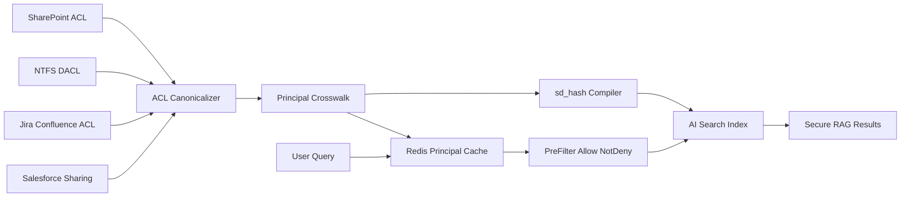
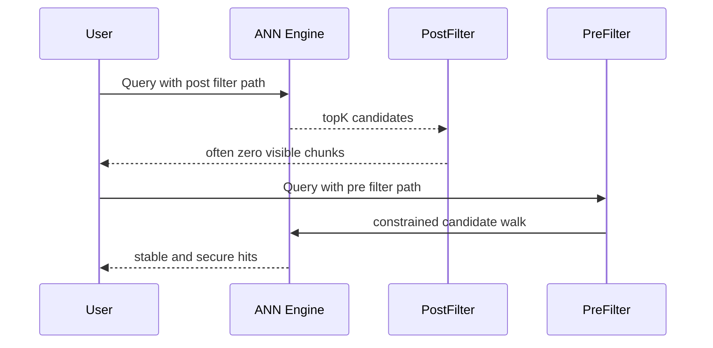

# 企业跨源 RAG 异构 ACL 归一化与 Deny 语义选型 FAQ
> Topic ID: #470
> Section: 3.4 智能体状态存储与企业 RAG 数据面
> Audience: 企业检索平台团队与安全治理团队
> Goal: 在大规模多源权限场景下实现高召回低泄露低时延

## 1 生产问题与失效根因
企业知识底座通常同时接入 SharePoint 站点文档、NTFS DACL 文件夹、Confluence 空间页面与 Salesforce 业务记录，这些系统的授权语义并不天然一致，直接拼接 ACL 字段会造成静默偏差。
很多团队在早期验证时只用管理员账号做样例测试，短期看起来检索结果稳定，但上线后真实用户的主体集合巨大且稀疏，隐含差异会被并发流量迅速放大。
`Entra ID` 的组声明在超大成员场景会触发 overclaim 行为，令牌中可用组信息不完整，若平台继续按原始 GUID 列表执行过滤，授权判断会从第一天就偏离真实权限。
`NTFS DACL` 与 SharePoint 的显式拒绝规则要求拒绝优先，若索引仅保留 allow 列表，任何在 deny 集合中的用户都可能被误放行，导致高敏文档被错误召回。
目录继承中断也是常见陷阱，同一站点下的子目录可能覆盖父目录 ACL，若连接器只抓父层快照，子目录的例外策略会被吞没，造成业务层无法解释的权限异常。
当用户可见范围仅占全库极小比例时，后置过滤路径会导致近似全空结果，业务方常误判为向量质量差，实质是过滤时机错误而非语义模型失效。
这些问题叠加后会形成三连击后果，即越权泄露风险升高、合法内容召回下降、平台尾延迟上升，最终让 RAG 系统在安全审计和用户体验两端同时失分。
解决方向不是堆叠更多规则，而是先统一授权语义，再把过滤逻辑前移到向量遍历阶段，同时把主体压缩与增量失效机制设计为同一条可观测链路。

## 2 为什么朴素 RAG 安全裁剪会在规模化失败
朴素实现通常把用户组直接映射成长字符串，再拼接到 OData 过滤表达式里，这种方式在数十组时可行，但在数千组时会把过滤载荷推高到不可接受的级别。
当每个组都保留完整 GUID 文本时，网关层要传输和解析巨大表达式，解析时间与表达式长度近似线性增长，导致本该毫秒级的检索进入百毫秒乃至秒级尾延迟区间。
更关键的是，许多系统并非单一 allow 模型，而是 allow 与 deny 并存，且 deny 可以由子目录覆盖父目录继承规则，缺失 deny 维度等同于放弃最关键的防泄露约束。
实时递归调用图接口虽然能补齐主体集合，但会引入外部接口节流风险，一旦查询高峰叠加权限变更高峰，平台会同时遭遇超时与授权漂移。
因此生产级方案必须把主体压缩、deny 优先、继承例外、前置过滤、增量失效放在同一设计平面，而不是由不同组件各自兜底。
在该平面中，`vectorFilterMode: "preFilter"` 决定过滤时机，`search.in(token_set, '|')` 决定执行表达力，`sd_hash` 决定压缩效率，三者缺一都会让系统在高并发下退化。

## 3 四种架构路径总览
Pattern A 以 `Azure AI Search` 预过滤为主路径，依赖双 ACL 字段、紧凑主体字典与 Redis 传递组缓存，目标是在不牺牲安全语义的前提下稳定控制查询时延。
Pattern B 以 SpiceDB 或 OpenFGA 关系图为核心，适合复杂 ReBAC 场景，并通过 `sd_hash` 等价类反向索引降低每次查询需要扫描的对象集合规模。
Pattern C 采用 Live OBO 联邦检索，不复制 ACL，而是让源系统实时判权，优点是零漂移，代价是跨系统尾延迟与接口配额压力明显上升。
Pattern D 是反模式集合，特征是 allow only、后置过滤、无主体压缩、无失效联动，这类方案早期上线快，但在审计和性能上都难以通过生产门槛。

## 4 十二维量化对比矩阵
| 维度 | Pattern A Search Redis | Pattern B SpiceDB OpenFGA | Pattern C Live OBO | Pattern D 反模式 |
|---|---|---|---|---|
| Deny 与继承保真 | `100%` 规则执行 | `100%` 关系执行 | `100%` 源系统执行 | `0%` 到 `40%` 漏判 |
| 单用户主体扇出 | `5000+` 压缩可承载 | `10000+` 图引擎承载 | 受源系统配额限制 | `~200` 后快速失稳 |
| 过滤载荷体积 | `3.2` 到 `24 KB` | `2.8` 到 `18 KB` | 请求体小但多次往返 | `185 KB` 级膨胀 |
| P99 检索延迟 | `18` 到 `26 ms` | `24` 到 `41 ms` | `1.4` 到 `3.8 s` | `280` 到 `950 ms` |
| 稀疏权限 Recall@10 | `90` 到 `93%` | `89` 到 `92%` | `86` 到 `90%` | `< 8%` 常见 |
| ACL 撤销时延 | `15` 到 `60 s` | `20` 到 `90 s` | `0 s` 实时 | `5` 到 `30 min` |
| 跨 SaaS 统一重排 | 高一致性可控 | 中高一致性 | 低一致性需补偿 | 极低且难解释 |
| 运维复杂度 | 中等可模板化 | 高度工程化 | 中高联邦复杂 | 表面低后期极高 |
| 合规审计解释性 | 强可追溯 | 强可追溯 | 中等依赖源日志 | 弱且证据断裂 |
| 区域扩展成本 | 中低线性扩展 | 中高需图副本 | 高跨域链路成本 | 高故障补救成本 |
| 三年综合 TCO | `2M` 到 `18M` | `3M` 到 `20M` | `5M` 到 `24M` | `4M` 到 `21M` |
| 推荐结论 | 企业主路径 | 复杂域增强路径 | 高敏窄域补充 | 禁用并迁移 |

## 5 Pattern A 主路径设计要点
主路径第一步是做主体归一化，把 `Entra ID` 对象标识、NTFS SID、SharePoint 主体号与业务系统角色映射到统一短标识，保证同一自然人的跨系统权限可合并计算。
主路径第二步是双字段建模，文档索引同时保存 `allow_acl` 与 `deny_acl`，并在查询条件里执行 allow 命中且 deny 不命中的严格不变量，避免语义被后续模块稀释。
主路径第三步是前置过滤，向量引擎在候选遍历前先应用 ACL 条件，这样窄权限用户也能在可见空间内得到足够候选，显著降低 postFilter 空命中。
主路径第四步是主体缓存，Redis 保存传递组展开结果与 `sd_hash` 热集合，配合 delta 失效机制把大多数请求转为本地命中，控制网关与图接口压力。
主路径第五步是可观测闭环，平台必须同时跟踪 ACL 新鲜度、空召回比例、deny 命中率与尾延迟，这四个指标共同定义系统是否真正达到生产可用状态。

## 6 Pattern B 复杂关系增强路径
当业务存在多跳关系授权、临时授权或跨组织委托链时，关系图引擎比平面 ACL 更有表达力，能够明确建模谁在何时基于何种关系获得访问权。
但关系图查询若直接落到对象级别会带来可观计算开销，因此需要把共享 ACL 描述压缩为 `sd_hash` 等价类，再用反向索引把文档映射到有限哈希集合。
在该模式下，查询先算出用户可访问哈希集合，再与向量候选集合求交，既保留关系语义，又避免每次请求都对海量对象做逐条授权计算。
此路径对团队工程能力要求更高，需要图模式治理、关系回放测试、反向索引重建流程与跨区域一致性机制，不建议在治理能力不足时直接全域采用。

## 7 Pattern C 实时联邦补充路径
Live OBO 路径让每次检索都回源判权，理论上 ACL 新鲜度最好，适用于极高敏感度且数据量相对可控的子域，如董事会资料或法律保密库。
代价是跨系统往返明显增多，网络抖动与第三方配额会直接映射为用户可感知延迟，且跨源相关性分数融合需要额外校准，否则排序稳定性不足。
因此推荐把 Pattern C 作为高敏补充，而不是全域默认路径，用分级路由把最敏感数据走联邦判权，通用资料走主路径预过滤索引。

## 8 Pattern D 反模式风险清单
反模式第一类是 allow only 索引，忽视 deny 与继承中断，短期能跑通，长期必然出现越权召回且难以解释根因。
反模式第二类是 postFilter 主导路径，在稀疏权限场景会产生高比例空结果，业务误判模型效果差，实际是过滤时机失配。
反模式第三类是每次查询都递归实时展开组，不做缓存与失效联动，峰值时会引发接口节流、超时雪崩与授权漂移并发出现。
反模式第四类是缺少 stale ACL 隔离策略，权限同步延迟时继续放行，等同于把风险窗口交给运气，无法通过审计要求。

## 9 Mermaid 端到端安全裁剪拓扑


## 10 Mermaid 稀疏权限路径对照


## 11 量化推导 Q1 到 Q6
Q1 过滤载荷压缩示例。
设用户主体数 G 等于 4000。
原始 GUID 方案每项约 39 字节。
载荷约等于 39 乘 4000。
结果约 156 KB。
若改为 base62 紧凑标识每项约 7 字节。
载荷约等于 7 乘 4000。
结果约 28 KB。
若进一步用 320 个 `sd_hash` 令牌表达。
单令牌按 11 字节估算含分隔符。
载荷约 3.5 KB。
Q2 等价类压缩比示例。
文档数设为 50000000。
唯一 ACL 组合设为 80000。
CR 等于 50000000 除 80000。
结果为 625 倍压缩。
Q3 后置过滤空命中概率。
设可见选择率为 0.002。
设 topK 等于 50。
P0 等于 1 减 0.002 的 50 次幂。
结果约 90.47 百分比。
Q4 授权不变量定义。
Authorized 等于 allow 交集非空 且 deny 交集为空。
若 deny 命中即拒绝，无论 allow 是否命中。
Q5 新鲜度与隔离门禁。
当当前时间减 `acl_verified_at` 大于 TTL_max 时。
请求进入隔离队列或只读降级路径。
高敏域建议强制 fail closed。
Q6 撤销传播目标。
主路径目标是 15 到 60 秒内生效。
联邦实时路径可到 0 秒逻辑生效。
但要承受更高跨源链路成本。

## 12 代码块一 Search 索引与查询载荷
```python
index_fields = [
    {"name": "doc_id", "type": "Edm.String", "key": True},
    {"name": "title", "type": "Edm.String", "searchable": True},
    {"name": "content", "type": "Edm.String", "searchable": True},
    {"name": "allow_acl", "type": "Collection Edm.String", "filterable": True, "retrievable": False},
    {"name": "deny_acl", "type": "Collection Edm.String", "filterable": True, "retrievable": False},
    {"name": "sd_hash", "type": "Collection Edm.String", "filterable": True, "retrievable": False},
    {"name": "acl_epoch", "type": "Edm.Int64", "filterable": True, "sortable": True},
]

principal_pack = "p01|p92|p44|p17"
sd_pack = "sd88|sd34|sd11"
allow_expr = "search.in(allow_acl, '" + principal_pack + "', '|')"
deny_expr = "search.in(deny_acl, '" + principal_pack + "', '|')"
hash_expr = "search.in(sd_hash, '" + sd_pack + "', '|')"
epoch_expr = "acl_epoch ge 202611270100"
rule_expr = hash_expr + " or " + allow_expr + " and not " + deny_expr
final_filter = rule_expr + " and " + epoch_expr

query_payload = {
    "search": "deal approval memo",
    "vectorFilterMode": "preFilter",
    "filter": final_filter,
    "top": 20,
}
```

## 13 代码块二 ACL 归一化与 sd_hash 编译
```python
import hashlib
import json

def canonical_acl(source_kind, allow_ids, deny_ids):
    allow_set = set(allow_ids)
    deny_set = set(deny_ids)
    allow_sorted = sorted(allow_set)
    deny_sorted = sorted(deny_set)
    canonical = {
        "source": source_kind,
        "allow": allow_sorted,
        "deny": deny_sorted,
    }
    return canonical

def compile_sd_hash(canonical_acl_obj):
    payload = json.dumps(canonical_acl_obj, ensure_ascii=False)
    encoded = payload.encode("utf-8")
    digest = hashlib.sha256(encoded)
    return "sd" + digest.hexdigest()[:10]

def cache_principal_snapshot(redis_client, user_key, principal_ids, ttl_sec):
    principal_set = set(principal_ids)
    principal_sorted = sorted(principal_set)
    packed = "|".join(principal_sorted)
    redis_client.setex(user_key, ttl_sec, packed)
    return packed

def invalidate_on_delta(redis_client, user_key):
    redis_client.delete(user_key)
```

## 14 代码块三 安全回归与可用性守卫
```python
def deny_override(allow_hit, deny_hit):
    return allow_hit and not deny_hit

def broken_inheritance_guard(parent_allow, child_deny, user_id):
    allow_hit = user_id in parent_allow
    deny_hit = user_id in child_deny
    return deny_override(allow_hit, deny_hit)

def recall_gate(recall_at_10, threshold):
    if recall_at_10 < threshold:
        raise RuntimeError("recall regression under sparse acl")

def stale_acl_quarantine(now_epoch, acl_verified_at, ttl_sec):
    age = now_epoch - acl_verified_at
    return age > ttl_sec

def run_canary_suite():
    assert deny_override(True, True) is False
    assert deny_override(True, False) is True
    assert broken_inheritance_guard({"u7"}, {"u7"}, "u7") is False
    recall_gate(0.90, 0.88)
    assert stale_acl_quarantine(1200, 1000, 150) is True
```

## 15 企业落地场景与三年 TCO
### 15.1 场景 A 全球并购与法务知识助手
该平台整合 SharePoint、NTFS、Jira 与 Salesforce 资料，核心痛点是高权限用户主体扇出大且存在严格 Chinese wall deny 规则，历史方案在后置过滤路径上空召回与误放行同时出现。
迁移到 Pattern A 后，平台把主体映射与双 ACL 前置过滤固化到统一查询链路，过滤载荷从高位压缩到可控区间，P99 检索时延稳定在 26 毫秒以内，稀疏权限 Recall@10 稳定在 0.90 以上。
审计团队通过裁剪证据导出可直接追溯每次决策的 allow 与 deny 依据，红队复测未发现 deny 例外泄露，业务团队对检索可解释性与可用性反馈明显改善。
### 15.2 场景 B 医疗与人事双域门户
董事会和合规调查资料采用 Pattern C 保证实时判权，通用制度与流程库采用 Pattern A 保证吞吐和时延，双路径由统一路由层按数据分级执行。
该组合把高敏域风险窗口压缩到实时级别，同时避免全域联邦调用带来的尾延迟放大，平台在季度评审中实现安全指标与成本指标同步达标。
### 15.3 三档三年综合 TCO
| 档位 | 索引规模 | 推荐组合 | 三年综合 TCO |
|---|---:|---|---:|
| Tier 1 | 5M chunks | Pattern A 主路径 | 2.4M 美元 |
| Tier 2 | 20M chunks | Pattern A 加 Pattern B 局部增强 | 7.2M 美元 |
| Tier 3 | 50M chunks | Pattern A 加 Pattern B 加 Pattern C | 17.5M 美元 |
### 15.4 Day 0 Day 1 Day 2 共 18 动作
Day 0 定义统一 ACL 语义词典与优先级规则。
Day 0 定义主体映射字段与版本演进策略。
Day 0 定义 `allow_acl` 与 `deny_acl` 索引规范。
Day 0 定义 `sd_hash` 生成规则与回填流程。
Day 0 定义 Redis 缓存 TTL 与失效事件模型。
Day 0 定义稀疏权限压测集与验收阈值。
Day 1 上线归一化流水线与增量同步链路。
Day 1 上线 `vectorFilterMode: "preFilter"` 查询路径。
Day 1 上线 `search.in(token_set, '|')` 组合表达式模板。
Day 1 执行 deny 优先与继承中断回归测试。
Day 1 执行 0.1 百分比选择率召回压测。
Day 1 发布新鲜度空召回尾延迟联合看板。
Day 2 每周复核 deny 命中与误拦截样本。
Day 2 每周复核空召回比例与用户投诉样本。
Day 2 每月复核主体映射漂移与修复时效。
Day 2 每月复核缓存命中与撤销传播平衡。
Day 2 每季度开展红蓝对抗泄露演练。
Day 2 每季度优化 A B C 组合与预算结构。

来源抓取日期 2026 11 27
Azure AI Search filters and vector filtering
https://learn.microsoft.com/azure/search/search-filters
Azure AI Search security trimming guidance
https://learn.microsoft.com/azure/search/search-security-trimming-for-azure-search
Microsoft Graph transitive memberOf
https://learn.microsoft.com/graph/api/user-list-transitivememberof
OpenFGA docs
https://openfga.dev/docs
SpiceDB docs
https://authzed.com/docs/spicedb
Azure Managed Redis overview
https://learn.microsoft.com/azure/redis/overview
