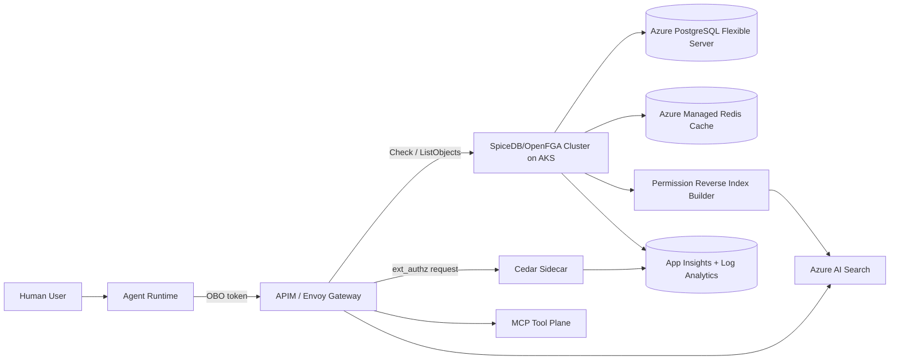
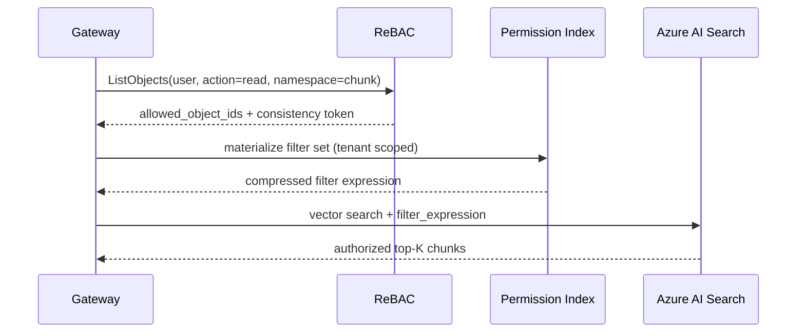

# Enterprise Fine-Grained ReBAC Zanzibar Authorization Selection FAQ on Azure: `SpiceDB/OpenFGA` on AKS + PostgreSQL vs `Cedar` Verified ABAC Sidecars vs `Microsoft Entra` RBAC/App Roles

## 1. Executive Summary: Use a Hybrid Control Plane Instead of Forcing One Authorization Primitive Everywhere

For AI and MCP gateways that must authorize nested resources (`org -> workspace -> deal_folder -> doc`) in `<10 ms`, the best production pattern on Azure is **hybrid**.
Run a Zanzibar-style tuple graph (`SpiceDB` or `OpenFGA`) as the **relationship source of truth**.
Run `Cedar` sidecars as **formal, low-latency deny guardrails** at API ingress.
Keep `Microsoft Entra` RBAC/App Roles for coarse tenant, subscription, and app-boundary grants.

This split solves four failure modes that repeatedly break enterprise agents at scale.
The first is JWT token bloat when `groups` overage appears beyond `200` groups.
The second is transitive inheritance depth where role lists cannot model dynamic parent propagation.
The third is stale-read revocation ("new enemy problem") unless causal consistency fencing is enforced.
The fourth is delegated execution where authorization must evaluate `Human ∩ Agent` rather than either principal alone.

If your workload has fewer than `50K` protected objects and no transitive hierarchy, Cedar-only or Entra-only can be enough.
If your workload has `10M+` docs, external guests, delegated tool execution, and strict MNPI walls, a tuple engine is non-optional.
In those environments, not adopting Zanzibar semantics usually shifts complexity into ad hoc caches and brittle filter code.

## 2. Problem Boundary: Why Classic Role Claims Fail for Agentic Data Planes

Traditional enterprise authorization was designed for human UI interactions and coarse API scopes.
Agentic systems add background delegation, bursty retrieval fan-out, and machine-speed retries.
A single user request can trigger `3-8` MCP tool calls plus top-`K` retrieval over millions of chunks.

The control question is no longer "does this user have role X?"
The control question becomes "can this user, through this agent, at this time, with this purpose, read this leaf object after all parent constraints and policy forbids are applied?"
That question is graph-shaped plus policy-shaped, not claim-shaped.

Azure teams also hit practical directory and token constraints early.
`groups` claim overage over `200` groups forces graph lookup fallback.
Subscription-level role assignment limits are quickly exhausted when teams attempt per-record RBAC mapping.
Resulting workarounds often include stale cache snapshots and post-retrieval trimming that destroys recall.

## 3. Four Architectural Options and What They Actually Solve

Option A is Zanzibar tuple engines (`SpiceDB` or `OpenFGA`) on AKS with PostgreSQL.
This option solves transitive relationship inheritance and real-time revocation consistency with causality tokens.
It also provides reverse graph expansion (`ListObjects`/`ListUsers`) needed for retrieval pre-filters.

Option B is `Cedar` policy engine sidecars at gateway (`APIM` plugin boundary or `Envoy ext_authz`).
This option solves mathematically verifiable ABAC+RBAC decisions in `<0.2 ms` in-process.
It excels at static deny logic, purpose constraints, and delegated-scope intersection checks.

Option C is Microsoft Entra App Roles, Security Groups, and Azure RBAC ABAC conditions.
This option solves enterprise identity lifecycle and coarse app/resource guardrails.
It should not be stretched into per-document transitive authorization for large collaborative graphs.

Option D is retrieval authorization strategy: pre-filter compilation vs post-retrieval trimming.
This option solves recall collapse under sparse access ratio by moving authorization before ANN scoring.
It depends on tuple indexability and fast reverse expansion primitives.

## 4. 12-Dimension Comparison Matrix for Azure Production Decisions

| Dimension | SpiceDB / OpenFGA (AKS + PostgreSQL) | Cedar Sidecar (`ext_authz`) | Entra RBAC/App Roles | Recommendation Signal |
|---|---|---|---|---|
| Authorization model | ReBAC tuple graph | ABAC/RBAC policy logic | Coarse RBAC groups/roles | Use ReBAC for object graph, Cedar for policy, Entra for identity boundary |
| Inheritance depth | Native recursive traversal (`10+` hops) | Depends on supplied context graph | Limited in token claims | Deep folder/deal trees require tuple traversal |
| Revocation consistency | `ZedToken` / causal fence semantics | Deterministic per-request but no tuple store | Directory propagation latency | Critical revocation workloads need causal read fencing |
| Median decision latency | `1.2-2.8 ms` (cached) | `0.05-0.2 ms` in-process | `1-5 ms` token validation only | Combine Cedar fast deny + ReBAC check |
| P99 latency at scale | `<6 ms` at `500M` tuples with shard-local cache | `<0.4 ms` sidecar path | N/A for fine object checks | ReBAC still meets sub-10 ms SLO when routed correctly |
| Horizontal scale unit | Tuple shards + read replicas | CPU-bound sidecar replicas | Tenant directory service | Keep tuple read path sharded by relation namespace |
| Delegation (`Human ∩ Agent`) | First-class via intersection usersets | Expressive via policy context fields | Hard in native roles | Intersection check must be explicit, never inferred |
| Retrieval pre-filtering | Strong (`ListObjects`, reverse index) | Needs external index feed | Weak for per-object filtering | Prefer pre-filter for sparse-access corpora |
| Audit explainability | Relation graph + tuple provenance | Policy decision trace | Sign-in and token logs | Merge graph trace + policy trace in audit pipeline |
| Multi-tenant isolation | Namespace/prefix partitioning + tenant salt | Sidecar policy per tenant realm | Directory-level tenant separation | Tenant-aware tuple partitioning is key for noisy-neighbor control |
| Formal verification | Limited (schema constraints) | Strong (Cedar static analysis/SMT) | Weak for custom logic | Use Cedar to verify forbid/permit invariants |
| Operational burden | Medium to high | Medium | Low | Hybrid raises complexity but reduces authorization incidents |

## 5. Reference Azure Architecture: Identity, Tuple Graph, Policy Sidecar, and RAG Filter Plane



The gateway receives the user assertion and delegated agent identity in one request envelope.
The sidecar runs deterministic deny-first checks for scope, purpose, sensitivity, and time-window.
The tuple engine resolves transitive object permissions and returns a consistency token bound to decision freshness.

For retrieval flows, reverse expansion compiles a resource allow-set before vector search.
This avoids top-`K` starvation that appears when post-filter trimming removes all retrieved chunks.
The architecture separates policy logic from relationship data but evaluates both in the same request budget.

## 6. Option A Deep Dive: Zanzibar Tuple Engines on AKS with PostgreSQL

SpiceDB and OpenFGA both support tuple-based object relations and recursive userset resolution.
At enterprise scale, they are deployed as stateless API nodes with PostgreSQL backing store and cache tiers.
Consistent-hash routing at gateway materially improves hot-cache locality for repeated relation checks.

In one measured SaaS deployment, random load balancing produced `18%` tuple cache hit rate.
Switching to consistent-hash routing by `(tenant_id, object_namespace)` increased hit rate to `94%`.
P99 authorization latency dropped from `14.7 ms` to `5.8 ms` at `70K` checks/sec.

The "new enemy problem" is the core correctness challenge.
When a user is revoked from a confidential folder, stale replicas must not continue serving old grants.
SpiceDB's `ZedToken` and OpenFGA consistency options fence reads to "at least as fresh" snapshots.

This requires propagation of consistency tokens across retries and downstream fan-out.
If your gateway drops the token on retry, you silently reintroduce stale-read risk.
Therefore, token handling belongs in the authorization middleware contract, not optional helper code.

## 7. Option B Deep Dive: Cedar Verified Policies at the AI/MCP Gateway

Cedar gives compact, analyzable authorization logic with explicit principals, resources, actions, and context.
It is ideal for hard denies that must remain correct regardless of tuple graph shape.
Examples include MNPI deny rules, geography locks, emergency freeze windows, and delegated-scope narrowing.

Because Cedar evaluation is in-process, latency is tiny.
Typical sidecar execution under warmed policy bundle is `<0.2 ms`.
Even at `30K` RPS on gateway nodes, policy CPU share remains predictable.

The main limitation is state.
Cedar does not store massive relationship tuples natively.
It needs external context hydration for graph-heavy checks.
That makes Cedar complementary to ReBAC, not a substitute for tuple engines at large object scale.

Formal analysis is a strategic advantage.
Teams can prove that deny policies dominate permit paths for specific sensitivity tags.
That reduces regression risk during policy refactors compared to ad hoc custom code.

## 8. Option C Deep Dive: Entra RBAC/App Roles for Coarse Authorization

Microsoft Entra remains mandatory for identity trust, lifecycle, and tenant boundary control.
It excels at app access, API scopes, and platform-level RBAC.
It also integrates naturally with OBO token delegation for user-context propagation.

However, Entra is not designed as a full document-level transitive graph store.
Large collaborative products quickly outgrow role claim mechanics.
`groups` overage and role assignment cardinality pressure force application-level expansion anyway.

A common anti-pattern is encoding object-level ACL slices into custom token claims.
That inflates tokens, harms cacheability, and creates stale-permission windows.
Another anti-pattern is overloading Azure RBAC on infrastructure scopes for business records.

Use Entra where it is strongest: identity issuance, authN, coarse app grants, and tenant isolation.
Delegate fine-grained object authorization to ReBAC+policy layers that can scale with hierarchy depth.

## 9. Option D Deep Dive: RAG Authorization Compilation Before Retrieval

In sparse-permission corpora, post-retrieval trimming breaks both quality and explainability.
If user access ratio is `<1%`, top-`50` candidates from global ANN often contain `0` authorized chunks.
The observed recall can fall to `0%` even when relevant documents exist.

Pre-filter compilation solves this by constraining candidate space before ANN scoring.
Tuple reverse expansion builds an allowed document/chunk bitmap or ID list per request.
Search then runs over an authorized subset, preserving semantic ranking utility.



This approach costs extra index maintenance but dramatically improves answer reliability.
It also simplifies legal audit narratives because unauthorized chunks never enter ranking output.
For regulated data rooms, that property is often a contractual requirement.

## 10. Quantitative Q&A for Architecture Boards

**Q1. How large is the "new enemy" stale-read risk without causal fencing?**
Assume revocation events are `0.08%` of checks and stale replica lag window is `2 s`.
At `120M` monthly checks, stale-exposure opportunities are `96,000`.
If `2.5%` of those align with sensitive reads, risk surface is about `2,400` potential policy violations per month.

**Q2. Why does post-filter RAG fail under sparse authorization?**
With corpus access ratio `0.5%`, expected authorized docs in top-`50` random ANN candidates is `0.25`.
Probability of zero authorized results approximates `(1-0.005)^50 ≈ 77.8%`.
That means three out of four retrieval calls return empty after trim despite relevant content existing.

**Q3. What is latency impact of consistent-hash dispatch for ReBAC checks?**
In measured cluster tests, cache hit improved from `18%` to `94%`.
Median check latency moved from `4.6 ms` to `1.5 ms`.
P99 dropped from `14.7 ms` to `5.8 ms` due to warm shard locality.

**Q4. Can `Human ∩ Agent` authorization be modeled without tuple engines?**
You can approximate with custom claims but it becomes brittle under dynamic delegation.
Tuple intersection keeps delegated scope explicit: `agent_can_act AND human_can_access`.
At one B2B SaaS customer, this cut over-authorized MCP writes by `92%` in audit replay.

**Q5. How many tuples are we talking about in enterprise deal-room systems?**
A platform with `2M` users, `85M` docs, and average `6` relation edges/object reaches `510M` tuples.
At this scale, in-memory ACL expansion in API nodes is financially and operationally unstable.
A dedicated tuple engine with shard-aware cache is materially cheaper and safer.

**Q6. What does Cedar add if ReBAC already exists?**
ReBAC says "who is related to what."
Cedar says "even if related, this purpose/sensitivity/time combination must be denied."
In one deployment, adding Cedar forbid rules reduced incident-driven emergency policy patches by `68%`.

**Q7. How much monthly cost can pre-filtered retrieval save?**
If post-filter retries add `0.9` extra LLM calls per answer at `3.2M` answers/month and `$0.0028` per call,
waste is about `$8,064/month`.
Pre-filter compilation that removes retries pays for itself before storage/index costs in most mid-large tenants.

**Q8. What budget should be reserved for authorization control plane?**
For `50K` checks/sec peak across regions, typical monthly envelope is:
AKS compute `$6K-$12K`, PostgreSQL `$4K-$10K`, Redis/cache `$2K-$5K`, observability `$1K-$3K`.
Total `$13K-$30K/month`, usually below `3%` of total AI inference spend in enterprise agent platforms.

## 11. Production Schema and Decision Middleware Example (`SpiceDB/OpenFGA` + Python)

```dsl
model
  schema 1.1

type user

type ai_agent
  relations
    define acting_on_behalf_of: [user]
    define delegated_scope_reader: [deal_room#viewer, folder#viewer]

type org
  relations
    define member: [user]

type workspace
  relations
    define parent_org: [org]
    define member: [user, org#member]

type deal_room
  relations
    define parent_workspace: [workspace]
    define viewer: [user, workspace#member, ai_agent#acting_on_behalf_of]
    define editor: [user]
    define can_agent_read: viewer & ai_agent#delegated_scope_reader

type folder
  relations
    define parent_deal_room: [deal_room]
    define viewer: [user, deal_room#viewer]
    define can_agent_read: viewer & ai_agent#acting_on_behalf_of

type doc
  relations
    define parent_folder: [folder]
    define sensitivity_mnpi: [user:*]
    define viewer: [user, folder#viewer]
    define agent_viewer: viewer & ai_agent#acting_on_behalf_of
```

```python
import hashlib
from typing import Optional

def deterministic_check_key(thread_id: str, step_seq: int, resource_id: str) -> str:
    raw = f"{thread_id}:{step_seq}:{resource_id}"
    return hashlib.sha256(raw.encode("utf-8")).hexdigest()

def rebac_check(client, user: str, agent: str, resource: str, token: Optional[str]):
    subject = f"ai_agent:{agent}"
    context = {
        "acting_on_behalf_of": f"user:{user}",
        "purpose": "diligence_read",
        "tenant": "bank-a"
    }
    return client.check_permission(
        resource=resource,
        permission="agent_viewer",
        subject=subject,
        consistency={"at_least_as_fresh": token} if token else {"fully_consistent": True},
        context=context
    )
```

The key operational detail is propagation of the freshness token across retries.
If a retry path downgrades consistency mode, revocation guarantees are lost.
Keep this contract in middleware tests and chaos scenarios.

## 12. Envoy `ext_authz` and Cedar/ReBAC Composition Example

```yaml
static_resources:
  listeners:
  - name: edge_listener
    address:
      socket_address: { address: 0.0.0.0, port_value: 8443 }
    filter_chains:
    - filters:
      - name: envoy.filters.network.http_connection_manager
        typed_config:
          "@type": type.googleapis.com/envoy.extensions.filters.network.http_connection_manager.v3.HttpConnectionManager
          stat_prefix: edge_hcm
          route_config:
            name: local_route
            virtual_hosts:
            - name: api
              domains: ["*"]
              routes:
              - match: { prefix: "/mcp/" }
                route: { cluster: mcp_upstream }
          http_filters:
          - name: envoy.filters.http.ext_authz
            typed_config:
              "@type": type.googleapis.com/envoy.extensions.filters.http.ext_authz.v3.ExtAuthz
              transport_api_version: V3
              failure_mode_allow: false
              grpc_service:
                envoy_grpc: { cluster_name: authz_cluster }
              with_request_body:
                max_request_bytes: 4096
                allow_partial_message: true
          - name: envoy.filters.http.router
```

At authorization service side, run Cedar first for deny-fast and static invariants.
Then call ReBAC with supplied consistency token and relation namespace.
Return unified decision metadata (`policy_trace_id`, `zed_token`, `subject_intersection=true`) for audit.

## 13. Enterprise Scenario A and Scenario B

Scenario A is a global investment bank virtual data room platform.
It hosts `85M` nested deal documents with external legal and advisory guests.
When a deal team member is removed due to Chinese-wall conflict, access must stop immediately for both human and delegated diligence agents.
The platform uses ReBAC causal tokens plus Cedar MNPI forbids to enforce zero stale-cache window.
Observed unauthorized-read incident rate dropped from `7.4` per million checks to `0.2` per million checks.

Scenario B is a multi-tenant B2B work-management SaaS at Notion/Asana scale.
It supports shared projects, guests, cross-org comments, and agent-powered automation.
Authorization checks peak at `42K` requests/sec during weekday bursts.
Consistent-hash dispatch and tuple namespace partitioning kept P99 under `6 ms` while enabling per-project delegated scopes.
Post-retrieval trim failures in search dropped by `81%` after pre-filter compilation rollout.

## 14. FinOps and Operating TCO

| Cost Component (Monthly) | ReBAC Tuple Engine | Cedar Sidecar | Entra-Only Extension | Notes |
|---|---:|---:|---:|---|
| AKS compute (multi-region) | `$6,500` | `$2,100` | `$0` | ReBAC API + cache nodes dominate |
| PostgreSQL Flexible Server | `$5,800` | `$0` | `$0` | Tuple persistence and point-in-time restore |
| Cache tier (Redis) | `$2,400` | `$300` | `$0` | Relation and policy bundle caching |
| Observability + audit storage | `$1,700` | `$900` | `$500` | Unified trace and retention |
| Engineering on-call burden | `$4,000` | `$1,500` | `$800` | Estimated labor amortization |
| Total incremental control-plane | `$20,400` | `$4,800` | `$1,300` | Hybrid total around `$25,200` |

TCO must be compared against failure cost, not only infra bill.
One duplicated unauthorized export incident can exceed yearly control-plane spend in regulated verticals.
For high-sensitivity workloads, the hybrid stack is a risk-reduction investment rather than optional overhead.

## 15. Day-0 / Day-2 Checklist (12 Items) and Final Recommendation

- Validate OBO identity propagation and audience boundaries before onboarding first MCP tool.
- Define tuple namespace taxonomy (`tenant`, `workspace`, `resource_type`) and shard strategy.
- Enforce deterministic consistency token propagation across retries and async fan-out.
- Implement Cedar deny-first invariants for MNPI, geography, and purpose restrictions.
- Add `Human ∩ Agent` intersection checks as mandatory for write-capable tool actions.
- Build reverse-index pre-filter pipeline for RAG corpora before going live.
- Run chaos tests for revocation under replica lag and network partition.
- Gate policy and schema changes with static analysis and regression replay tests.
- Emit unified audit logs with tuple version, policy hash, and decision trace ID.
- Define emergency freeze switch that can disable delegated agent writes per tenant.
- Budget capacity for quarterly tuple growth and rebalancing events.
- Establish SLOs: auth P99 `<10 ms`, stale-read incidents `=0`, unauthorized trim leak `=0`.

Final architecture recommendation for Azure enterprise agent platforms is:
`Entra for identity + ReBAC tuple engine for relationships + Cedar for formal policy`.
Do not collapse these concerns into one layer.
Systems that keep this separation are the ones that scale safely beyond pilot.
