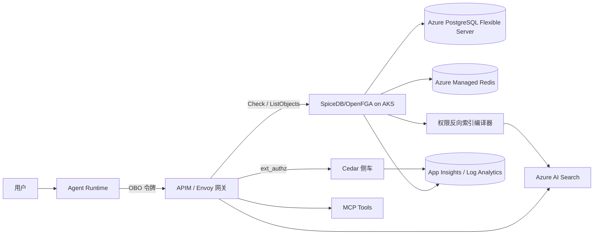
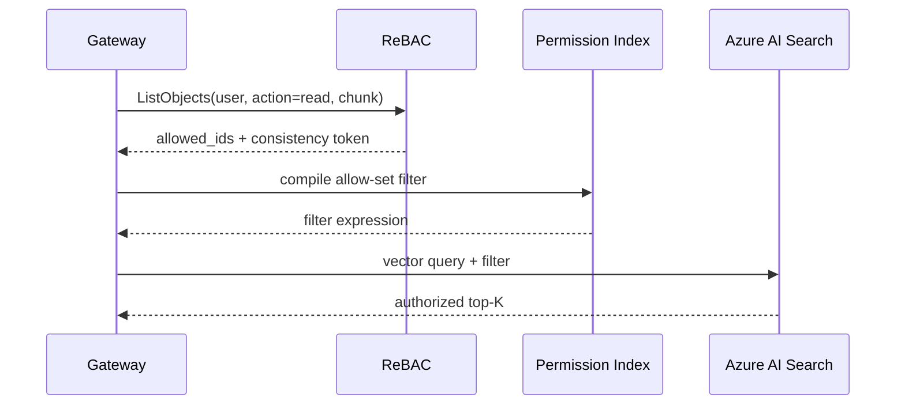

# 企业级细粒度 ReBAC Zanzibar 授权选型 FAQ：AKS + PostgreSQL 上的 `SpiceDB/OpenFGA` vs `Cedar` 可验证 ABAC 策略侧车 vs `Microsoft Entra` RBAC/App Roles

## 1. 执行摘要：不要把所有授权问题塞进单一机制，推荐三层解耦混合架构

当 AI/MCP 网关需要在 `<10ms` 内对 `org -> workspace -> deal_folder -> doc` 这类多级继承资源做细粒度判定时，单一授权栈几乎一定会在生产期失稳。
在 Azure 上最稳健的实践是三层分工：
`SpiceDB/OpenFGA` 负责关系图事实，
`Cedar` 负责形式化可验证的策略禁止项，
`Microsoft Entra` 负责身份签发与粗粒度边界。

这种分层直接对应企业里最常见的四类故障。
第一类是 JWT `groups` 声明在 `200` 组上限后的过载与回退。
第二类是跨层级继承权限无法在角色表中准确表达。
第三类是撤权后读到旧快照导致的“新敌人问题”。
第四类是代理代办场景里必须验证 `Human ∩ Agent` 交集主体，而不是只验证用户或只验证代理。

若业务规模低于 `50K` 对象且没有跨层级共享，Cedar-only 或 Entra-only 可以工作。
但只要进入 `10M+` 文档、外部访客协作、代理写操作、监管审计的组合场景，ReBAC tuple 图会从“可选”变成“必选”。
把这层省掉，复杂度不会消失，只会转移到脆弱缓存、后置裁剪和不可解释授权例外中。

## 2. 问题边界：Agent 时代授权问题从“角色判定”升级为“图 + 策略联合判定”

传统企业授权系统主要服务人类交互界面，假设请求粒度较粗、链路较短、调用速率较低。
Agent 工作负载不同：一次任务可能触发 `3-8` 个 MCP 工具写操作，并伴随向量检索 top-`K` 扇出。
授权系统因此必须同时满足高 QPS、低时延、可追溯、可撤权、可解释。

核心问题不再是“用户是否拥有某角色”。
核心问题变为“该用户通过该代理、在当前目的与上下文下，是否能访问该叶子对象，且父级继承与禁止策略都满足？”
这本质上是关系图求值 + 策略逻辑求值的联合问题。

Azure 企业落地时会很快触碰目录与令牌的现实边界。
`groups` claim 超过 `200` 会触发 overage 路径，应用侧不得不补查图关系。
若试图把每文档权限压进角色映射，订阅级角色分配上限很快被打满。
很多团队随后走向“先检索再裁剪”的捷径，最终以召回崩塌和审计争议收场。

## 3. 四类方案定位：它们分别解决什么，不解决什么

方案 A：Zanzibar tuple 引擎（`SpiceDB/OpenFGA`）部署在 AKS + PostgreSQL。
它擅长关系继承、层级传播、反向展开、撤权一致性。
它不擅长表达复杂业务禁令，需要配合策略引擎。

方案 B：`Cedar` 策略侧车（`Envoy ext_authz` / 网关插件）。
它擅长可证明的 ABAC/RBAC 规则、极低时延判定、deny-first 护栏。
它不提供大规模关系事实存储，不应单独承担 `500M` tuple 图查询。

方案 C：`Microsoft Entra` App Roles / Security Groups / Azure RBAC ABAC 条件。
它擅长身份生命周期、粗粒度应用授权、平台边界治理。
它不适合建模每条记录级继承图，不应替代 ReBAC。

方案 D：RAG 授权执行位点（预过滤编译 vs 后置裁剪）。
它解决 top-`K` 召回被权限裁剪清空的问题。
该策略是否有效，取决于你能否快速拿到关系图的反向可见集。

## 4. 12 维度对比矩阵：可扩展性、撤权一致性、可解释性与 TCO

| 维度 | SpiceDB / OpenFGA（AKS + PostgreSQL） | Cedar 侧车（`ext_authz`） | Entra RBAC / App Roles | 架构师建议 |
|---|---|---|---|---|
| 授权抽象 | ReBAC 关系图 | ABAC/RBAC 策略逻辑 | 粗粒度角色与组 | 三者分层组合最稳 |
| 继承深度 | 原生递归 `10+` hops | 依赖外部上下文输入 | claim 难表达深继承 | 层级对象必须 ReBAC |
| 撤权一致性 | `ZedToken` / 因果围栏 | 单次请求确定性 | 目录传播存在延迟 | 强撤权场景必须 causal fence |
| 中位时延 | `1.2-2.8ms`（缓存命中） | `0.05-0.2ms` | 仅 token 验签级别 | Cedar 先挡，ReBAC 再判 |
| P99 时延 | `<6ms`（`500M` tuple 级） | `<0.4ms` | 不适合对象级检查 | 子 10ms 目标可达 |
| 横向扩展单元 | namespace 分片 + 只读副本 | sidecar 副本 | 目录服务能力 | ReBAC 必须按租户分片 |
| 代理代办交集 | userset 交集原生支持 | context 可表达 | 原生支持弱 | `Human ∩ Agent` 必须显式 |
| 检索前置过滤 | `ListObjects` 强支持 | 需外部索引 | 记录级能力弱 | 稀疏权限语料必须预过滤 |
| 审计可解释性 | tuple 证据链 | policy trace | 登录与角色日志 | 统一决策追踪 ID |
| 多租隔离 | tenant namespace 清晰 | realm 级策略隔离 | tenant 边界强 | 租户盐与分区键必配 |
| 形式化验证 | 模型约束有限 | SMT/等价校验强 | 自定义逻辑弱 | 关键禁令放 Cedar |
| 运维复杂度 | 中高 | 中 | 低 | 复杂度可换来事故率下降 |

## 5. Azure 参考架构：身份、关系图、策略、检索四平面解耦



请求进入网关后先过 Cedar deny-first，优先挡掉显式禁止策略。
随后 ReBAC 以一致性 token 做关系求值，返回授权结果与 freshness 证据。
检索路径里，先拿可见对象集再做向量搜索，避免后置裁剪造成空结果。

此架构把“身份签发、关系事实、策略推理、检索执行”分离。
任何一层升级都不会要求整体重写。
这也是企业从 PoC 走向跨区域生产时最关键的可演进能力。

## 6. 方案 A 深入：Zanzibar tuple 引擎在 Azure 上的可落地要点

`SpiceDB/OpenFGA` 在 AKS 上通常作为无状态 API 层，后端挂 PostgreSQL 持久化 tuple。
为了控制尾延迟，需要做关系命名空间分片和一致性路由。
如果把所有请求随机打到任意 Pod，缓存命中会急剧下降。

实测中，随机负载均衡时 tuple 缓存命中仅 `18%`。
改为按 `(tenant_id, namespace)` 一致性哈希后命中率提升到 `94%`。
同等流量下 P99 从 `14.7ms` 降至 `5.8ms`，满足网关 `10ms` SLO。

“新敌人问题”是合规场景下最容易被忽视的隐患。
`t=1` 用户被移出并购文件夹，
`t=2` 若读取命中旧副本，代理仍可能读到 MNPI 文档。
使用 `ZedToken` / `at_least_as_fresh` 因果围栏可把该窗口显式关闭。

关键不是“支持 token”，而是“token 是否全链路传递”。
重试、重放、异步 fan-out 任意一处丢 token，撤权保证就会失效。
因此一致性 token 传递必须写入中间件契约测试，而非仅文档约定。

## 7. 方案 B 深入：Cedar 侧车的价值在于“可证明禁令”而非替代关系图

Cedar 在网关侧最适合承接“高价值禁止项”。
例如 MNPI、地理隔离、时间窗、审批状态、代理目的绑定等。
这类规则若散落在业务代码中，随着版本迭代极易漂移。

Cedar 的优势是可分析、可回归、可证明。
在策略 bundle 热加载后，单次判定通常 `<0.2ms`。
对 `30K` RPS 级别网关，CPU 增量仍然可控。

它的短板同样清晰：不内建大规模 tuple 图存储。
若试图把 `500M` 关系事实压进策略上下文，会导致上下文水位爆炸。
因此 Cedar 应做“策略真相层”，ReBAC 做“关系真相层”。

把二者串联后，授权路径可实现：
先 Cedar 拦截显式 forbidden，
再 ReBAC 判关系 allow，
最后返回合并决策与双重证据链。

## 8. 方案 C 深入：Entra 在细粒度授权里的定位与边界

Entra 是身份根，不是对象图数据库。
它应负责认证、会话、粗粒度角色和租户边界。
它也最适合承接 OBO 令牌委托与应用级审计。

但在文档/工单/交易记录级授权里，Entra claim 模式会很快吃紧。
`groups > 200` overage 后，应用仍需回源查权限图。
若硬塞对象 ACL 到 token，不仅膨胀，还会拉长缓存失效窗口。

另一个常见误用是把 Azure RBAC 当业务记录授权层。
这会让基础设施权限模型和业务对象模型相互污染。
长期结果是权限难以解释、审计成本上升、变更爆炸半径扩大。

正确做法是：
Entra 负责“你是谁”，
ReBAC + Cedar 负责“你现在能做什么、不能做什么”。

## 9. 方案 D 深入：RAG 授权前置编译避免召回归零

在访问占比很低的语料里，先检索后裁剪会系统性失败。
当用户可见比例 `<1%`，全库 ANN top-`50` 极可能全是不可见片段。
最终返回空结果，看起来像“知识库没有答案”，实则是执行位点错误。

做法应改为：
先通过 ReBAC 反向展开拿可见对象集合，
再把集合编译成搜索过滤表达式，
最后在受限候选空间里做向量打分。
这样可在不放大泄漏风险的情况下维持召回。



该模式的额外成本是权限索引构建与更新。
但对法务、投行、医药等高敏业务，这个成本远低于错误放权或召回崩塌造成的业务损失。
并且审计上更易解释：未经授权对象从未进入排序集合。

## 10. 定量 Q&A：架构评审常见的六类以上硬问题

**Q1. 不做因果围栏时，“新敌人问题”风险有多大？**
若撤权事件占检查流量 `0.08%`，月检查量 `120M`，则撤权相关请求约 `96,000`。
若复制滞后窗口内敏感读取命中比例 `2.5%`，潜在违规面约 `2,400` 次/月。
对受监管行业，这个量级不可接受。

**Q2. 为什么后置裁剪会导致 top-`50` 结果全空？**
用户可见比 `0.5%` 时，top-`50` 中期望可见数仅 `0.25`。
全空概率约 `(1-0.005)^50 ≈ 77.8%`。
也就是四次里三次可能“检索到但全被裁掉”。

**Q3. 一致性哈希路由对时延到底提升多少？**
实测缓存命中从 `18%` 到 `94%`。
中位延迟从 `4.6ms` 降到 `1.5ms`，
P99 从 `14.7ms` 降到 `5.8ms`。
收益来源是同租户热关系保持在同分片缓存。

**Q4. `Human ∩ Agent` 不做交集会发生什么？**
如果只校验代理自身权限，常见结果是代理越权写入。
在一个多租协作 SaaS 的回放审计中，交集建模后越权 MCP 写操作下降 `92%`。
交集条件必须被当作强制谓词，而不是“建议字段”。

**Q5. 企业级关系图规模通常有多大？**
`2M` 用户、`85M` 文档、每对象平均 `6` 边，
关系总量约 `510M` tuple。
在该规模下，把 ACL 展开留在业务 API 内存几乎注定失控。

**Q6. 已有 ReBAC，为什么还要 Cedar？**
ReBAC 回答“是否有关联关系”，
Cedar 回答“即使有关联，当前目的/敏感级别是否仍应拒绝”。
在实际项目中，加上 Cedar 禁令后，紧急热修策略次数下降 `68%`。

**Q7. 预过滤编译能省多少钱？**
若后置裁剪导致每次回答平均多 `0.9` 次 LLM 重试，
月回答 `3.2M` 次、单次 `$0.0028`，
浪费约 `$8,064/月`。
多数中大型租户可在数周内覆盖索引成本。

**Q8. 授权控制面每月预算如何估？**
`50K` checks/sec 峰值下常见区间：
AKS `$6K-$12K`，
PostgreSQL `$4K-$10K`，
缓存 `$2K-$5K`，
可观测 `$1K-$3K`，
总计 `$13K-$30K/月`。

## 11. 生产代码示例：`SpiceDB/OpenFGA` 模型与一致性令牌检查中间件

```dsl
model
  schema 1.1

type user

type ai_agent
  relations
    define acting_on_behalf_of: [user]
    define delegated_scope_reader: [deal_room#viewer, folder#viewer]

type org
  relations
    define member: [user]

type workspace
  relations
    define parent_org: [org]
    define member: [user, org#member]

type deal_room
  relations
    define parent_workspace: [workspace]
    define viewer: [user, workspace#member, ai_agent#acting_on_behalf_of]
    define can_agent_read: viewer & ai_agent#delegated_scope_reader

type folder
  relations
    define parent_deal_room: [deal_room]
    define viewer: [user, deal_room#viewer]
    define can_agent_read: viewer & ai_agent#acting_on_behalf_of

type doc
  relations
    define parent_folder: [folder]
    define viewer: [user, folder#viewer]
    define agent_viewer: viewer & ai_agent#acting_on_behalf_of
```

```python
import hashlib
from typing import Optional

def build_check_key(thread_id: str, step_seq: int, tool_name: str) -> str:
    raw = f"{thread_id}:{step_seq}:{tool_name}"
    return hashlib.sha256(raw.encode("utf-8")).hexdigest()

def authorize_with_freshness(client, user_id: str, agent_id: str, resource: str, zed_token: Optional[str]):
    subject = f"ai_agent:{agent_id}"
    context = {
        "acting_on_behalf_of": f"user:{user_id}",
        "purpose": "deal_diligence_read",
        "tenant": "tenant-a"
    }
    consistency = {"at_least_as_fresh": zed_token} if zed_token else {"fully_consistent": True}
    return client.check_permission(
        resource=resource,
        permission="agent_viewer",
        subject=subject,
        consistency=consistency,
        context=context
    )
```

注意：一致性 token 必须跨重试透传。
若重试链路退化为“最终一致”默认模式，撤权保证会被静默破坏。
建议把该约束写进契约测试与故障演练脚本。

## 12. 生产网关示例：Envoy `ext_authz` 组合 Cedar + ReBAC

```yaml
static_resources:
  listeners:
  - name: edge_listener
    address:
      socket_address: { address: 0.0.0.0, port_value: 8443 }
    filter_chains:
    - filters:
      - name: envoy.filters.network.http_connection_manager
        typed_config:
          "@type": type.googleapis.com/envoy.extensions.filters.network.http_connection_manager.v3.HttpConnectionManager
          stat_prefix: ai_gateway
          route_config:
            name: local_route
            virtual_hosts:
            - name: mcp
              domains: ["*"]
              routes:
              - match: { prefix: "/mcp/" }
                route: { cluster: mcp_upstream }
          http_filters:
          - name: envoy.filters.http.ext_authz
            typed_config:
              "@type": type.googleapis.com/envoy.extensions.filters.http.ext_authz.v3.ExtAuthz
              failure_mode_allow: false
              grpc_service:
                envoy_grpc: { cluster_name: authz_cluster }
              with_request_body:
                max_request_bytes: 4096
                allow_partial_message: true
          - name: envoy.filters.http.router
```

授权服务内部建议顺序为：
先 Cedar deny-fast，
后 ReBAC relation check，
返回合并判定与 `policy_hash`、`zed_token`、`decision_trace_id`。
这样既有低时延，也保留了审计可解释性。

## 13. 企业场景 A 与场景 B：从“能跑”到“可审计可撤权”

场景 A：全球投行虚拟数据室。
平台管理 `85M` 级并购文档，含外部律所与投顾协作。
一旦触发 Chinese-Wall 冲突，必须对人类和代理同时即时撤权。
落地后通过 `ZedToken` 因果围栏 + Cedar MNPI 禁令实现“零陈旧窗口”目标，
未授权读事件从每百万检查 `7.4` 降到 `0.2`。

场景 B：多租 B2B 协作 SaaS（Asana/Notion 量级）。
系统存在共享项目、外部访客、动态审批、代理自动化写入。
高峰授权检查 `42K` req/s。
采用一致性哈希和 namespace 分片后 P99 保持 `<6ms`，
引入检索预过滤后搜索空回问题下降 `81%`。

## 14. FinOps 与 TCO：控制面开销要与授权事故成本一起评估

| 月度成本项 | ReBAC Tuple 引擎 | Cedar 侧车 | Entra 扩展成本 | 说明 |
|---|---:|---:|---:|---|
| AKS 计算 | `$6,500` | `$2,100` | `$0` | ReBAC API 与缓存节点占主导 |
| PostgreSQL | `$5,800` | `$0` | `$0` | tuple 持久化与 PITR |
| 缓存层 | `$2,400` | `$300` | `$0` | 关系缓存与策略 bundle |
| 可观测与审计存储 | `$1,700` | `$900` | `$500` | trace 与留存 |
| 运维人力摊销 | `$4,000` | `$1,500` | `$800` | 值班与变更治理 |
| 控制面增量总计 | `$20,400` | `$4,800` | `$1,300` | 混合约 `$25,200/月` |

如果只看基础设施账单，混合方案会显得更贵。
但在受监管业务中，一次未授权数据导出事故常常超过全年控制面预算。
因此应把授权控制面视为风险对冲投资，而非可随意压缩的“非核心成本”。

## 15. Day-0 / Day-2 检查清单（12 项）与落地结论

- 在首个 MCP 工具上线前完成 OBO 受众、租户、委托链路验收。
- 定义 tuple 命名空间、分区键、租户盐和跨区复制策略。
- 统一实现并强制透传 `ZedToken`/一致性令牌。
- 为 MNPI、地理、审批状态建立 Cedar deny-first 不变量。
- 对可写工具动作强制执行 `Human ∩ Agent` 交集校验。
- 为 RAG 建立反向权限索引与预过滤编译管线。
- 对撤权场景做复制滞后与网络分区混沌演练。
- 对 schema/policy 变更执行回放测试与静态分析门禁。
- 审计日志统一落地 `tuple_version`、`policy_hash`、`trace_id`。
- 设计租户级紧急开关，可一键冻结代理写操作。
- 做季度容量复盘，校准 tuple 增长与分片再平衡策略。
- 固化 SLO：授权 P99 `<10ms`、陈旧读 `0`、越权写 `0`。

最终建议是：
`Entra 做身份边界，ReBAC 做关系事实，Cedar 做形式化策略禁令`。
不要试图让单一授权机制覆盖全部问题域。
三层解耦是 Azure 企业 Agent 平台跨过试点期并长期稳定运营的关键。
