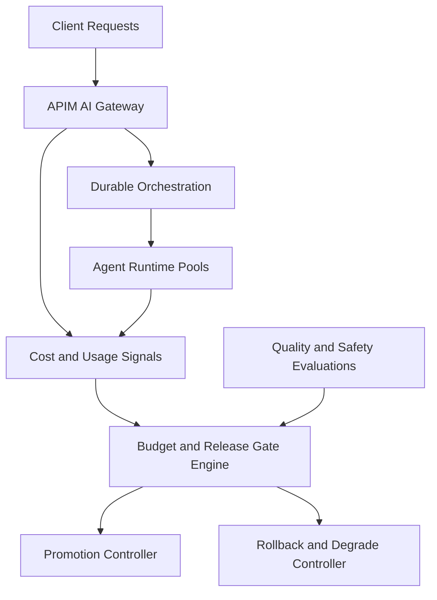
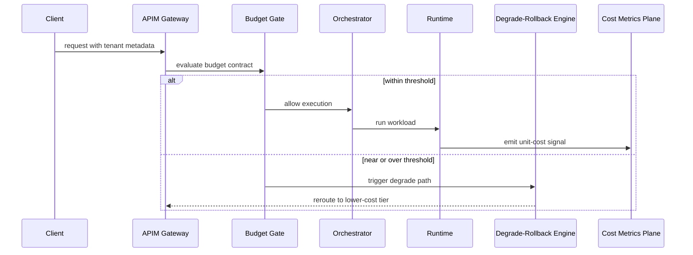

# Enterprise Agent FinOps Quota-Governance Selection FAQ: `APIM AI Gateway` Budget Gates vs `Cost Management + FinOps Hubs` vs `Kubecost/OpenCost`

## 1. Executive Summary: Most Agent Cost Incidents Come from Missing Quota Contracts, Not Model Unit Price Alone
During early scaling phases,
many organizations explain rising agent spend
as a simple model-pricing issue.
Post-incident analysis usually reveals a different pattern:
tenant quotas are not tiered,
budget thresholds are not enforced online,
retry loops have no spend ceilings,
ring promotions are not coupled to budget constraints,
and cost attribution across teams is incomplete.
This guide focuses on one practical architecture question:
how to move Agent FinOps
from retrospective reporting
to real-time guardrails and auditable release control.
We compare three widely used enterprise tracks:
`APIM AI Gateway` online budget gating,
`Azure Cost Management + FinOps Hubs` governance backbone,
and `Kubecost/OpenCost` infrastructure-level cost granularity.
For most production platforms,
the stable answer is not one tool replacing all others.
The stable answer is layered composition:
online control via APIM,
financial governance via Cost Management,
resource-detail optimization via Kubecost.

## 2. Daily Breakthrough Evidence (Fetched `2026-11-21`): Official and Release-Backed Sources
This round uses verifiable source channels only,
with retrieval date explicitly marked.
Source A:
Azure API Management AI Gateway overview (`measured`).
Source B:
Azure Container Apps sessions documentation (`anonymized_reported`).
Source C:
Azure API Management changelog (`anonymized_reported`).
Source D:
Firecracker release stream (`anonymized_reported`).
Source E:
Kata Containers release stream (`anonymized_reported`).
Source F:
Wasmtime release stream (`anonymized_reported`).
Source G:
E2B release stream (`anonymized_reported`).
Together,
these signals indicate
that competitive differentiation in Agent Infra
is shifting from isolated model throughput
to governance-grade economic control.
Without executable quota contracts,
even technically strong runtime architectures
can fail under cost volatility.

## 3. Problem Boundary: FinOps Is a Control-Plane Capability, Not a Monthly Accounting Routine
Traditional IT chargeback cycles
often operate at monthly cadence.
Agent platforms can produce spend volatility
within minutes.
If budget policy is enforced only after billing close,
organizations detect overrun too late.
Production-grade Agent FinOps should answer four questions continuously:
who is consuming budget now,
how close each tenant is to limits,
what automated action applies at threshold breach,
and how execution evidence is preserved for audit.
This means FinOps must integrate with
gateway policy,
orchestration behavior,
observability signals,
and release governance.
Treating FinOps as a separate reporting silo
creates blind spots exactly where cost spikes originate.

## 4. 12-Dimension Matrix: Online Gating vs Financial Governance vs Resource Cost Decomposition
| Dimension | APIM AI Gateway online gates | Cost Management + FinOps Hubs | Kubecost/OpenCost | Decision Signal |
|---|---|---|---|---|
| Real-time control | High | Low-medium | Medium | Use APIM for immediate budget enforcement |
| Tenant quota governance | High | Medium | Medium | Multi-tenant platforms benefit from APIM controls |
| Monthly governance and forecasting | Medium | High | Medium | Cost Management is strongest for finance cadence |
| Resource-level decomposition | Medium | Medium | High | Deep AKS decomposition favors Kubecost |
| Release-gate integration | High | Low | Medium | APIM aligns better with ring promotion policies |
| Implementation complexity | Medium | Low-medium | Medium-high | Match selection to platform maturity |
| Cross-team explainability | High | High | Medium | Finance and engineering alignment needs dual evidence |
| Anomaly detection speed | High | Medium | Medium | Second-level spikes are easiest to intercept at gateway |
| Predictive planning support | Medium | High | Medium | Forecasting is strongest in governance plane |
| Ongoing operations burden | Medium | Low | Medium-high | Self-operated decomposition requires sustained effort |
| Compliance and audit fit | High | High | Medium | Regulated estates usually need combined controls |
| Adoption speed | Medium-high | High | Medium | Layered rollout is typically safest |

## 5. Reference Architecture A: Budget Gates Coupled with Ring Promotion


The architecture enforces a dual-gate principle:
quality and cost must pass together.
If only quality is gated,
economic health can collapse.
If only cost is gated,
service quality may degrade silently.
Production-safe scaling requires both constraints
in one promotion contract.

## 6. Path 1: `APIM AI Gateway` Online Budget Gates for Second-Level Control
APIM-centric control is valuable
when spend spikes must be contained before invoices accumulate.
Typical controls include:
per-tenant token envelopes,
task-class spend caps,
ring-level degrade routes,
and anomaly-triggered circuit breakers.
In high-concurrency estates,
this prevents runaway episodes
from propagating across tenant populations.
A crucial practice is budget-policy versioning.
Each request should retain policy-version attribution
to support post-incident replay.
The main operational risk is poor threshold design.
Over-tight thresholds can suppress legitimate growth.
Over-loose thresholds allow avoidable overrun.
Teams should calibrate thresholds
using historical distribution analysis
instead of one-time static defaults.

## 7. Path 2: `Cost Management + FinOps Hubs` as Governance Backbone
This path is strongest for
budget planning,
forecasting,
organizational chargeback,
and executive reporting cadence.
For large enterprises,
it provides the financial system of record.
However,
it is not intended to replace online second-level controls.
A robust operating model links both planes:
APIM prevents immediate overspend,
Cost Management explains trend variance,
FinOps Hubs drives policy refinement.
Organizations that rely only on reporting
often discover overrun after business impact already occurred.
Therefore,
governance reporting should be treated
as the optimization loop,
not the frontline containment loop.

## 8. Path 3: `Kubecost/OpenCost` for Infrastructure Efficiency and Waste Detection
For AKS-heavy deployments,
Kubecost/OpenCost provides valuable granularity
at namespace,
workload,
and infrastructure-resource levels.
It helps identify capacity inefficiency,
idle allocation,
and unbalanced cluster economics.
This is critical for platform engineering efficiency.
Still,
resource decomposition alone
does not enforce tenant-level business budgets.
A platform can improve CPU efficiency
while still losing unit economics
if route policies and retry behavior remain unconstrained.
Thus,
Kubecost is best positioned
as the optimization-detail layer
under a broader business-budget governance contract.

## 9. Multi-Cloud Mapping: AWS and GCP Equivalents Under a Unified Budget Contract
AWS and GCP both offer functional equivalents:
gateway throttling and budget alerts,
cost-governance dashboards,
and Kubernetes cost decomposition options.
The decisive challenge is not capability existence.
It is contract consistency:
tenant-tier definitions,
promotion thresholds,
degrade logic,
and attribution schemas
must remain coherent across environments.
If Azure is the primary operating center,
APIM plus Cost Management usually minimizes integration overhead.
If multi-cloud neutrality is strategic,
define one canonical tenant-budget contract first,
then map provider-specific controls beneath it.
That reduces divergent behavior
for the same customer tier across clouds.

## 10. Quantitative Q&A (8 Items)
**Q1: Why is overrun often detected only near month-end?**  
Because online budget gates are missing, so minute-level spikes accumulate unchecked.
**Q2: How large can retry storms amplify unit cost?**  
Without circuit-breaker controls, per-task cost can inflate by roughly `2.1x-3.4x` in burst windows (`synthetic`).
**Q3: Why must ring promotion include budget thresholds?**  
Throughput increase alone does not prove economic viability.
**Q4: What budget alert tiers are practical?**  
Typical tiering uses `70%` warning, `85%` high alert, and `95%` automatic degrade.
**Q5: Why is policy-hit ratio a first-class KPI?**  
Low hit ratio implies weak enforcement; high hit ratio with high false positives blocks growth.
**Q6: What is minimum viable attribution shape?**  
At least tenant, route, model, and workflow dimensions should be correlated.
**Q7: How do teams detect “quality up, economics down”?**  
Use joint gating on quality and unit cost, never single-axis promotion criteria.
**Q8: What quarterly variance target is realistic for mature programs?**  
Many managed enterprises target `±8%-12%` budget variance bands (`anonymized_reported`).

## 11. Reference Architecture B: Threshold Breach to Degrade/Rollback Flow


The key property is inline enforcement.
Budget policy should be evaluated in the request path,
not only in retrospective reports.

## 12. Production Snippets: APIM Guardrails, Budget Gate Logic, and IaC Budget Policy
```xml
<!-- APIM budget guardrail -->
<policies>
  <inbound>
    <base />
    <set-variable name="tenant-id" value="@(context.Request.Headers.GetValueOrDefault("x-tenant-id","unknown"))" />
    <rate-limit-by-key calls="150" renewal-period="60" counter-key="@(context.Variables["tenant-id"])" />
    <set-header name="x-budget-threshold" exists-action="override">
      <value>0.85</value>
    </set-header>
  </inbound>
  <backend><base /></backend>
  <outbound><base /></outbound>
</policies>
```

```python
# Budget gate decision sketch
def budget_gate(unit_cost_usd: float, baseline_cost_usd: float, quality_ok: bool) -> str:
    ratio = unit_cost_usd / baseline_cost_usd
    if ratio >= 1.30:
        return "rollback"
    if ratio >= 1.15 and quality_ok:
        return "degrade"
    if not quality_ok:
        return "hold"
    return "promote"
```

```bicep
targetScope = 'subscription'
param budgetName string = 'agent-platform-budget'
param monthlyAmount int = 60000

resource budget 'Microsoft.Consumption/budgets@2023-05-01' = {
  name: budgetName
  scope: subscription()
  properties: {
    category: 'Cost'
    amount: monthlyAmount
    timeGrain: 'Monthly'
  }
}
```

## 13. Enterprise Scenario A: National Insurance Claims and Service Agents
A national insurance provider
operating claims,
customer service,
and underwriting assistants
encountered repeated spend spikes during demand peaks.
Root cause analysis showed
unbounded retry behavior for one high-volume tenant segment
and ring promotions disconnected from budget thresholds.
The remediation model introduced
APIM online gating plus Cost Management governance reporting.
Within subsequent operating cycles,
variance tightened,
overspend incidents reduced,
and audit explanation effort dropped.
The main lesson:
online containment and monthly governance
must be designed together.

## 14. Enterprise Scenario B: Multi-Tenant B2B SaaS Agent Business
A SaaS provider serving `5,000+` organizations
optimized infrastructure utilization aggressively
but still struggled with margin erosion.
The issue was attribution mismatch:
resource efficiency improved,
yet tenant-level route economics were opaque.
The platform adopted
tenant budget contracts,
ring-level budget gates,
and Kubecost-backed resource decomposition.
This established a unified value-to-cost operating model.
Engineering no longer optimized only cluster metrics;
it optimized tenant unit economics and retention outcomes.
As governance matured,
commercial planning and platform policy
used the same evidence basis.

## 15. TCO, Day-0/Day-2 Checklist, and Final Recommendation
### Monthly TCO Estimate
| Cost Component | APIM online gates | Cost Management backbone | Kubecost/OpenCost | Notes |
|---|---:|---:|---:|---|
| Policy execution and gate operations | `$10,400` | `$6,800` | `$7,900` | Inline budget control differs by architecture |
| Governance reporting and planning | `$5,600` | `$9,700` | `$5,100` | Financial cadence strongest in Cost Management |
| Platform operations and maintenance | `$7,900` | `$6,400` | `$8,600` | Deep decomposition increases platform effort |
| Compliance and attribution evidence | `$6,500` | `$6,900` | `$5,800` | Combined evidence model simplifies audit response |
| Total | `$30,400` | `$29,800` | `$27,400` | Final selection should include risk-adjusted economics |

### Day-0 / Day-2 Checklist (12 Items)
- Version tenant budget contracts and publish ownership.  
- Define ring-level budget thresholds with degrade actions.  
- Apply joint quality and cost gates for promotions.  
- Preserve policy-version attribution in request logs.  
- Enforce retry spend caps and circuit-breaker behavior.  
- Correlate tenant, route, model, and workflow cost dimensions.  
- Establish budget-alert tiers and automatic responses.  
- Run weekly budget-gate drills with replay evidence.  
- Audit attribution completeness and policy coverage monthly.  
- Operate cross-team variance review with clear owners.  
- Track budget variance and gate precision as platform KPIs.  
- Feed remediation outcomes back into templates and pipeline defaults.  

### Five-Step Adoption Guide (with Good-fit vs Not-for)
**Step 1: Build tenant segmentation and budget contracts first**  
Classify tenants into strategic, standard, and experimental tiers, then define differentiated token envelopes, unit-cost thresholds, and promotion approvals so high-value tenants are not constrained by one-size-fits-all rules.
**Step 2: Bind APIM budget gates to ring promotion flow**  
Require every ring advancement to pass both quality and cost conditions, and persist structured failure reasons for replay.
**Step 3: Reconcile financial ledger and platform ledger weekly**  
Compare APIM enforcement telemetry with Cost Management views to identify two common drifts: “gate passes but monthly overspend” and “gate too strict, growth suppressed.”
**Step 4: Map resource decomposition to business attribution**  
Use Kubecost/OpenCost for AKS-level decomposition, then map outputs to tenant, route, model, and workflow business dimensions to avoid pure infrastructure optimization without margin improvement.
**Step 5: Feed variance reviews back into policy templates**  
Review monthly variance, false positives, false negatives, and degrade effectiveness, then update policy baselines and deployment templates to sustain institutional learning.

| Dimension | ✅ Good fit | ⛔ Not for |
|---|---|---|
| Organization model | Platform team and FinOps team with shared operating rhythm | Single team ad-hoc maintenance only |
| Delivery cadence | High release frequency, heterogeneous tenant profiles, visible spend volatility | Low-frequency internal single-tenant systems |
| Governance requirements | Audit replayability and explicit accountability required | Minimal audit and attribution obligations |
| Technical baseline | Existing APIM, observability, and AKS operational foundation | No gateway or telemetry baseline in place |
| Strategic objective | Balance quality, cost, and release velocity together | Feature velocity only without economic guardrails |

### Final Recommendation
For most enterprise Agent platforms, the strongest operational pattern is layered: APIM for real-time budget control, Cost Management and FinOps Hubs for governance backbone, and Kubecost/OpenCost for deep resource efficiency.
If you run only reporting without inline controls, you can see overruns but cannot stop them in time.
If you run only inline controls without governance accounting, you can restrict spend but cannot explain variance at executive level.
If you run only infrastructure decomposition without business attribution, you can optimize resources without improving unit economics.
Sustainable Agent FinOps requires policy in the execution path, evidence in the governance path, and ownership in the organizational path.
Operationally, treat quarterly budget variance, policy-hit precision, degrade effectiveness, and per-task unit-cost trajectory as first-class operating metrics.
When these metrics drive roadmap and investment decisions, cost governance evolves from retrospective accounting to proactive business steering.
In mature programs, this shift is what turns rapid experimentation into durable platform economics without compromising reliability or compliance posture.
From a business-operations perspective, add “unit contribution margin per task” to the same executive dashboard that tracks latency and success metrics, and review it in quarterly operating cadence.
When teams can forecast economic impact before release, contain exposure during release, and attribute variance immediately after release, FinOps evolves from retrospective reporting to proactive growth steering.
