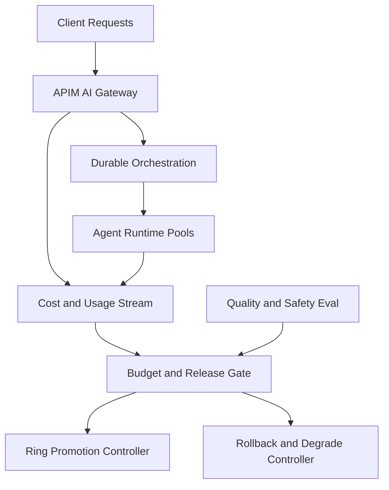
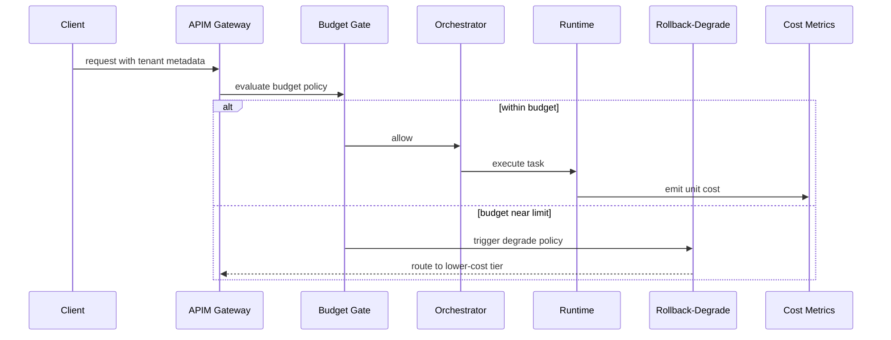

# 企业 Agent FinOps 配额治理选型 FAQ：`APIM AI Gateway` 预算门禁 vs `Cost Management + FinOps Hubs` vs `Kubecost/OpenCost`

## 1. 执行摘要：Agent 成本失控通常不是“模型太贵”，而是“配额契约缺失”
企业在 Agent 平台放量阶段，
经常把成本上升归因为模型单价问题。
但复盘显示，
真正的成本失控多数来自治理缺口：
租户配额未分层、
门禁阈值未自动执行、
重试策略无成本上限、
灰度放量未绑定预算阈值、
以及跨团队成本归因不清晰。
本指南聚焦一个核心问题：
如何把 Agent FinOps
从“事后报表”
升级为“事前约束 + 事中控制 + 事后审计”。
我们对比三条常见路径：
`APIM AI Gateway` 在线预算门禁，
`Azure Cost Management + FinOps Hubs` 财务治理主线，
`Kubecost/OpenCost` 资源成本深度拆解。
在企业生产实践中，
最稳妥策略通常不是三选一，
而是分层组合：
在线控制看 APIM，
月度治理看 Cost Management，
资源细账看 Kubecost。

## 2. 今日突破与证据（抓取日 `2026-11-21`）：官方/Release 为主
本轮仅使用可验证来源，
并标注来源类型。
来源 A：
Azure API Management AI Gateway 官方文档（`measured`）。
来源 B：
Azure Container Apps Sessions 文档（`anonymized_reported`）。
来源 C：
Azure API Management Changelog（`anonymized_reported`）。
来源 D：
Firecracker Releases（`anonymized_reported`）。
来源 E：
Kata Containers Releases（`anonymized_reported`）。
来源 F：
Wasmtime Releases（`anonymized_reported`）。
来源 G：
E2B Releases（`anonymized_reported`）。
这些信号表明，
Agent Infra 进入“精细化运营”阶段，
平台竞争焦点从单纯推理吞吐
转向预算弹性与治理韧性。
如果没有可执行配额模型，
再强的运行时架构也会在成本冲击下失去可持续性。

## 3. 问题边界：FinOps 不是财务报销流程，而是平台控制平面能力
在传统 IT 中，
财务治理可以按月结算。
在 Agent 平台中，
成本波动是分钟级。
如果预算策略不能在线执行，
团队通常只能在账单出来后追责，
而非实时纠偏。
生产级 FinOps 必须回答四个问题：
谁在消耗预算？
何时接近阈值？
阈值触发后如何自动降级？
如何证明策略执行有效？
这意味着 FinOps 必须与
网关、
编排、
观测、
发布体系联动，
并形成可审计的自动化闭环。

## 4. 12 维对比矩阵：在线门禁、财务治理、资源细账三路线
| 维度 | APIM AI Gateway 在线门禁 | Cost Management + FinOps Hubs | Kubecost/OpenCost | 决策信号 |
|---|---|---|---|---|
| 实时控制能力 | 高 | 低到中 | 中 | 在线阈值优先 APIM |
| 租户级配额治理 | 高 | 中 | 中 | 多租户平台优先 APIM |
| 月度预算治理 | 中 | 高 | 中 | 财务闭环优先 Cost Management |
| 资源细粒度拆账 | 中 | 中 | 高 | K8s 成本深挖优先 Kubecost |
| 发布联动门禁 | 高 | 低 | 中 | 发布工程联动 APIM 更直接 |
| 实施复杂度 | 中 | 低到中 | 中高 | 需按团队能力选择 |
| 跨团队可解释性 | 高 | 高 | 中 | 财务/平台协作看 Cost+APIM |
| 异常检测灵敏度 | 高 | 中 | 中 | 秒级成本异常 APIM 更快 |
| 成本预测能力 | 中 | 高 | 中 | 财务预测更依赖 FinOps Hubs |
| 运维负担 | 中 | 低 | 中高 | 自建成本引擎需要持续维护 |
| 合规审计适配 | 高 | 高 | 中 | 审计场景通常需要双轨证据 |
| 组织落地速度 | 中高 | 高 | 中 | 组合式落地最稳健 |

## 5. 参考架构 A：预算门禁与发布灰度联动


该架构的核心是双门禁：
质量门禁 + 成本门禁。
任何一次灰度放量，
都必须同时通过两类约束。
否则平台会出现“质量提升但成本失控”
或“成本优化但质量坍塌”的偏科风险。

## 6. 路线一：`APIM AI Gateway` 在线预算门禁（秒级控制）
APIM 路线适合需要实时约束的企业。
典型能力包括：
按租户 token 限额、
按任务类型成本上限、
按流量环级别降级策略、
以及异常尖峰熔断。
在高并发平台，
这类在线门禁能在账单形成前阻断失控。
关键实践是把预算策略版本化，
并将策略版本与请求日志绑定。
这样在审计时可以复原：
某次请求使用了哪版预算策略，
为何被降级或拒绝。
风险点在于阈值设计不合理。
若阈值过紧，
会压制业务增长。
若阈值过松，
会放大成本风险。
因此需要基于历史分布
动态调优阈值而非一次性配置。

## 7. 路线二：`Cost Management + FinOps Hubs`（财务治理主线）
这条路线强项在于预算规划、
成本趋势洞察、
组织级责任分摊。
对大型企业而言，
它是财务与平台协作的主干。
但它不负责秒级在线控制，
更偏向日级或月级治理闭环。
最佳实践是把它作为“治理总账”，
并与 APIM 在线门禁形成前后联动：
APIM 负责防止失控，
Cost Management 负责解释偏差与优化策略。
若企业只依赖报表治理，
通常会出现“看得清但控不住”的问题。

## 8. 路线三：`Kubecost/OpenCost`（资源细账与效率优化）
当平台大量运行在 AKS 时，
Kubecost/OpenCost 能提供资源粒度成本拆解，
帮助识别 CPU/内存/存储浪费。
它对平台工程优化价值高，
尤其在多工作负载混部场景。
但它并不直接替代租户级业务预算门禁。
若只做资源成本优化，
而不做业务层预算治理，
仍可能出现“资源效率提升但业务成本失控”。
因此建议把 Kubecost 作为资源优化层，
而不是唯一 FinOps 控制层。

## 9. 多云对标：AWS/GCP 的成本治理映射
AWS 与 GCP 都有对应能力：
在线网关限流与预算告警、
成本管理看板、
Kubernetes 成本拆解工具。
差异主要在组织既有资产和治理流程。
若主平面在 Azure，
将 APIM 与 Cost Management 组合通常整合成本更低。
若多云并行，
建议采用统一租户预算合同，
再映射到各云执行层，
避免同一租户在不同云被不同阈值策略处理。

## 10. 定量 Q&A（8 组）
**Q1：为什么月末才发现超支？**  
因为缺少在线预算门禁，
异常流量在分钟级放大但未被实时拦截。
**Q2：单租户重试风暴会放大多少成本？**  
在无熔断策略下，
单位任务成本可在短时放大 `2.1x-3.4x`（`synthetic`）。
**Q3：灰度放量为何必须绑定预算阈值？**  
否则“成功放量”可能只代表流量增长，
不代表单位经济性健康。
**Q4：建议的预算告警分级？**  
`70%` 预警、
`85%` 强告警、
`95%` 自动降级。
**Q5：策略命中率为什么是关键指标？**  
低命中率意味着策略形同虚设，
高命中率但高误杀则影响业务增长。
**Q6：租户级归因最低要求是什么？**  
必须能按 tenant、route、model、workflow 四维归因。
**Q7：如何识别“质量提升但成本劣化”？**  
把质量指标与单位成本做联合门禁，
禁止单指标决策。
**Q8：季度预算偏差控制目标建议？**  
成熟平台通常把偏差控制在 `±8%-12%` 区间（`anonymized_reported`）。

## 11. 参考架构 B：预算超阈触发降级与回滚


这个闭环强调：
预算策略应成为执行路径的一部分，
而不是独立报表系统中的后验信息。

## 12. 生产代码与 IaC 示例：策略、预算规则与看板查询
```xml
<!-- APIM budget guardrail -->
<policies>
  <inbound>
    <base />
    <set-variable name="tenant-id" value="@(context.Request.Headers.GetValueOrDefault("x-tenant-id","unknown"))" />
    <rate-limit-by-key calls="150" renewal-period="60" counter-key="@(context.Variables["tenant-id"])" />
    <set-header name="x-budget-threshold" exists-action="override">
      <value>0.85</value>
    </set-header>
  </inbound>
  <backend><base /></backend>
  <outbound><base /></outbound>
</policies>
```

```python
# 成本门禁示意
def budget_gate(unit_cost_usd: float, baseline_cost_usd: float, quality_ok: bool) -> str:
    ratio = unit_cost_usd / baseline_cost_usd
    if ratio >= 1.30:
        return "rollback"
    if ratio >= 1.15 and quality_ok:
        return "degrade"
    if not quality_ok:
        return "hold"
    return "promote"
```

```bicep
targetScope = 'subscription'
param budgetName string = 'agent-platform-budget'
param monthlyAmount int = 60000

resource budget 'Microsoft.Consumption/budgets@2023-05-01' = {
  name: budgetName
  scope: subscription()
  properties: {
    category: 'Cost'
    amount: monthlyAmount
    timeGrain: 'Monthly'
  }
}
```

## 13. 企业场景 A：全国性保险理赔 Agent 平台
某保险集团在理赔、
客服、
核保场景部署 Agent。
上线后出现波峰时段成本激增。
根因是单租户重试策略未限额，
且灰度放量缺乏预算门禁。
整改后采用 APIM 在线门禁 +
Cost Management 月度治理双层模型。
结果显示：
成本波动区间收敛，
异常超支事件显著下降，
并且审计解释效率提升。
该案例体现：
在线控制与财务治理缺一不可。

## 14. 企业场景 B：多租户 B2B SaaS Agent 平台
某 SaaS 厂商服务 `5,000+` 企业租户。
此前只做资源成本优化，
缺乏租户级业务归因。
导致销售增长与成本增长脱钩，
利润率被持续挤压。
平台升级后，
引入租户级预算合同、
发布环预算门禁、
以及 Kubecost 资源拆账。
最终形成“业务价值-成本效率”联合看板。
平台团队不再仅看基础设施成本，
而是按租户生命周期优化单位经济性。

## 15. TCO、Day-0/Day-2 清单与最终建议
### TCO（月度估算）
| 成本项 | APIM 在线门禁 | Cost Management 主线 | Kubecost/OpenCost | 说明 |
|---|---:|---:|---:|---|
| 门禁与策略执行 | `$10,400` | `$6,800` | `$7,900` | 在线控制能力差异明显 |
| 财务治理与报表 | `$5,600` | `$9,700` | `$5,100` | 月度治理 Cost Management 更强 |
| 平台运营与维护 | `$7,900` | `$6,400` | `$8,600` | 自建深度拆账维护成本更高 |
| 合规审计与归因 | `$6,500` | `$6,900` | `$5,800` | 组合方案审计解释更完整 |
| 总计 | `$30,400` | `$29,800` | `$27,400` | 需按组织目标做组合评估 |

### Day-0 / Day-2 检查清单（12 项）
- 建立租户级预算合同并版本化。  
- 为发布环定义预算阈值与降级动作。  
- 把成本门禁与质量门禁联合执行。  
- 强制记录策略版本与命中日志。  
- 建立重试成本上限与熔断策略。  
- 建立 tenant/route/model/workflow 四维归因。  
- 设置预算告警分级与自动响应。  
- 每周执行一次预算门禁演练。  
- 每月审计成本归因完整性。  
- 建立跨团队成本偏差复盘机制。  
- 将预算偏差纳入平台 KPI。  
- 把改进结果回写到模板与流水线。  

### 五步落地指南（含 Good fit vs Not for）
**第 1 步：先做租户分层与预算合同建模**  
把租户分为战略级、
标准级、
试验级三类，
分别定义不同 token 上限、
单位任务成本阈值、
以及放量审批规则，
避免“一刀切”导致高价值租户体验受损。
**第 2 步：把 APIM 门禁接入发布分环**  
将预算阈值与 ring 推进绑定，
要求每次 ring 晋级同时满足质量与成本双门槛，
并把失败原因写入可追溯日志。
**第 3 步：建立财务总账与平台总账对齐机制**  
每周对比 APIM 实时门禁日志与 Cost Management 账单视图，
识别“门禁放行但月账超支”或“门禁过严影响增长”两类偏差。
**第 4 步：补齐资源细账与业务归因映射**  
通过 Kubecost/OpenCost 对 AKS 资源成本做细粒度拆解，
并映射到 tenant、route、model、workflow 四维业务标签，
防止出现“资源节省了但商业利润没改善”。
**第 5 步：把偏差复盘写回模板和策略基线**  
每月复盘预算偏差、
误杀率、
漏放率、
降级有效性，
并将结论更新到策略模板，
形成持续改进闭环。

| 维度 | ✅ Good fit | ⛔ Not for |
|---|---|---|
| 组织形态 | 有平台团队 + FinOps 团队协同机制 | 仅靠单团队临时维护 |
| 业务节奏 | 高频发布、租户差异大、成本波动明显 | 低频发布、单租户内网系统 |
| 治理需求 | 需要审计可追溯与责任分摊 | 对审计与归因几乎无要求 |
| 技术栈 | 已有 APIM / Azure Monitor / AKS 生态 | 完全无网关与可观测基础 |
| 目标导向 | 同时追求质量、成本、速度平衡 | 只追求短期功能上线 |

### 最终建议
对大多数企业，
推荐采用三层组合架构：
APIM 负责实时门禁，
Cost Management 负责治理总账，
Kubecost 负责资源细账优化。
若只做报表不做在线门禁，
平台会陷入“看得见但控不住”。
若只做在线门禁不做财务总账，
平台会陷入“控得住但说不清”。
若只做资源细账不做业务归因，
平台会陷入“算得细但不赚钱”。
真正可持续的 Agent FinOps，
必须把预算治理写入发布与运行主流程，
并在组织层面形成责任闭环。
建议把季度预算偏差、
策略命中准确率、
降级触发有效性、
单位任务成本变化率
作为平台核心运营指标，
持续驱动策略优化与投资决策，
让成本治理从“被动追账”
升级为“主动经营”，并形成可复用的经营决策资产与治理惯例供后续规模扩展复用与长期运营能力沉淀机制闭环复用优化迭代能力。
从经营视角看，
建议将“单位任务贡献毛利”
纳入与技术指标同级的管理看板，
并在季度经营会议中同步评审，
确保架构决策、
产品策略、
商业策略三者一致。
当平台能够在发布前预测经济影响、
发布中控制风险敞口、
发布后快速归因并迭代策略，
FinOps 才真正从后台职能
转化为业务增长杠杆。
为防止策略形同虚设，建议将预算门禁命中率与误杀率同时纳入值班看板，并要求每次策略调整必须附带“业务影响预估 + 风险缓释预案 + 回滚触发条件”三件套，确保策略迭代既能提高控制精度又不会引入新的经营不确定性，同时把策略变更前后的真实业务收益与客户体验变化做对照跟踪，防止“指标好看但价值下降”。
对跨区域组织，建议将预算阈值拆分为“全局基线阈值 + 区域弹性系数 + 租户特例白名单”三层配置，避免在法规、汇率、季节性需求差异明显的市场中使用单一阈值模型导致治理失真，并将区域阈值调整依据沉淀为标准化说明文档供审计与经营复盘复用，并在跨区域委员会中定期评审。
在平台工具链上，建议把 APIM 策略变更、FinOps 报表口径变更、Kubecost 标签映射变更纳入同一变更编排窗口，统一评审与统一发布，避免“技术口径变化先行、财务口径滞后”造成跨团队对账争议，并通过自动化对账作业在发布后 `24h` 内完成差异扫描与责任归类。
在组织治理上，建议建立“异常成本战情机制”：当任一租户或业务线单位成本连续两个观测窗口超过阈值时，自动拉起跨团队处置会，现场输出限时动作清单并在 `24h` 内回填执行证据，确保偏差不过夜，并把处置效果在下一窗口进行复核闭环，防止问题反复出现。
在能力沉淀上，建议将每次预算偏差复盘转写为可复用策略案例库，按场景标签（高并发问答、长链路工具调用、语音会话、批处理任务）归档，供后续新业务接入时复用，缩短策略建模启动时间并降低试错成本，并通过案例标签关联上线后真实收益结果，持续筛选高价值策略模板。
在经营协同上，建议将“单位任务成本、策略命中准确率、租户续费率、SLA 违约率”四项指标做联合相关性分析，定期验证成本控制动作是否真正带来商业正反馈，避免出现“成本下降但客户流失上升”的局部最优，并把分析结果直接映射到下一轮产品定价、服务分层、资源采购和客户成功运营计划中，形成经营闭环。
