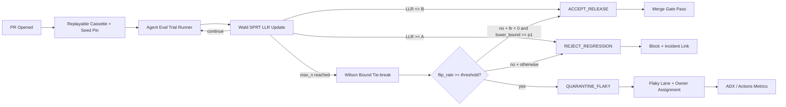
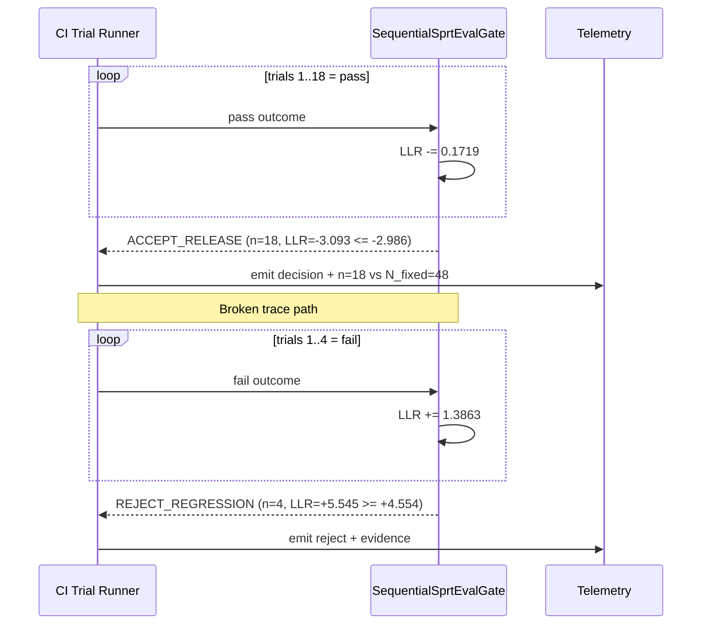

# Enterprise flaky agent-eval CI gate selection FAQ: Pattern A (replayable cassette + seed/fingerprint pinning + Wald `SPRT` adaptive early stop + flaky quarantine) vs Pattern B (fixed `Pass^k`) vs Pattern C (nightly full regression) vs Pattern D (`Pass@k>=1` retry-until-green anti-pattern)

## 1. Executive Summary

For multi-step agent release gates, the recommended default is **Pattern A**: deterministic replay fixtures, seed and fingerprint pinning, Wald binomial sequential testing (`SPRT`) for adaptive early stopping, and a dedicated quarantine lane for high-flip cases instead of blindly blocking the mainline.  
This approach reduces token spend while preserving statistical rigor, and avoids both extremes of `k=1` false-red friction and fixed high-`k` cost inflation.

The practical advantage of Pattern A is not only lower cost; it converts stochastic behavior into observable and governable engineering signals. Pattern B and Pattern C remain conditional options, while Pattern D should be explicitly prohibited.

## 2. Context and recurring symptoms

Even with `temperature=0`, enterprise pipelines still see randomness from GPU kernels, batch composition, live tool fixtures, and borderline LLM-judge decisions.  
If teams stay on single-shot `k=1`, pull requests suffer avoidable false failures; if teams force fixed `k=8` or `k=10`, they burn budget and can still mask true regressions.

## 3. Three critical failure modes

1. **False-red blocking**: single-run gates fail borderline cases and slow PR throughput.  
2. **False-green leakage**: `Pass@k>=1` can pass broken behavior with high probability.  
3. **Fixture contamination**: unpinned seeds and live dependencies make failures non-reproducible.

## 4. Four-pattern comparison matrix (12 dimensions)

| Dimension | Pattern A: SPRT + quarantine (recommended) | Pattern B: fixed `Pass^k` | Pattern C: nightly full + PR smoke | Pattern D: `Pass@k>=1` blind retries (prohibit) |
|---|---|---|---|---|
| Statistical rigor | High | Medium-high | Medium | Low |
| False-red control | High | Medium | Medium-high | Low |
| False-green control | High | Medium | Medium | Low |
| Cost efficiency | High | Low to medium | Medium | Superficially high, operationally risky |
| Early stop | Strong | None | Weak | None |
| Reproducibility | High | Medium | Medium | Low |
| Root-cause speed | High | Medium | Low | Low |
| Release velocity | High | Medium | High but delayed risk | High but unreliable |
| Explainability | High | Medium | Medium | Low |
| Ops complexity | Medium | Medium | Medium | Low but incident-heavy |
| 3-year TCO | Best | Second-best | Mid | Worst |
| Compliance/audit fit | High | Medium | Medium | Low |

## 5. Recommended architecture details (Pattern A)

Pattern A should include five deterministic stages: input determinism (cassette plus seed/fingerprint), sequential statistical decisioning (SPRT), Wilson interval tie-break for boundary cases, flaky quarantine lane, and telemetry plus cost attribution.  
Any non-reproducible failure should be classified as regression, noise, or fixture drift before it is allowed to block release.

Operationally, `p0`, `p1`, `alpha`, and `beta` should be policy fields, versioned and risk-tiered. High-risk suites can run stricter error bounds; lower-risk suites can use relaxed thresholds for higher throughput.

## 6. Mermaid: deterministic cassette + adaptive SPRT CI gate



## 7. Mermaid: sequential LLR random walk outcomes



## 8. Q1–Q6 formulas with worked values

| ID | Formula | Example inputs | Result and interpretation |
|---|---|---|---|
| Q1 Wald LLR | `LLR = s*ln(p1/p0) + (n-s)*ln((1-p1)/(1-p0))` | `p0=0.95,p1=0.80` | Per-pass delta `-0.1719`, per-fail delta `+1.3863`. |
| Q2 Boundaries | `A=ln((1-β)/α), B=ln(β/(1-α))` | `α=0.01,β=0.05` | `A≈4.554, B≈-2.986`. |
| Q3 Expected sample savings | `saving = 1 - E[N]/N_fixed` | `E[N|clean]=18,N_fixed=48` | `62.5%` fewer trials. |
| Q4 False-green inflation | `Pass@k>=1 = 1-(1-p)^k` | `p=0.60,k=3` | `0.936` false-green probability. |
| Q5 Strict pass probability | `Pass^k = p^k` | `p=0.60,k=3` | `0.216`, highlighting semantic difference. |
| Q6 Wilson lower bound | Standard Wilson 95% lower bound | `n=25,s=24,z=1.96` | `LB≈0.8046`, enough to rule out `H1: p<=0.80`. |

## 9. Executable stdlib Python: SequentialSprtEvalGate

```python
from __future__ import annotations

from dataclasses import dataclass
from typing import Dict, Iterable, List, Tuple
import hashlib
import math


@dataclass
class SprtConfig:
    p0: float = 0.95
    p1: float = 0.80
    alpha: float = 0.01
    beta: float = 0.05
    max_trials: int = 25
    flaky_flip_threshold: float = 0.30


@dataclass
class GateResult:
    decision: str
    llr: float
    trials: int
    passes: int
    wilson_low: float
    wilson_high: float
    flip_rate: float


class SequentialSprtEvalGate:
    def __init__(self, config: SprtConfig) -> None:
        self.cfg = config
        self.A = math.log((1 - config.beta) / config.alpha)
        self.B = math.log(config.beta / (1 - config.alpha))

    @staticmethod
    def cassette_sha256(payload: bytes) -> str:
        return hashlib.sha256(payload).hexdigest()

    @staticmethod
    def wilson_interval(successes: int, n: int, z: float = 1.96) -> Tuple[float, float]:
        if n == 0:
            return (0.0, 1.0)
        phat = successes / n
        denom = 1.0 + z * z / n
        center = phat + z * z / (2 * n)
        delta = z * math.sqrt((phat * (1 - phat) + z * z / (4 * n)) / n)
        low = (center - delta) / denom
        high = (center + delta) / denom
        return (max(0.0, low), min(1.0, high))

    @staticmethod
    def flip_rate(trace: List[int]) -> float:
        if len(trace) <= 1:
            return 0.0
        flips = 0
        for i in range(1, len(trace)):
            if trace[i] != trace[i - 1]:
                flips += 1
        return flips / (len(trace) - 1)

    def _llr(self, successes: int, n: int) -> float:
        fails = n - successes
        return successes * math.log(self.cfg.p1 / self.cfg.p0) + fails * math.log((1 - self.cfg.p1) / (1 - self.cfg.p0))

    def evaluate(
        self,
        outcomes: Iterable[int],
        system_fingerprint_stable: bool,
    ) -> GateResult:
        s = 0
        n = 0
        trace: List[int] = []
        llr = 0.0

        for item in outcomes:
            x = 1 if int(item) == 1 else 0
            trace.append(x)
            n += 1
            s += x
            llr = self._llr(s, n)

            if llr >= self.A:
                low, high = self.wilson_interval(s, n)
                return GateResult("REJECT_REGRESSION", llr, n, s, low, high, self.flip_rate(trace))
            if llr <= self.B:
                low, high = self.wilson_interval(s, n)
                return GateResult("ACCEPT_RELEASE", llr, n, s, low, high, self.flip_rate(trace))
            if n >= self.cfg.max_trials:
                break

        low, high = self.wilson_interval(s, n)
        flips = self.flip_rate(trace)

        if system_fingerprint_stable and flips >= self.cfg.flaky_flip_threshold:
            return GateResult("QUARANTINE_FLAKY", llr, n, s, low, high, flips)
        if llr < 0.0 and low >= self.cfg.p1:
            return GateResult("ACCEPT_RELEASE", llr, n, s, low, high, flips)
        return GateResult("REJECT_REGRESSION", llr, n, s, low, high, flips)


if __name__ == "__main__":
    gate = SequentialSprtEvalGate(SprtConfig())

    clean = [1] * 25
    r1 = gate.evaluate(clean, system_fingerprint_stable=True)
    assert r1.decision == "ACCEPT_RELEASE"
    assert r1.trials == 18

    broken = [0] * 25
    r2 = gate.evaluate(broken, system_fingerprint_stable=True)
    assert r2.decision == "REJECT_REGRESSION"
    assert r2.trials == 4

    single_blip = [0] + [1] * 24
    r3 = gate.evaluate(single_blip, system_fingerprint_stable=True)
    assert r3.trials == gate.cfg.max_trials
    assert abs(r3.flip_rate - (1.0 / 24.0)) < 1e-12
    assert abs(r3.wilson_low - 0.8046) < 1e-3
    assert r3.decision == "ACCEPT_RELEASE"

    oscillating = [0, 1, 0, 1, 0, 1, 1, 1, 1, 0, 1, 1, 1, 1, 1, 1, 1, 1, 0, 1, 1, 1, 1, 1, 1]
    r4 = gate.evaluate(oscillating, system_fingerprint_stable=True)
    assert r4.trials == gate.cfg.max_trials
    assert abs(r4.flip_rate - (9.0 / 24.0)) < 1e-12
    assert r4.decision == "QUARANTINE_FLAKY"

    p = 0.60
    pass_at_3 = 1 - (1 - p) ** 3
    assert abs(pass_at_3 - 0.936) < 1e-12

    digest = gate.cassette_sha256(b"fixture-v1")
    assert len(digest) == 64
```

## 10. JSON policy and cassette manifest

```json
{
  "policy_version": "2026-11-27",
  "sprt_gate": {
    "p0": 0.95,
    "p1": 0.8,
    "alpha": 0.01,
    "beta": 0.05,
    "max_trials": 25
  },
  "determinism": {
    "seed_pin": 20261127,
    "system_fingerprint": "fp_model_a_2026_11_27",
    "cassette_sha256": "f7f3b2d8d0b72f6fa4ce7a52f72958d69f9ba2b7648e76f3f5e8f91eec2e1f4a"
  },
  "flaky_quarantine": {
    "flip_rate_threshold": 0.3,
    "lane": "ci-flaky-quarantine",
    "owner_group": "agent-eval-oncall"
  },
  "actions": {
    "accept": "merge_gate_pass",
    "reject": "block_release",
    "quarantine": "route_to_flaky_lane"
  }
}
```

## 11. KQL: 7-day savings, early-stop distribution, and flaky quarantine

```kql
let win = 1d;
let base =
    AgentEvalGateLogs
    | where TimeGenerated > ago(7d)
    | extend repo = tostring(CustomDimensions.repo)
    | extend suite = tostring(CustomDimensions.suite)
    | extend decision = tostring(CustomDimensions.decision)
    | extend trials = toint(coalesce(CustomDimensions.trials, extract(@"trials=(\d+)", 1, Message)))
    | extend token_cost = todouble(coalesce(CustomDimensions.token_cost_usd, extract(@"token_cost_usd=([0-9.]+)", 1, Message)));
let savings =
    base
    | summarize trial_avg = avg(trials), token_sum = sum(token_cost) by bin(TimeGenerated, win), repo;
let decisions =
    base
    | summarize accept_cnt = countif(decision == "ACCEPT_RELEASE"),
                reject_cnt = countif(decision == "REJECT_REGRESSION"),
                flaky_cnt = countif(decision == "QUARANTINE_FLAKY") by bin(TimeGenerated, win), repo;
let suites =
    base
    | summarize suite_cnt = dcount(suite) by bin(TimeGenerated, win), repo;
savings
| join kind=fullouter decisions on TimeGenerated, repo
| extend TimeGenerated = coalesce(TimeGenerated, TimeGenerated1), repo = coalesce(repo, repo1)
| project-away TimeGenerated1, repo1
| join kind=fullouter suites on TimeGenerated, repo
| extend TimeGenerated = coalesce(TimeGenerated, TimeGenerated1), repo = coalesce(repo, repo1)
| project-away TimeGenerated1, repo1
| extend fixed_trials = 48.0
| extend est_token_saving_ratio = iif(fixed_trials > 0, 1.0 - (trial_avg / fixed_trials), 0.0)
| project TimeGenerated, repo, trial_avg, est_token_saving_ratio, token_sum,
          accept_cnt=coalesce(accept_cnt, 0), reject_cnt=coalesce(reject_cnt, 0),
          flaky_cnt=coalesce(flaky_cnt, 0), suite_cnt=coalesce(suite_cnt, 0)
| order by TimeGenerated desc
```

## 12. Extended Q&A (Q7–Q12)

| ID | Question | Key answer |
|---|---|---|
| Q7 | Why distinguish `Pass@k` from `Pass^k`? | One is at-least-one success, the other is all-success; risk semantics differ drastically. |
| Q8 | Why pin `system_fingerprint`? | Without pinning, model-version drift can be misclassified as product regression. |
| Q9 | Why quarantine instead of immediate fail? | High-flip cases pollute mainline signal and should be isolated for root-cause analysis. |
| Q10 | When does Wilson tie-break apply? | At `max_trials` when SPRT boundaries are not crossed. |
| Q11 | How to tune `p0/p1`? | Risk-tier by suite and business impact, not one constant for all workloads. |
| Q12 | Can cassette mocks drift from reality? | Yes; periodic live-data calibration is mandatory. |

## 13. Selection decision tree (concise)

1. If PR throughput is high and release cadence is tight, choose Pattern A.  
2. If governance requires fixed-sample reports, choose Pattern B and accept higher cost.  
3. If nightly batch is primary and delay is acceptable, Pattern C can be transitional.  
4. Any retry-until-green logic without statistical safeguards is Pattern D and should fail readiness review.

To prevent teams from equating "more retries" with quality assurance, require policy metadata in every gate review: statistical definition (`Pass@k` vs `Pass^k`), boundaries, maximum trials, and deterministic fallback rules.  
A second common failure is attributing all flips to model instability while ignoring fixture drift, timezone dependencies, cache contamination, and fingerprint changes; quarantine labels should encode these root-cause categories explicitly.

## 14. Scenario 15.1: banking multi-team copilot monorepo (`420` PR/day, `1,200` eval cases)

This environment needs both speed and strict risk control. Pattern A reduces average trials per PR and routes noisy cases into a focused lane handled by a specialized reliability group.  
At organizational scale, shared SPRT policy and evidence schemas reduce cross-team disputes and accelerate release decision consistency.

For financial controls, emit and retain `LLR`, boundaries, trial trace, fingerprint version, and final decision source (boundary hit, Wilson tie-break, or quarantine).  
When model or tool versions change, run shadow evaluation first and compare `E[N]`, flip-rate, and reject density before changing production thresholds.

## 15. Scenario 15.2: global SaaS coding/SQL agent benchmark gate

This scenario sees frequent model upgrades and fingerprint churn. Pattern A quantifies quality impact and gate cost simultaneously, reducing silent regressions after nominally "green" upgrades.  
During major fingerprint transitions, temporarily increase quarantine allocation to protect mainline confidence.

For multi-region operations, split suites by region and track `LLR` and flip-rate separately to avoid mistaking regional infrastructure instability for global model regression.  
Region-aware observability shortens triage cycles and reduces unnecessary rollback scope.

## 16. 15.3 Three-tier 3-year risk-adjusted TCO (USD, thousands)

| Tier | Scale assumption | Pattern A | Pattern B | Pattern C | Pattern D |
|---|---|---:|---:|---:|---:|
| Tier-1 | `120` PR/day | `1,260` | `1,780` | `1,520` | `2,340*` |
| Tier-2 | `420` PR/day | `3,980` | `5,740` | `4,920` | `8,410*` |
| Tier-3 | `1,000` PR/day | `9,550` | `14,900` | `12,700` | `21,800*` |

`*` Pattern D becomes cost-dominant once false-green incidents, rollback labor, and customer-impact mitigation are included.  
Pattern A requires stronger upfront engineering discipline, but typically reaches payback within months `6-10`.

Model "evaluation-noise handling cost" should be tracked explicitly, including false-alarm triage, rerun compute, cross-team communication, and delayed release opportunity cost.  
At scale, this human and process burden often grows faster than token spend, so robust statistical gating is a strategic investment rather than a local optimization.

## 17. 15.4 D0 / D1 / D2 runbook (18 items)

**D0 (same-day containment)**  
1. Stop retry-until-green automation.  
2. Enforce seed and fingerprint pinning.  
3. Move critical suites to SPRT gate.  
4. Standardize tri-state outcomes (`ACCEPT/REJECT/QUARANTINE`).  
5. Enable trial-trace and parameter snapshots.  
6. Replay recent anomalous PRs for baseline validation.  

**D1 (1-2 week hardening)**  
7. Establish cassette manifest and hash verification process.  
8. Add Wilson tie-break governance and change control.  
9. Integrate quarantine lane with work-tracking systems.  
10. Build suite-level flip-rate dashboards.  
11. Add fingerprint-upgrade canary workflow.  
12. Add cross-region evaluation reporting.  

**D2 (1-2 month optimization)**  
13. Build risk-tiered parameter templates (`p0/p1/alpha/beta`).  
14. Add historical trace-based parameter recommendations.  
15. Run quarterly adversarial drills (noise injection and regression escape).  
16. Automate audit sampling and remediation closure.  
17. Maintain executive and engineering dual-track reporting.  
18. Link gate outcomes with FinOps budget controls.  

Each runbook action should include clear ownership, SLA, observability targets, and rollback criteria to prevent execution ambiguity during high-pressure release windows.  
Quarantine outcomes must be fed back into a prioritized reliability backlog so flaky governance remains a converging engineering program instead of an unbounded noise sink.

## 18. Sources (retrieved on 2026-11-27)

Wald, A. (1945) Sequential Tests of Statistical Hypotheses  
https://projecteuclid.org/journals/annals-of-mathematical-statistics/volume-16/issue-2/Sequential-Tests-of-Statistical-Hypotheses/10.1214/aoms/1177731118.full

GitHub Actions documentation  
https://docs.github.com/actions

Azure AI Foundry evaluation guidance  
https://learn.microsoft.com/azure/ai-foundry/how-to/evaluate

Microsoft Learn: Azure Data Explorer (KQL)  
https://learn.microsoft.com/azure/data-explorer/kusto/query/

Microsoft Learn: Cost Management and FinOps  
https://learn.microsoft.com/azure/cost-management-billing/
